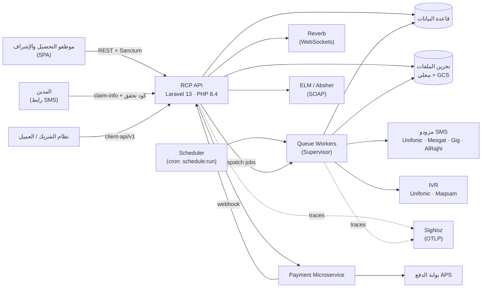
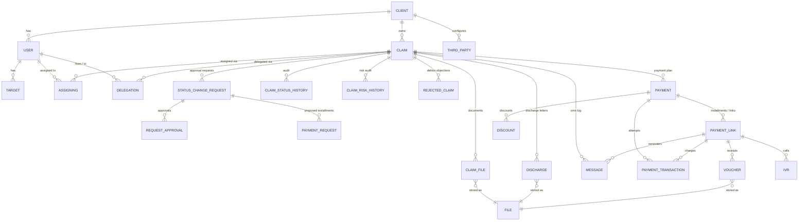
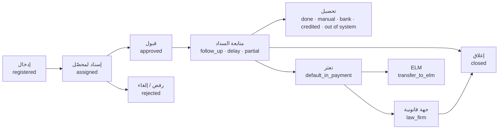
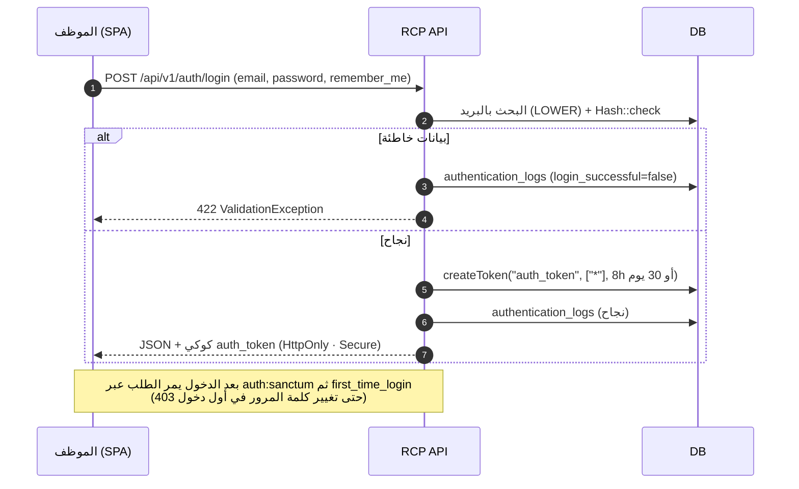
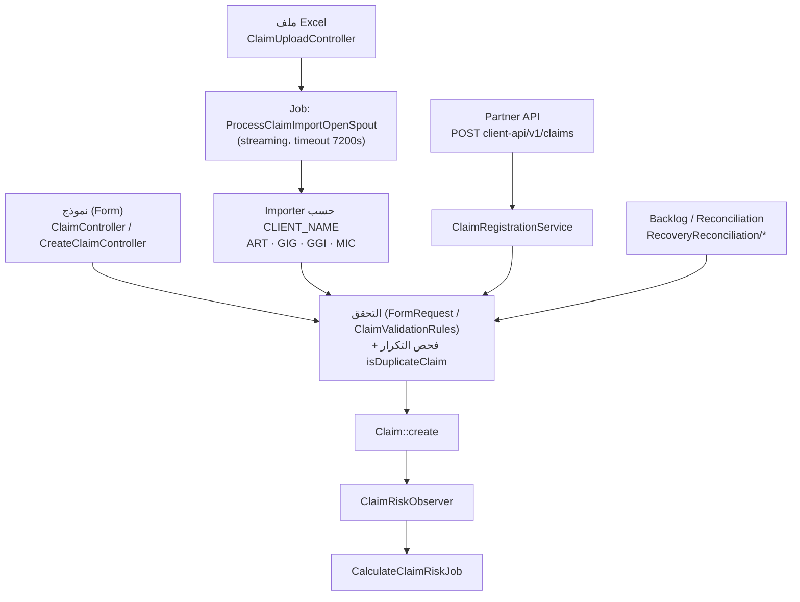
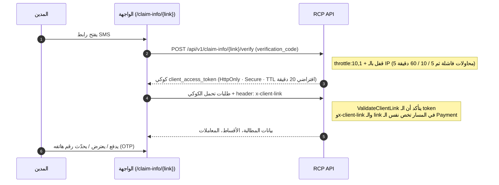
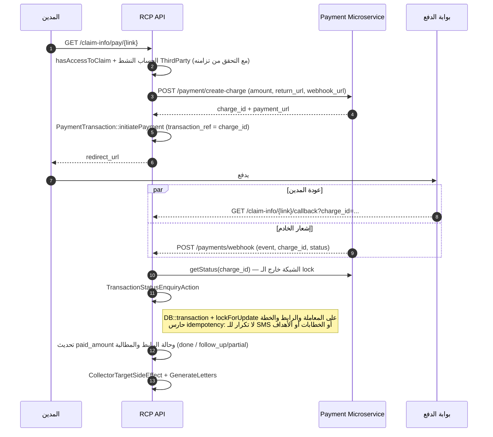
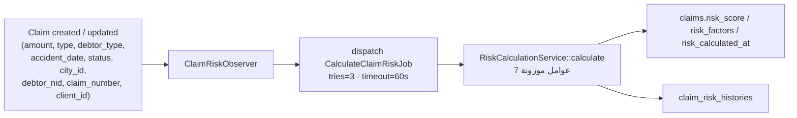

# RCP — نموذج المعمارية الشامل (Solution Architecture Model)

| البند | التفصيل |
|-------|---------|
| **المشروع** | RCP Backend — Laravel API لإدارة وتحصيل مطالبات التأمين |
| **الأساس** | فرع `main` — commit `0c1ed66` |
| **التاريخ** | 2026-10-13 |
| **إعداد** | Ahmed Ramadan — Backend Team |
| **النطاق** | الـ Backend API، العمليات الخلفية (Queue / Scheduler)، التكاملات الخارجية، النشر والمراقبة. الواجهة الأمامية (React) في ريبو منفصل وخارج النطاق. |
| **المنهج** | قراءة مباشرة للكود (≈ 70 ألف سطر PHP داخل `app/`، و195 migration، و23 ملف routes داخل `routes/api`). لم يتم تشغيل النظام ولا فحص بيئة الـ production. |

**مفتاح التوثيق** المستخدم في المستند:

- ✅ موثّق من الكود مباشرة (مع ذكر الملف)
- ⚠️ استنتاج منطقي من الكود أو من الأسماء، ويحتاج تأكيداً
- ❓ سؤال مفتوح لا يمكن حسمه من الكود وحده

---

## 1. الخلاصة التنفيذية

**RCP** منصة لتحصيل المبالغ المستحقة لشركات التأمين من المدينين (المؤمَّن عليه أو الطرف الثالث) بعد الحوادث. الموظف يسجّل أو يستورد المطالبة، توزَّع على محصّل (Collector)، ثم يُرسل للمدين رابط SMS يدخل منه بكود تحقق ليدفع أونلاين أو يقسّط أو يعترض، بينما النظام يتابع السداد والتصعيد تلقائياً.

**المعمارية في سطور:**

1. **Monolith طبقي** على Laravel 13 / PHP 8.4، مقسّم إلى Controllers رفيعة نسبياً وServices وActions وPolicies.
2. **ثلاث هويات منفصلة** للدخول: موظفو النظام (Sanctum token)، المدين (token قصير العمر على رابط الدفع)، وأنظمة الشركاء (`X-Client-Id` / `X-Client-Secret`).
3. **نشر منفصل لكل عميل وبيئة**: نفس الكود يعمل في deployments مستقلة (ART / GIG / RCP ...)، والسلوك الخاص بكل عميل يتحدد بمتغير `CLIENT_NAME` وبإعدادات `ThirdParty` المخزنة في قاعدة البيانات.
4. **المدفوعات عبر Microservice خارجي** (يتحدث مع بوابة APS)، وRCP يتعامل معه بنمط "إشعار ثم تحقق": الـ webhook والـ callback يستدعيان نفس الفعل الذي يسأل الـ Microservice عن الحالة الفعلية.
5. **العمل الثقيل في الخلفية**: استيراد Excel بالـ streaming، تصدير التقارير، مزامنة الملفات مع GCS، حساب المخاطر، و14 أمراً مجدولاً.
6. **مراقبة بـ OpenTelemetry → SigNoz** مع `X-Trace-Id` يعود في كل استجابة.

**أقوى ما في التصميم:** نمط Strategy لإجراءات الحالة، معالجة الدفع المحمية بـ lock وidempotency، نطاق رؤية المطالبات الموحّد `scopeVisibleTo`، وسير موافقات (Maker–Checker) مبني على الصلاحيات.

**أهم ما يحتاج معالجة (تفاصيله في القسم 13):** حجم بعض الكلاسات (`ClaimService` ≈ 1,850 سطر)، تفرّع السلوك حسب العميل بشروط في الكود، غياب بوابة اختبارات في خط النشر، كود ميت كثير، وعيب وظيفي في حساب درجة المخاطر.

---

## 2. السياق التجاري والفاعلون

### 2.1 المجال

- **العميل (Client / Tenant):** شركة تأمين. الأكواد المعرّفة في `App\Enums\Clients`: `GGI`، `GIG`، `MIC`، `ART` ✅.
- **المطالبة (Claim):** مبلغ مستحق على مدين. أنواعها ✅: `individual`، `corporate`، `leasing`، `government`، `municipality`.
- **نوع المدين** ✅: `insured` (المؤمَّن عليه) أو `third party` (طرف ثالث).
- **طرق الإدخال** ✅ (`ClaimInsertionType`): نموذج (form)، ملف Excel، API، وbacklog.

### 2.2 الفاعلون

| الفاعل | كيف يدخل النظام | ملاحظات |
|--------|------------------|----------|
| **موظفو النظام** | `POST /api/v1/auth/login` ← Sanctum token | 8 أدوار في `Roles` ✅: Super Admin، Supervisor، Collector، External Office، Legal Department، Taheiya Admin، Others، Senior Collector |
| **المدين** | رابط SMS + كود تحقق | لا يوجد حساب؛ الـ token مرتبط بسجل `Payment` أو `PaymentLink` |
| **نظام الشريك/العميل** | `client-api/v1/*` بـ `X-Client-Id` و`X-Client-Secret` | يسجّل المطالبات ويحدّثها ويدير الأقساط |
| **النظام نفسه** | Scheduler وQueue | يرسل الروابط ويصعّد ويجدّد الأهداف |
| **مزودو الخدمة** | Webhooks وCallbacks | الدفع، SMS، IVR، ELM |

---

## 3. نظرة عامة على المعمارية

### 3.1 سياق النظام



### 3.2 المكوّنات

| المكوّن | الدور | المصدر |
|---------|-------|--------|
| RCP API | تطبيق Laravel واحد يخدم الموظفين والمدينين والشركاء | `routes/api.php` ✅ |
| Queue Workers | تنفيذ الـ Jobs، ويُعاد تشغيلها مع كل نشر عبر `supervisorctl restart` | workflows ✅ |
| Scheduler | `App\Console\Kernel::schedule()` | ✅ |
| قاعدة البيانات | Eloquent + 195 migration | ❓ المحرك في الإنتاج غير محسوم (انظر 10.1) |
| الملفات | قرص محلي + Google Cloud Storage (bucket عام وآخر خاص) | `config/filesystems.php`, `SyncFileToCloudJob` ✅ |
| Payment Microservice | إنشاء الشحنات والاستعلام عن حالتها | `PaymentMicroservice` ✅ |
| Reverb | إشعارات لحظية للموظفين | `routes/channels.php` ✅ |
| الواجهة الأمامية | React في ريبو منفصل | ⚠️ من تعليقات الكود والتوثيق |

### 3.3 التقنيات

| الطبقة | التقنية |
|--------|---------|
| اللغة والإطار | PHP `^8.4`، Laravel `^13.0` |
| المصادقة | Laravel Sanctum `^4.0` + حارس مخصص `polymorphic-sanctum` |
| Real-time | Laravel Reverb `^1.7` |
| Excel | `openspout/openspout ^4.28` (streaming) + `maatwebsite/excel ^3.1` |
| PDF | `barryvdh/laravel-dompdf`، `carlos-meneses/laravel-mpdf`، `spatie/browsershot` + `spatie/laravel-pdf` (Puppeteer/Chrome) |
| التخزين السحابي | `spatie/laravel-google-cloud-storage` |
| الوسائط | `pbmedia/laravel-ffmpeg` |
| الهاتف | `propaganistas/laravel-phone` |
| SOAP | `ext-soap` (تكامل ELM) |
| المراقبة | `open-telemetry/*` (SDK + auto-instrumentation لـ Laravel وPDO وHTTP) |
| الجودة (dev) | PHPUnit 12، Pint، Larastan، Debugbar |

---

## 4. تنظيم الكود والأنماط المستخدمة

### 4.1 الطبقات

```text
Request ─► Middleware ─► Controller (+ FormRequest) ─► Service / Action ─► Model (Eloquent)
                                │                           │
                                │                           ├─► ThirdParty adapters (SMS / IVR / Payment)
                                │                           ├─► Jobs (Queue)
                                │                           └─► Events / Listeners / Notifications
                                └─► Resource (تشكيل الاستجابة)
```

### 4.2 الحجم (على `main`) ✅

| المجلد | عدد الملفات | ملاحظة |
|--------|-------------|--------|
| `app/Models` | 61 + `Concerns` | |
| `app/Http/Controllers` | 78 | منها **24 داخل `Deleted/`** (كود غير مستخدم) |
| `app/Http/Requests` / `Resources` | 72 / 40 | |
| `app/Services` | 81 | أكبرها `ClaimService` (1,853 سطر) و`PaymentService` (879) |
| `app/Jobs` | 31 | معظمها تصدير واستيراد |
| `app/Policies` | 43 | |
| `app/Enums` | 70 | الحالات والأنواع والصلاحيات |
| `app/Console/Commands` | 33 | بعضها للصيانة والترحيل لمرة واحدة |
| `app/Exports` / `Imports` | 38 / 7 | |
| `database/migrations` | 195 | |
| `tests` | 16 ملف اختبار | |

### 4.3 الأنماط المطبّقة

| النمط | أين | الفائدة |
|-------|-----|---------|
| **Strategy + Resolver** | `ClaimStatusActionResolver` ← 10 كلاسات `*StatusAction` | إضافة حالة جديدة = كلاس جديد + سطر واحد في الخريطة، دون لمس الـ Controller ✅ |
| **Observer** | `ClaimRiskObserver` على `Claim` | إعادة حساب المخاطر عند التغيير ✅ |
| **Adapter / Interface** | `SmsInterface`، `IvrInterface`، `PaymentInterface` + كلاس لكل مزود | تبديل المزود دون تغيير منطق الأعمال ✅ |
| **Action classes** | `app/Actions/*` | عمليات أعمال مفردة قابلة للاستدعاء من أكثر من مدخل ✅ |
| **Policy + Scope** | `app/Policies` + `Claim::scopeVisibleTo` | مركزية قواعد الرؤية والصلاحيات ✅ |
| **Options object** | `ClaimActionOptions` (مثلاً `systemApi()`) | يفرّق بين مسار الموظف (موافقات) ومسار الـ API (بدون موافقات) ✅ |
| **Per-tenant mapping** | `getImportClass()` تختار importer حسب `CLIENT_NAME` | تخصيص الاستيراد لكل عميل ✅ (انظر الملاحظة في 13) |
| **Maker–Checker** | `StatusChangeRequest` + `RequestApproval` | موافقة المشرف على الإجراءات الحساسة ✅ |

---

## 5. نموذج البيانات

### 5.1 العلاقات الرئيسية ✅ (من علاقات Eloquent)



### 5.2 الكيانات المحورية

| الكيان | المعنى | ملاحظات |
|--------|--------|---------|
| `Claim` | المطالبة | `SoftDeletes`، `reference` ثابت (`HasImmutableClaimReference`)، يحمل `risk_score` و`risk_factors`، ويُحمَّل معه `city` و`client` دائماً (`$with`) |
| `Payment` | خطة السداد للمطالبة | يحمل `amount` و`paid_amount` و`payment_status` و`verification_code` |
| `PaymentLink` | رابط/قسط داخل الخطة | أنواعه ✅ `full_payment` / `delay_payment` / `installment_payment`، وحالاته `LinkSendStatus` (not sent، sent، paid، canceled، expired، failed، dispute payment، skipped، pending) |
| `PaymentTransaction` | محاولة دفع فعلية | `transaction_ref` = `charge_id` من الـ Microservice، وحالاتها created / paid / cancelled / failed / pending |
| `StatusChangeRequest` | طلب تغيير حالة يحتاج موافقة | يربط المحصّل بالمشرف، وله فروع (مبلغ، جهة قانونية، خصم، أقساط مقترحة) |
| `Assigning` / `Delegation` | الإسناد والتفويض | أساس رؤية المطالبات (`visibleTo`) |
| `ThirdParty` | إعداد مزود الخدمة لكل عميل | الحقل `values` من نوع `array` يحمل بيانات الاعتماد |
| `Permission` / `GeneralPermission` | الصلاحيات | `GeneralPermission` كتالوج، و`Permission` قيم لكل مستخدم بصيغة JSON |
| `File` | ملف مرفوع | `uuid`، `source`، ويحل `resolveClaimId()` الملف إلى مطالبته للتحقق من الوصول |

---

## 6. دورة حياة المطالبة وسير العمل

### 6.1 الحالات ✅ (`ClaimStatus`)

| المجموعة | الحالات |
|----------|---------|
| **الإدخال والإسناد** | `registered`، `assigned` |
| **القبول والرفض** | `approved`، `rejected` |
| **المتابعة** | `follow_up`، `follow_up/delay`، `follow_up/partial` |
| **التعثر** | `default_in_payment` (يدوي)، `default_in_payment_by_system` |
| **التحصيل** | `done` (تلقائي عبر النظام)، `manaual_collected`*، `manaual_collected_for_installment`*، `bank_collected`، `collected_credited`، `collected_out_of_system` |
| **التصعيد والإغلاق** | `law_firm`، `transfer_to_elm`، `closed` |
| **حالات إجرائية** | `discount`، `claim_amount_change`، `dispute payment`، `delete_installment`، `back_to_original_status` |

\* الكتابة `manaual` خطأ إملائي محفوظ في القيمة نفسها (انظر 13).

### 6.2 المراحل (على مستوى المرحلة وليس FSM)

> لم أجد في الكود جدول انتقالات مركزياً يفرض الانتقالات المسموحة؛ القواعد موزعة داخل `ClaimService` وكلاسات الـ StatusAction. الرسم التالي يوضح المراحل المفاهيمية فقط.



### 6.3 سير الموافقات (Maker–Checker) ✅

مصدر المنطق: `ClaimService::createRequestStatus()`.

1. يتحقق من صلاحية المستخدم عبر `get_permission_value($path, $key, $user)`؛ إن كانت `granted = 0` يُرفض الإجراء.
2. إن كانت الصلاحية `with_approve = 1` يُنشأ `StatusChangeRequest` بدل تنفيذ الإجراء مباشرة.
3. يشترط وجود `supervisor_id` للمستخدم، وإلا يفشل الطلب.
4. يمنع وجود أكثر من طلب مفتوح على نفس المطالبة (باستثناء طلبات الخصم).
5. يُحفظ تفصيل الطلب حسب النوع (`PaymentRequest` للأقساط والتأجيل، وملاحظات، وملف مرفق)، ويُرسَل إشعار للمشرف في عدة أنواع من الطلبات (مثل الإغلاق والتحصيل خارج النظام).
6. ⚠️ عند الموافقة يُنفَّذ الإجراء الفعلي ويُسجَّل في سجل حالات المطالبة (`writeToClaimStatusHistory`)؛ مسار الموافقة نفسه لم أقرأه بالتفصيل.

**مسار الـ Partner API:** يستخدم `ClaimActionOptions::systemApi()` فيتجاوز الموافقات وفحص صلاحيات المستخدم؛ بيانات اعتماد الشريك نفسها هي حد التفويض، ويُنفَّذ الإجراء "باسم" المستخدم المسجل في `created_by` للـ credential.

### 6.4 إجراءات الحالة (Strategy) ✅

الخريطة في `ClaimStatusActionResolver::ACTIONS`:

| الحالة المطلوبة | الكلاس |
|------------------|--------|
| `approved` | `AcceptClaimStatusAction` |
| `closed` | `CloseClaimStatusAction` |
| `back_to_original_status` | `BackToOriginalClaimStatusAction` |
| `rejected` | `RejectedClaimStatusAction` |
| `collected_out_of_system` | `CollectedOutOfSystemStatusAction` |
| `law_firm` | `LawFirmStatusAction` |
| `manaual_collected` | `ManualCollectedStatusAction` |
| `collected_credited` | `CreditedStatusAction` |
| `default_in_payment` | `DefualtInPaymentStatusAction` |
| `transfer_to_elm` | `TransferToElmStatusAction` |

كل كلاس يحدد `requiresFile()` إن كان الإجراء يحتاج مرفقاً، ويتحقق منه `UpdatePartnerClaimsRequest` قبل تنفيذ المنطق.

---

## 7. التدفقات التشغيلية الرئيسية

### 7.1 دخول الموظف ✅



### 7.2 قنوات إدخال المطالبات ✅



- استيراد Excel يعمل بالـ streaming صفاً صفاً عبر OpenSpout لتجنب تحميل الملف كله في الذاكرة، ويسجّل الفاشل في `FailedImportedClaim` ويحدّث `UploadedClaimsFile.uploaded_claims_status` ✅.
- الـ Partner API يدعم دفعات (bulk) بنتيجة لكل عنصر (`ClaimBulkItemResult`) ويمنع تكرار `externalReference` داخل الدفعة الواحدة ✅.
- ⚠️ مسار الـ backlog (`RecoveryReconciliation/*` وأوامر `SplitRecoveryBacklog` و`ApplyRecoveryBacklog`) مرسوم هنا بالاستنتاج من الأسماء ولم أقرأ تفاصيله.

### 7.3 بوابة المدين ✅



- الـ token نوعه Sanctum لكن الـ `tokenable` فيه هو `Payment` أو `PaymentLink` وليس `User`، ويقرؤه الحارس المخصص `PolymorphicSanctumGuard` (driver: `polymorphic-sanctum`) ✅.
- الملفات المحمية تمر عبر `AuthorizeFileAccess`: المدين لا يصل إلا لملفات مطالبته، والموظف لا يصل إلا لما تسمح به `Claim::visibleTo`، والمصدر العام (مثل صورة الملف الشخصي) مفتوح ✅.

### 7.4 الدفع الإلكتروني ✅



**ما يجعل هذا التدفق متيناً:**

- المصدر الوحيد للحقيقة هو استعلام الـ Microservice، وليس محتوى الـ webhook نفسه.
- الـ callback والـ webhook يصلان معاً فيتسلسلان على نفس صف المعاملة بـ `lockForUpdate`.
- مبلغ الدفع الكامل يُحسب بعد استثناء الروابط المعلّقة (`pending`) حتى لا تُدفع القيمة مرتين.
- ⚠️ يوجد أمر مجدول يومي `app:transaction-enquiry` يبدو أنه يعيد الاستعلام عن المعاملات غير المحسومة (الوصف مستنتج من الاسم، انظر 7.5).

### 7.5 الأوامر المجدولة ✅

الجدولة في `App\Console\Kernel`. التوقيت `Asia/Riyadh` حيث ذُكر.

| الأمر | التوقيت | الوظيفة |
|-------|---------|----------|
| `app:send-links` | كل دقيقة | إرسال رسائل الروابط المستحقة (`not sent` وتاريخ الاستحقاق ≤ اليوم، المطالبات غير الـ backlog) ✅ |
| `app:reminder` | كل دقيقة | ⚠️ تذكيرات (من الاسم) |
| `app:law-reminder` | كل دقيقة | ⚠️ تذكيرات القسم القانوني (من الاسم) |
| `ivr-check` | كل 5 دقائق | ⚠️ متابعة مكالمات IVR |
| `check-elm-message` | كل 5 دقائق | ⚠️ متابعة رسائل ELM |
| `app:close-target` | كل 5 دقائق | ⚠️ إغلاق الأهداف المنتهية |
| `app:default-on-payment-claim` | يومياً 00:01 | ⚠️ نقل المتعثرين إلى `default_in_payment_by_system` |
| `app:escalation-command` | يومياً 00:01 | أربعة أنواع تصعيد: رفض المطالبة، موعد الدفع، التعثر، طلبات الحالة، ثم بريد التصعيد ✅ |
| `app:sent-supervisor-request-after-one-month` | يومياً 00:01 | ⚠️ طلب للمشرف بعد شهر |
| `app:delegation-expiration` | يومياً 00:01 | إنهاء التفويضات المنتهية ✅ |
| `app:transaction-enquiry` | يومياً 08:00 | ⚠️ إعادة الاستعلام عن معاملات الدفع غير المحسومة |
| `app:renew-targets` | شهرياً يوم 1 الساعة 00:05 | تجديد الأهداف الشهرية ✅ |
| `tokens:record-expired-logouts` | كل ساعة | تسجيل `logout_at` للجلسات المنتهية، ويجب أن يسبق التنظيف ✅ |
| `sanctum:prune-expired --hours=24` | يومياً | حذف الـ tokens المنتهية ✅ |

### 7.6 حساب درجة المخاطر ✅



الأوزان: نوع المطالبة 15، المبلغ 20، قدم الحادث 15، السجل السابق 15، نوع المدين 20، مخاطر المنطقة 10، مخاطر العميل 5. المستويات: `low` أقل من 30، `medium` من 30 إلى أقل من 70، `high` من 70 فأكثر. (ملاحظة على الدقة في القسم 13.)

---

## 8. معمارية الأمان والصلاحيات

### 8.1 مستويات الهوية ✅

| المستوى | الآلية | العمر | الملف |
|---------|--------|-------|-------|
| **موظف** | Sanctum token، `abilities: ["*"]`، يُمرَّر Bearer أو كوكي `auth_token` (يحوّله `ConvertUserTokenCookieToHeader`) | 8 ساعات، أو 30 يوماً مع remember me | `AuthController` |
| **مدين** | token باسم `client_view` على `Payment`/`PaymentLink`، حارس `client-view` | `CLIENT_VIEW_TTL_MINUTES` (افتراضي 20) | `DebtorService`, `PolymorphicSanctumGuard` |
| **شريك** | `X-Client-Id` + `X-Client-Secret` (يُقارن بـ hash)، رد 401 موحّد لكل أسباب الفشل | غير محدد (يُلغى بتغيير الحالة) | `AuthenticatePartnerApi` |

### 8.2 طبقات التفويض ✅

1. **Middleware:** `auth:sanctum`، `first_time_login`، `client-view`، `partner.auth`، `authorize.file.access`.
2. **الصلاحيات الدقيقة:** كتالوج `GeneralPermission` (الفئات: claims، claim_status، claims_files، settings، third_parties، users، permissions، transactions، reports، role، accounting، dashboard، payments)، وكل صلاحية لها `granted` وأوضاع إضافية مثل `with_approve`.
3. **Policies:** 43 Policy على الكيانات.
4. **نطاق الرؤية:** `Claim::scopeVisibleTo` — صلاحية `show_all_claims`، أو المطالبات المسندة للمستخدم ومرؤوسيه، أو المسندة إلى من فوّض المستخدم (ضمن فترة التفويض)، أو التي أنشأها ولم تُسنَد بعد.
5. **الموافقات:** Maker–Checker للإجراءات الحساسة (6.3).

### 8.3 الحماية من التخمين وإساءة الاستخدام ✅

- قفل بالـ IP على بوابة المدين: جدول `login_attempts` لكل محاولة، و`ip_login_locks` لحالة القفل، مع تصعيد 5 ثم 10 ثم 60 دقيقة (مفصّل في `docs/deployment-changes/IP_LOGIN_ATTEMPT_TRACKING.md`).
- `throttle:10,1` على `verify`، ومحدد `api` عام (`RATE_LIMIT`)، ومحدد مستقل `client-errors` بواقع 60 في الدقيقة لكل IP.
- إشعار المحصّل المسؤول عند محاولة دخول فاشلة على مطالبته.
- سجل `authentication_logs` للجلسات (دخول، خروج، فشل).

### 8.4 الأسرار والبيئات

- ملف `.env` لا يُحفظ في الريبو؛ يُسحب أثناء النشر من **GCP Secret Manager** ✅.
- المصادقة إلى GCP من GitHub Actions عبر **OIDC (keyless)** ✅.
- بيانات اعتماد مزودي الخدمة لكل عميل تُدار من واجهة الإعدادات وتُحفظ في `third_parties.values`، والحقول الحساسة معلَّمة `sensitive` في `config/third-party.php` ✅.

---

## 9. التكاملات الخارجية

| التكامل | الاستخدام | التنفيذ |
|---------|-----------|---------|
| **Payment Microservice** | إنشاء الشحنات (`create-charge`) والاستعلام (`getStatus`) وإدارة حسابات الدفع | `PaymentMicroservice`، المصادقة بـ `x-api-key` / `x-api-secret`، مهلة 30 ثانية ✅ |
| **APS** (عبر الـ Microservice) | بوابة الدفع الفعلية | `PaymentProvider::AMAZON_PAYMENT` ← اسم `aps`، العملة SAR ✅ |
| **SMS** | الروابط، OTP، التذكيرات | `Unifonic`، `Mesgat`، `Gig`، `AlRajhiTakful` ✅ |
| **IVR** | مكالمات صوتية | `Unifonic` (adapter) + `Maqsam` (خدمة مستقلة بـ callback) ✅ |
| **ELM / Absher** | رسائل رسمية للمدين | SOAP عبر `ElmService`، ومعالجة أكواد الأخطاء `AbsherErrorCode` ✅ |
| **Google Cloud Storage** | التخزين الدائم | قرصان `gcs_public` و`gcs_private` مع signed URLs (TTL افتراضي 1800 ثانية) ✅ |
| **SigNoz** | Traces | OTLP عبر HTTP ✅ |
| **Reverb** | إشعارات لحظية | قنوات خاصة بالمستخدم `notification.{id}` وغيرها ✅ |

**آلية اختيار المزود:** كل عميل يخزّن في جدول `third_parties` مزوده النشط وقيمه. يحدد `SmsService` المزود النشط (أو المزود المرتبط بقالب مخصص `CustomTemplate`)، ثم يُنشئ كلاس `App\ThirdParty\SMS\{Vendor}` ديناميكياً. تعريف المزودين وحقولهم في `config/third-party.php`، ولكل مزود `ThirdPartyExecutionType` (داخلي أو عبر API) ✅.

---

## 10. البيانات والتخزين

### 10.1 قاعدة البيانات

| المصدر | ما يقوله |
|--------|----------|
| `.env.example` و`config/database.php` | الافتراضي `mysql` |
| `php.DockerFile` | يثبّت `pdo_pgsql` |
| وثيقة `docs/multi-tenant-architecture-design` (فرع آخر) | تفترض PostgreSQL |
| `phpunit.xml` + `config/database.php` | الاختبارات على اتصال SQLite باسم `memory_testing` |

❓ **سؤال مفتوح:** ما محرك قاعدة البيانات في الإنتاج؟ وجود ثلاثة محركات في ثلاثة أماكن يعني خطر اختلاف سلوك بين الاختبار والإنتاج (أنواع الأعمدة، حالة الأحرف، الـ JSON).

### 10.2 الملفات

- نموذج `File` له `uuid` و`source` و`visibility`، والوصول عبر `/api/v1/show-file/{key}` أو `/public-file/{key}` خلف `authorize.file.access` ✅.
- `FilesService` يطبّع المسارات ويعقّم أسماء الملفات لتصلح كمقاطع في أسماء كائنات GCS ✅.
- `SyncFileToCloudJob` يرفع الملف المحلي إلى GCS: idempotent، 5 محاولات، backoff تصاعدي (30، 60، 120، 300، 600 ثانية) ✅.
- ملفات التصدير تُكتب مؤقتاً في `storage/app/public/exports` ✅.

### 10.3 الكاش والجلسات

- `.env.example` يضع `CACHE_DRIVER=file` و`SESSION_DRIVER=file` و`QUEUE_CONNECTION=sync` ✅؛ لكن إعدادات الإنتاج الفعلية ❓ غير معروفة من الكود.
- قائمة المدن تُخزَّن في الكاش بلا مدة انتهاء (`Cache::remember('cities', null, ...)`) ✅.

---

## 11. المعالجة غير المتزامنة والأداء

| الـ Job | الإعداد | الغرض |
|---------|---------|-------|
| `ProcessClaimImportOpenSpout` | `timeout = 7200`، `tries = 1` | استيراد Excel كبير بالـ streaming |
| `CalculateClaimRiskJob` | `tries = 3`، `timeout = 60` | حساب المخاطر |
| `SyncFileToCloudJob` | `tries = 5` + backoff | رفع الملفات إلى GCS |
| `Export*` (22 job، معظمها `*OpenSpout`) | مهلات مرتفعة (كما في `ExportClaimsOpenSpout`) | تصدير التقارير إلى XLSX ثم `MarkExportAsReady` |

- اتصال `database` في `config/queue.php` مضبوط بـ `retry_after = 9000` أي أكبر من مهلة الاستيراد، وهذا مؤشر ⚠️ على أن طابور قاعدة البيانات هو المستخدم فعلياً.
- في 2026-10-04 و2026-10-05 أُضيفت فهارس على `assignings` و`claim_files` و`payments` و`payment_links` و`messages` و`claims` ✅ (migrations بتلك التواريخ).
- الأوامر التي تعمل كل دقيقة (`send-links`، `reminder`، `law-reminder`) تعتمد على استعلامات على جداول كبيرة، وفهارس الاستحقاق والحالة هي ما يحميها من التباطؤ ⚠️.

---

## 12. النشر والبيئات والمراقبة

### 12.1 خط النشر ✅

كل Workflow في `.github/workflows` يعمل عند push على فرع محدد:

| الفرع | البيئة المستهدفة |
|-------|------------------|
| `main` | ART — Live |
| `uat` | **ثلاث بيئات UAT معاً:** ART وGIG وRCP |
| `demo` | ART — Demo |
| `deploy-gig` | GIG — Live |
| `dev` | RCP — Dev |

مراحل كل نشر:

```mermaid
flowchart LR
    G["push على فرع"] --> T["توليد GitHub App token"]
    T --> A["مصادقة GCP عبر OIDC (keyless)"]
    A --> S["SSH إلى الـ VM عبر IAP"]
    S --> P["git fetch + reset --hard + lfs pull"]
    P --> C["composer install"]
    C --> E[".env من Secret Manager"]
    E --> M["artisan migrate --force + seeders"]
    M --> O["artisan optimize"]
    O --> W["supervisorctl restart workers"]
```



- كل نشر يعمل على **VM** يعمل عليها php-fpm وSupervisor وcron ✅ (من وثائق المراقبة وملفات الـ workflow).
- لا يوجد artifact مبني؛ الكود يُسحب ويُثبَّت على السيرفر نفسه.
- مراجعة آلية بالذكاء الاصطناعي (`ai-code-review`) تعمل على الـ Pull Requests الموجهة لـ `dev` فقط ✅.

### 12.2 المراقبة ✅

```text
php-fpm / queue worker / scheduler
  └─ opentelemetry (auto-instrumentation: HTTP kernel، queue، console، PDO، HTTP client)
       └─ OTLP (HTTP :4318) ─► SigNoz
```

- `bootstrap/otel.php` يصدّر متغيرات `OTEL_*` من `.env` قبل تحميل الـ autoloader، لأن الـ SDK يقرأها قبل أن يحلل Laravel ملف `.env` (يسمّيها التوثيق "The .env trap").
- `EnrichTraceContext` يضيف `enduser.id` و`enduser.role` و`app.tenant` إلى الـ span، ويعيد `X-Trace-Id` في كل استجابة (ومكشوف عبر CORS).
- `GET /api/health` لفحص الحياة، و`POST /api/v1/client-errors` لاستقبال أخطاء المتصفح وتسجيلها كأحداث استثناء على الـ trace.
- التفاصيل الكاملة في `docs/observability/README.md`.

### 12.3 الجودة والاختبارات ✅

- 16 ملف اختبار (Unit وFeature) تغطي: رؤية المطالبات، الأهداف، تصدير المعاملات، الاستيراد، نقطة الحياة، حل الملفات، تقارير أخطاء العميل، وطبقة تهيئة OTel.
- أدوات الجودة `pint` و`larastan` و`phpunit` موجودة في `require-dev`، **لكن لا يوجد workflow يشغّلها**.
- `sonar-project.properties` يحمل قيم قالب (`sonar.projectKey=laraveldemo`).

---

## 13. تقييم المعمارية

### 13.1 نقاط القوة ✅

1. **امتداد الحالات:** Strategy + Resolver يجعل إضافة إجراء جديد منخفضة المخاطر.
2. **سلامة المدفوعات:** الاستعلام الموثوق، الـ lock، idempotency، وإبقاء مكالمة الشبكة خارج الـ transaction.
3. **مركزية الرؤية:** `scopeVisibleTo` يُستخدم في القوائم وفي التحقق من الوصول للملفات (`can_user_access_claim`)، فلا تتشتت قاعدة الرؤية.
4. **المرونة التشغيلية:** Adapters للمزودين، وإعدادات المزود لكل عميل من واجهة الإعدادات.
5. **قابلية الرصد:** trace id لكل طلب، وسجل تدقيق للحالات والمخاطر والجلسات.
6. **سلسلة النشر:** أسرار خارج الريبو، ومصادقة بلا مفاتيح (OIDC)، وإعادة تشغيل الـ workers تلقائياً.
7. **التعامل مع الأحجام الكبيرة:** استيراد وتصدير بالـ streaming، ومهلات مناسبة.

### 13.2 ملاحظات وديون تقنية

| # | الملاحظة | الأثر | الدليل |
|---|----------|-------|--------|
| A1 | **كلاسات ضخمة:** `ClaimService` (1,853 سطر)، `PaymentService` (879)، `DebtorController` (667) تجمع مسؤوليات متعددة | صعوبة الاختبار والتعديل الآمن | `app/Services/ClaimService.php` |
| A2 | **السلوك حسب العميل بشروط في الكود:** اختيار الـ importer بمصفوفة داخل الـ Job، وقواعد خاصة بعميل بعينه داخل Controller | كل عميل جديد يعني تعديل كود مشترك (انتهاك Open/Closed) | `ProcessClaimImportOpenSpout::getImportClass`, `DebtorController` |
| A3 | **عيب وظيفي في حساب المخاطر:** دالتا `calculateTypeScore` و`calculateDebtorScore` تستخدمان `match` (مقارنة صارمة) بين قيمة نصية مخزنة وقيمة enum، ولا يوجد cast للحقلين على `Claim`، فيسقط الحساب دائماً إلى القيمة الافتراضية (10 و50). أي أن عاملين يمثلان 35% من الوزن ثابتان عملياً | درجة المخاطر لا تميّز نوع المطالبة ولا نوع المدين | `RiskCalculationService.php:83-135`، و`Claim::$casts` |
| A4 | **نقاط أخرى في المخاطر:** `trigger` يُكتب دائماً `updated`، ومخاطر المنطقة ثابتة 30، وحالة `cancelled` في الاستعلامات غير موجودة في `ClaimStatus`، وكل حساب ينفّذ عدة استعلامات `COUNT` على جدول المطالبات | دقة وأداء | `RiskCalculationService.php` |
| A5 | **كود ميت:** 24 Controller داخل `Deleted/`، وكتل كود معلّقة كثيرة (مثلاً داخل `SendLinks` و`routes/api.php`) | ضجيج وارتباك للفريق | `app/Http/Controllers/Api/V1/Deleted/` |
| A6 | **منطق أعمال داخل أوامر Console** (`SendLinks` تُعيّن Super Admin كمستخدم مصادق عليه داخل الأمر) | اعتماد المنطق على سياق مصطنع، وصعوبة اختباره | `SendLinks.php` |
| A7 | **أخطاء إملائية محفوظة في القيم:** `manaual_collected`، وحالات enum مثل `DELAY_PAYEMNT` | تكلفة تصحيحها مرتفعة لأنها مخزنة في البيانات | `ClaimStatus`, `MessageTemplates` |
| A8 | **خط النشر بلا بوابة جودة:** لا اختبارات ولا Pint ولا Larastan قبل النشر؛ الفرع `uat` يطلق ثلاثة نشرات معاً؛ `main` هو الإنتاج لـ ART | كل push يصل للسيرفر بما فيه من أخطاء | `.github/workflows/*` |
| A9 | **اختلاف محركات قواعد البيانات** بين الاختبار والتطوير والإنتاج (انظر 10.1) | سلوك غير متوقع | `config/database.php`, `php.DockerFile` |
| A10 | **تغطية اختبار منخفضة:** 16 ملفاً مقابل ≈ 70 ألف سطر، ولا اختبارات لتدفقات الدفع والحالات والاستيراد end-to-end | خطر الانحدار في أكثر المناطق حساسية | `tests/` |
| A11 | **توثيق متفرق:** وثائق في `docs/` وفروع منفصلة بلا فهرس موحّد | صعوبة التعلم للمطور الجديد | `docs/` |
| A12 | **docker-compose** يعرّف خدمة `php` فقط (بلا قاعدة بيانات أو Redis أو Nginx أو worker) | بيئة محلية غير مكتملة | `docker-compose.yml` |

---

## 14. التوصيات وخارطة الطريق

### 14.1 الآن (أسبوعان)

1. **إصلاح عاملي المخاطر:** إضافة `casts` (`type` → `ClaimType`، `debtor_type` → `DebtorType`) أو المقارنة بـ `->value`، مع اختبار وحدة يغطي كل قيمة، ثم **إعادة حساب** المطالبات الحالية بأمر مجدول لمرة واحدة.
2. **بوابة جودة في CI:** workflow يشغّل `phpunit` و`pint --test` و`larastan` على كل PR، ويكون شرطاً قبل الدمج في `dev` و`uat` و`main`.
3. **فصل `uat`:** فرع UAT لكل عميل (أو workflow يدوي بمُدخل) بدل إطلاق ثلاثة نشرات من push واحد.
4. **حذف الكود الميت:** مجلد `Deleted/` والكتل المعلّقة.

### 14.2 التالي (1–2 شهر)

5. **تقسيم `ClaimService`** حسب القدرة: Registration، Collection، Installments، Discharge/Voucher، Status. مع الإبقاء على الواجهة العامة كـ Facade مؤقتاً.
6. **نموذج حالات صريح:** جدول انتقالات مسموحة (`from → to`) يُفرض في مكان واحد، مع اختبارات عليه.
7. **Tenant Config بدل الشروط:** كلاس `TenantProfile` يحمل سلوك كل عميل (importer، قواعد التحقق، قوالب)، يُحقن من الـ container.
8. **حسم محرك قاعدة البيانات** وتوحيد بيئة الاختبار عليه (مثلاً PostgreSQL في CI عبر service container).
9. **تحسين المخاطر:** مخاطر المدينة من جدول، وتسجيل `trigger` الحقيقي، وتجميع الاستعلامات.

### 14.3 لاحقاً

10. **تنفيذ مسار Multi-Tenancy** حسب الاقتراح الموثّق في فرع `docs/multi-tenant-architecture-design` (Hybrid)، بعد استقرار البندين 6 و7.
11. **اختبارات تكامل** لتدفقات الدفع والاستيراد والـ Partner API (مع Microservice وهمي).
12. **قياس وتنبيه:** لوحات SigNoz لزمن الاستجابة وأعمار الطوابير وفشل المزودين.

### 14.4 قرارات معمارية مقترحة (ADRs)

| ADR | العنوان | القرار المطلوب |
|-----|---------|-----------------|
| ADR-001 | استراتيجية الـ Tenancy | Deployment لكل عميل (الحالي) أم Hybrid Multi-tenant |
| ADR-002 | نموذج الحالات | FSM صريح مع جدول انتقالات |
| ADR-003 | بوابة الجودة والنشر | شروط الدمج، وفصل UAT، واستراتيجية rollback |
| ADR-004 | محرك البيانات | توحيد المحرك في كل البيئات |
| ADR-005 | تقسيم `ClaimService` | حدود الـ Bounded Contexts داخل الـ monolith |

---

## 15. أسئلة مفتوحة ❓

1. ما محرك قاعدة البيانات الفعلي في الإنتاج؟ وما إعدادات النسخ الاحتياطي والـ replication؟
2. ما driver الطابور والكاش والجلسات في الإنتاج؟ وهل Redis مستخدم؟ وكم عدد الـ workers لكل بيئة؟
3. ما سياسة الاحتفاظ بملفات التصدير المؤقتة؟ ومن ينظّفها؟
4. أين تُحفظ أسرار مزودي الخدمة لكل عميل فعلياً، وهل هناك سياسة لتدويرها؟
5. هل يوجد rollback آلي لو فشل الـ migration أثناء النشر؟
6. هل الواجهة الأمامية (React) تستخدم Reverb فعلاً في كل البيئات؟
7. ما الأوامر التي ما زالت مطلوبة من بين الـ 33 أمراً (بعضها يبدو ترحيلاً لمرة واحدة)؟

---

## 16. الملاحق

### أ. خريطة الـ API

| المجموعة | المسار | الحماية |
|----------|--------|---------|
| عامة | `GET /api/health`، `POST /api/v1/client-errors` (throttled) | بلا مصادقة |
| الدفع | `POST /api/v1/payments/webhook`، `POST /api/v1/redirect-payment` | بلا مصادقة (يعتمد على الاستعلام من الـ Microservice) |
| المدين | `/api/v1/claim-info/*` | `verify` بلا مصادقة، والباقي `client-view` + `x-client-link` |
| الملفات | `/api/v1/show-file/{key}`، `/api/v1/public-file/{key}` | `authorize.file.access` |
| الشريك | `/api/client-api/v1/claims*` (9 مسارات: عرض، إنشاء، تعديل، أقساط) | `partner.auth` + `throttle:60,1` |
| الموظفون | `/api/v1/{auth, users, claims, settings, requests, targets, reports, roles, calendar, notifications, dashboard, scheduled-payments, transaction-history, cities, permissions, client-requests, delegations, ivrs, client, accouting}` | `auth:sanctum` + `first_time_login` (و`login`/`forget-password`/`reset-password` مستثناة) |

> مجموعة `accouting` بهذا الإملاء في اسم الملف والمسار (`routes/api/accouting.php`).

### ب. متغيرات البيئة حسب المجموعة

| المجموعة | المتغيرات |
|----------|-----------|
| التطبيق | `APP_*`، `CLIENT_NAME`، `FRONT_END_URL`، `SESSION_DOMAIN`، `RATE_LIMIT`، `ADMIN_MAIL`، `HAS_OTP_VERIFICATION` |
| البيانات | `DB_*`، `CACHE_DRIVER`، `QUEUE_CONNECTION`، `SESSION_DRIVER`، `REDIS_*` |
| الجلسات والأمان | `TOKEN_TIME_OUT`، `CLIENT_VIEW_TTL_MINUTES`، `LOGIN_MAX_ATTEMPTS_PER_IP`، `LOGIN_LOCK_DURATION_DEFAULT_MINUTES` |
| الدفع | `PAYMENT_MICROSERVICE_URL`، `PAYMENT_MICROSERVICE_API_KEY`، `PAYMENT_MICROSERVICE_API_SECRET` |
| الرسائل والصوت | `MAIL_*`، `IVR_*`، `MAQSAM_*`، `ALRAJHI_TAKAFUL_SMS_*` |
| ELM | `HAVE_ELM`، `ELM_*` |
| التخزين | `FILESYSTEM_DISK`، `GOOGLE_CLOUD_*`، `GCS_PUBLIC_SIGNED_URL_TTL`، `GCS_PRIVATE_SIGNED_URL_TTL` |
| الاستيراد | `EXCEL_IMPORT_CHUNK_SIZE` |
| المراقبة | `OTEL_*` |
| البث | `BROADCAST_DRIVER`، `PUSHER_*` / Reverb |

### ج. قاموس المصطلحات

| المصطلح | المعنى |
|---------|--------|
| Claim / مطالبة | مبلغ مستحق على مدين لصالح شركة تأمين |
| Debtor / مدين | المؤمَّن عليه أو الطرف الثالث |
| Collector / محصّل | الموظف المسؤول عن المتابعة والتحصيل |
| Payment | خطة السداد للمطالبة |
| Payment Link | رابط دفع لقسط أو لكامل المبلغ |
| Voucher / Discharge | إيصال سداد / خطاب مخالصة |
| Default in payment | تعثر في السداد |
| ELM | قناة رسائل حكومية رسمية عبر SOAP |
| Backlog | مطالبات قديمة تُدخل ولا تُرسل لها رسائل تلقائية |
| Tenant | عميل (شركة تأمين) له deployment وإعدادات مستقلة |

### د. سجل التحقق

- قُرئت ملفات: `composer.json`، `.env.example`، `docker-compose.yml`، `php.DockerFile`، workflows، `routes/*`، `bootstrap/*`، `config/{app,auth,cors,queue,sanctum,database,filesystems,third-party,payment-microservice,login_attempts}.php`، `Kernel` (HTTP وConsole)، وملفات الـ Services والـ Controllers والـ Models المذكورة في كل قسم.
- بند A3 جرى التحقق من سلوك `match` الصارم في PHP بتجربة معزولة (قيمة نصية مقابل حالة enum تعيد القيمة الافتراضية)، ومن غياب الـ cast في `Claim`. **لم يُشغَّل الكود ضد قاعدة بيانات**، لذا يُنصح بتأكيده باختبار وحدة قبل الإصلاح.
- لم تُفحص أي بيئة تشغيل، وكل ما يخص الإنتاج مصنّف ❓ أو ⚠️.
