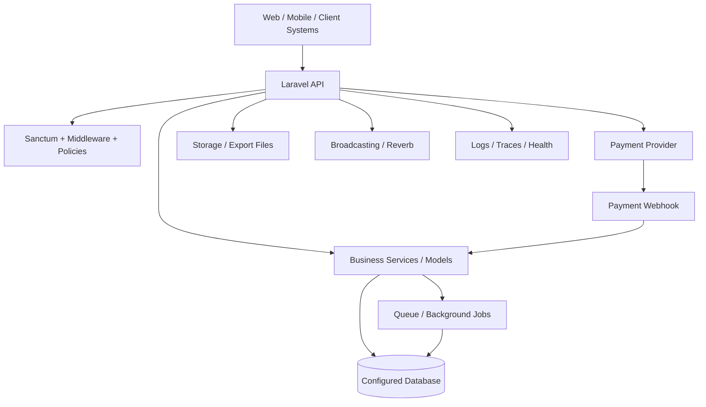
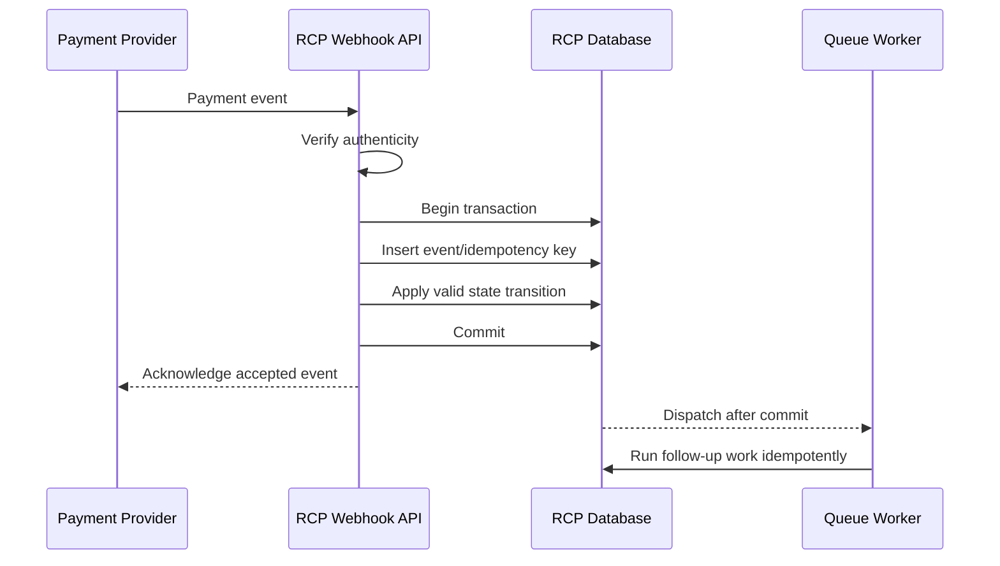

# RCP — Solution Architecture Field Guide

**Audience:** Backend engineers preparing to take architecture ownership  
**Repository:** [AhmedRamadan03/rcp](https://github.com/AhmedRamadan03/rcp)  
**Baseline:** `main` at the time this document was created  
**Purpose:** Explain how to think and work as a Solution Architect using RCP as the working example.

> **Important scope note:** This is an architecture guide and an initial architecture review, not a claim that every source file, production environment, or runtime behavior has been exhaustively verified. Findings below distinguish repository evidence from decisions that require confirmation. Keep this document aligned with code and deployed infrastructure.

---

## 1. What a Solution Architect actually does

A Solution Architect translates a business need into a solution that is secure, reliable, supportable, scalable, observable, and affordable. The role is not simply drawing diagrams or choosing technologies.

For each significant request, the architect should answer:

1. **Business outcome:** What problem are we solving, for whom, and how will success be measured?
2. **Current state:** How does the system behave today? Which code paths, data, integrations, and teams are affected?
3. **Options:** What realistic designs could solve the problem? What are their trade-offs?
4. **Decision:** Which option is recommended, why, and what assumptions or risks remain?
5. **Delivery plan:** What changes are needed in code, database, infrastructure, operations, and tests? Can they be released safely in stages?
6. **Verification:** What evidence proves the solution works in production-like conditions?
7. **Ownership:** Who maintains it, monitors it, responds to incidents, and documents future changes?

A good architect does not automatically choose microservices, Kubernetes, event sourcing, or the newest technology. The right design is the simplest design that satisfies the real requirements and leaves a safe path for future change.

## 2. RCP at a glance

RCP is a Laravel API backend. The inspected `main` branch's `composer.json` declares PHP `^8.4` and Laravel `^13.0`. It includes Sanctum, Reverb, PDF/document generation, Excel/spreadsheet support, Google Cloud Storage integration, FFmpeg, and OpenTelemetry packages.

The route definitions show several important business capabilities:

- Authentication and authenticated API routes.
- Claim-information/client-view flows, including OTP verification and debtor-related requests.
- Payment redirect and payment webhook endpoints.
- File serving and export downloads.
- City lookup and client-error intake.
- Health endpoint and authenticated broadcasting routes.
- Additional route groups loaded from `routes/api/clientapi.php` and `routes/api/base.php`.

The broader project context includes claims, collectors/supervisors and targets, permissions, risk assessment, notifications, and external payment integrations. Verify each capability against the exact branch and runtime before using it as a formal inventory.

### Evidence observed in the repository

| Area | Evidence on `main` | Architectural implication |
|---|---|---|
| Runtime/framework | `composer.json`: PHP ^8.4, Laravel ^13.0 | Runtime and framework upgrades affect compatibility, deployment and testing. |
| API entry point | `routes/api.php` | Route groups and middleware form important security boundaries. |
| Authentication | Sanctum middleware appears on protected route groups and broadcasting routes | Authentication proves identity; authorization must still prove access to a specific action/resource. |
| Payments | `v1/payments/webhook`, `v1/redirect-payment`, payment-link routes | Payment flows need idempotency, signature/authenticity validation, state transitions and reconciliation. |
| Files | File-serving routes use `authorize.file.access`; an export route uses the public storage disk | Review access control, expiry, private storage, path traversal protection and sensitive-file exposure. |
| Data stores | `config/database.php` supports MySQL, PostgreSQL, SQLite and SQL Server; default comes from `DB_CONNECTION` | A configured driver is not proof that every driver is tested or supported in production. |
| Queues | `config/queue.php` defaults to `sync` unless overridden | Confirm production queue configuration, worker operation, retries, failed jobs and after-commit behavior. |
| Broadcasting | Reverb connection is configured; `config/broadcasting.php` defaults to `null` unless overridden | Confirm production environment selects Reverb and that private channel authorization is correct. |
| Telemetry | OpenTelemetry packages appear in `composer.json`; health and client-error routes exist | Dependency presence alone does not prove traces, metrics, logs and alerts are correctly configured. |

## 3. High-level system view

This is a logical view based on the repository configuration and routes. It is not a verified deployment topology.

**How to use this diagram:** For a real architecture review, replace each generic box with verified components and document the deployed host/service, trust boundary, network path, credentials owner, failure behavior, and monitoring. Do not present a logical diagram as an infrastructure diagram.

### Request flow in the current route structure

1. A client calls an API route.
2. Route middleware may authenticate the caller, throttle requests, enforce client-view rules, or apply first-login restrictions.
3. A controller receives the request and delegates to application/business logic.
4. Business logic reads or updates persistent data and may call an external provider or dispatch asynchronous work.
5. The API returns a response; some flows may additionally publish events or produce downloadable files.

For each important endpoint, trace the real controller → service/action → model/repository → external integration path. Do not assume every endpoint follows the same layering pattern.

## 4. Architecture responsibilities and boundaries

Use these responsibilities as a review lens; do not introduce a layer just to satisfy a diagram.

| Component | Responsibility | Warning sign |
|---|---|---|
| Routes / middleware | Define entry points and cross-cutting request controls | Sensitive route is reachable without the intended middleware |
| Controller | Validate/accept input, coordinate the use case, format response | Large business rules or payment state logic embedded in controller |
| Request validation | Validate shape, types and basic constraints | Business authorization confused with input validation |
| Policy / permission service | Decide whether the actor can perform an action on a resource | Frontend-only permission checks or inconsistent authorization paths |
| Service / use case | Coordinate business workflow and transaction boundaries | Duplicate rules scattered across controllers/jobs |
| Model / persistence layer | Represent data and persistence relationships | Hidden side effects or expensive queries in unexpected places |
| Job / event / listener | Perform asynchronous work and react to committed business events | Non-idempotent retries, lost jobs, or events dispatched before commit |
| External integration adapter | Encapsulate provider protocol, errors, timeouts and mapping | Provider-specific assumptions spread throughout business code |
| Resource / response mapper | Expose a stable API contract | Leaking internal columns or breaking clients with unversioned changes |
| Tests / telemetry | Verify behavior and reveal production health | “Tests pass” without integration/failure-path coverage or actionable alerts |

## 5. Key architectural topics for RCP

### 5.1 Tenant isolation and database strategy

The project context describes a **database-per-client** operating model. Treat that as a key business constraint, and verify its implementation on the target branch before making changes.

For database-per-client, an architect must define:

- How the tenant/client is identified and authenticated.
- How the correct database connection is selected for every request, job, command, scheduled task, export and websocket event.
- How connection credentials are stored, rotated and protected.
- How connection pools and long-running workers avoid leaking a previous tenant's connection into the next job.
- How migrations are applied to all tenant databases, monitored, retried and rolled back.
- How tenant provisioning, suspension, backup, restore and deletion work.
- How cross-tenant reporting is handled without silently bypassing isolation.
- How tests prove tenant A can never read or mutate tenant B's data.

A single `DB_CONNECTION` in Laravel config does not, by itself, implement database-per-tenant. Locate and review the actual tenant resolver/connection-switching mechanism and its lifecycle.

**Design trade-off:** Database-per-tenant offers stronger isolation and tenant-specific operational control, but increases migration, monitoring, connection management and fleet-wide reporting complexity. A shared database with `tenant_id` can simplify operations but requires rigorous tenant scoping and has a different isolation profile. Do not migrate between these models without a business case, cost estimate, migration plan and rollback strategy.

### 5.2 Authorization and permission scopes

Review access as a chain:

1. Is the caller authenticated?
2. Is the requested action granted?
3. Does the permission allow the relevant scope (for example, own records, team records, or all records)?
4. Does the resource belong to the correct tenant/database?
5. Is the operation allowed in the current business state?

A permission such as `show_claim` is not enough by itself if data scope is also required. Apply scope in the query/data-access path, not only after fetching all records. Verify policies, helpers such as approval checks, API routes, background jobs, exports and file downloads use consistent rules. Add negative tests for cross-team and cross-tenant access.

### 5.3 Payment workflows and webhooks

Payment providers may retry webhooks, deliver duplicate events, or deliver events in an unexpected order. Redirect/callback completion is not equivalent to verified payment settlement.

Review the following:

- Verify webhook authenticity using the provider's documented mechanism.
- Make event handling idempotent using a stable provider event/payment identifier and a database uniqueness constraint where appropriate.
- Define explicit payment state transitions and reject invalid transitions.
- Use transactions around local state changes.
- Handle duplicate, delayed and out-of-order events.
- Keep provider calls bounded by timeouts; retry only safe operations.
- Store a correlation/reference ID without logging secrets or sensitive payment data.
- Reconcile local payment records against provider reports/status APIs.
- Test the race between a browser redirect and a webhook.
- Provide a safe operational path for pending or inconsistent payments.

### 5.4 Queue and event reliability

The queue config's default is synchronous. Production may override it through environment configuration, so verify deployed values rather than inferring runtime behavior from defaults.

For each queued workflow, document:

- What triggers it and whether the event must happen after transaction commit.
- Whether duplicate delivery is safe.
- Retry/backoff policy and maximum attempts.
- Timeout, worker memory and queue priority.
- Failed-job alerting and replay procedure.
- Whether ordering matters.
- What happens if the database commits but dispatch fails, or a job runs before data is committed.
- Tenant context propagation and cleanup for multi-tenant workers.

Do not move work to a queue solely to make a controller look cleaner. Define the user-visible consistency requirement first: immediate consistency, eventual consistency, or an explicit pending state.

### 5.5 Files and exports

The route file includes file-serving endpoints with an authorization middleware and an export-download endpoint using the public storage disk. This is a review priority because exports can contain personal, financial or claim data.

Verify that sensitive files are stored privately, downloads authorize the current user and tenant, file keys cannot be guessed or manipulated into arbitrary paths, links expire where appropriate, and access is audited. Confirm whether the public disk is appropriate for each class of export. Do not expose a file merely because its URL is hard to guess.

### 5.6 Risk assessment and background calculations

For a risk-scoring feature, the architect must turn business policy into a documented, testable contract:

- Inputs and data sources, including freshness and minimum sample requirements.
- Exact formula, weights, thresholds and missing-data behavior.
- What triggers recalculation and how irrelevant updates are excluded.
- Whether calculations run synchronously or asynchronously.
- How duplicate jobs and concurrent updates are handled.
- How each score is explained to users and audited over time.
- How model/rule versions are stored so old scores remain interpretable.
- How to backfill existing records and monitor calculation failures.
- Tests for boundaries, missing values, stale data and repeat execution.

Keep business decisions separate from infrastructure details where practical. A score that appears numeric but cannot be explained or reproduced is difficult to trust operationally.

### 5.7 API contracts and compatibility

For API changes, document request/response schemas, authentication, authorization, pagination, filtering, error codes, idempotency and rate limits. Check actual consumers before changing a field or response shape.

Prefer additive changes where possible. For breaking changes, define versioning/deprecation, consumer migration, rollout order and a removal date. API Resources can help isolate external response contracts from database structure, but their use and consistency must be verified endpoint by endpoint.

## 6. Initial architecture review: questions and priorities

These are review items inferred from the inspected files, not confirmed production incidents.

### Priority 0 — security and correctness

- [ ] Audit every file/export route, especially the public-disk export download path.
- [ ] Verify webhook signature/authenticity, idempotency and payment state transitions.
- [ ] Trace authentication, policies, permission scopes and tenant isolation end to end.
- [ ] Confirm public routes are intentionally public and sensitive endpoints have appropriate throttling.
- [ ] Check secrets and tenant database credentials are never committed or logged.

### Priority 1 — runtime reliability

- [ ] Confirm production `QUEUE_CONNECTION`; verify workers, retries, timeouts, failed-job alerts and after-commit behavior.
- [ ] Confirm production `BROADCAST_CONNECTION`/driver selects Reverb if real-time delivery is required.
- [ ] Verify health checks distinguish process liveness from dependency readiness where needed.
- [ ] Confirm OpenTelemetry actually exports useful telemetry and alerts have owners/runbooks.
- [ ] Test external provider timeouts, outages and recovery.

### Priority 2 — maintainability and performance

- [ ] Map major business modules and their dependencies.
- [ ] Review slow queries, N+1 loading, unbounded lists, indexes and transaction duration.
- [ ] Check cache keys include the right tenant/context and invalidation is correct.
- [ ] Review large exports/media processing for memory, storage and queue pressure.
- [ ] Establish test coverage for business-critical flows and integration contracts.
- [ ] Verify dependency security/update policy and supported PHP/Laravel runtime in CI and production.

### Priority 3 — operational maturity

- [ ] Document tenant onboarding, migrations, backup/restore and disaster recovery.
- [ ] Define SLOs for API availability, latency, payment correctness and queue delay.
- [ ] Add dashboards for errors, latency, queue depth, failed jobs, provider failures and tenant-level resource usage.
- [ ] Document incident response, escalation, rollback and recovery exercises.
- [ ] Estimate infrastructure cost and capacity under expected and peak traffic.

## 7. How to handle an architecture task — step by step

Use this workflow for each real ticket or feature.

### Step 1 — clarify the requirement

Write a short problem statement and acceptance criteria. Ask about actors, volume, latency, availability, data sensitivity, audit requirements, expected growth, budget and deadline. Record unknowns instead of silently guessing.

**Deliverable:** Problem statement + measurable non-functional requirements.

### Step 2 — map the current implementation

Search routes, middleware, controllers, services, models, policies, jobs, events, migrations, external clients and tests. Follow the complete path, including failure paths. Inspect production configuration safely; never expose credentials.

**Deliverable:** Current-state sequence diagram and affected-component list.

### Step 3 — identify constraints and failure modes

List tenant isolation, legacy clients, database compatibility, provider behavior, deployment limitations, data migration risks and operational ownership. Ask “what happens if this dependency times out, retries, or partially succeeds?”

**Deliverable:** Assumptions, constraints and failure-mode list.

### Step 4 — compare options

At minimum, compare the current design plus the smallest safe change against any larger redesign. Score options for security, correctness, performance, complexity, delivery risk, cost and reversibility.

**Deliverable:** Options table with a recommended option and explicit trade-offs.

### Step 5 — write an Architecture Decision Record (ADR)

Use a short record with: title, status, context, decision, alternatives, consequences, risks, rollout and rollback. Example: “ADR-00X: Make payment webhook processing idempotent.” The record should explain why, not merely what code changed.

**Deliverable:** ADR reviewed by relevant stakeholders.

### Step 6 — break the decision into delivery work

Split work into API/code changes, schema changes, backfill, infrastructure/configuration, dashboards/alerts, tests, documentation and rollout. Identify dependencies and owners. Keep unrelated refactoring out of the change.

**Deliverable:** Ordered implementation plan and acceptance checklist.

### Step 7 — implement and verify incrementally

Use a dedicated branch from the correct baseline. Make small commits. Add unit tests for rules, feature tests for API/security, integration tests for database/provider boundaries, and load/failure tests where required. Review migrations for locking, compatibility and rollback behavior.

**Deliverable:** Reviewable PR, test evidence and deployment notes.

### Step 8 — release safely

Prefer expand-and-contract migrations for zero/low-downtime changes: add compatible schema, deploy code that supports old/new states, backfill, switch reads/writes, then remove obsolete schema in a later release. Use feature flags or canaries where appropriate.

**Deliverable:** Release plan, health signals, rollback trigger and owner.

### Step 9 — verify after release

Check real metrics and logs, not only a successful deployment. Compare against acceptance criteria, verify background jobs and external integrations, and confirm tenant isolation. Capture lessons and update the architecture docs.

**Deliverable:** Post-release verification and follow-up actions.

## 8. Example architecture task: make payment updates reliable

**Business problem:** A customer returns from the payment provider while a webhook is also arriving. The API must not mark the payment twice, lose a successful payment, or regress a final state.

**Proposed flow:**

This is a target pattern to evaluate, not a statement that the current code already implements every step.

**Acceptance criteria:**

- Invalid signatures are rejected.
- Repeated delivery of the same event has no duplicate business effect.
- Redirect and webhook races converge on one valid final state.
- Invalid state regressions are rejected and logged.
- Transient failures can be retried safely.
- Support staff can find a payment by correlation/reference ID.
- Reconciliation identifies mismatches.
- Tests cover duplicates, out-of-order events, provider outage and concurrent delivery.

**Architect's work:** validate provider guarantees, agree on the payment state machine, design constraints/transactions, review the implementation, define telemetry and runbook, and get business sign-off on reconciliation behavior.

## 9. Example architecture task: add a new permission scope

Suppose RCP needs a permission scope such as `onlyme`, `team`, or `all`.

Do not implement this as a frontend filter. Define the authorization contract first:

- What identifies “me” and “team” in each business module?
- What happens when a user has no team or belongs to multiple teams?
- Does the scope apply to list, detail, update, delete, export, file access and background jobs?
- How does approval mode interact with scope?
- What is the backward-compatible default for existing permission records?
- How do we prevent a query from returning records before scope is applied?

Then centralize/reuse the rule where appropriate, apply it before pagination, add policy and query tests, test cross-team/cross-tenant denial, and document migration/backfill behavior. The architecture deliverable is the consistent contract across all access paths, not just a new JSON key.

## 10. Architecture artifacts you should learn to produce

| Artifact | When to use it | What it should contain |
|---|---|---|
| C4 context/container/component diagrams | New system or major boundary change | Actors, responsibilities, dependencies and trust boundaries |
| Sequence diagram | Multi-step flow, async processing, payment, OTP | Order, alternate paths, retries, failures and transaction boundaries |
| ADR | A decision with long-term consequences | Context, options, decision, consequences and status |
| Data model / migration plan | Schema or tenant changes | Ownership, constraints, indexes, data migration and rollback |
| Threat model | Sensitive data, authentication, files, integrations | Assets, trust boundaries, threats, mitigations and residual risk |
| Capacity estimate | Traffic or data growth changes | Request rate, concurrency, storage, queue throughput and headroom |
| API contract | New or changed endpoint | Schema, errors, auth, compatibility and consumer impact |
| Runbook | Production-critical behavior | Symptoms, diagnostics, recovery, escalation and rollback |
| Test strategy | Any important feature | Unit, feature, integration, contract, security and load coverage |
| Release plan | Risky deployment | Ordering, feature flags, observability, rollback and owner |

## 11. Suggested 30/60/90-day learning plan

### Days 1–30: understand and document RCP

- Trace the 5–10 most business-critical user journeys end to end.
- Map routes, middleware, permissions, data ownership, tenant switching and external integrations.
- Read migrations and inspect indexes for core entities.
- Review production queue, broadcast, storage, deployment and telemetry settings with the responsible team.
- Produce a current-state context/container diagram and one sequence diagram.
- Write one ADR for a real, contained design decision.

### Days 31–60: lead a bounded design

- Choose a real improvement such as webhook reliability, export security, queue reliability or tenant-isolation testing.
- Gather requirements and baseline metrics.
- Compare at least two options and record trade-offs.
- Write a threat/failure-mode review and delivery plan.
- Review implementation PRs and test evidence with the team.
- Validate operational dashboards and rollback steps.

### Days 61–90: own an end-to-end architecture outcome

- Lead a medium-sized feature from discovery to production verification.
- Facilitate a design review and capture decisions/risks.
- Establish SLOs and operational ownership for the flow.
- Present before/after results using evidence: failure rate, latency, support incidents, cost or delivery time.
- Create a follow-up roadmap based on measured risk, not technology trends.

## 12. Design review checklist

Before approving a design, ask:

- [ ] Does it solve the stated business problem?
- [ ] Are functional and non-functional requirements measurable?
- [ ] Are trust boundaries, authentication and authorization explicit?
- [ ] Is tenant/database isolation preserved in HTTP, jobs, exports and realtime flows?
- [ ] Are transactions, retries, idempotency and concurrency addressed?
- [ ] Are API and database changes backward compatible or safely staged?
- [ ] What happens when each external dependency fails?
- [ ] Is performance understood at expected and peak volume?
- [ ] Are logs, metrics, traces, alerts and a runbook available?
- [ ] Can the change be tested, deployed, rolled back and supported?
- [ ] Are cost, complexity and operational burden justified?
- [ ] Is the decision documented and is there a named owner?

## 13. How to use this document

Treat the guide as a working document. As you verify a section against code and production configuration:

1. Replace generic diagrams with exact component names.
2. Add links to the actual route, class, migration, job and test.
3. Label findings as **Verified**, **Needs verification**, or **Decision required**.
4. Add an ADR for meaningful decisions.
5. Keep recommendations separate from existing behavior.
6. Revisit the guide after significant architecture changes.

### Initial evidence references

- [Repository](https://github.com/AhmedRamadan03/rcp)
- [composer.json](https://github.com/AhmedRamadan03/rcp/blob/main/composer.json)
- [routes/api.php](https://github.com/AhmedRamadan03/rcp/blob/main/routes/api.php)
- [config/database.php](https://github.com/AhmedRamadan03/rcp/blob/main/config/database.php)
- [config/queue.php](https://github.com/AhmedRamadan03/rcp/blob/main/config/queue.php)
- [config/broadcasting.php](https://github.com/AhmedRamadan03/rcp/blob/main/config/broadcasting.php)

---

**Core principle:** A Solution Architect is accountable for the quality of the decision and the path to a safe outcome—not just the diagram, code pattern, or technology choice.
