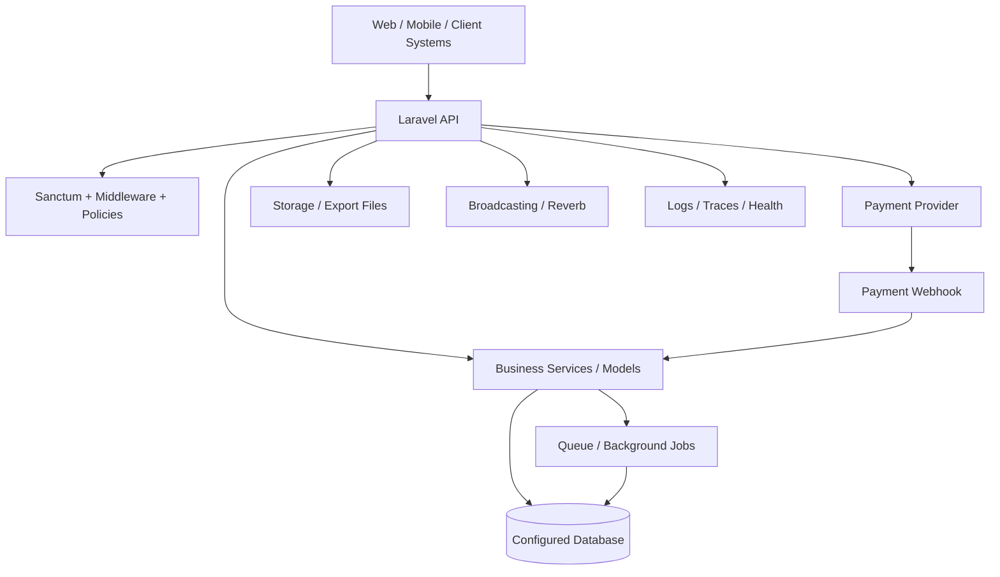
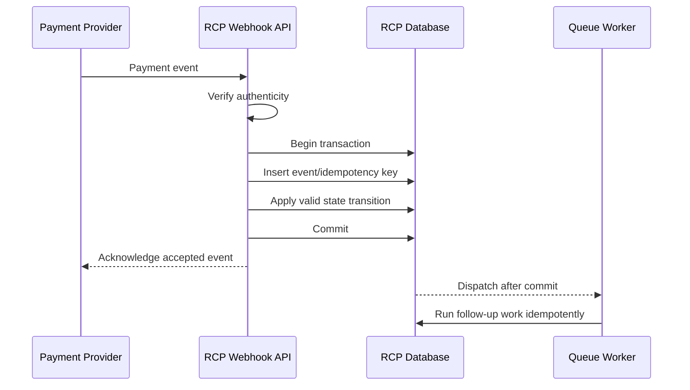
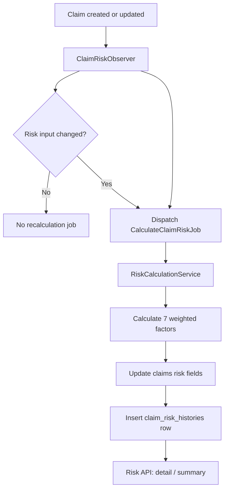

# RCP — Solution Architecture Field Guide

**Audience:** Backend engineers preparing to take architecture ownership  
**Repository:** [AhmedRamadan03/rcp](https://github.com/AhmedRamadan03/rcp)  
**Baseline:** `main` at the time this document was created  
**Purpose:** Explain how to think and work as a Solution Architect using RCP as the working example.

> **Important scope note:** This is an architecture guide and an initial architecture review, not a claim that every source file, production environment, or runtime behavior has been exhaustively verified. Findings below distinguish repository evidence from decisions that require confirmation. Keep this document aligned with code and deployed infrastructure.

---

## 1. What a Solution Architect actually does

A Solution Architect translates a business need into a solution that is secure, reliable, supportable, scalable, observable, and affordable. The role is not simply drawing diagrams or choosing technologies.

For each significant request, the architect should answer:

1. **Business outcome:** What problem are we solving, for whom, and how will success be measured?
2. **Current state:** How does the system behave today? Which code paths, data, integrations, and teams are affected?
3. **Options:** What realistic designs could solve the problem? What are their trade-offs?
4. **Decision:** Which option is recommended, why, and what assumptions or risks remain?
5. **Delivery plan:** What changes are needed in code, database, infrastructure, operations, and tests? Can they be released safely in stages?
6. **Verification:** What evidence proves the solution works in production-like conditions?
7. **Ownership:** Who maintains it, monitors it, responds to incidents, and documents future changes?

A good architect does not automatically choose microservices, Kubernetes, event sourcing, or the newest technology. The right design is the simplest design that satisfies the real requirements and leaves a safe path for future change.

## 2. RCP at a glance

RCP is a Laravel API backend. The inspected `main` branch's `composer.json` declares PHP `^8.4` and Laravel `^13.0`. It includes Sanctum, Reverb, PDF/document generation, Excel/spreadsheet support, Google Cloud Storage integration, FFmpeg, and OpenTelemetry packages.

The route definitions show several important business capabilities:

- Authentication and authenticated API routes.
- Claim-information/client-view flows, including OTP verification and debtor-related requests.
- Payment redirect and payment webhook endpoints.
- File serving and export downloads.
- City lookup and client-error intake.
- Health endpoint and authenticated broadcasting routes.
- Additional route groups loaded from `routes/api/clientapi.php` and `routes/api/base.php`.

The broader project context includes claims, collectors/supervisors and targets, permissions, risk assessment, notifications, and external payment integrations. Verify each capability against the exact branch and runtime before using it as a formal inventory.

### Evidence observed in the repository

| Area | Evidence on `main` | Architectural implication |
|---|---|---|
| Runtime/framework | `composer.json`: PHP ^8.4, Laravel ^13.0 | Runtime and framework upgrades affect compatibility, deployment and testing. |
| API entry point | `routes/api.php` | Route groups and middleware form important security boundaries. |
| Authentication | Sanctum middleware appears on protected route groups and broadcasting routes | Authentication proves identity; authorization must still prove access to a specific action/resource. |
| Payments | `v1/payments/webhook`, `v1/redirect-payment`, payment-link routes | Payment flows need idempotency, signature/authenticity validation, state transitions and reconciliation. |
| Files | File-serving routes use `authorize.file.access`; an export route uses the public storage disk | Review access control, expiry, private storage, path traversal protection and sensitive-file exposure. |
| Data stores | `config/database.php` supports MySQL, PostgreSQL, SQLite and SQL Server; default comes from `DB_CONNECTION` | A configured driver is not proof that every driver is tested or supported in production. |
| Queues | `config/queue.php` defaults to `sync` unless overridden | Confirm production queue configuration, worker operation, retries, failed jobs and after-commit behavior. |
| Broadcasting | Reverb connection is configured; `config/broadcasting.php` defaults to `null` unless overridden | Confirm production environment selects Reverb and that private channel authorization is correct. |
| Telemetry | OpenTelemetry packages appear in `composer.json`; health and client-error routes exist | Dependency presence alone does not prove traces, metrics, logs and alerts are correctly configured. |

## 3. High-level system view

This is a logical view based on the repository configuration and routes. It is not a verified deployment topology.

**How to use this diagram:** For a real architecture review, replace each generic box with verified components and document the deployed host/service, trust boundary, network path, credentials owner, failure behavior, and monitoring. Do not present a logical diagram as an infrastructure diagram.

### Request flow in the current route structure

1. A client calls an API route.
2. Route middleware may authenticate the caller, throttle requests, enforce client-view rules, or apply first-login restrictions.
3. A controller receives the request and delegates to application/business logic.
4. Business logic reads or updates persistent data and may call an external provider or dispatch asynchronous work.
5. The API returns a response; some flows may additionally publish events or produce downloadable files.

For each important endpoint, trace the real controller → service/action → model/repository → external integration path. Do not assume every endpoint follows the same layering pattern.

## 4. Architecture responsibilities and boundaries

Use these responsibilities as a review lens; do not introduce a layer just to satisfy a diagram.

| Component | Responsibility | Warning sign |
|---|---|---|
| Routes / middleware | Define entry points and cross-cutting request controls | Sensitive route is reachable without the intended middleware |
| Controller | Validate/accept input, coordinate the use case, format response | Large business rules or payment state logic embedded in controller |
| Request validation | Validate shape, types and basic constraints | Business authorization confused with input validation |
| Policy / permission service | Decide whether the actor can perform an action on a resource | Frontend-only permission checks or inconsistent authorization paths |
| Service / use case | Coordinate business workflow and transaction boundaries | Duplicate rules scattered across controllers/jobs |
| Model / persistence layer | Represent data and persistence relationships | Hidden side effects or expensive queries in unexpected places |
| Job / event / listener | Perform asynchronous work and react to committed business events | Non-idempotent retries, lost jobs, or events dispatched before commit |
| External integration adapter | Encapsulate provider protocol, errors, timeouts and mapping | Provider-specific assumptions spread throughout business code |
| Resource / response mapper | Expose a stable API contract | Leaking internal columns or breaking clients with unversioned changes |
| Tests / telemetry | Verify behavior and reveal production health | “Tests pass” without integration/failure-path coverage or actionable alerts |

## 5. Key architectural topics for RCP

### 5.1 Tenant isolation and database strategy

The project context describes a **database-per-client** operating model. Treat that as a key business constraint, and verify its implementation on the target branch before making changes.

For database-per-client, an architect must define:

- How the tenant/client is identified and authenticated.
- How the correct database connection is selected for every request, job, command, scheduled task, export and websocket event.
- How connection credentials are stored, rotated and protected.
- How connection pools and long-running workers avoid leaking a previous tenant's connection into the next job.
- How migrations are applied to all tenant databases, monitored, retried and rolled back.
- How tenant provisioning, suspension, backup, restore and deletion work.
- How cross-tenant reporting is handled without silently bypassing isolation.
- How tests prove tenant A can never read or mutate tenant B's data.

A single `DB_CONNECTION` in Laravel config does not, by itself, implement database-per-tenant. Locate and review the actual tenant resolver/connection-switching mechanism and its lifecycle.

**Design trade-off:** Database-per-tenant offers stronger isolation and tenant-specific operational control, but increases migration, monitoring, connection management and fleet-wide reporting complexity. A shared database with `tenant_id` can simplify operations but requires rigorous tenant scoping and has a different isolation profile. Do not migrate between these models without a business case, cost estimate, migration plan and rollback strategy.

### 5.2 Authorization and permission scopes

Review access as a chain:

1. Is the caller authenticated?
2. Is the requested action granted?
3. Does the permission allow the relevant scope (for example, own records, team records, or all records)?
4. Does the resource belong to the correct tenant/database?
5. Is the operation allowed in the current business state?

A permission such as `show_claim` is not enough by itself if data scope is also required. Apply scope in the query/data-access path, not only after fetching all records. Verify policies, helpers such as approval checks, API routes, background jobs, exports and file downloads use consistent rules. Add negative tests for cross-team and cross-tenant access.

### 5.3 Payment workflows and webhooks

Payment providers may retry webhooks, deliver duplicate events, or deliver events in an unexpected order. Redirect/callback completion is not equivalent to verified payment settlement.

Review the following:

- Verify webhook authenticity using the provider's documented mechanism.
- Make event handling idempotent using a stable provider event/payment identifier and a database uniqueness constraint where appropriate.
- Define explicit payment state transitions and reject invalid transitions.
- Use transactions around local state changes.
- Handle duplicate, delayed and out-of-order events.
- Keep provider calls bounded by timeouts; retry only safe operations.
- Store a correlation/reference ID without logging secrets or sensitive payment data.
- Reconcile local payment records against provider reports/status APIs.
- Test the race between a browser redirect and a webhook.
- Provide a safe operational path for pending or inconsistent payments.

### 5.4 Queue and event reliability

The queue config's default is synchronous. Production may override it through environment configuration, so verify deployed values rather than inferring runtime behavior from defaults.

For each queued workflow, document:

- What triggers it and whether the event must happen after transaction commit.
- Whether duplicate delivery is safe.
- Retry/backoff policy and maximum attempts.
- Timeout, worker memory and queue priority.
- Failed-job alerting and replay procedure.
- Whether ordering matters.
- What happens if the database commits but dispatch fails, or a job runs before data is committed.
- Tenant context propagation and cleanup for multi-tenant workers.

Do not move work to a queue solely to make a controller look cleaner. Define the user-visible consistency requirement first: immediate consistency, eventual consistency, or an explicit pending state.

### 5.5 Files and exports

The route file includes file-serving endpoints with an authorization middleware and an export-download endpoint using the public storage disk. This is a review priority because exports can contain personal, financial or claim data.

Verify that sensitive files are stored privately, downloads authorize the current user and tenant, file keys cannot be guessed or manipulated into arbitrary paths, links expire where appropriate, and access is audited. Confirm whether the public disk is appropriate for each class of export. Do not expose a file merely because its URL is hard to guess.

### 5.6 Risk assessment and background calculations

For a risk-scoring feature, the architect must turn business policy into a documented, testable contract:

- Inputs and data sources, including freshness and minimum sample requirements.
- Exact formula, weights, thresholds and missing-data behavior.
- What triggers recalculation and how irrelevant updates are excluded.
- Whether calculations run synchronously or asynchronously.
- How duplicate jobs and concurrent updates are handled.
- How each score is explained to users and audited over time.
- How model/rule versions are stored so old scores remain interpretable.
- How to backfill existing records and monitor calculation failures.
- Tests for boundaries, missing values, stale data and repeat execution.

Keep business decisions separate from infrastructure details where practical. A score that appears numeric but cannot be explained or reproduced is difficult to trust operationally.

### 5.7 API contracts and compatibility

For API changes, document request/response schemas, authentication, authorization, pagination, filtering, error codes, idempotency and rate limits. Check actual consumers before changing a field or response shape.

Prefer additive changes where possible. For breaking changes, define versioning/deprecation, consumer migration, rollout order and a removal date. API Resources can help isolate external response contracts from database structure, but their use and consistency must be verified endpoint by endpoint.

## 6. Initial architecture review: questions and priorities

These are review items inferred from the inspected files, not confirmed production incidents.

### Priority 0 — security and correctness

- [ ] Audit every file/export route, especially the public-disk export download path.
- [ ] Verify webhook signature/authenticity, idempotency and payment state transitions.
- [ ] Trace authentication, policies, permission scopes and tenant isolation end to end.
- [ ] Confirm public routes are intentionally public and sensitive endpoints have appropriate throttling.
- [ ] Check secrets and tenant database credentials are never committed or logged.

### Priority 1 — runtime reliability

- [ ] Confirm production `QUEUE_CONNECTION`; verify workers, retries, timeouts, failed-job alerts and after-commit behavior.
- [ ] Confirm production `BROADCAST_CONNECTION`/driver selects Reverb if real-time delivery is required.
- [ ] Verify health checks distinguish process liveness from dependency readiness where needed.
- [ ] Confirm OpenTelemetry actually exports useful telemetry and alerts have owners/runbooks.
- [ ] Test external provider timeouts, outages and recovery.

### Priority 2 — maintainability and performance

- [ ] Map major business modules and their dependencies.
- [ ] Review slow queries, N+1 loading, unbounded lists, indexes and transaction duration.
- [ ] Check cache keys include the right tenant/context and invalidation is correct.
- [ ] Review large exports/media processing for memory, storage and queue pressure.
- [ ] Establish test coverage for business-critical flows and integration contracts.
- [ ] Verify dependency security/update policy and supported PHP/Laravel runtime in CI and production.

### Priority 3 — operational maturity

- [ ] Document tenant onboarding, migrations, backup/restore and disaster recovery.
- [ ] Define SLOs for API availability, latency, payment correctness and queue delay.
- [ ] Add dashboards for errors, latency, queue depth, failed jobs, provider failures and tenant-level resource usage.
- [ ] Document incident response, escalation, rollback and recovery exercises.
- [ ] Estimate infrastructure cost and capacity under expected and peak traffic.

## 7. How to handle an architecture task — step by step

Use this workflow for each real ticket or feature.

### Step 1 — clarify the requirement

Write a short problem statement and acceptance criteria. Ask about actors, volume, latency, availability, data sensitivity, audit requirements, expected growth, budget and deadline. Record unknowns instead of silently guessing.

**Deliverable:** Problem statement + measurable non-functional requirements.

### Step 2 — map the current implementation

Search routes, middleware, controllers, services, models, policies, jobs, events, migrations, external clients and tests. Follow the complete path, including failure paths. Inspect production configuration safely; never expose credentials.

**Deliverable:** Current-state sequence diagram and affected-component list.

### Step 3 — identify constraints and failure modes

List tenant isolation, legacy clients, database compatibility, provider behavior, deployment limitations, data migration risks and operational ownership. Ask “what happens if this dependency times out, retries, or partially succeeds?”

**Deliverable:** Assumptions, constraints and failure-mode list.

### Step 4 — compare options

At minimum, compare the current design plus the smallest safe change against any larger redesign. Score options for security, correctness, performance, complexity, delivery risk, cost and reversibility.

**Deliverable:** Options table with a recommended option and explicit trade-offs.

### Step 5 — write an Architecture Decision Record (ADR)

Use a short record with: title, status, context, decision, alternatives, consequences, risks, rollout and rollback. Example: “ADR-00X: Make payment webhook processing idempotent.” The record should explain why, not merely what code changed.

**Deliverable:** ADR reviewed by relevant stakeholders.

### Step 6 — break the decision into delivery work

Split work into API/code changes, schema changes, backfill, infrastructure/configuration, dashboards/alerts, tests, documentation and rollout. Identify dependencies and owners. Keep unrelated refactoring out of the change.

**Deliverable:** Ordered implementation plan and acceptance checklist.

### Step 7 — implement and verify incrementally

Use a dedicated branch from the correct baseline. Make small commits. Add unit tests for rules, feature tests for API/security, integration tests for database/provider boundaries, and load/failure tests where required. Review migrations for locking, compatibility and rollback behavior.

**Deliverable:** Reviewable PR, test evidence and deployment notes.

### Step 8 — release safely

Prefer expand-and-contract migrations for zero/low-downtime changes: add compatible schema, deploy code that supports old/new states, backfill, switch reads/writes, then remove obsolete schema in a later release. Use feature flags or canaries where appropriate.

**Deliverable:** Release plan, health signals, rollback trigger and owner.

### Step 9 — verify after release

Check real metrics and logs, not only a successful deployment. Compare against acceptance criteria, verify background jobs and external integrations, and confirm tenant isolation. Capture lessons and update the architecture docs.

**Deliverable:** Post-release verification and follow-up actions.

## 8. Example architecture task: make payment updates reliable

**Business problem:** A customer returns from the payment provider while a webhook is also arriving. The API must not mark the payment twice, lose a successful payment, or regress a final state.

**Proposed flow:**

This is a target pattern to evaluate, not a statement that the current code already implements every step.

**Acceptance criteria:**

- Invalid signatures are rejected.
- Repeated delivery of the same event has no duplicate business effect.
- Redirect and webhook races converge on one valid final state.
- Invalid state regressions are rejected and logged.
- Transient failures can be retried safely.
- Support staff can find a payment by correlation/reference ID.
- Reconciliation identifies mismatches.
- Tests cover duplicates, out-of-order events, provider outage and concurrent delivery.

**Architect's work:** validate provider guarantees, agree on the payment state machine, design constraints/transactions, review the implementation, define telemetry and runbook, and get business sign-off on reconciliation behavior.

## 9. Example architecture task: add a new permission scope

Suppose RCP needs a permission scope such as `onlyme`, `team`, or `all`.

Do not implement this as a frontend filter. Define the authorization contract first:

- What identifies “me” and “team” in each business module?
- What happens when a user has no team or belongs to multiple teams?
- Does the scope apply to list, detail, update, delete, export, file access and background jobs?
- How does approval mode interact with scope?
- What is the backward-compatible default for existing permission records?
- How do we prevent a query from returning records before scope is applied?

Then centralize/reuse the rule where appropriate, apply it before pagination, add policy and query tests, test cross-team/cross-tenant denial, and document migration/backfill behavior. The architecture deliverable is the consistent contract across all access paths, not just a new JSON key.

## 10. Architecture artifacts you should learn to produce

| Artifact | When to use it | What it should contain |
|---|---|---|
| C4 context/container/component diagrams | New system or major boundary change | Actors, responsibilities, dependencies and trust boundaries |
| Sequence diagram | Multi-step flow, async processing, payment, OTP | Order, alternate paths, retries, failures and transaction boundaries |
| ADR | A decision with long-term consequences | Context, options, decision, consequences and status |
| Data model / migration plan | Schema or tenant changes | Ownership, constraints, indexes, data migration and rollback |
| Threat model | Sensitive data, authentication, files, integrations | Assets, trust boundaries, threats, mitigations and residual risk |
| Capacity estimate | Traffic or data growth changes | Request rate, concurrency, storage, queue throughput and headroom |
| API contract | New or changed endpoint | Schema, errors, auth, compatibility and consumer impact |
| Runbook | Production-critical behavior | Symptoms, diagnostics, recovery, escalation and rollback |
| Test strategy | Any important feature | Unit, feature, integration, contract, security and load coverage |
| Release plan | Risky deployment | Ordering, feature flags, observability, rollback and owner |

## 11. Suggested 30/60/90-day learning plan

### Days 1–30: understand and document RCP

- Trace the 5–10 most business-critical user journeys end to end.
- Map routes, middleware, permissions, data ownership, tenant switching and external integrations.
- Read migrations and inspect indexes for core entities.
- Review production queue, broadcast, storage, deployment and telemetry settings with the responsible team.
- Produce a current-state context/container diagram and one sequence diagram.
- Write one ADR for a real, contained design decision.

### Days 31–60: lead a bounded design

- Choose a real improvement such as webhook reliability, export security, queue reliability or tenant-isolation testing.
- Gather requirements and baseline metrics.
- Compare at least two options and record trade-offs.
- Write a threat/failure-mode review and delivery plan.
- Review implementation PRs and test evidence with the team.
- Validate operational dashboards and rollback steps.

### Days 61–90: own an end-to-end architecture outcome

- Lead a medium-sized feature from discovery to production verification.
- Facilitate a design review and capture decisions/risks.
- Establish SLOs and operational ownership for the flow.
- Present before/after results using evidence: failure rate, latency, support incidents, cost or delivery time.
- Create a follow-up roadmap based on measured risk, not technology trends.

## 12. Design review checklist

Before approving a design, ask:

- [ ] Does it solve the stated business problem?
- [ ] Are functional and non-functional requirements measurable?
- [ ] Are trust boundaries, authentication and authorization explicit?
- [ ] Is tenant/database isolation preserved in HTTP, jobs, exports and realtime flows?
- [ ] Are transactions, retries, idempotency and concurrency addressed?
- [ ] Are API and database changes backward compatible or safely staged?
- [ ] What happens when each external dependency fails?
- [ ] Is performance understood at expected and peak volume?
- [ ] Are logs, metrics, traces, alerts and a runbook available?
- [ ] Can the change be tested, deployed, rolled back and supported?
- [ ] Are cost, complexity and operational burden justified?
- [ ] Is the decision documented and is there a named owner?

## 13. How to use this document

Treat the guide as a working document. As you verify a section against code and production configuration:

1. Replace generic diagrams with exact component names.
2. Add links to the actual route, class, migration, job and test.
3. Label findings as **Verified**, **Needs verification**, or **Decision required**.
4. Add an ADR for meaningful decisions.
5. Keep recommendations separate from existing behavior.
6. Revisit the guide after significant architecture changes.

### Initial evidence references

- [Repository](https://github.com/AhmedRamadan03/rcp)
- [composer.json](https://github.com/AhmedRamadan03/rcp/blob/main/composer.json)
- [routes/api.php](https://github.com/AhmedRamadan03/rcp/blob/main/routes/api.php)
- [config/database.php](https://github.com/AhmedRamadan03/rcp/blob/main/config/database.php)
- [config/queue.php](https://github.com/AhmedRamadan03/rcp/blob/main/config/queue.php)
- [config/broadcasting.php](https://github.com/AhmedRamadan03/rcp/blob/main/config/broadcasting.php)

---

**Core principle:** A Solution Architect is accountable for the quality of the decision and the path to a safe outcome—not just the diagram, code pattern, or technology choice.

# Repository-specific audit update — 2026-10-12

This section supersedes the earlier generic review checklist wherever a finding below is more specific. The baseline is `main` commit `0c1ed664c3273ac8f7c84599cdf594e9bf136593`. The guide branch is documentation-only and must not be merged as a code fix.

## 14. Repository inventory and audit boundaries

The recursive Git tree for `main` contains **1,520 tracked paths** (1,270 PHP files, 195 migration files, 39 seeders, plus configuration, routes, tests, deployment workflows, documentation, language files, static assets, generated assets and templates). The tree was not truncated.

Architecture-bearing areas identified:

- `app/Http/Controllers`: 78 files, including API V1, claim, payment, risk, partner and file endpoints.
- `app/Models`: 62 files, including claims, payments, permissions, files, partner credentials, targets and risk history.
- `app/Services`: 81 files, including claim workflows, payment gateway, file handling, permissions, reporting and risk calculation.
- `app/Jobs`: 31 files, including imports, exports, cloud file synchronization and risk calculation.
- `app/Policies`: 43 files.
- `app/Http/Middleware`: 21 files.
- `app/Http/Requests`: 72 files.
- `app/Http/Resources`: 40 files.
- `database/migrations`: 195 files.
- `database/seeders`: 39 files.
- `routes`: 28 files.
- `config`: 20 files.
- `tests`: 19 tracked files.
- `.github/workflows`: 8 workflow files.

**Evidence boundary:** the inventory covers every tracked path, and the implementation review inspected the main architectural entry points and critical cross-cutting paths (routing, authentication, policies, partner API, payment webhook/status reconciliation, files, queue configuration, risk scoring, core claim model/service, migrations, tests, deployment and observability). This is not a line-by-line manual correctness certification of every legacy controller, every language file, every static asset or every migration. The GitHub connector does not execute the project; no local PHPUnit run, production configuration inspection, penetration test, load test or live provider test was performed. Findings below are therefore classified by evidence and verification need rather than presented as a production certification.

## 15. Actual RCP architecture and runtime boundaries

### 15.1 Framework and application shape

- `composer.json` declares PHP `^8.4` and Laravel `^13.0`.
- The application is a Laravel modular monolith with API V1 routes, Eloquent models, controllers, services/actions, policies, jobs/events/listeners and integrations. There is no evidence in the inspected runtime configuration that the whole application is already split into independently deployed business microservices.
- A separate payment microservice is called over HTTP through `PaymentMicroservice`; this is a real service boundary. ELM, SMS, IVR/Maqsam, mail, Google Cloud Storage and PDF/Excel/browser tooling are other integration or infrastructure boundaries.
- The codebase includes both API endpoints and Blade/Livewire-oriented UI/PDF/mail views. It is not strictly an API-only repository even though the business API is the central interface.
- The route entry point is `routes/api.php`; it includes `routes/api/clientapi.php` and `routes/api/base.php`. The latter contains the authenticated application route groups. Broadcasting routes use Sanctum authentication.
- The project has ART, GIG and RCP deployment workflow variants. The deployment workflow selects environment secrets and deployment directories per environment/brand.

### 15.2 Tenant/client model — important distinction

The application contains `client_id` fields and client relationships. The partner API credential model also stores `client_id`. However, the inspected database configuration selects one default connection using `DB_CONNECTION`; no dynamic per-request connection-switching resolver was found in the inspected bootstrap/config path. The partner claim filter's own comment says client scoping was removed for a single-tenant database.

The project operating constraint communicated by the team is **database-per-client / separate client deployments**. The architecture should therefore currently be documented as **deployment/database isolation per client**, not as proven runtime database-per-tenant switching inside one shared Laravel process. Confirm this against the deployment secret, actual database endpoints, and infrastructure inventory.

Architectural consequence: code that omits `client_id` filters may be safe only if each deployed application instance can access exactly one client's database. If a future deployment shares a database or credential store between clients, several queries and credential-management endpoints need tenant scoping before that topology is safe. Do not mix these two tenancy models in design discussions.

### 15.3 Main business capabilities found in routes and source structure

| Capability | Main implementation areas | Architecture concerns |
|---|---|---|
| Claims lifecycle | `ClaimController`, `ClaimInfoController`, `ClaimService`, `ClaimStatusActionResolver`, claim actions and history models | State machine consistency, approval rules, concurrency, audit trail, permissions and query visibility |
| Imports / bulk actions | Claim import services/actions, `ProcessClaimImport*` jobs, failed-import records and commands | Partial success semantics, idempotency, batch sizing, retries, data validation and recovery |
| Payments / installments | `PaymentService`, `PaymentServiceGateway`, `PaymentMicroservice`, transaction status/enquiry actions, payment models | External truth vs local state, duplicate callbacks, locks, reconciliation and financial auditability |
| Partner API | `AuthenticatePartnerApi`, partner credentials, `PartnerClaimController`, registration/update services | Credential lifecycle, API contract, client database boundary, per-item bulk failures and audit actor |
| Files / exports | `FileController`, `AuthorizeFileAccess`, `FilesUploader`, cloud sync job, export jobs | Private-by-default storage, authorization, safe paths, signed URLs, retention and memory use |
| Authorization | 43 policies, `PermissionService`, `GeneralPermissionSeeder`, `app/helpers.php` | Central permission contract, scope enforcement, legacy JSON compatibility and negative tests |
| Targets / collectors / delegations | Target services/models, target jobs/commands and supervisor-related routes | Reporting correctness, date boundaries, team membership, query performance and history |
| Notifications / messages / SMS / IVR | Events/listeners, message/notification/SMS/IVR services and scheduled commands | Retry safety, provider throttling, delivery observability and PII-safe logs |
| Risk assessment | `ClaimRiskObserver`, `CalculateClaimRiskJob`, `RiskCalculationService`, `RiskController`, `ClaimRiskHistory` | Formula correctness, missing-data policy, queue reliability, access control and rule versioning |
| Reports / dashboards | Dashboard/report services, query/filter classes and OpenSpout exports | Bounded queries, index strategy, large export lifecycle and consistent filters |
| Audit / observability | Data/authentication histories, login-attempt tracking, OpenTelemetry and SigNoz docs | Trace correlation, access audit, alert ownership and incident response |

## 16. Verified findings requiring action

These are source-level findings, not claims that exploitation or a production incident has occurred. The first items should be treated as design-review blockers before describing the system as secure.

### Finding A — export-download route is not visibly protected by authentication or file authorization

**Evidence:** `routes/api.php` defines `GET /v1/download-export/exports/{file?}` as an inline closure. Unlike the `show-file` routes, this route does not attach `authorize.file.access`, Sanctum, a policy or a signed-URL middleware in its route definition. It concatenates the supplied path segment into `storage_path('app/public/exports/'.$file)` and passes the resulting relative path to the public disk's `download()`.

**Risk:** if the endpoint is reachable as written, a caller may attempt to download sensitive exports without being authenticated or authorized. Path normalization and traversal must also be handled explicitly rather than trusting a route parameter.

**Required verification/fix:** enumerate every caller of this endpoint; replace arbitrary filename/path handling with a server-generated export record or opaque file UUID; authorize the current user and client/database before streaming; canonicalize and constrain the path to the exports directory; use private storage for sensitive exports; add unauthenticated, cross-user, cross-client and traversal regression tests. Do not assume an unguessable filename is authorization.

### Finding B — payment webhook does not validate the sender in the controller

**Evidence:** `PaymentWebhookController::webhook()` checks only that `event`, `charge_id` and `status` are present, then invokes `TransactionStatusEnquiryAction` using `charge_id`. The controller does not validate a provider signature, shared secret, authenticated sender, timestamp or replay token. The received `event` and `status` are not used to establish payment truth; the action asks the payment microservice for the current status, which is a good source-of-truth direction but does not authenticate the webhook request itself.

**Risk:** an unauthenticated caller can trigger provider-status lookups and downstream processing for known charge identifiers, potentially creating load or unexpected retry pressure. The controller's required fields are not proof that the event came from the provider.

**Required verification/fix:** follow the payment microservice/provider's supported webhook-authentication contract; reject invalid signatures before any status enquiry; use a timestamp/replay policy where supported; rate-limit safely without blocking legitimate provider retries; record correlation IDs without secrets; test forged, duplicate, delayed and out-of-order callbacks. Preserve the downstream transaction-row locks and reconciliation logic, which already attempt to serialize concurrent status checks.

### Finding C — risk recalculation route has a parameter-binding mismatch and weaker authorization than the read route

**Evidence:** `routes/api/claims.php` defines the route as `/{claimId}/risk/recalculate`, while `RiskController::recalculate()` accepts `Claim $claim`. Laravel implicit model binding normally matches the route parameter name to the controller argument; these names do not match. The route applies `auth:sanctum`, but unlike `show()`, the recalculation method does not itself query through `Claim::visibleTo($user)` or explicitly authorize the claim.

**Risk:** recalculation may fail to bind the model correctly; if the route is adjusted without adding resource authorization, any authenticated user could potentially trigger recalculation for a claim they cannot see.

**Required verification/fix:** make route and argument names consistent; resolve the claim through the user's visible-claims query or a policy; add a dedicated permission for manual recalculation if required; test missing claim, invisible claim, allowed claim and role restrictions. Recalculation should not be made functional by fixing binding alone.

### Finding D — risk score currently contains a constant city component

**Evidence:** `RiskCalculationService::calculateCityRiskScore()` returns `30` for every claim. This is a placeholder, not a score derived from city history. The client score counts claims for the same `client_id` and counts only `rejected` and `cancelled` statuses. The claim-history factor counts all earlier claims with the same `debtor_nid`, then adds weighted counts for `rejected`, `cancelled`, `closed` and `manaual_collected`.

**Risk:** the API exposes a city-risk component that appears data-driven but currently contributes a constant neutral value. The client metric does not currently include `closed`. If `debtor_nid` is null, a query for `debtor_nid = null` may group unrelated records with missing identifiers into one apparent history cohort, depending on query/database behavior. The current formula is deterministic but not a validated predictive model.

**Required verification/fix:** label city risk as unavailable/neutral until the agreed city sample threshold and status cohort are implemented; explicitly handle null debtor identifiers; document whether deleted claims count; define status normalization; agree the business formula and threshold policy; add boundary tests and a reproducible example. Do not describe the risk output as a machine-learning prediction or a proven probability of default.

### Finding E — risk history metadata does not distinguish actual triggers

**Evidence:** `ClaimRiskObserver` dispatches a job on claim creation and on updates to a risk-related field. `RiskCalculationService::calculate()` writes every history row with `trigger = 'updated'`, including manual recalculation. The migration allows `created`, `updated`, `manual_recalc` and `status_change`, but the service does not select among these values. The observer dispatches with `auth()->id()`, which can be null for imports, CLI commands or background execution.

**Risk:** history consumers cannot reliably tell why a score was calculated; actor attribution is incomplete for non-HTTP workflows. The job also has three attempts and a 60-second timeout, but production retry/failed-job monitoring still needs verification.

**Required verification/fix:** pass an explicit trigger/source and actor context to the job; distinguish system actor from user actor; add after-commit dispatch or an equivalent transactional-outbox strategy; make repeated execution safe; test create/update/manual/command/import paths; decide whether unchanged risk inputs should create a new history row.

### Finding F — queue reliability depends on environment and current defaults are not safe evidence of production behavior

**Evidence:** `config/queue.php` defaults to `sync` when `QUEUE_CONNECTION` is unset. The database queue connection has `after_commit => false`; the Redis connection also has `after_commit => false`. `.env.example` sets `QUEUE_CONNECTION=sync`. Jobs such as `CalculateClaimRiskJob`, imports, exports and cloud file sync implement `ShouldQueue`, but that interface alone does not prove a real worker runs.

**Risk:** synchronous execution can put heavy work in request latency; asynchronous dispatch before transaction commit can expose a job to uncommitted or rolled-back data. A queue that is configured but not monitored can silently accumulate failures.

**Required verification/fix:** inspect each deployment secret and Supervisor/cron configuration; explicitly configure after-commit behavior or dispatch jobs after commit; define retries/backoff/timeouts, failed-job alerting and replay; verify workers for every environment; test job execution with the production queue driver. Never paste secret environment contents into tickets or logs.

### Finding G — permission architecture is legacy JSON plus per-policy checks; the proposed scope contract is not implemented on main

**Evidence:** `GeneralPermissionSeeder` defines permission keys and currently declares `permission_mode` values such as `with_approve`; it does not define `scope` values `all`, `onlyme` or `team`. `PermissionService` converts request data into per-category JSON and preserves configured mode keys. `get_permission_value()` in `app/helpers.php` supports both scalar legacy values and structured values. `custom_policy()` currently returns the supplied boolean unchanged. The policy set contains explicit permission checks, but some action methods rely on route-level `can:view` middleware for resource visibility rather than checking visibility again inside the action method.

**Risk:** adding scope to the seeder alone will not enforce scope. A future implementation can accidentally show the correct buttons but return broader query results, or protect list routes while leaving detail/export/file/job paths inconsistent. Existing scalar JSON values and old records are a migration/backward-compatibility concern.

**Required verification/fix:** define a central contract for `granted`, approval mode and scope; choose a safe default for existing records; apply query scope before pagination and aggregation; ensure every detail, mutation, export, file and background path follows the same rule; add negative tests for own/team/all and cross-client denial. Keep authorization separate from workflow approval: a permission grant does not automatically mean the action is approved.

### Finding H — partner API credentials have no automatic expiry and client scoping must match the deployment topology

**Evidence:** `AuthenticatePartnerApi` checks `X-Client-Id`, `X-Client-Secret`, active status and a hash check; failures return a generic 401. `PartnerApiCredential` hides the stored secret hash. Credential generation returns the raw secret once and stores only a hash. The controller documentation explicitly states credentials do not expire automatically. The credential listing query shown in `PartnerApiCredentialController` does not itself add a `client_id` filter; the partner claim query is also not visibly constrained by the credential's client ID. The partner update service documents that client scoping was removed for a single-tenant database.

**Risk:** credential lifecycle and data isolation depend on the assumption that each deployed database belongs to one client. If that assumption changes, credential listing/management and partner data access can cross client boundaries. Long-lived credentials increase the impact of a leaked secret.

**Required verification/fix:** document the single-client-per-database invariant as a deployment guardrail; verify database credentials and deployment secrets are unique per client; test revocation and rotation; consider expiry/rotation policy; add client scoping to queries before ever sharing a database or process across clients. Review whether bulk API responses may contain sensitive exception messages.

### Finding I — authorization policies need systematic consistency review

**Evidence:** `ClaimPolicy::viewAny()` returns true, while actual list visibility is expected to be constrained in service/query paths. `ClaimPolicy` mixes permission JSON checks and resource visibility checks; several action methods have comments showing resource checks are expected from route-level middleware. `PermissionPolicy` has several permissive `true` methods with the previous permission check commented out. This may be intentional if route groups and higher-level permissions provide the boundary, but the policy itself does not establish that boundary.

**Risk:** a route added without the matching query scope or second policy can expose a list or mutation unexpectedly. Tests focused only on happy-path roles will miss this.

**Required verification/fix:** build a route-to-policy matrix; test all privileged endpoints as anonymous, low-privilege, same-team, other-team and other-client actors; verify exports and jobs reapply the original actor's scope; remove stale commented policy logic only after confirming intended behavior with the business owner.

### Finding J — risk reporting has avoidable query repetition

**Evidence:** `RiskController::summary()` runs total-count queries more than once and performs separate counts for high/medium/low plus average score. It starts from `Claim::visibleTo($user)`, which is the right direction for visibility.

**Risk:** the summary cost grows with database size and repeats similar filters. It is not necessarily a bottleneck at current volumes, but it should be measured.

**Required verification/fix:** profile with production-like data; use a single aggregate query or grouped conditional aggregates where supported; confirm the database's indexes and query plan; preserve identical visibility filters and percentage semantics.

### Finding K — production observability is documented, but configuration and alerting still need runtime proof

**Evidence:** the repository contains `bootstrap/otel.php`, `bootstrap/otel-env.php`, `EnrichTraceContext`, health/client-error endpoints and SigNoz dashboards/alert documentation. The docs explain that OpenTelemetry environment variables must be present before Composer autoload and that CLI tracing is required for jobs/commands. Workflow variants use different deployment secrets and service names.

**Risk:** code and dashboards can exist while telemetry remains disabled, missing for CLI workers, or pointed at the wrong service. The health route is described as a liveness endpoint, not a full readiness check.

**Required verification/fix:** check actual deployment secrets and worker environment with the operations owner; verify traces for HTTP, PDO, external HTTP, jobs and scheduler; trigger a safe test alert; restrict the unauthenticated OTLP receiver to the internal network; define alert owner/runbook and data-retention policy.

## 17. Deployment and delivery pipeline review

The RCP UAT workflow triggers on pushes to `uat`, checks out the repository, authenticates to GCP through workload identity, connects to a VM through IAP, fetches/resets the selected branch, runs `composer install`, loads the environment from Secret Manager, clears configuration, runs `php artisan migrate --force`, runs selected seeders, optimizes Laravel and restarts Supervisor workers.

Architecture implications:

1. **No PHPUnit step is visible in the inspected RCP UAT deployment workflow before migration/deployment.** A separate CI system may exist outside the tracked workflows, but the repository workflow alone does not demonstrate test-gated deployment.
2. Migrations are run automatically in the deployment path. Every schema change therefore needs production-safe locking/compatibility review, and rollback must be planned before deployment.
3. `GeneralPermissionSeeder` and `CategoryMessageVariablesSeeder` are run in UAT deploy. Seeders must be idempotent and safe to rerun against real data.
4. The workflow performs a hard reset of the deployment checkout and intentionally leaves `git clean -fd` commented out. Confirm which generated/untracked files are expected to persist and ensure secrets/configuration are not accidentally overwritten.
5. The workflow uses pinned major versions for third-party GitHub Actions, but not immutable commit SHAs. Apply the team's supply-chain policy consistently.
6. `php.DockerFile` installs PHP extensions, Node, Chromium/Chrome and builds assets, but the provided `docker-compose.yml` only defines the PHP service. The Docker setup should not be confused with the production VM deployment topology.
7. Validate rollback and recovery operationally: schema changes may not be reversible after new writes; restoring code alone may not restore data consistency.

**Recommended release gate:** automated unit/feature tests → static analysis/format checks → dependency/security checks → migration dry-run or compatibility review → approval → deploy → smoke tests → telemetry verification. Production should have a documented rollback trigger and named release owner.

## 18. Risk Assessment — exact V1 behavior visible on main

### Current calculation contract

The service uses seven weighted components totaling 100%:

| Factor | Weight | Current component behavior |
|---|---:|---|
| Claim type | 15% | Individual 20; corporate 40; leasing 35; government 25; municipality 30; fallback 10 |
| Claim amount | 20% | >=100,000: 100; >=50,000: 80; >=20,000: 60; >=10,000: 40; >=5,000: 25; otherwise 10 |
| Accident age | 15% | Missing date: 50; >24 months: 90; >12: 70; >6: 40; >3: 20; otherwise 10 |
| Previous debtor claim history | 15% | Previous claims ×10 plus rejected/cancelled/closed/manual-collected claims ×20, capped at 100 |
| Debtor type | 20% | Third party 80; insured 20; fallback 50 |
| City risk | 10% | **Constant 30 placeholder** |
| Client risk | 5% | Missing client: 30; otherwise rejected/cancelled share ×2, capped at 100 |

The weighted score is the sum of each factor score multiplied by its weight divided by 100, rounded to two decimal places and capped at 100. The model derives levels as **high >=70**, **medium >=30 and <70**, **low <30**. Color and label are derived from the level. The score is persisted on `claims`; factor details are stored as JSON; a history row is created for each calculation.

### Trigger and data flow

This flow is the intended observed code path, with the earlier caveats about queue configuration, trigger metadata and transaction timing. The observer dispatches on creation and when these fields change: amount, type, debtor type, accident date, status, city, debtor national ID, claim number and client ID.

### API surface and operational limitations

- Risk detail returns score, level, color, label, factor details, calculation time and history.
- Summary returns visible claim count, counts by level, average score and high-risk percentage.
- Manual recalculation exists in route/controller code but has a route-model-binding name mismatch and lacks the same explicit visibility query used by detail.
- The risk migration creates `risk_score` (default 0), `risk_factors`, `risk_calculated_at`, an index on score and a `claim_risk_histories` table indexed by claim and creation time.
- The tracked test inventory on `main` contains no dedicated risk-calculation test file. Do not state that risk behavior is covered by a passing test suite on this branch without adding/running those tests.
- The high-risk label says “mandatory review,” but no automatic claim workflow/approval enforcement was identified in the inspected risk controller/service path. Treat it as presentation text until a business rule is explicitly implemented and tested.
- The current score is a rule-based heuristic. It is not a calibrated probability, model prediction or independently validated measure of financial loss.

### Minimum acceptance tests before using the score for decisions

- Every factor threshold immediately below, at and above each boundary.
- Null/missing city, client, accident date and debtor national ID.
- City sample-size threshold and exact eligible status cohort when city risk is implemented.
- Client score with 0 claims, 1 claim and rejected/cancelled/closed records.
- Re-running the same calculation and concurrent jobs.
- Creation, relevant update, irrelevant update, manual recalculation and status transition.
- Actor attribution for HTTP, imports, queue jobs and Artisan commands.
- User visibility, manual-recalculation permission and history visibility.
- Rollback/failed-job recovery and a backfill plan for existing claims.

## 19. Architecture backlog ranked by risk

| Priority | Work item | Why it comes first | Evidence required to close |
|---|---|---|---|
| P0 | Protect export download and constrain file paths | Possible sensitive-data exposure | Route tests proving unauthenticated, unauthorized and traversal requests fail |
| P0 | Authenticate payment webhooks | External endpoint currently trusts required fields, not sender identity | Valid/invalid signature and replay tests |
| P0 | Fix and authorize manual risk recalculation | Binding mismatch and missing resource-level visibility check | Route binding + cross-user visibility tests |
| P1 | Make queue/transaction boundaries explicit | Jobs can run synchronously or before commit depending on environment | Per-environment config proof; after-commit/retry tests |
| P1 | Complete and explain city-risk policy | City score is constant | Approved business rule, sample threshold, deterministic tests |
| P1 | Fix null debtor-history behavior and history trigger attribution | Potentially misleading scores/audit history | Null identifier tests and trigger/actor assertions |
| P1 | Create authorization matrix for all routes/policies | Policy checks and route checks are distributed | Automated negative access tests for roles, team scope and client DB boundary |
| P1 | Verify partner API tenant invariant | Client credential metadata exists but data queries rely on single-client DB | Infrastructure proof + credential rotation/revocation and isolation tests |
| P1 | Add test-gated CI before migration | Deployment workflow does not show a PHPUnit gate | CI run proving tests/static checks pass before deployment |
| P2 | Optimize risk summary aggregation and report queries | Repeated aggregates and large datasets can increase latency | Query plan and benchmark on representative data |
| P2 | Verify observability end to end | Docs/config are not proof of live telemetry | Example traces for web, jobs and scheduler; alert delivery test |
| P2 | Document migration/backup/restore and incident runbooks | Operational recovery is part of architecture | Successful rehearsal with owner and recorded timing |

## 20. Architecture review deliverables for future RCP tasks

For any non-trivial feature, attach these to the PR or its design ticket:

1. **Requirement brief:** problem, actors, acceptance criteria, data sensitivity, traffic and latency targets.
2. **Current-state map:** routes, middleware, controller, service/action, model, jobs/events, integrations and tables affected.
3. **Sequence diagram:** success path, failures, retries, concurrency and transaction boundaries.
4. **Options analysis:** at least the smallest safe change and any larger alternative, with cost/complexity/security/rollback trade-offs.
5. **ADR:** decision, alternatives rejected, assumptions, consequences and review date.
6. **Security and data-access review:** authentication, permission, resource visibility, client database boundary, files and audit trail.
7. **Migration and release plan:** expand/contract, backfill, rollout order, monitoring, rollback limitations and owner.
8. **Test evidence:** unit, feature, integration, negative authorization, retry/concurrency and load tests appropriate to the change.
9. **Operational readiness:** dashboard, alert, runbook, support owner and recovery procedure.
10. **Post-release evidence:** metrics and smoke tests compared with the original acceptance criteria.

## 21. Reference map — inspect these first in the repository

- [Main API route map](https://github.com/AhmedRamadan03/rcp/blob/main/routes/api.php)
- [Claim routes](https://github.com/AhmedRamadan03/rcp/blob/main/routes/api/claims.php)
- [Partner API routes](https://github.com/AhmedRamadan03/rcp/blob/main/routes/api/clientapi.php)
- [Claim policy](https://github.com/AhmedRamadan03/rcp/blob/main/app/Policies/ClaimPolicy.php)
- [Permission service](https://github.com/AhmedRamadan03/rcp/blob/main/app/Services/PermissionService.php)
- [Permission helpers](https://github.com/AhmedRamadan03/rcp/blob/main/app/helpers.php)
- [Partner API authentication](https://github.com/AhmedRamadan03/rcp/blob/main/app/Http/Middleware/AuthenticatePartnerApi.php)
- [File authorization middleware](https://github.com/AhmedRamadan03/rcp/blob/main/app/Http/Middleware/AuthorizeFileAccess.php)
- [Export/file route definitions](https://github.com/AhmedRamadan03/rcp/blob/main/routes/api.php)
- [Payment webhook controller](https://github.com/AhmedRamadan03/rcp/blob/main/app/Http/Controllers/Api/V1/PaymentWebhookController.php)
- [Payment status reconciliation](https://github.com/AhmedRamadan03/rcp/blob/main/app/Actions/TransactionStatusEnquiryAction.php)
- [Risk controller](https://github.com/AhmedRamadan03/rcp/blob/main/app/Http/Controllers/Api/V1/RiskController.php)
- [Risk calculation service](https://github.com/AhmedRamadan03/rcp/blob/main/app/Services/Risk/RiskCalculationService.php)
- [Risk observer](https://github.com/AhmedRamadan03/rcp/blob/main/app/Observers/ClaimRiskObserver.php)
- [Queue configuration](https://github.com/AhmedRamadan03/rcp/blob/main/config/queue.php)
- [Storage configuration](https://github.com/AhmedRamadan03/rcp/blob/main/config/filesystems.php)
- [RCP UAT deployment workflow](https://github.com/AhmedRamadan03/rcp/blob/main/.github/workflows/rcp-uat-deployment.yaml)
- [Observability guide](https://github.com/AhmedRamadan03/rcp/blob/main/docs/observability/README.md)
- [PHPUnit configuration](https://github.com/AhmedRamadan03/rcp/blob/main/phpunit.xml)

---

**Final architecture position:** RCP has a substantial, feature-rich Laravel codebase with explicit business services, policies, background jobs, payment integration and observability documentation. The highest-value architect contribution is not a premature rewrite; it is to close the security and correctness gaps above, make permission and database-isolation assumptions explicit, gate releases with tests, and prove production behavior through metrics and recovery drills.
