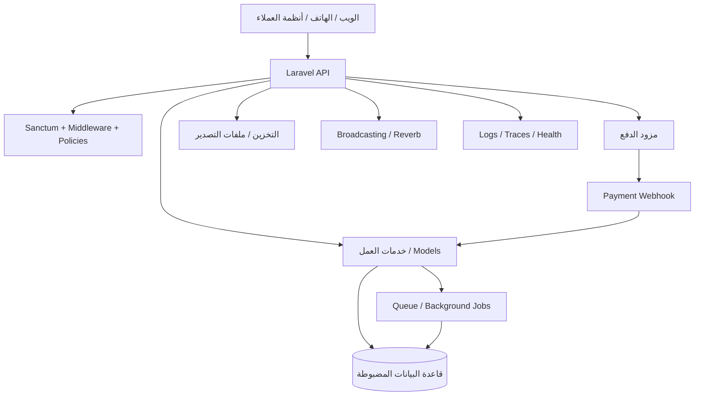
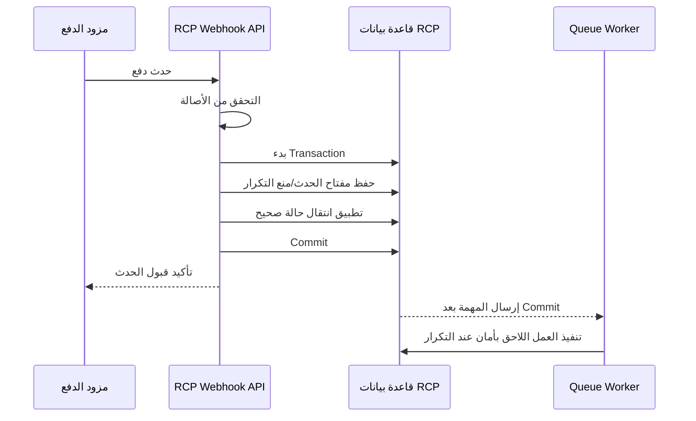
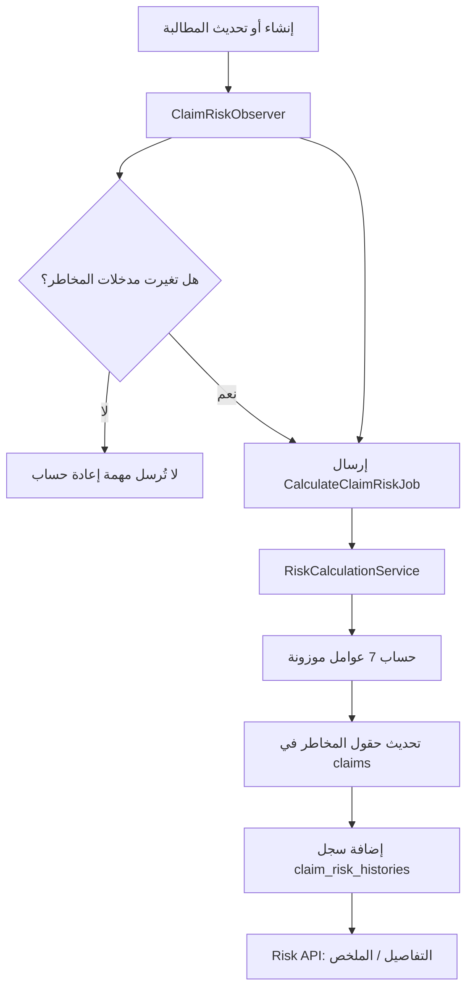

# دليل هندسة الحلول — مشروع RCP

**الفئة المستهدفة:** مطوّرو الـ Backend الذين يستعدون لتحمّل مسؤولية هندسة الحلول (Solution Architecture).  
**المستودع:** [AhmedRamadan03/rcp](https://github.com/AhmedRamadan03/rcp)  
**الفرع المرجعي للمراجعة:** `main` وقت إعداد الدليل.  
**الهدف:** فهم طريقة التفكير والعمل كمهندس حلول باستخدام مشروع RCP مثالًا عمليًا، مع توضيح بنية النظام، ومخاطر التصميم، وخطوات التعامل مع المهام المعمارية.

> **حدود المراجعة:** هذا الدليل يجمع بين شرح معماري ومراجعة أولية للكود. لا يعني ذلك أن كل سطر في المستودع أو إعدادات الإنتاج قد اختُبر بالكامل. سنميّز بين ما ظهر في الكود وبين الأمور التي تحتاج إلى تأكيد من بيئة التشغيل والفريق المسؤول.

---

## 1. ما دور مهندس الحلول فعلًا؟

مهندس الحلول يحوّل احتياج العمل إلى حل آمن وموثوق وقابل للصيانة والتوسع والمراقبة، وبتكلفة مناسبة. الدور ليس مجرد رسم مخططات أو اختيار تقنيات حديثة.

عند دراسة أي طلب مهم، يجب أن تجيب عن الأسئلة التالية:

1. **الهدف التجاري:** ما المشكلة التي نحلها؟ من المتأثر بها؟ وكيف سنقيس النجاح؟
2. **الوضع الحالي:** كيف يعمل النظام اليوم؟ وما المسارات البرمجية والبيانات والتكاملات والفرق المتأثرة؟
3. **البدائل:** ما التصميمات الواقعية التي يمكن أن تحقق الهدف؟ وما مزايا وعيوب كل منها؟
4. **القرار:** ما الخيار الموصى به؟ ولماذا؟ وما الافتراضات والمخاطر المتبقية؟
5. **خطة التنفيذ:** ما التعديلات المطلوبة في الكود وقاعدة البيانات والبنية التحتية والتشغيل والاختبارات؟ وهل يمكن إطلاقها تدريجيًا؟
6. **التحقق:** ما الأدلة التي تثبت أن الحل يعمل في ظروف قريبة من الإنتاج؟
7. **المسؤولية المستمرة:** من سيصون الحل ويراقبه ويتعامل مع الأعطال ويوثّق التغييرات المستقبلية؟

المهندس الجيد لا يختار Microservices أو Kubernetes أو Event Sourcing لمجرد أنها تقنيات مشهورة. الأفضل هو أبسط تصميم يحقق المتطلبات الفعلية، مع إبقاء التغيير المستقبلي آمنًا وممكنًا.

## 2. نظرة سريعة على RCP

مشروع RCP عبارة عن Backend مبني باستخدام Laravel ويقدم واجهات API. يحدد ملف `composer.json` في فرع `main` إصدار PHP `^8.4` وLaravel `^13.0`. كما تظهر حزم مرتبطة بـ Sanctum وReverb وإنشاء ملفات PDF والمستندات وExcel والتخزين على Google Cloud Storage وFFmpeg وOpenTelemetry.

توضح تعريفات المسارات وجود قدرات أساسية، منها:

- المصادقة والمسارات المحمية.
- تدفقات عرض معلومات المطالبة والتحقق باستخدام OTP وبعض طلبات المدين.
- إعادة التوجيه إلى الدفع واستقبال Webhooks الخاصة بالدفع.
- تقديم الملفات وتنزيل ملفات التصدير.
- البحث عن المدن واستقبال أخطاء العملاء.
- فحص الصحة (Health endpoint) ومسارات البث المحمية.
- مجموعات مسارات إضافية يتم تحميلها من `routes/api/clientapi.php` و`routes/api/base.php`.

يشمل سياق المشروع كذلك المطالبات، والمحصلين والمشرفين والأهداف، والصلاحيات، وتقييم المخاطر، والإشعارات، وتكاملات الدفع. يجب مطابقة كل قدرة مع الفرع وبيئة التشغيل الفعليين قبل اعتبارها جردًا رسميًا للنظام.

### أدلة ظاهرة في المستودع

| المجال | ما ظهر في الكود | الدلالة المعمارية |
|---|---|---|
| إطار العمل | `composer.json`: PHP ^8.4 وLaravel ^13.0 | التحديثات قد تؤثر في التوافق والنشر والاختبارات. |
| نقطة دخول API | `routes/api.php` | مجموعات المسارات والـ Middleware حدود أمنية مهمة. |
| المصادقة | استخدام Sanctum في مجموعات محمية ومسارات البث | إثبات هوية المستخدم لا يثبت وحده أن له صلاحية على المورد المطلوب. |
| الدفع | مسارات Webhook وإعادة التوجيه وروابط الدفع | يلزم التحقق من مصدر الحدث، ومنع التكرار، وضبط انتقال الحالات والمطابقة المالية. |
| الملفات | Middleware لتفويض بعض الملفات، ومسار تصدير يستخدم التخزين العام | يجب مراجعة التفويض، ومدة صلاحية الروابط، والتخزين الخاص، ومنع التلاعب بالمسارات. |
| قواعد البيانات | الإعداد يدعم MySQL وPostgreSQL وSQLite وSQL Server | وجود Driver لا يعني أن كل قاعدة مدعومة ومختبرة في الإنتاج. |
| Queue | الإعداد الافتراضي هو `sync` إذا لم تُحدّد قيمة أخرى | يجب التحقق من إعداد الإنتاج والعاملين وإعادة المحاولة والمهام الفاشلة وتوقيت التنفيذ بعد Commit. |
| البث المباشر | إعداد Reverb موجود، والافتراضي في إعداد البث `null` ما لم يتم تغييره | يجب التأكد من إعداد الإنتاج وصحة تفويض القنوات الخاصة. |
| المراقبة | وجود حزم OpenTelemetry ومسارات Health وأخطاء العميل | وجود الحزم وحده لا يثبت أن الـ Traces والـ Metrics والتنبيهات تعمل. |

## 3. التصور العام للنظام

المخطط التالي منطقي ومبني على إعدادات ومسارات المستودع، وليس إثباتًا لبنية النشر الفعلية.

عند إجراء مراجعة معمارية حقيقية، استبدل الصناديق العامة بأسماء المكونات والخدمات الفعلية، وحدد مكان تشغيل كل مكون، وحدود الثقة، ومسارات الشبكة، ومالك بيانات الاعتماد، وسلوك الفشل والمراقبة. لا تعرض مخططًا منطقيًا على أنه مخطط للبنية التحتية.

### مسار الطلب داخل التطبيق

1. يرسل العميل طلبًا إلى أحد مسارات API.
2. قد تتحقق الـ Middleware من هوية المستخدم أو تحد من معدل الطلبات أو تطبق قواعد عرض بيانات العميل أو قيود أول تسجيل دخول.
3. يستقبل Controller الطلب وينسق تنفيذ منطق العمل.
4. يقرأ منطق العمل البيانات أو يعدّلها، وقد يتواصل مع مزود خارجي أو يرسل مهمة إلى Queue.
5. يعيد API الاستجابة؛ وقد تنشر بعض التدفقات أحداثًا أو تنشئ ملفات قابلة للتنزيل.

تتبّع المسار الحقيقي لكل Endpoint مهم: Route ثم Middleware ثم Controller ثم Service/Action ثم Model أو قاعدة البيانات ثم التكامل الخارجي. لا تفترض أن كل المسارات تتبع طبقات موحدة دون فحصها.

## 4. مسؤوليات الطبقات وحدودها

استخدم هذا الجدول كمنظور للمراجعة، ولا تضف طبقة جديدة لمجرد أن الرسم المعماري يبدو أجمل.

| المكوّن | مسؤوليته | علامة تستدعي الانتباه |
|---|---|---|
| Routes / Middleware | تحديد نقاط الدخول وضوابط الطلب المشتركة | مسار حساس لا يمر عبر الحماية المطلوبة |
| Controller | استقبال المدخلات وتنسيق حالة الاستخدام وتجهيز الاستجابة | وجود قواعد عمل كبيرة أو انتقالات الدفع داخله |
| Request Validation | التحقق من شكل البيانات وأنواعها والقيود الأساسية | الخلط بين صحة المدخلات وصلاحية المستخدم |
| Policy / Permission Service | تحديد ما إذا كان الفاعل مسموحًا له بتنفيذ العملية على المورد | الاعتماد على الواجهة الأمامية أو اختلاف قواعد التفويض |
| Service / Use Case | تنسيق خطوات العمل وحدود المعاملات | تكرار القواعد في Controllers وJobs متعددة |
| Model / Persistence | تمثيل البيانات والعلاقات | آثار جانبية مخفية أو استعلامات مكلفة في أماكن غير متوقعة |
| Job / Event / Listener | تنفيذ العمل غير المتزامن والتفاعل مع الأحداث | إعادة محاولة غير آمنة أو فقد المهام أو تنفيذها قبل Commit |
| External Adapter | عزل بروتوكول المزود وأخطائه وTimeouts وتحويل البيانات | انتشار افتراضات مزود محدد في منطق العمل |
| Resource / Response Mapper | الحفاظ على عقد API مستقر | كشف أعمدة داخلية أو كسر العملاء دون إصدار جديد |
| Tests / Telemetry | التحقق من السلوك وإظهار حالة النظام في الإنتاج | الاكتفاء بنجاح الاختبارات دون حالات الفشل والتنبيهات |

## 5. موضوعات معمارية مهمة في RCP

### 5.1 عزل العملاء واستراتيجية قواعد البيانات

نموذج التشغيل الذي وصفه الفريق هو **قاعدة بيانات مستقلة لكل عميل (Database-per-client)**. يجب اعتبار ذلك قيدًا مهمًا، والتحقق من تنفيذه في الفرع المستهدف قبل إجراء أي تغيير.

في هذا النموذج يجب على مهندس الحلول تحديد:

- كيف يتم التعرف على العميل والتحقق من هويته؟
- كيف تُختار قاعدة البيانات الصحيحة لكل Request وJob وCommand ومهمة مجدولة وتصدير وحدث WebSocket؟
- أين تُخزّن بيانات الاتصال؟ وكيف يتم تدويرها وحمايتها؟
- كيف تمنع الـ Workers طويلة العمر تسرب اتصال عميل سابق إلى مهمة عميل آخر؟
- كيف تُطبّق الـ Migrations على كل قواعد العملاء، وتُراقب، ويُعاد تشغيلها أو التراجع عنها؟
- كيف تتم إضافة عميل جديد أو إيقافه أو النسخ الاحتياطي والاستعادة والحذف؟
- كيف يتم إعداد تقارير مشتركة دون تجاوز حدود العزل؟
- كيف تثبت الاختبارات أن العميل A لا يستطيع قراءة بيانات العميل B أو تعديلها؟

وجود `DB_CONNECTION` واحد في إعدادات Laravel لا يثبت وجود آلية Database-per-tenant. يجب العثور على آلية تحديد العميل وتغيير الاتصال الفعلية وفهم دورة حياتها.

**المفاضلة:** قاعدة مستقلة لكل عميل تعطي عزلًا أقوى وتحكمًا تشغيليًا لكل عميل، لكنها تزيد تعقيد الـ Migrations والاتصالات والمراقبة والتقارير. قاعدة مشتركة مع `tenant_id` قد تبسط التشغيل لكنها تتطلب ضبطًا صارمًا لنطاق كل استعلام ولها نموذج عزل مختلف. لا تنتقل بين النموذجين دون مبرر تجاري وتقدير تكلفة وخطة نقل وتراجع.

### 5.2 التفويض ونطاق الصلاحية

راجع سلسلة الوصول كاملة:

1. هل المستخدم مسجّل الدخول؟
2. هل لديه الصلاحية المطلوبة؟
3. هل تسمح الصلاحية بنطاق السجلات المطلوبة: سجلاته فقط، أو فريقه، أو كل السجلات؟
4. هل المورد تابع لقاعدة بيانات العميل الصحيحة؟
5. هل تسمح حالة العمل الحالية بتنفيذ العملية؟

وجود صلاحية مثل `show_claim` لا يكفي إن كان هناك نطاق للبيانات. يجب تطبيق النطاق داخل الاستعلام أو طبقة الوصول إلى البيانات، قبل جلب النتائج، وليس بعد جلبها كلها. راجع Policies والـ Helpers مثل فحوصات الموافقة (approval)، والمسارات والـ Jobs والتصدير وتنزيل الملفات. أضف اختبارات سلبية تثبت منع الوصول بين الفرق والعملاء.

### 5.3 تدفقات الدفع وWebhooks

قد يعيد مزود الدفع إرسال الحدث أكثر من مرة أو يرسله بترتيب غير متوقع. والعودة من صفحة الدفع لا تعني وحدها أن الدفع تم التحقق منه وتسويته.

راجع النقاط التالية:

- التحقق من أصالة الـ Webhook بآلية المزود الرسمية.
- جعل معالجة الحدث آمنة عند التكرار باستخدام معرّف ثابت للحدث أو الدفع، مع قيد فريد في قاعدة البيانات عند الحاجة.
- تعريف انتقالات واضحة لحالات الدفع ورفض الانتقالات غير الصحيحة.
- استخدام Transactions للتعديلات المحلية.
- التعامل مع الأحداث المكررة والمتأخرة وغير المرتبة.
- ضبط Timeouts للاتصالات الخارجية وإعادة المحاولة فقط للعمليات الآمنة.
- تسجيل Reference ID للربط بين الأنظمة دون تسجيل الأسرار أو بيانات الدفع الحساسة.
- مطابقة السجلات المحلية مع تقارير المزود أو واجهات الاستعلام عن الحالة.
- اختبار التزامن بين Redirect المتصفح وWebhook.
- توفير إجراء تشغيلي آمن للمدفوعات المعلقة أو غير المتطابقة.

### 5.4 موثوقية Queue والأحداث

الإعداد الافتراضي للـ Queue هو التنفيذ المتزامن `sync`. قد يغير الإنتاج ذلك عبر متغيرات البيئة؛ لذلك يجب فحص البيئة الفعلية بدل استنتاج السلوك من الإعداد الافتراضي.

وثّق لكل تدفق غير متزامن:

- ما الذي يطلقه؟ وهل يجب أن يحدث بعد Commit؟
- هل يمكن تنفيذ المهمة أكثر من مرة بأمان؟
- سياسة Retry وBackoff والحد الأقصى للمحاولات.
- Timeout وذاكرة العامل وأولوية الطابور.
- التنبيه عن المهام الفاشلة وإجراءات إعادة تشغيلها.
- هل ترتيب المهام مهم؟
- ماذا يحدث إذا تم Commit ثم فشل الإرسال إلى Queue، أو بدأت المهمة قبل Commit؟
- كيف يتم تمرير سياق العميل وتنظيفه في الـ Workers؟

لا تنقل العمل إلى Queue لمجرد تقليل حجم Controller. حدد أولًا ما يراه المستخدم: هل يجب أن تكون النتيجة فورية، أم يمكن أن تكون Eventually Consistent، أم نحتاج إلى حالة Pending واضحة؟

### 5.5 الملفات والتصدير

تحتوي المسارات على نقاط لتقديم الملفات مع Middleware للتفويض، وكذلك مسار تنزيل تصدير يستخدم التخزين العام. هذه أولوية للمراجعة لأن الملفات قد تحتوي بيانات شخصية أو مالية أو بيانات مطالبات.

تحقق من تخزين الملفات الحساسة بشكل خاص، وتفويض كل تنزيل للمستخدم والعميل الحاليين، ومنع تخمين أو تغيير مفاتيح الملفات إلى مسارات أخرى، وانتهاء صلاحية الروابط عند الحاجة، وتسجيل عمليات الوصول. لا تجعل الملف عامًا لمجرد أن عنوانه صعب التخمين.

### 5.6 تقييم المخاطر والحسابات الخلفية

في ميزة تقييم المخاطر، يجب تحويل سياسة العمل إلى قواعد موثقة وقابلة للاختبار، تشمل:

- المدخلات ومصادر البيانات وحداثتها والحد الأدنى لحجم العينة.
- المعادلة الدقيقة والأوزان والحدود وكيفية التعامل مع البيانات الناقصة.
- ما الذي يطلق إعادة الحساب وكيف نستبعد التعديلات غير المؤثرة؟
- هل الحساب متزامن أم غير متزامن؟
- كيف نتعامل مع تكرار الـ Jobs والتحديثات المتزامنة؟
- كيف نفسر النتيجة للمستخدم ونراجع تاريخها؟
- كيف نحتفظ بإصدار القواعد حتى تظل النتائج القديمة مفهومة؟
- كيف نحسب النتائج للسجلات القديمة ونراقب الفشل؟
- اختبارات الحدود والقيم الناقصة والبيانات القديمة وتكرار التنفيذ.

افصل قواعد العمل عن تفاصيل البنية التحتية قدر الإمكان. النتيجة الرقمية التي لا يمكن تفسيرها أو إعادة إنتاجها يصعب الوثوق بها.

### 5.7 عقود API والتوافق

عند تغيير API، وثّق شكل الطلب والاستجابة، والمصادقة والتفويض، والصفحات والفلاتر، وأكواد الأخطاء، ومنع التكرار وحدود معدل الطلبات. افحص المستهلكين الحقيقيين قبل تغيير حقل أو شكل استجابة.

فضّل التغييرات الإضافية المتوافقة. أما التغييرات الكاسرة، فحدد إصدارًا أو خطة إيقاف تدريجي، وموعد انتقال المستهلكين، وترتيب النشر وتاريخ إزالة السلوك القديم. يمكن لـ API Resources عزل عقد الاستجابة عن بنية قاعدة البيانات، لكن يجب التحقق من استخدامها واتساقها لكل Endpoint.

## 6. نتائج المراجعة المعمارية الأولية حسب الأولوية

هذه نقاط مراجعة استُنتجت من الملفات التي تم فحصها، وليست تأكيدًا على وقوع حوادث في الإنتاج.

### الأولوية P0 — الأمان وصحة السلوك

- [ ] مراجعة جميع مسارات الملفات والتصدير، خصوصًا تنزيل التصدير من التخزين العام.
- [ ] التحقق من توقيع/أصالة Webhook ومنع التكرار وصحة انتقالات الدفع.
- [ ] تتبّع المصادقة والـ Policies ونطاق الصلاحيات وعزل العملاء من البداية للنهاية.
- [ ] التأكد من أن المسارات العامة عامة عن قصد، وأن المسارات الحساسة عليها Rate Limiting مناسب.
- [ ] التأكد من عدم رفع الأسرار أو بيانات اتصال قواعد العملاء إلى Git أو السجلات.

### الأولوية P1 — موثوقية التشغيل

- [ ] التحقق من `QUEUE_CONNECTION` في الإنتاج، والـ Workers وإعادة المحاولة والـ Timeouts والتنبيه عن الفشل وسلوك After Commit.
- [ ] التحقق من أن إعداد البث في الإنتاج يختار Reverb عند الحاجة إلى التحديث الفوري.
- [ ] التأكد من التمييز بين فحص بقاء العملية حية وفحص جاهزية الاعتماديات عند الحاجة.
- [ ] إثبات أن OpenTelemetry يرسل بيانات مفيدة وأن لكل تنبيه مالكًا ودليل إجراءات.
- [ ] اختبار انقطاع المزود الخارجي والـ Timeouts والتعافي.

### الأولوية P2 — قابلية الصيانة والأداء

- [ ] رسم الوحدات التجارية الرئيسية واعتمادياتها.
- [ ] مراجعة الاستعلامات البطيئة وN+1 والقوائم غير المحدودة والفهارس ومدة الـ Transactions.
- [ ] التأكد من أن مفاتيح Cache تتضمن سياق العميل الصحيح وأن الإبطال يعمل.
- [ ] مراجعة التصدير الكبير ومعالجة الوسائط من ناحية الذاكرة والتخزين وضغط Queue.
- [ ] وضع تغطية اختبار للتدفقات التجارية الحرجة وعقود التكامل.
- [ ] التحقق من سياسة تحديث وأمان الاعتماديات وإصدارات PHP/Laravel في CI والإنتاج.

### الأولوية P3 — النضج التشغيلي

- [ ] توثيق إضافة العملاء والـ Migrations والنسخ الاحتياطي والاستعادة والتعافي من الكوارث.
- [ ] تحديد SLOs لتوافر API وزمن الاستجابة وصحة الدفع وتأخير Queue.
- [ ] إعداد لوحات لمعدل الأخطاء والـ Latency وعمق Queue والمهام الفاشلة وأخطاء المزود واستهلاك الموارد لكل عميل.
- [ ] توثيق الاستجابة للحوادث والتصعيد والتراجع وتجارب الاستعادة.
- [ ] تقدير التكلفة والسعة في الظروف العادية وأوقات الذروة.

## 7. كيف تتعامل مع مهمة معمارية خطوة بخطوة؟

استخدم هذا المسار مع كل Feature أو Ticket حقيقية.

### الخطوة 1 — توضيح المتطلبات

اكتب وصفًا مختصرًا للمشكلة ومعايير قبول واضحة. اسأل عن المستخدمين وحجم البيانات وزمن الاستجابة والتوافر وحساسية البيانات ومتطلبات التدقيق والنمو المتوقع والميزانية والموعد. سجّل الأمور المجهولة بدلًا من افتراضها.

**المخرج:** وصف المشكلة ومتطلبات غير وظيفية قابلة للقياس.

### الخطوة 2 — رسم التنفيذ الحالي

ابحث في Routes وMiddleware وControllers وServices وModels وPolicies وJobs وEvents وMigrations والعملاء الخارجيين والاختبارات. تتبّع المسار الكامل، بما فيه حالات الفشل. افحص إعدادات الإنتاج بأمان ولا تكشف بيانات الاعتماد.

**المخرج:** مخطط Sequence للحالة الحالية وقائمة بالمكونات المتأثرة.

### الخطوة 3 — تحديد القيود وأنماط الفشل

اكتب قيود عزل العملاء والعملاء القدامى وتوافق قواعد البيانات وسلوك المزود وحدود النشر ومخاطر نقل البيانات والمسؤولية التشغيلية. اسأل: ماذا يحدث إذا انتهت مهلة الاعتمادية أو أعادت الطلب أو نجح جزء من العملية فقط؟

**المخرج:** قائمة الافتراضات والقيود وأنماط الفشل.

### الخطوة 4 — مقارنة البدائل

قارن على الأقل التصميم الحالي مع أصغر تغيير آمن، ثم أي إعادة تصميم أكبر مطروحة. قيّم الأمان والصحة والأداء والتعقيد ومخاطر التسليم والتكلفة وإمكانية التراجع.

**المخرج:** جدول بدائل مع توصية ومفاضلات واضحة.

### الخطوة 5 — كتابة ADR

سجل قرارًا معماريًا مختصرًا يحتوي العنوان والحالة والسياق والقرار والبدائل والنتائج والمخاطر وخطة الإطلاق والتراجع. مثال: «ADR-00X: جعل معالجة Webhook الدفع آمنة عند التكرار». يجب أن يشرح السجل سبب القرار، لا أن يكتفي بوصف التغيير البرمجي.

**المخرج:** ADR يراجعه أصحاب العلاقة.

### الخطوة 6 — تقسيم القرار إلى أعمال تنفيذية

قسّم العمل إلى تغييرات API والكود، وتغييرات Schema، ونقل/تعبئة البيانات، وإعدادات البنية التحتية، ولوحات المراقبة والتنبيهات، والاختبارات والتوثيق وخطة الإطلاق. حدد الاعتماديات والمسؤولين وتجنب التعديلات غير المرتبطة.

**المخرج:** خطة تنفيذ مرتبة وقائمة قبول.

### الخطوة 7 — التنفيذ والتحقق تدريجيًا

استخدم Branch مخصصًا من الـ Baseline الصحيح، واجعل الـ Commits صغيرة. أضف Unit Tests للقواعد، وFeature Tests للـ API والأمان، وIntegration Tests لحدود قاعدة البيانات والمزود، واختبارات حمل وفشل عند الحاجة. راجع قفل الجداول والتوافق وإمكانية التراجع في الـ Migrations.

**المخرج:** Pull Request قابل للمراجعة وأدلة اختبار وملاحظات نشر.

### الخطوة 8 — إطلاق آمن

فضّل أسلوب Expand-and-Contract لتغييرات قاعدة البيانات التي تحتاج إلى توقف قليل أو دون توقف: أضف Schema متوافقًا، ثم انشر كودًا يدعم الشكل القديم والجديد، وانقل البيانات، وبدّل القراءة والكتابة، ثم احذف الشكل القديم في إصدار لاحق. استخدم Feature Flags أو Canary عند ملاءمتها.

**المخرج:** خطة إصدار وإشارات صحة ومحفز تراجع ومالك مسؤول.

### الخطوة 9 — التحقق بعد النشر

افحص Metrics وLogs الفعلية، لا نجاح عملية النشر فقط. قارن النتائج بمعايير القبول، وتحقق من الـ Jobs والتكاملات الخارجية وعزل العملاء، وسجّل الدروس وحدّث التوثيق.

**المخرج:** تقرير تحقق بعد النشر وإجراءات متابعة.

## 8. مثال تطبيقي: جعل تحديثات الدفع موثوقة

**المشكلة التجارية:** قد يعود المستخدم من مزود الدفع في نفس وقت وصول Webhook. يجب ألا يسجل النظام الدفع مرتين، أو يفقد عملية ناجحة، أو يعيد حالة نهائية إلى حالة أقدم.

**التدفق المقترح:**

هذا نمط مستهدف للدراسة، وليس ادعاءً بأن الكود الحالي ينفذ كل خطوة بالفعل.

**معايير القبول:**

- رفض التوقيعات غير الصحيحة.
- ألا ينتج عن تكرار الحدث الأثر التجاري نفسه مرتين.
- أن يصل الـ Redirect والـ Webhook إلى حالة نهائية صحيحة واحدة.
- رفض انتقالات الحالة غير المسموحة وتسجيلها.
- إمكانية إعادة المحاولة بعد الفشل المؤقت بأمان.
- قدرة فريق الدعم على العثور على الدفع باستخدام Reference ID.
- اكتشاف حالات عدم التطابق عبر المطابقة.
- اختبارات للتكرار والأحداث غير المرتبة وانقطاع المزود والتزامن.

**دور مهندس الحلول:** التحقق من ضمانات المزود، والاتفاق على آلة حالات الدفع، وتصميم القيود والمعاملات، ومراجعة التنفيذ، وتحديد المراقبة ودليل التشغيل، والحصول على موافقة العمل على سلوك المطابقة.

## 9. مثال تطبيقي: إضافة نطاق جديد للصلاحية

لنفترض أن RCP يحتاج إلى نطاقات مثل `onlyme` و`team` و`all`.

لا تنفّذ ذلك كفلتر في الواجهة الأمامية. عرّف عقد التفويض أولًا:

- كيف نحدد «أنا» و«فريقي» في كل وحدة عمل؟
- ماذا يحدث إذا لم يكن للمستخدم فريق أو كان عضوًا في أكثر من فريق؟
- هل يسري النطاق على القائمة والتفاصيل والتعديل والحذف والتصدير والملفات والـ Jobs؟
- كيف يتفاعل النطاق مع وضع الموافقة؟
- ما القيمة الافتراضية المتوافقة مع سجلات الصلاحيات القديمة؟
- كيف نضمن ألا يعيد الاستعلام سجلات قبل تطبيق النطاق؟

بعد ذلك، أعد استخدام القاعدة بشكل مركزي عند ملاءمة ذلك، وطبّق النطاق قبل Pagination، وأضف اختبارات للـ Policy والاستعلام، واختبارات تمنع الوصول بين الفرق والعملاء، ووثّق سلوك الترحيل والتعبئة. المخرج المعماري هو عقد موحد لكل مسارات الوصول، وليس مجرد مفتاح JSON جديد.

## 10. المستندات المعمارية التي ينبغي أن تتعلم إعدادها

| المستند | متى تحتاج إليه؟ | ما الذي يجب أن يحتويه؟ |
|---|---|---|
| مخططات C4: Context / Container / Component | نظام جديد أو تغيير كبير في الحدود | المستخدمون والمسؤوليات والاعتماديات وحدود الثقة |
| Sequence Diagram | تدفق متعدد الخطوات أو دفع أو OTP أو معالجة غير متزامنة | الترتيب والمسارات البديلة وإعادة المحاولة والفشل وحدود المعاملات |
| ADR | قرار له آثار طويلة المدى | السياق والخيارات والقرار والنتائج والحالة |
| نموذج البيانات وخطة Migration | تغييرات Schema أو عزل العملاء | الملكية والقيود والفهارس ونقل البيانات والتراجع |
| Threat Model | بيانات حساسة أو مصادقة أو ملفات أو تكاملات | الأصول وحدود الثقة والتهديدات والتخفيف والمخاطر المتبقية |
| تقدير السعة | تغيّر الحمل أو نمو البيانات | معدل الطلبات والتزامن والتخزين وقدرة Queue والهامش |
| عقد API | Endpoint جديد أو متغير | Schema والأخطاء والمصادقة والتوافق وتأثير المستهلك |
| Runbook | سلوك مهم في الإنتاج | الأعراض والتشخيص والتعافي والتصعيد والتراجع |
| استراتيجية الاختبار | أي ميزة مهمة | Unit وFeature وIntegration وContract وSecurity وLoad |
| خطة الإصدار | نشر عالي المخاطر | الترتيب وFeature Flags والمراقبة والتراجع والمسؤول |

## 11. خطة تعلم مقترحة خلال 30 / 60 / 90 يومًا

### الأيام 1–30: فهم RCP وتوثيقه

- تتبّع أهم 5 إلى 10 رحلات استخدام تجارية من البداية للنهاية.
- ارسم Routes وMiddleware والصلاحيات وملكية البيانات وآلية اختيار قاعدة العميل والتكاملات الخارجية.
- اقرأ الـ Migrations وافحص الفهارس للكيانات الأساسية.
- راجع إعدادات الإنتاج للـ Queue وBroadcasting والتخزين والنشر والمراقبة مع الفريق المسؤول.
- أنشئ مخطط Context/Container ومخطط Sequence واحدًا على الأقل.
- اكتب ADR لقرار حقيقي محدود النطاق.

### الأيام 31–60: قيادة تصميم محدود

- اختر تحسينًا حقيقيًا مثل موثوقية Webhook أو أمان التصدير أو Queue أو اختبار عزل العملاء.
- اجمع المتطلبات ومقاييس الوضع الحالي.
- قارن خيارين على الأقل ووثّق المفاضلات.
- اكتب مراجعة تهديدات وأنماط فشل وخطة تنفيذ.
- راجع Pull Requests وأدلة الاختبار مع الفريق.
- تحقق من لوحات المراقبة وخطوات التراجع.

### الأيام 61–90: امتلاك نتيجة معمارية كاملة

- قد ميزة متوسطة الحجم من جمع المتطلبات إلى التحقق في الإنتاج.
- أدر جلسة مراجعة تصميم وسجّل القرارات والمخاطر.
- حدد SLOs والملكية التشغيلية للتدفق.
- اعرض النتائج قبل/بعد بأدلة مثل معدل الفشل أو زمن الاستجابة أو حوادث الدعم أو التكلفة أو وقت التسليم.
- أنشئ خارطة تحسينات تالية حسب المخاطر المقاسة، لا حسب رواج التقنيات.

## 12. قائمة مراجعة التصميم قبل الموافقة

- [ ] هل يحل التصميم المشكلة التجارية المحددة؟
- [ ] هل المتطلبات الوظيفية وغير الوظيفية قابلة للقياس؟
- [ ] هل حدود الثقة والمصادقة والتفويض واضحة؟
- [ ] هل عزل العميل/قاعدة البيانات محفوظ في HTTP والـ Jobs والتصدير والبث؟
- [ ] هل تم التعامل مع Transactions وإعادة المحاولة ومنع التكرار والتزامن؟
- [ ] هل تغييرات API وقاعدة البيانات متوافقة أو ستُطلق تدريجيًا بأمان؟
- [ ] ماذا يحدث عند فشل كل اعتماد خارجي؟
- [ ] هل الأداء مفهوم عند الحمل المتوقع وحمل الذروة؟
- [ ] هل توجد Logs وMetrics وTraces وتنبيهات وRunbook؟
- [ ] هل يمكن اختبار التغيير ونشره والتراجع عنه ودعمه؟
- [ ] هل التكلفة والتعقيد والعبء التشغيلي مبررة؟
- [ ] هل القرار موثق وله مسؤول محدد؟

## 13. كيفية استخدام هذا الدليل

تعامل معه كمستند حي. عند التحقق من أي جزء من الكود وإعدادات الإنتاج:

1. استبدل المخططات العامة بأسماء المكونات الفعلية.
2. أضف روابط للـ Route والـ Class والـ Migration والـ Job والاختبار.
3. صنّف كل نتيجة: **تم التحقق (Verified)** أو **تحتاج إلى تحقق (Needs verification)** أو **تحتاج إلى قرار (Decision required)**.
4. أضف ADR للقرارات المهمة.
5. افصل التوصيات عن السلوك الموجود بالفعل.
6. راجع الدليل بعد التغييرات المعمارية المهمة.

---

# تحديث المراجعة الخاصة بالمستودع — 12 أكتوبر 2026

هذا القسم يضيف نتائج أكثر تحديدًا من قائمة المراجعة العامة. تمت مراجعة فرع `main` عند Commit:

`0c1ed664c3273ac8f7c84599cdf594e9bf136593`

فرع هذا الدليل مخصص للتوثيق فقط، ولا ينبغي اعتباره إصلاحًا برمجيًا أو دمجه على أنه يعالج المخاطر المذكورة.

## 14. جرد المستودع وحدود المراجعة

يحتوي Git tree المتكرر لفرع `main` على **1,520 مسارًا متتبعًا**، منها 1,270 ملف PHP و195 ملف Migration و39 Seeder، إضافة إلى الإعدادات والمسارات والاختبارات وسير عمل النشر والتوثيق وملفات اللغات والأصول الثابتة والقوالب.

أهم المناطق التي تم تحديدها:

- `app/Http/Controllers`: عدد 78 ملفًا.
- `app/Models`: عدد 62 ملفًا.
- `app/Services`: عدد 81 ملفًا.
- `app/Jobs`: عدد 31 ملفًا.
- `app/Policies`: عدد 43 ملفًا.
- `app/Http/Middleware`: عدد 21 ملفًا.
- `app/Http/Requests`: عدد 72 ملفًا.
- `app/Http/Resources`: عدد 40 ملفًا.
- `database/migrations`: عدد 195 ملفًا.
- `database/seeders`: عدد 39 ملفًا.
- `routes`: عدد 28 ملفًا.
- `config`: عدد 20 ملفًا.
- `tests`: عدد 19 ملفًا متتبعًا.
- `.github/workflows`: عدد 8 ملفات.

**حدود الأدلة:** يشمل الجرد كل المسارات المتتبعة، وركز فحص التنفيذ على نقاط الدخول المعمارية والمسارات الحساسة المشتركة: Routes والمصادقة والـ Policies وPartner API وWebhook الدفع ومطابقة الحالة والملفات وإعدادات Queue وتقييم المخاطر ونموذج/خدمة المطالبة والـ Migrations والاختبارات والنشر والمراقبة. لم تتم مراجعة كل سطر يدويًا في كل Controller قديم أو ملف لغة أو أصل ثابت أو Migration. كما لم يتم تشغيل المشروع عبر موصل GitHub؛ ولم تُشغّل PHPUnit محليًا، ولم تُفحص إعدادات الإنتاج الفعلية، ولم تُنفذ اختبارات اختراق أو حمل أو اختبارات مباشرة مع مزودي الخدمة. لذلك تُعرض النقاط التالية كأدلة ومخاطر تحتاج إلى تحقق، لا كشهادة بأن الإنتاج مخترق أو معطّل.

## 15. بنية RCP الفعلية وحدود التشغيل

### 15.1 إطار العمل وشكل التطبيق

- يحدد `composer.json` PHP `^8.4` وLaravel `^13.0`.
- التطبيق **Modular Monolith** مبني بـ Laravel، ويحتوي على API V1 وEloquent Models وControllers وServices/Actions وPolicies وJobs/Events/Listeners وتكاملات خارجية. لم يظهر في إعدادات التشغيل التي تمت مراجعتها دليل على تقسيم التطبيق كله إلى Microservices مستقلة النشر.
- يوجد حد خدمة منفصل للدفع يُستدعى عبر HTTP من خلال `PaymentMicroservice`. وتوجد تكاملات أخرى مثل ELM وSMS وIVR/Maqsam والبريد وGoogle Cloud Storage وأدوات PDF وExcel والمتصفح.
- يحتوي المستودع على API وكذلك Views مبنية بـ Blade/Livewire أو مستخدمة في PDF والبريد؛ لذا فهو ليس مستودع API فقط بالمعنى الحرفي.
- نقطة دخول المسارات هي `routes/api.php`، ويضم `routes/api/clientapi.php` و`routes/api/base.php`. تحتوي الأخيرة على مجموعات التطبيق المحمية. وتستخدم مسارات Broadcasting مصادقة Sanctum.
- توجد نسخ نشر لـ ART وGIG وRCP، ويختار سير النشر الأسرار ومجلدات النشر حسب البيئة/العلامة.

### 15.2 نموذج العميل — فرق يجب عدم الخلط بينها

يحتوي التطبيق على حقول وعلاقات `client_id`، كما يخزن نموذج بيانات اعتماد Partner API قيمة `client_id`. لكن إعداد قاعدة البيانات الذي تمت مراجعته يختار اتصالًا افتراضيًا عبر `DB_CONNECTION`، ولم تظهر في مسار الإقلاع والإعدادات التي فُحصت آلية لتغيير الاتصال ديناميكيًا مع كل Request. كما يذكر تعليق في فلترة مطالبات Partner API أن نطاق العميل أُزيل لأن قاعدة البيانات أحادية العميل.

قيد التشغيل الذي وصفه الفريق هو **قاعدة بيانات/نشر مستقل لكل عميل**. لذلك الوصف الدقيق حاليًا هو **عزل على مستوى النشر وقاعدة البيانات لكل عميل**، وليس وجود آلية مثبتة لتبديل قاعدة البيانات لكل Tenant داخل عملية Laravel مشتركة. يجب تأكيد ذلك من أسرار النشر وعناوين قواعد البيانات الفعلية وجرد البنية التحتية.

**النتيجة المعمارية:** قد تكون الاستعلامات التي لا تضيف فلتر `client_id` آمنة فقط إذا كان كل تطبيق منشور يصل إلى قاعدة بيانات عميل واحد لا غير. إذا أصبحت قاعدة البيانات أو مخزن بيانات الاعتماد مشتركًا مستقبلًا، فيجب إضافة نطاق العميل إلى الاستعلامات ونقاط إدارة الاعتماد قبل اعتماد هذا التصميم.

### 15.3 القدرات التجارية الرئيسية

| القدرة | مناطق التنفيذ الأساسية | أسئلة المراجعة المعمارية |
|---|---|---|
| دورة حياة المطالبة | `ClaimController` و`ClaimInfoController` و`ClaimService` وResolvers وActions وسجلات التاريخ | اتساق الحالات والموافقات والتزامن والتدقيق والصلاحيات وظهور السجلات |
| الاستيراد والعمليات الجماعية | خدمات/Actions الاستيراد وJobs وFailed Imports وCommands | التعامل مع النجاح الجزئي ومنع التكرار وحجم الدفعات وإعادة المحاولة والتعافي |
| الدفع والأقساط | Controllers وActions وخدمة بوابة الدفع وخدمة الدفع المنفصلة | أصالة Webhook والمطابقة وانتقالات الحالة والتكرار والتعافي |
| صلاحيات المستخدمين | Seeder وPermissionService وHelpers وPolicies وMiddleware | اتساق المنح ونطاق البيانات والموافقة والتوافق مع السجلات القديمة |
| Partner API | المصادقة والاعتمادات وRoutes وخدمات تحديث المطالبات | تدوير الأسرار والإلغاء وحدود العميل ورسائل الأخطاء |
| الملفات والتصدير | Middleware للتفويض وخدمات التخزين وJobs التصدير | الخصوصية والروابط ومسارات الملفات والذاكرة والاحتفاظ |
| تقييم المخاطر | Observer وJob وRiskCalculationService وController وHistory | صحة المعادلة والتوقيت والتفسير والتاريخ والتغطية الاختبارية |
| الإشعارات والاتصالات | Broadcasting وSMS وIVR والبريد | التسليم وإعادة المحاولة والخصوصية ومراقبة المزود |
| التقارير | Controllers وServices واستعلامات التجميع | نطاق الصلاحيات والفهارس والتجميع وزمن الاستجابة |
| التشغيل والمراقبة | Health وOpenTelemetry وDashboards وWorkflows | إثبات الإعداد الفعلي والتنبيهات والـ Runbooks |

## 16. النتائج التفصيلية للمراجعة

### النتيجة A — مسار تنزيل التصدير يحتاج مراجعة أمنية عاجلة

**الدليل:** يوجد في `routes/api.php` مسار `GET /v1/download-export/exports/{file?}` لا يظهر عليه Middleware واضح للمصادقة أو التفويض على الملف، ويجمع قيمة المسار مع `storage_path('app/public/exports/'.$file)`.

**الخطر المحتمل:** كشف ملفات حساسة أو التلاعب بالمسار للوصول إلى ملفات خارج المجلد المقصود. هذا احتمال مستند إلى شكل الكود، وليس إثباتًا لاستغلال حدث في الإنتاج.

**المطلوب:** اجعل التخزين خاصًا للملفات الحساسة، واستخدم معرفًا داخليًا أو مسارًا آمنًا لا يقبل Traversal، وتحقق من هوية المستخدم وصلاحيته وملكية الملف/العميل، وأضف اختبارات تمنع الوصول غير المصرح به ومحاولات المسارات المتلاعب بها.

### النتيجة B — Webhook الدفع لا يُظهر تحققًا من هوية المرسل

**الدليل:** يتحقق `PaymentWebhookController::webhook()` من وجود `event` و`charge_id` و`status`، ثم يستخدم `TransactionStatusEnquiryAction` للاستعلام عن الحالة. لم يظهر في المسار الذي تمت مراجعته تحقق من توقيع المرسل أو آلية مصادقة للـ Webhook نفسه.

**الخطر المحتمل:** يستطيع طرف غير موثوق محاولة إرسال أحداث إلى Endpoint عام. الاستعلام عن الحالة من المزود يساعد على عدم الاعتماد على قيمة الحالة الواردة وحدها، لكنه لا يغني عن حماية نقطة الدخول.

**المطلوب:** طبّق آلية التحقق الرسمية التي يدعمها المزود، واجعل المعالجة Idempotent، وحدد انتقالات الحالة المسموحة، واختبر التكرار والأحداث المزيفة والقديمة.

### النتيجة C — إعادة حساب المخاطر يدويًا قد تعاني من عدم تطابق Model Binding والتفويض

**الدليل:** يوجد مسار لإعادة الحساب باستخدام `{claimId}` في `routes/api/claims.php` بينما تستقبل الدالة `recalculate(Claim $claim)`، وهو اختلاف قد يمنع Implicit Route Model Binding من العمل كما هو متوقع. كما يظهر `auth:sanctum` دون نفس فحص `visibleTo` المستخدم في مسار التفاصيل.

**الخطر المحتمل:** تعطل المسار أو السماح لمستخدم موثّق بإعادة حساب مطالبة لا يحق له الوصول إليها.

**المطلوب:** توحيد اسم معامل المسار مع اسم المتغير أو استخدام Binding صريح، والتحقق من صلاحية المستخدم وظهور المطالبة له قبل إعادة الحساب، وإضافة اختبارات للمسار وللوصول بين المستخدمين.

### النتيجة D — مكوّن مخاطر المدينة ثابت، وبعض تفاصيل التاريخ تحتاج ضبطًا

**الدليل:** تُرجع `RiskCalculationService::calculateCityRiskScore()` القيمة الثابتة 30. كما يعتمد مكوّن مخاطر العميل على سجلات مرفوضة/ملغاة ولا يشمل المغلقة، بينما يستخدم تاريخ المدين رقم الهوية `debtor_nid` وقد يؤدي غيابه إلى تجميع سجلات لا تخص الشخص نفسه إذا لم يُعالج صراحة.

**الخطر المحتمل:** ظهور تقييم دقيق ظاهريًا دون أن يعكس مخاطر المدينة فعليًا، أو إنتاج تاريخ مضلل عند غياب معرّف المدين. النتيجة الحالية Heuristic مبنية على قواعد، وليست احتمالًا إحصائيًا مثبتًا للخسارة.

**المطلوب:** اعتماد قاعدة تجارية موثقة لمخاطر المدينة والحد الأدنى للعينة والحالات الداخلة في الحساب، ومعالجة الهوية الناقصة دون خلط السجلات، وتغطية الحدود باختبارات حتمية.

### النتيجة E — Observer وJob يحتاجان سياقًا واضحًا للمصدر والفاعل وتوقيت التنفيذ

**الدليل:** يرسل `ClaimRiskObserver` مهمة عند الإنشاء وعند تغيير حقول المخاطر. لكن إنشاء سجل التاريخ مرتبط بحدث `updated`، ولا يظهر تمييز كامل بين إعادة الحساب اليدوية والنظامية. كما قد ترجع `auth()->id()` بقيمة null في عمليات CLI أو الاستيراد أو المهام الخلفية.

**الخطر المحتمل:** صعوبة معرفة سبب حساب النتيجة أو من بدأه، وعدم اكتمال بيانات التدقيق. وقد تبدأ المهمة قبل Commit بحسب إعداد Queue.

**المطلوب:** تمرير مصدر العملية وهوية الفاعل صراحة، مع تمييز المستخدم عن النظام، وضمان التنفيذ بعد Commit أو استخدام نمط Transactional Outbox مناسب، وجعل التكرار آمنًا، واختبار الإنشاء والتحديث اليدوي والاستيراد وArtisan. قرر أيضًا متى يجب إنشاء سجل تاريخ إذا لم تتغير مدخلات المخاطر.

### النتيجة F — موثوقية Queue تعتمد على إعداد البيئة

**الدليل:** القيمة الافتراضية في `config/queue.php` هي `sync` إذا لم يتم تحديد `QUEUE_CONNECTION`. إعدادا Database وRedis يحددان `after_commit => false`، كما يضع `.env.example` القيمة `sync`. تطبيق `ShouldQueue` في Jobs لا يثبت أن Worker حقيقي يعمل في الإنتاج.

**الخطر المحتمل:** تنفيذ العمل الثقيل ضمن زمن استجابة الطلب، أو تشغيل Job قبل Commit، أو تراكم مهام فاشلة دون تنبيه.

**المطلوب:** افحص أسرار كل بيئة وإعدادات Supervisor/Cron دون نشر الأسرار في التذاكر أو السجلات، واضبط After Commit بوضوح، وحدد Retry وBackoff وTimeout وتنبيهات الفشل وإعادة التشغيل، واختبر السلوك باستخدام Driver الإنتاج.

### النتيجة G — الصلاحيات الحالية تعتمد على JSON قديم وفحوصات متفرقة؛ نطاقات all/onlyme/team ليست مطبقة في main

**الدليل:** يعرّف `GeneralPermissionSeeder` مفاتيح الصلاحيات و`permission_mode` مثل `with_approve`، لكنه لا يعرّف نطاقات `all` و`onlyme` و`team`. يحول `PermissionService` بيانات الطلب إلى JSON لكل فئة ويحافظ على مفاتيح النمط المعرّفة. ويدعم `get_permission_value()` القيم القديمة المفردة والقيم المنظمة. أما `custom_policy()` فتعيد القيمة المنطقية المقدمة دون إضافة منطق. تعتمد بعض عمليات الوصول على Middleware للمسار بدل إعادة فحص الظهور داخل كل دالة.

**الخطر المحتمل:** إضافة `scope` إلى Seeder وحده لن تطبق النطاق. قد تخفي الواجهة الأزرار بينما تعيد API سجلات أوسع من المطلوب، أو تحمي القائمة وتترك التفاصيل والتصدير والملفات والـ Jobs دون حماية متسقة. كما تمثل قيم JSON القديمة مشكلة توافق وترحيل.

**المطلوب:** تعريف عقد موحد لـ `granted` ووضع الموافقة والنطاق، وتحديد القيمة الآمنة للسجلات القديمة، وتطبيق النطاق قبل Pagination والتجميع، وتوحيد القاعدة في التفاصيل والتعديل والتصدير والملفات والمهام الخلفية، وإضافة اختبارات سلبية لـ own/team/all ومنع الوصول بين العملاء. منح الصلاحية لا يعني أن العملية حصلت على الموافقة التجارية تلقائيًا.

### النتيجة H — بيانات اعتماد Partner API لا تنتهي تلقائيًا، ونطاق العميل مرتبط بطريقة النشر

**الدليل:** يتحقق `AuthenticatePartnerApi` من `X-Client-Id` و`X-Client-Secret` وحالة التفعيل والـ Hash، وتُعاد أخطاء المصادقة بشكل عام. يخفي نموذج `PartnerApiCredential` الـ Hash، وتُعرض القيمة السرية الخام مرة عند الإنشاء ثم يُخزن الـ Hash فقط. توضح ملاحظات Controller أن بيانات الاعتماد لا تنتهي تلقائيًا. كما لا يظهر فلتر `client_id` في بعض استعلامات إدارة الاعتماد أو مطالبات Partner API التي تمت مراجعتها، مع وجود تعليق يفترض قاعدة بيانات أحادية العميل.

**الخطر المحتمل:** يعتمد العزل على افتراض أن كل قاعدة منشورة تخص عميلًا واحدًا. إذا تغير النموذج إلى قاعدة مشتركة، قد تتداخل إدارة الاعتمادات أو بيانات الشريك. كما يزيد بقاء السر طويلًا من أثر تسريبه.

**المطلوب:** توثيق قاعدة «عميل واحد لكل قاعدة بيانات» كشرط نشر، والتأكد من أن بيانات الاتصال والأسرار منفصلة لكل عميل، واختبار الإلغاء والتدوير، ودراسة سياسة انتهاء الصلاحية، وإضافة نطاق العميل قبل مشاركة قاعدة البيانات أو العملية بين العملاء. راجع كذلك احتمال كشف رسائل استثناء حساسة في استجابات API الجماعية.

### النتيجة I — سياسات التفويض تحتاج إلى مصفوفة تغطية واختبارات سلبية

**الدليل:** تعيد `ClaimPolicy::viewAny()` القيمة true، بينما يُتوقع تقييد ظهور القائمة داخل Services أو الاستعلامات. تمزج `ClaimPolicy` بين فحص JSON للصلاحيات وفحص ظهور المورد، وتعتمد بعض العمليات على Middleware في المسار. كما تحتوي بعض دوال `PermissionPolicy` على `true` مع تعليق فحص الصلاحية السابق. قد يكون ذلك مقصودًا إذا كانت هناك حماية أعلى مستوى، لكن الدالة نفسها لا تثبت وجودها.

**الخطر المحتمل:** إضافة Route دون نطاق الاستعلام أو فحص Policy مناسب قد تكشف قائمة أو تسمح بتعديل غير متوقع. اختبارات الأدوار المسموح لها فقط لن تكشف هذه الحالات.

**المطلوب:** إنشاء مصفوفة Route-to-Policy، واختبار المسارات الحساسة كمستخدم مجهول ومنخفض الصلاحية ومن الفريق نفسه ومن فريق آخر ومن عميل آخر، والتحقق من أن التصدير والـ Jobs يحافظان على نطاق المستخدم الأصلي. لا تحذف منطقًا قديمًا معلقًا قبل تأكيد السلوك المقصود مع مالك العمل.

### النتيجة J — ملخص المخاطر يكرر عمليات التجميع

**الدليل:** ينفذ `RiskController::summary()` استعلامات إجمالي أكثر من مرة، ثم عمليات عد منفصلة للمستويات High/Medium/Low ومتوسط النتيجة. يبدأ من `Claim::visibleTo($user)`، وهي نقطة جيدة للحفاظ على نطاق الظهور.

**الخطر المحتمل:** تزداد تكلفة الملخص مع نمو قاعدة البيانات وتكرار الفلاتر. لا يعني ذلك أنه يمثل عنق زجاجة حاليًا؛ يجب قياسه أولًا.

**المطلوب:** عمل Profiling ببيانات قريبة من الإنتاج، واستخدام Aggregate واحد أو Conditional Aggregates عند دعم قاعدة البيانات، وفحص الفهارس وخطة الاستعلام، مع الحفاظ على فلاتر الصلاحيات ودلالات النسب كما هي.

### النتيجة K — وجود توثيق للمراقبة لا يثبت أن المراقبة تعمل في الإنتاج

**الدليل:** يحتوي المستودع على `bootstrap/otel.php` و`bootstrap/otel-env.php` و`EnrichTraceContext` ومسارات Health/Client Error وتوثيق لوحات وتنبيهات SigNoz. يشير التوثيق إلى ضرورة ضبط متغيرات OpenTelemetry قبل Composer Autoload، وتفعيل التتبع للـ CLI Jobs/Commands. وتستخدم ملفات النشر أسرارًا وأسماء خدمات مختلفة حسب البيئة.

**الخطر المحتمل:** قد يكون الكود والـ Dashboards موجودين بينما التتبع متوقف أو لا يشمل العمال أو يرسل إلى خدمة خاطئة. ومسار Health موصوف كفحص Liveness، وليس بالضرورة فحص جاهزية كاملًا.

**المطلوب:** مراجعة إعدادات النشر الفعلية مع مسؤول التشغيل، وإثبات وجود Traces لطلبات HTTP وPDO والاتصالات الخارجية والـ Jobs والـ Scheduler، وإطلاق تنبيه تجريبي آمن، وحصر مستقبل OTLP غير المصادق عليه داخل الشبكة الداخلية، وتحديد مالك التنبيه ودليل الإجراء وسياسة الاحتفاظ بالبيانات.

## 17. مراجعة النشر وخط التسليم

يبدأ Workflow الخاص بـ RCP UAT عند الدفع إلى فرع `uat`، ويجري Checkout للمستودع، ويتحقق من GCP عبر Workload Identity، ويتصل بآلة افتراضية عبر IAP، ثم يجلب الفرع المحدد ويعيد ضبط نسخة النشر، ويشغّل `composer install`، ويحمل البيئة من Secret Manager، ويمسح الإعدادات المخبأة، وينفذ `php artisan migrate --force`، ويشغّل Seeders محددة، ثم يحسّن Laravel ويعيد تشغيل عمال Supervisor.

الدلالات المعمارية:

1. لا تظهر خطوة PHPUnit في Workflow النشر الذي تمت مراجعته قبل الـ Migration والنشر. قد توجد منظومة CI منفصلة خارج الملفات المتتبعة، لكن هذا الـ Workflow وحده لا يثبت أن النشر مشروط بنجاح الاختبارات.
2. تُشغّل الـ Migrations تلقائيًا أثناء النشر؛ لذا يجب مراجعة القفل والتوافق مع الإصدار السابق، والتخطيط للتراجع قبل النشر.
3. يُشغّل Seeder الخاص بالصلاحيات وSeeder الخاص بمتغيرات الرسائل في UAT. يجب أن تكون الـ Seeders آمنة عند تكرار التشغيل وألا تفسد البيانات الموجودة.
4. ينفذ الـ Workflow إعادة ضبط قسرية لنسخة النشر، بينما يظل `git clean -fd` معلقًا. يجب معرفة الملفات غير المتتبعة المتوقع بقاؤها والتأكد من عدم الكتابة فوق إعدادات أو أسرار.
5. تستخدم ملفات Workflow إصدارات رئيسية مثبتة من GitHub Actions، وليس بالضرورة Commit SHAs ثابتة. طبّق سياسة أمن سلسلة التوريد المعتمدة.
6. يثبت `php.DockerFile` امتدادات PHP وNode وChromium/Chrome ويبني الأصول، لكن `docker-compose.yml` المعروض يعرّف خدمة PHP فقط. لا تخلط بين إعداد Docker وبين بنية النشر على الـ VM.
7. اختبر التراجع والتعافي عمليًا؛ فقد لا يمكن عكس Migration بعد كتابة بيانات جديدة، وقد لا يعيد نشر الكود القديم اتساق البيانات.

**بوابة إصدار موصى بها:** اختبارات Unit/Feature آلية ← فحوصات Static Analysis/Formatting ← فحص الاعتماديات والأمان ← مراجعة Migration أو تجربة توافق ← موافقة ← نشر ← Smoke Tests ← التحقق من المراقبة. يجب تحديد محفز التراجع ومالك الإصدار في الإنتاج.

## 18. تقييم المخاطر — السلوك الحالي الظاهر في main

### عقد الحساب الحالي

تستخدم الخدمة سبعة مكونات مجموع أوزانها 100%:

| العامل | الوزن | السلوك الحالي |
|---|---:|---|
| نوع المطالبة | 15% | فردي 20؛ شركة 40؛ تأجير 35؛ حكومي 25؛ بلدية 30؛ افتراضي 10 |
| قيمة المطالبة | 20% | 100,000 فأكثر: 100؛ 50,000 فأكثر: 80؛ 20,000 فأكثر: 60؛ 10,000 فأكثر: 40؛ 5,000 فأكثر: 25؛ أقل من ذلك: 10 |
| عمر الحادث | 15% | التاريخ غير موجود: 50؛ أكثر من 24 شهرًا: 90؛ أكثر من 12: 70؛ أكثر من 6: 40؛ أكثر من 3: 20؛ غير ذلك: 10 |
| تاريخ مطالبات المدين | 15% | عدد المطالبات السابقة ×10، بالإضافة إلى المرفوضة/الملغاة/المغلقة/المحصلة يدويًا ×20، بحد أقصى 100 |
| نوع المدين | 20% | طرف ثالث 80؛ مؤمّن عليه 20؛ افتراضي 50 |
| مخاطر المدينة | 10% | **قيمة ثابتة 30 كحل مؤقت** |
| مخاطر العميل | 5% | العميل غير موجود: 30؛ وإلا نسبة المرفوضة/الملغاة ×2 وبحد أقصى 100 |

يُحسب المجموع المرجح بضرب درجة كل عامل في وزنه وقسمة الناتج على 100، ثم التقريب إلى منزلتين عشريتين ووضع حد أقصى 100. المستويات هي **High عند 70 فأكثر**، و**Medium من 30 إلى أقل من 70**، و**Low لأقل من 30**. تُشتق الألوان والتسميات من المستوى. تُحفظ النتيجة في جدول `claims`، وتُحفظ تفاصيل العوامل كـ JSON، وينشأ سجل تاريخ لكل عملية حساب.

### محفز الحساب ومسار البيانات

هذا هو المسار المقصود الذي ظهر من الكود مع التحفظات المذكورة بشأن Queue ومصدر المحفز وتوقيت المعاملة. يرسل Observer مهمة عند الإنشاء وعند تغيير حقول مثل المبلغ والنوع ونوع المدين وتاريخ الحادث والحالة والمدينة والرقم القومي للمدين ورقم المطالبة ومعرّف العميل.

### واجهة API والقيود التشغيلية

- تعيد تفاصيل المخاطر الدرجة والمستوى واللون والتسمية وتفاصيل العوامل ووقت الحساب والتاريخ.
- يعيد الملخص عدد المطالبات الظاهرة للمستخدم والتوزيع حسب المستوى ومتوسط الدرجة ونسبة المخاطر العالية.
- توجد إعادة حساب يدوية في المسار/Controller، لكن يوجد اختلاف محتمل في اسم Route Model Binding ولا يظهر نفس فحص ظهور المورد المستخدم في التفاصيل.
- تنشئ Migration الخاصة بالمخاطر حقل `risk_score` بقيمة افتراضية 0، وحقل `risk_factors`، وحقل `risk_calculated_at`، وفهرسًا للدرجة وجدول `claim_risk_histories` مفهرسًا بالمطالبة وتاريخ الإنشاء.
- لا يحتوي جرد الاختبارات المتتبعة في `main` على ملف مخصص لاختبارات حساب المخاطر. لا تقل إن الميزة مغطاة باختبارات ناجحة على هذا الفرع دون إضافة الاختبارات وتشغيلها.
- تقول تسمية المخاطر العالية «مراجعة إلزامية»، لكن لم يظهر في مسار Controller/Service الذي تمت مراجعته فرض آلي لموافقة أو Workflow. اعتبرها تسمية عرض حتى تُنفذ القاعدة التجارية وتُختبر.
- الدرجة الحالية نموذج قواعد Heuristic، وليست احتمالًا معايرًا أو توقعًا إحصائيًا أو مقياس خسارة مثبتًا بشكل مستقل.

### الحد الأدنى لاختبارات القبول

- اختبار كل حد في العوامل: القيمة الأقل مباشرة، والقيمة عند الحد، والقيمة الأعلى مباشرة.
- مدينة أو عميل أو تاريخ حادث أو رقم قومي للمدين غير موجود.
- حد حجم العينة للمدينة والحالات الداخلة في الحساب بعد اعتماد القاعدة.
- درجة العميل مع صفر مطالبة ومطالبة واحدة وسجلات مرفوضة/ملغاة/مغلقة.
- تكرار الحساب والمهام المتزامنة.
- الإنشاء والتحديث المؤثر وغير المؤثر وإعادة الحساب اليدوية وتغيير الحالة.
- إسناد الفاعل في HTTP والاستيراد وQueue وArtisan.
- صلاحيات عرض البيانات وإعادة الحساب اليدوية وعرض التاريخ.
- التعافي من Migration أو Job فاشلة وخطة تحديث المطالبات القديمة.

## 19. قائمة أعمال معمارية مرتبة حسب المخاطر

| الأولوية | العمل | سبب الأولوية | دليل إغلاق المهمة |
|---|---|---|---|
| P0 | حماية تنزيل التصدير وتقييد مسارات الملفات | احتمال كشف بيانات حساسة | اختبارات تثبت رفض المستخدم المجهول وغير المصرح ومحاولات Traversal |
| P0 | التحقق من مصدر Webhook الدفع | الـ Endpoint يعتمد حاليًا على الحقول المطلوبة دون ظهور تحقق من هوية المرسل | اختبارات توقيع صحيح/خاطئ وإعادة إرسال الحدث |
| P0 | إصلاح وإضافة تفويض لإعادة حساب المخاطر يدويًا | اختلاف Binding واحتمال غياب فحص ظهور المورد | اختبارات Binding ومنع الوصول بين المستخدمين |
| P1 | توضيح حدود Queue والمعاملات | قد تنفذ المهام متزامنة أو قبل Commit حسب البيئة | إثبات إعداد كل بيئة واختبارات After Commit وإعادة المحاولة |
| P1 | إكمال وتفسير قاعدة مخاطر المدينة | الدرجة ثابتة حاليًا | قاعدة عمل معتمدة وحد العينة واختبارات حتمية |
| P1 | معالجة غياب رقم المدين وتحسين مصدر التاريخ | احتمال نتائج مضللة أو نقص التدقيق | اختبارات القيم الفارغة وإثبات مصدر الحساب والفاعل |
| P1 | إنشاء مصفوفة تفويض لكل المسارات والسياسات | الفحوص موزعة بين Route وPolicy وQuery | اختبارات وصول سلبية للأدوار ونطاق الفريق وحدود العميل |
| P1 | إثبات افتراض عزل Partner API | الاستعلامات تعتمد على قاعدة مستقلة لكل عميل | دليل بنية تحتية واختبارات تدوير/إلغاء الاعتماد والعزل |
| P1 | إضافة بوابة اختبارات قبل Migration في CI | Workflow النشر لا يُظهر خطوة PHPUnit | تشغيل CI يثبت نجاح الاختبارات والفحوص قبل النشر |
| P2 | تحسين تجميع ملخص المخاطر والتقارير | تكرار التجميع قد يزيد زمن الاستجابة | خطة استعلام وBenchmark على بيانات ممثلة |
| P2 | إثبات المراقبة من البداية للنهاية | وجود التوثيق لا يثبت تشغيل Telemetry | Traces للويب والـ Jobs والـ Scheduler واختبار وصول التنبيه |
| P2 | توثيق Migration والنسخ الاحتياطي والاستعادة | التعافي جزء من المسؤولية المعمارية | تجربة استعادة ناجحة مع مسؤول وزمن موثق |

## 20. مخرجات المراجعة المعمارية المطلوبة لمهام RCP القادمة

أرفق العناصر التالية مع PR أو تذكرة التصميم لكل ميزة غير بسيطة:

1. **ملخص المتطلبات:** المشكلة والمستخدمون ومعايير القبول وحساسية البيانات وحجم الحركة وأهداف زمن الاستجابة.
2. **خريطة الوضع الحالي:** Routes وMiddleware وController وService/Action وModel والـ Jobs/Events والتكاملات والجداول المتأثرة.
3. **Sequence Diagram:** مسار النجاح والفشل وإعادة المحاولة والتزامن وحدود المعاملات.
4. **مقارنة البدائل:** أصغر تغيير آمن وأي بديل أكبر، مع تكلفة وتعقيد وأمان ومفاضلات التراجع.
5. **ADR:** القرار والبدائل المرفوضة والافتراضات والنتائج وتاريخ المراجعة.
6. **مراجعة الأمان والوصول للبيانات:** المصادقة والصلاحيات وظهور المورد وحد قاعدة العميل والملفات وسجل التدقيق.
7. **خطة Migration وإصدار:** Expand/Contract والتعبئة وترتيب النشر والمراقبة وحدود التراجع والمسؤول.
8. **أدلة الاختبار:** Unit وFeature وIntegration واختبارات التفويض السلبية وإعادة المحاولة والتزامن والحمل بحسب الحاجة.
9. **الجاهزية التشغيلية:** Dashboard وتنبيه وRunbook ومالك دعم وإجراء تعافٍ.
10. **دليل ما بعد النشر:** Metrics وSmoke Tests مقارنة بمعايير القبول الأصلية.

## 21. خريطة الملفات المرجعية — ابدأ من هنا

- [خريطة مسارات API الرئيسية](https://github.com/AhmedRamadan03/rcp/blob/main/routes/api.php)
- [مسارات المطالبات](https://github.com/AhmedRamadan03/rcp/blob/main/routes/api/claims.php)
- [مسارات Partner API](https://github.com/AhmedRamadan03/rcp/blob/main/routes/api/clientapi.php)
- [ClaimPolicy](https://github.com/AhmedRamadan03/rcp/blob/main/app/Policies/ClaimPolicy.php)
- [PermissionService](https://github.com/AhmedRamadan03/rcp/blob/main/app/Services/PermissionService.php)
- [Permission Helpers](https://github.com/AhmedRamadan03/rcp/blob/main/app/helpers.php)
- [مصادقة Partner API](https://github.com/AhmedRamadan03/rcp/blob/main/app/Http/Middleware/AuthenticatePartnerApi.php)
- [Middleware تفويض الملفات](https://github.com/AhmedRamadan03/rcp/blob/main/app/Http/Middleware/AuthorizeFileAccess.php)
- [تعريفات مسارات الملفات والتصدير](https://github.com/AhmedRamadan03/rcp/blob/main/routes/api.php)
- [PaymentWebhookController](https://github.com/AhmedRamadan03/rcp/blob/main/app/Http/Controllers/Api/V1/PaymentWebhookController.php)
- [مطابقة حالة الدفع](https://github.com/AhmedRamadan03/rcp/blob/main/app/Actions/TransactionStatusEnquiryAction.php)
- [RiskController](https://github.com/AhmedRamadan03/rcp/blob/main/app/Http/Controllers/Api/V1/RiskController.php)
- [RiskCalculationService](https://github.com/AhmedRamadan03/rcp/blob/main/app/Services/Risk/RiskCalculationService.php)
- [ClaimRiskObserver](https://github.com/AhmedRamadan03/rcp/blob/main/app/Observers/ClaimRiskObserver.php)
- [إعدادات Queue](https://github.com/AhmedRamadan03/rcp/blob/main/config/queue.php)
- [إعدادات التخزين](https://github.com/AhmedRamadan03/rcp/blob/main/config/filesystems.php)
- [Workflow نشر RCP UAT](https://github.com/AhmedRamadan03/rcp/blob/main/.github/workflows/rcp-uat-deployment.yaml)
- [دليل المراقبة](https://github.com/AhmedRamadan03/rcp/blob/main/docs/observability/README.md)
- [إعداد PHPUnit](https://github.com/AhmedRamadan03/rcp/blob/main/phpunit.xml)

---

## الخلاصة المعمارية

يمتلك RCP قاعدة Laravel كبيرة نسبيًا وبها خدمات عمل واضحة ومجموعة Policies وJobs وتكامل دفع وتوثيق للمراقبة. أعلى قيمة يمكن أن يقدمها مهندس الحلول ليست إعادة كتابة النظام بسرعة، بل إغلاق مخاطر الأمان وصحة السلوك، وتوضيح افتراضات الصلاحيات وعزل قواعد العملاء، وربط النشر بالاختبارات، وإثبات سلوك الإنتاج باستخدام المقاييس وتجارب التعافي.

**المبدأ الأساسي:** مسؤولية مهندس الحلول هي جودة القرار والطريق الآمن للوصول إلى النتيجة، وليس الرسم أو نمط الكود أو اختيار التقنية وحده.
