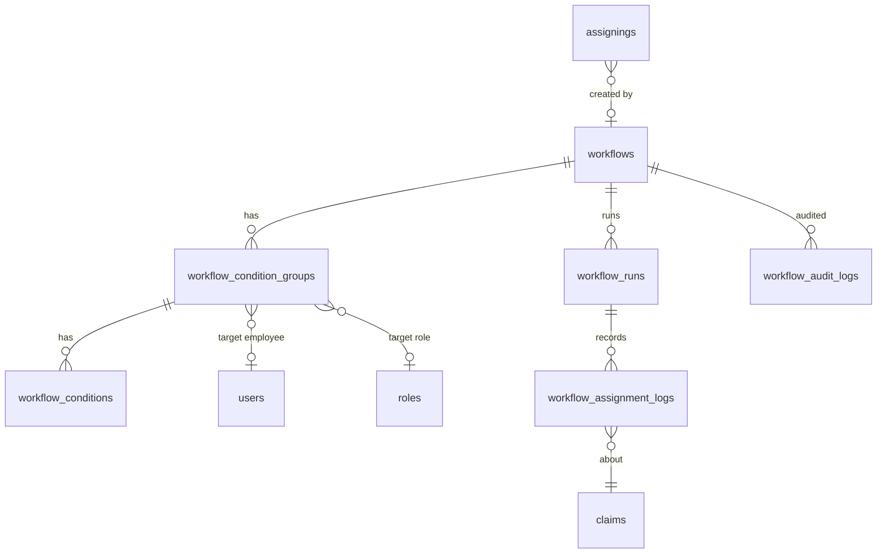

# RCP — Workflow Configuration: تحليل معماري (Architecture Analysis)

| | |
|---|---|
| **الـ Feature** | Workflow Configuration (BRD v1.0 — Draft for Review) |
| **الـ Repo / Branch** | `AhmedRamadan03/rcp` — branch `docs/workflow-configuration-analysis` |
| **الأساس اللي اتدرس** | `main` @ `0c1ed66` (الكود والـ migrations كلها من هنا) |
| **مصادر المتطلبات** | (1) BRD v1.0 (Draft) • (2) Prototype تفاعلي `rcp_workflows_configuration_v1_2.html` (نموذج واجهة، مش متصل بخلفية) |
| **تاريخ التحليل** | 2026-10-14 (النسخة 2: بعد استلام الـ Prototype وتعديل قرار الـ capacity) |
| **النوع** | تحليل وتصميم فقط — **مفيش كود اتنفّذ أو اتجرّب** |
| **الجمهور** | Architecture team / Backend lead / BA |

**مفتاح درجة الثقة** (مستخدم في كل الوثيقة):

- **[مؤكد]** — اتحقق منه مباشرة في الكود أو الـ migrations على `main`.
- **[مرجع]** — مصدره نص الـ BRD أو وثيقة محددة، ومتحققتش منه في الكود.
- **[تخمين]** — استنتاج أو توصية مني، محتاج تأكيد قبل ما يتبني عليه.

---

## 0. الخلاصة التنفيذية — الحاجات غير المريحة الأول

### 0.أ — اللي اتضاف بعد قراءة الـ Prototype (النسخة 2)

1. **الـ Prototype بيطبّق 3 قواعد توزيع مختلفة في نفس الملف، ونتايجها مختلفة.** [مؤكد من قراءة الـ HTML]
   - نص الواجهة (wizard والـ notice): "الأقل في **عدد المطالبات المسندة**" (يطابق BRD-14).
   - عنوان قسم المعاينة: "الأولويات: عدد المطالبات ← **قيمة المحفظة** ← **نوع الرجوع**" (يخالف الـ BRD اللي بيمنع المعايير دي صراحة في §4.2 و§9.2).
   - دالة `simulate` (اللي بتحسب النتيجة الفعلية): بترتّب بـ **نسبة الاستخدام** `active/cap` وبتملّى كل موظف لحد سقفه قبل ما تنتقل للي بعده (greedy).
   - **نتيجة على بيانات الـ Prototype نفسها** (المصدر أحمد، 20 مطالبة، سقف الدور 500): الـ simulate بيعطي **كل الـ 20 لخالد**. قاعدة الـ BRD (الأقل عدداً، مطالبة مطالبة، مع إعادة العدّ) بتعطي **كل الـ 20 لسارة**. الاتنين صح حسب القاعدة اللي كل واحد بيطبقها، لكن مش نفس القاعدة.
   - **التوصية:** القاعدة الوحيدة المعتمدة = الـ BRD (أقل عدد، مطالبة مطالبة، مع إعادة العدّ بعد كل إسناد). الـ simulate في الـ Prototype **مش مرجع** ولا يتبني عليه تنفيذ.

2. **الـ Prototype بيضيف متطلبات الـ BRD مش بيغطيها أو بيمنعها.** [مؤكد من المقارنة]
   - بيعرض حقل **Timezone** (الـ BRD بيقول لازم ما يظهرش).
   - الـ Modal القديم فيه ربط شروط **AND/OR** (الـ BRD: AND فقط).
   - فيه إعدادات **للتحويل الخارجي** مفيش لها أي مقابل في الـ BRD: مكتب افتراضي، حد تحويل 60 يوم، حالة رفض السداد، تعليق تلقائي إلزامي، وقنوات "واجهة / رفع جماعي / Nitrinus API".
   - فيه حالة **مسودة (Draft)** (الـ BRD: Enabled/Disabled فقط).
   - فيه بيانات نموذج لسه فيها `event:"claim_created"` (يعني trigger) رغم إن الـ BRD ألغى الـ trigger.
   - **الجدول الكامل في §1.5.** كل نقطة منهم محتاجة قرار قبل البناء.

3. **سؤالك عن الـ capacity على التوزيع العادي بيغيّر افتراضي القديم.** كنت مفترض (Q9) إن الـ capacity بيطبّقها الـ workflow بس. [تخمين → اتغيّر]
   - اللي فهمته منك: الموظف ما ينفعش ياخد مطالبات فوق سقفه، **ولا في التوزيع العادي كمان**، فنضيف check داخلي عليه. **لو فهمي غلط صحّحني.**
   - التنفيذ ممكن، لكنه **تغيير سلوك على نظام شغال** مش إضافة، وفيه خطر فعلي: استيرادات الـ ART بتبلع أي exception وتكتفي بـ log (تفاصيل في §3.9 و§6). فالـ guard لازم يتبني بـ rollout (off → warn → enforce) ومعاه استثناءات صريحة. **ده أخطر جزء في الـ feature كلها**، مش الـ workflow نفسه.

4. **الـ "توزيع العادي" الموجود في الكود مش شغال أصلاً لأكتر من موظف.** [مؤكد: قراءة الكود + إعادة تنفيذ المنطق بـ PHP عادي خارج التطبيق]
   - `AssigningService::create` فيه فرع بيوزع على عدة موظفين بنسبة `round(claims/employees)`. على 4 مطالبات و3 موظفين: المطالبة الرابعة **ما بتتوزعش**، وعلى 7 مطالبات و3 موظفين: السابعة كمان. بعدها `$employees_claim[$claim_id]` على مفتاح مش موجود، فالـ exception بيتحول لـ `NotExistsException`.
   - **كل الـ callers الفعالين بيبعتوا موظف واحد فقط** (`ClaimInfoController::assign`, imports ART/GIG, `LawFirm`, `ClaimService`)، والاستثناء الوحيد controller في namespace `Deleted` ملوش route. فالفرع ده **كود ميت عملياً**. يعني مفيش "توزيع عادي" على أكتر من موظف حالياً غير اللي هنبنيه إحنا.
   - ده بيغيّر معنى طلبك: مش "نضيف check على توزيع موجود"، بل "نبني نقطة التوزيع الوحيدة الصح، ونحط الـ check جواها".

### 0.ب — الحاجات اللي كانت في النسخة الأولى (من الـ BRD والكود)

الـ BRD مكتوب كأن في أساس جاهز، والكود على `main` مش كده. دي أهم النقاط، مرتبة بتأثيرها:

1. **الـ BRD بيعتمد على 4 حاجات بيقول عليها "existing" ومش موجودة على `main`.** [مؤكد]
   - **Capacity limits** (للموظف وللـ role): مفيش أي عمود أو كلاس أو config بالمعنى ده. بحثت عن `capacity` و`max_claims` و`workload` وغيرهم في `app/` و`database/` و`config/` و`routes/` ومفيش نتيجة.
   - **Employee eligibility rules**: مفيش قواعد أهلية. الموجود هو الـ soft delete على `users` بس.
   - **RCP audit standards**: مفيش جدول أو package لـ audit عام. الموجود جداول تاريخ متفرقة (`claim_status_histories` وغيرها) ومش بتغطي تغييرات الإعدادات.
   - **Assignment concurrency rules**: كود الإسناد مفيهوش أي lock. الـ locks الموجودة في أماكن تانية (مثلاً `lockForUpdate` في `RecoveryBacklogWriter`).
   - **النتيجة:** يا إما الحاجات دي موجودة في branch/نظام تاني، يا إما الـ BRD بيفترضها غلط. **لازم نسأل قبل أي تصميم نهائي**، لأن غيابها معناه إن الـ scope الحقيقي أكبر من اللي الـ BRD بيوحي بيه.

2. **الـ BRD متناقض من جوه في سلوك الإسناد.** [مرجع]
   - BRule-08 بيقول لو الإسناد فشل "الـ claim يفضل مع الـ current assignee"، يعني الـ workflow بيشتغل على claims **عليها assignee بالفعل**، يعني بيعمل reassign.
   - BR-19 بيقول تعديل الإعداد "ميعملش reassign تلقائي للـ claims المسندة".
   - الاتنين ممكن يتوافقوا (BR-19 عن *التعديل*، مش عن *التنفيذ*)، بس ده مش مكتوب. ولو مفيش قاعدة صريحة، كل دورة تنفيذ هتعيد توزيع نفس الـ claims (ping-pong). الحل المقترح في §5.5.

3. **"Execution duration + unit" مش معرّف.** [مرجع]
   - الـ BRD بيسميها مرة "execution duration" ومرة "execution interval"، ومفيش trigger. ما نعرفش هل المقصود "شغّل كل N أيام" ولا "اللي عدّى عليه N أيام". كل تفسير بيطلع تصميم مختلف. تفاصيله في §1.4.

4. **أول تفعيل لـ workflow ممكن يعمل reassign جماعي على الـ backlog كله.** [تخمين]
   - مفيش في الـ BRD أي baseline أو حد أقصى لعدد الـ claims في الدورة. على داتا بالحجم ده (الـ migrations فيها backlog imports) ده أخطر سيناريو تشغيلي. الحماية المقترحة: dry-run + per-run cap + baseline (§5.7 و§7).

5. **الـ BRD ساكت عن تعارض الـ workflows مع بعض.** [مرجع]
   - بيحدد أولوية بين *groups جوه workflow واحد* بس (وبيحيل على "approved priority rule" مش موجودة في الوثيقة). لو claim طابق workflow Internal وExternal في نفس الوقت مفيش حاجة بتحسم.

6. **"Internal / External" بلا تعريف تشغيلي.** [مؤكد + مرجع]
   - في الكود مفهومين متداخلين: `users.user_type` (`internal_user` / `external_user`) و`Roles::EXTERNAL_OFFICE = 4`. والـ `claims` نفسها مفيهاش أي صفة internal/external. فنوع الـ workflow غالباً بيحدد *مين ينفع يستلم*، بس ده تخمين (§6).

7. **سلوك الـ assignment الحالي فيه مشاكل بتأثر على أي عدّ أو توزيع.** [مؤكد]
   - `UserService::reAssign()` بيعدّل `to` في نفس الصف بدل ما يضيف صف جديد، يعني تاريخ الإسناد بيتغيّر من ورا.
   - `Assigning` مفيهوش `SoftDeletes` رغم إن الجدول فيه `deleted_at`، فـ `delete()` حذف فعلي.
   - مفيش constraint بيضمن assignment نشط واحد لكل claim.
   - التفاصيل في §2.2.

**التوصية:** المشروع قابل للتنفيذ، لكن مش جاهز يتنفذ من الـ BRD ده زي ما هو. محتاج جلسة قرارات مع الـ BA/Business (قائمة الأسئلة في §8) قبل ما نبدأ Phase 3 (محرك التنفيذ). Phase 1 و2 (الجداول وAPI الإعداد) ينفع تبدأ بالتوازي.

---

## 1. شرح الـ BRD

### 1.1 الفكرة في جملتين

مدير العمليات عايز واجهة (wizard) يعرّف منها قواعد إسناد تلقائي: "الـ claims اللي بتطابق الشروط دي تتسند لفلان / لأي حد في role كذا". القواعد دي بتتقيّم دورياً بدل ما حد يسند يدوي أو بـ Excel.

### 1.2 المفاهيم الأساسية

| المفهوم | معناه في الـ BRD | ملاحظة |
|---|---|---|
| **Workflow** | قاعدة إسناد مُسماة، ليها نوع (Internal/External)، فترة تنفيذ، وحالة (enabled/disabled) | BR-04..BR-06 |
| **Condition Group** | مجموعة شروط، كل الشروط جواها بـ **AND** بس (مفيش OR) | BR-08, BR-09, BRule-03 |
| **Condition** | شرط واحد: حقل + operator + قيمة | §9.2 |
| **Assignment target (per group)** | لكل group هدف إسناد خاص بيه: **موظف محدد** أو **Role** | BR-10..BR-13 |
| **Role-based distribution** | لو الهدف Role: الاختيار بين الموظفين الأهل بحسب **أقل عدد claims مسندة حالياً** فقط | BR-14, BRule-06 |
| **Capacity** | حد أقصى للموظف وللـ role لا يتجاوزه التوزيع | BR-15, BRule-07 |
| **Execution interval** | كل قد إيه الـ workflow بيتقيّم (مفيش trigger) | BR-07, BRule-02 |

### 1.3 مثال عملي (توضيحي — الأسماء والقيم من عندي)

> **Workflow: "متابعة المتأخرات — الرياض"**، النوع Internal، بيتقيّم كل 1 يوم.
>
> - **Group 1:** `status = follow_up/delay` **AND** `amount > 5000` **AND** `city = الرياض` → الهدف: Role **Senior Collector** (يتوزع بحسب أقل عدد claims).
> - **Group 2:** `status = registered` **AND** `debtor_type = third party` → الهدف: موظف محدد (مثلاً أحمد).
>
> كل دورة: الـ engine يلاقي الـ claims اللي بتطابق Group 1 ويوزعها على الـ Senior Collectors حسب الأقل حملاً (بشرط ما يتعدّوش capacity). لو مفيش حد أهل → الـ claim تفضل مع assignee الحالي ويتسجل سبب الفشل.

### 1.4 الغموض اللي لازم يتحسم (قبل التصميم النهائي)

| # | الغموض | التفسيرات الممكنة | اعتمادي المؤقت |
|---|---|---|---|
| A1 | معنى Duration + Unit | (أ) فترة تكرار التقييم: "قيّم كل N أيام" • (ب) نافذة عمر: "claims اللي عدّى عليها N أيام" | (أ) [تخمين] — لأن الـ BRD بيسميها "execution interval" وبيمنع الـ trigger |
| A2 | هل الـ workflow بيشتغل على claims مسندة فعلاً؟ | (أ) غير المسندة بس • (ب) المسندة وغير المسندة | (ب) [مرجع] — لأن BRule-08 بيفترض "current assignee" |
| A3 | منع الـ ping-pong | مفيش قاعدة | قاعدة "skip لو الـ assignee الحالي بالفعل هدف مطابق" (§5.5) [تخمين] |
| A4 | تعارض أكتر من group/workflow على نفس الـ claim | الـ BRD يحيل على "approved priority rule" مش موجودة | أول مطابق حسب الترتيب، وأولوية صريحة بين الـ workflows [تخمين] |
| A5 | معنى Internal/External | يحدد نوع المستلم؟ أم نوع الـ claims؟ | نوع المستلم (`users.user_type`) [تخمين] |
| A6 | معنى Role capacity | (أ) سقف إجمالي للـ role كله • (ب) سقف افتراضي لكل موظف فيه | (أ) [تخمين] |
| A7 | تعريف "assigned claim" في العدّ | أي assignment نشط؟ ولا غير المنتهية بس؟ | غير المنتهية، بنفس تعريف `UserService::getActiveClaimAssiendToUser` (§2.4) [مؤكد للتعريف الحالي] |
| A8 | هل الـ workflow per-client؟ | `users.client_id` و`claims.client_id` موجودين | `workflows.client_id` nullable [تخمين] |

> **تحديث بعد الـ Prototype:** A6 اتحسم جزئياً. تبويب "السعة والتوزيع" بيعرض **سعة دور إجمالية (500)** + **سعة فردية لكل محصل (150/300/200/100)**، والمتاح للدور = السعة − مجموع المطالبات النشطة (110). يعني التفسير (أ) صح، **والاتنين لازم يتحققوا معاً**. [مؤكد من الـ HTML] لسه محتاج تأكيد إن ده قرار الـ Business مش مجرد شكل واجهة.

### 1.5 الـ Prototype v1.2 مقابل الـ BRD v1.0

الـ Prototype ملف HTML واحد، **بيانات تجريبية داخل الصفحة وبيصدّر JSON بس، مفيش اتصال بأي خلفية** (مكتوب فيه ذلك صراحة). فيه بنيتين متجاورتين: تبويبات قديمة قائمة على **rules** (تبويبي "التدوير الداخلي" و"التحويل الخارجي")، و**wizard جديد** قائم على **groups**. الـ BRD مبني على الـ groups. **أنا ماشي على الـ wizard + الـ BRD**، والتبويبات القديمة اعتبرتها مصدر أفكار مش مواصفة.

| # | الموضوع | الـ BRD | الـ Prototype | اعتمادي المؤقت |
|---|---|---|---|---|
| P1 | Timezone | محظور في الـ wizard (§4.2، §9.1) | حقل موجود في الـ wizard وفي التبويب القديم (`Asia/Riyadh` / `UTC`) | الـ BRD يكسب. الـ interval نسبي، ومفيش timezone مخزّن [تخمين] |
| P2 | منطق الشروط | AND فقط (BR-09) | الـ wizard: AND. الـ Modal القديم: AND/OR | AND فقط |
| P3 | معيار التوزيع على Role | عدد المطالبات فقط (BR-14) | 3 قواعد متضاربة (راجع §0.أ-1) | عدد المطالبات فقط |
| P4 | حالة الـ workflow | Enabled/Disabled (BR-06) | `مسودة` أو `مفعّل` عند الإنشاء، وفي التبويب: `مفعّل`/`معطّل` | 3 حالات: `draft`, `active`, `disabled` [تخمين]، والـ draft لا ينفّذ أبداً |
| P5 | نوع الـ workflow | Internal/External (BR-05) | `internal` / `external` / **`custom`** | Internal/External فقط لحد قرار |
| P6 | الإجراء (Action) | الإسناد لموظف أو Role (BR-11) | الـ wizard: موظف أو Role. التبويب القديم: + **"تحويل إلى مكتب خارجي"** | المكتب الخارجي = إسناد لمستخدمين دورهم `EXTERNAL_OFFICE` (§3.10). مفيش action جديد |
| P7 | إعدادات التحويل الخارجي | غير موجودة | مكتب افتراضي، حد 60 يوم (> وليس ≥)، حالة رفض السداد، تعليق تلقائي إلزامي | مش في النطاق لحد ما الـ BRD يتحدّث (§3.10 و§8-Q14) |
| P8 | "Nitrinus API" كقناة | غير مذكور | مذكور كقناة لقاعدة التعليق الإلزامي | **ما لقيتش أي أثر للاسم ده في الكود** (`grep` على `app/ config/ routes/`). الموجود `PartnerApiCredential` و`PartnerApiCredentialController`. أعتبره غير مؤكد [تخمين] |
| P9 | Trigger | ممنوع (BRule-02) | `event:"claim_created"` لسه في بيانات النموذج | **لا يتنفّذ**. تنظيف الـ Prototype |
| P10 | استبعاد المحصل المصدر | غير موجود | Toggle "استبعاد المحصل المصدر من الدفعة نفسها" | أضيفه كـ option على الـ workflow (§3.2) [تخمين] |
| P11 | التوزيع الجماعي | غير موجود | "احتساب التوزيع الكامل قبل نقل المطالبات" | الخطة تتحسب في الذاكرة الأول ثم تتطبّق (§3.4) |
| P12 | عرض الفشل | BR-20 (تسجيل) | Toggle "عرض حالات الفشل في لوحة التحكم" + تبويب متابعة (فشل، غير مسندة > 24 ساعة، audit) | الـ logs موجودة في التصميم؛ الـ dashboard والـ "غير مسندة > 24h" خارج المتطلبات المكتوبة (§8-Q15) |
| P13 | تأثير التعديل | BR-19: لا reassign بأثر رجعي | سلوك تنفيذ الـ "إعادة الجدولة": "عند تغيير الدورية تتم إعادة جدولة الدورة الحالية" | يتحسب `next_run_at` من جديد عند تغيير الـ interval، بدون reassign [تخمين] |
| P14 | أسماء القواعد | — | قاعدة اسمها "رفض العميل السداد" شرطها فعلياً `عمر المطالبة < 60` | بيانات تجريبية متناقضة. **مش مواصفة** |

**عيوب تقنية في الـ Prototype نفسه** (مش بتأثر على التصميم، لكن مهمة لو اتعرض كـ demo): [مؤكد من قراءة الـ JS]
- زر "إنشاء مسار العمل" في الـ wizard بيقرأ عناصر `#wfAssignTo` و`#wfEmployee` و`#wfRole` و`#wfRoleMethod`، **وهي مش موجودة في الـ HTML** (الـ wizard اتحوّل لـ fields داخل كل group)، فالـ handler هيرمي TypeError ولا ينشئ حاجة.
- معرّفات وأسماء دوال بحروف عربية ناتجة عن find/replace غلط (`inالحالة`, `rالحقل`, `renderالمحصلs`). وكمان عناصر `option` فيها نص "تعطيلd" و"أكبر من or equal to".

---

## 2. الوضع الحالي (As-Is) على `main`

### 2.1 الـ Stack والبنية

- **Laravel 13** (`composer.json`: `"laravel/framework": "^13.0"`), Sanctum للـ auth, Reverb للـ broadcasting. [مؤكد]
- **قاعدة البيانات PostgreSQL** عملياً: الكود بيستخدم `ILIKE` (مثلاً `Role::scopeFilter`) و`pg_index` في migrations (مثلاً `2026_10_04_101414_add_claim_id_index_to_assignings_table.php`). بينما `.env.example` و`config/database.php` default بيقولوا `mysql`. [مؤكد] — يعني البيئة الحقيقية Postgres، وده بيفتح لنا partial indexes وadvisory locks.
- **الـ Scheduler**: `app/Console/Kernel.php` فيه commands كتير بـ `->timezone('Asia/Riyadh')` hardcoded. [مؤكد]
- **الـ Queue**: `.env.example` فيه `QUEUE_CONNECTION=sync` و`CACHE_DRIVER=file`. [مؤكد للـ example] — إعدادات الإنتاج الفعلية **مش معروفة** لي [تخمين]. ده مهم لأن `onOneServer()` و`Cache::lock` ما ينفعوش مع `file` على أكتر من server.
- مفيش `app/Services` لـ workflows ولا أي جدول باسم workflow. الكلمة بتظهر في تعليق عن "approval workflow" في `ClaimService.php` وبس. [مؤكد]

### 2.2 نموذج الإسناد (Assignment)

**الجدول `assignings`** (من `2024_01_21_110009_create_assignings_table.php` + migrations لاحقة): [مؤكد]

| العمود | النوع | ملاحظة |
|---|---|---|
| `id` | PK | |
| `claim_id` | FK → claims | cascade |
| `supervisor_id` | FK → users, nullable | اللي عمل الإسناد |
| `from` | FK → users, nullable | التعليق في الـ migration: "if null it means automatically assigned by assigning system" |
| `to` | FK → users | المستلم |
| `assign_as_office` | bool | |
| `assign_comment` | text | |
| `assign_date` | datetime | |
| `is_active` | tinyint default 1 | أضيف بـ `2024_06_30_102331` |
| `deleted_at` | timestamptz | موجود في الجدول |

**الـ Indexes الحالية:** `(claim_id, is_active, created_at)` و`("to", is_active)` (من migrations أكتوبر 2026). [مؤكد]

**مفيش على `claims` عمود "assigned_to".** الـ assignee الحالي = الصف النشط في `assignings` (`Claim::assignee()` = `hasOne(Assigning)->where('is_active', 1)->latest()`). [مؤكد]

**مين بيكتب في `assignings` (نقاط الدخول):** [مؤكد]

| المصدر | الملف | السلوك |
|---|---|---|
| إسناد فردي | `ClaimInfoController::assign` → `AssigningService::create` | يعطّل القديم (`is_active=0`) ثم `Assigning::insert` — **بدون transaction** (فيه try/catch بس) |
| إسناد جماعي | `ClaimInfoController::bulkAssignClaims` → `AssigningService::bulkCreate` | نفس النمط |
| Excel | `AssigningService::excelBulkAssign` + `ProcessBulkAssignClaimsOpenSpout` + `BulkAssignClaimsMapper` | `DB::beginTransaction` في الـ service؛ الـ mapper بيبني الصفوف |
| حذف مستخدم | `UserService::delete` → `reAssign` | **بيعدّل `to` في نفس الصف** بدل صف جديد |
| تراجع | `RevertAssignClaimsAction` | بيعدّل `to` أو يحذف الصف |

**الـ routes:** كلها محمية بـ `can:assign_claim,App\Models\Claim` (`routes/api/claims.php`). [مؤكد]

**ملاحظات مهمة لأي تصميم فوقه:** [مؤكد]

1. **مفيش ضمان لـ assignment نشط واحد لكل claim** على مستوى الـ DB. الكود بيعتمد على إن كل writer يعطّل القديم بنفسه.
2. `UserService::reAssign` بيغيّر `to` في الصف النشط من غير تاريخ → أي عدّ تاريخي أو audit فوق `assignings` هيكون ناقص.
3. `Assigning` مفيهوش `SoftDeletes` رغم عمود `deleted_at`: فـ `$current->delete()` في `RevertAssignClaimsAction` حذف فعلي، ومفيش global scope بيفلتر `deleted_at`. لازم نتأكد إن الصفوف ذات `deleted_at` مش null (لو في أصلاً من `DataMigrationFromOld`) ما بتتحسبش.
4. إسناد الـ claim **مش بيغيّر `claims.status`** (سطر تغيير الحالة لـ `ASSIGNED` معلّق في `AssigningService::create`). فالـ workflow ما ينفعش يفترض إن الحالة هتتغير.
5. الإسناد اليدوي بيبعت notification (`NotificationType::CLAIM_ASSIGNED`) لكل claim. الـ workflow على مئات الـ claims هيعمل spam لو ما اتجمّعتش.
6. في الكود بقايا `UserAutoAssign`: import في `UserService` و`UserAutoAssignPolicy` بجسم فاضي، لكن **مفيش `app/Models/UserAutoAssign.php`** والاستخدام معلّق. يعني فكرة auto-assign اتبدأت قبل كده وما اتكملتش. [مؤكد] — يستاهل نسأل عن السبب قبل ما نكرر.
7. **فرع التوزيع على أكتر من موظف في `AssigningService::create` معطوب وغير مستخدم.** [مؤكد للمنطق: إعادة تنفيذ نفس المعادلة بـ PHP عادي خارج التطبيق؛ مؤكد لغياب الاستخدام: قراءة كل الـ callers]
   - المعادلة `round(count($claims) / count($employees_to))` بتسيب مطالبات من غير موظف: 4 مطالبات على 3 موظفين → الرابعة بلا موظف. 7 على 3 → السابعة بلا موظف. 5 على 3 و10 على 4 شغالين صدفة.
   - الـ callers الفعالين كلهم بيبعتوا مصفوفة `to` من عنصر واحد: `ClaimInfoController::assign`, `GIG/ClaimImport`, `ART/ArtClaimImport::runPostImportAssignments`, `Statuses/Approved/LawFirm`, `ClaimService` (التحويل للقانونية), `Claim/LawFirmService`.
   - الاستثناء الوحيد اللي بيبعت array حقيقية (`assigns_to`) هو `Http/Controllers/Api/V1/Deleted/AssigningController::store` مع `CreateAssigningRequest`، وده في namespace اسمه `Deleted` وما لقيتش أي route بيشاور عليه (`grep` على `routes/`). فعملياً كود مهجور.
   - ويوزع بالتساوي بالترتيب، **مش** بالأقل حملاً، **ومش** بيراعي أي سقف.
8. **عمود `assignings.assign_as_office` موجود ومش مستخدم في أي مكان في `app/`.** [مؤكد: `grep`] — يعني مفيش تمييز حالياً بين إسناد لمحصل وإسناد لمكتب خارجي غير `users.role_id = 4` (`Roles::EXTERNAL_OFFICE`). أي سلوك "مكتب خارجي" لازم يتبني على الـ role مش على العمود ده، إلا لو حد يفتكر ليه اتعمل.
9. **التعليقات:** `claim_comments.user_id` nullable و`body` nullable (`2024_06_23_085439`). [مؤكد] — يسمح بتعليق نظام (بدون مستخدم). لكن ما لقيتش عمود بيفرّق "تعليق نظام" عن "تعليق مستخدم"، فلما الـ Prototype يقول "لا تنسب التعليق التلقائي للعميل" لازم نحدد إزاي نعلّمه (§3.10).

### 2.3 المستخدمين والـ Roles والصلاحيات

- **`users`**: `role_id` (FK واحد لكل مستخدم)، `client_id`، `supervisor_id`، `user_type` (default `internal_user`)، `last_active_at`، soft delete. مفيش عمود "active" أو "assignable" أو "capacity". [مؤكد]
- **`roles`**: `title`, `description`, `discount_percentage`, `default_permissions`، soft delete. مفيش capacity. [مؤكد]
- **`Roles` enum**: SUPER_ADMIN=1, SUPERVISOR=2, COLLECTOR=3, EXTERNAL_OFFICE=4, LEGAL_DEPARTMENT=5, TAHEIYA_ADMIN=6, OTHERS=7, SENIOR_COLLECTOR=8. [مؤكد]
- **`UserType` enum**: INTERNAL_USER, EXTERNAL_USER. [مؤكد]
- **الصلاحيات**: جدول `permissions` فيه أعمدة JSON حسب المنطقة (`permissions`, `settings`, `users`, `claims`, `offices`, `response`, `recovery_target` + أعمدة أضيفت لاحقاً مثل `dashboard` في `2026_09_24_112456`). الـ defaults لكل role متعرّفة كمصفوفات في `app/helpers.php` (مفاتيح زي `assign_claim`)، وأمر `app:update-permission` بيضيف المفاتيح الناقصة. جدول `general_permissions` فيه `permission_mode` JSON. [مؤكد]
- **`Claim::scopeVisibleTo`** بيحدد رؤية الـ claim بناءً على: `show_all_claims`، الـ assignings النشطة للمستخدم ومرؤوسيه، الـ delegations الفعالة، أو إنه منشئ الـ claim ومفيش assignment نشط. [مؤكد] → **أي إسناد من الـ workflow بيغيّر مين بيشوف إيه فوراً.**

### 2.4 تعريف "عدد الـ claims المسندة" الحالي

الموجود الوحيد اللي لقيته هو `UserService::getActiveClaimAssiendToUser`: claims اللي ليها assigning نشط لـ المستخدم **و** حالتها **مش** واحدة من `rejected, closed, done, manaual_collected, bank_collected, collected_credited`. [مؤكد]

ملاحظة: حالات زي `collected_out_of_system` و`law_firm` و`transfer_to_elm` مش مستبعدة هناك. **لازم تعريف "open claim" يتحدد رسمياً** لأن ده أساس عدّ الـ capacity وأساس التوزيع (A7).

### 2.5 الـ Audit والتاريخ

[مؤكد] مفيش `spatie/laravel-activitylog` ولا `owen-it/laravel-auditing` في `composer.json`. الموجود:

| الجدول | بيغطي إيه |
|---|---|
| `claim_status_histories` | تغيير حالة الـ claim |
| `claim_amount_histories` | تغيير المبلغ |
| `target_histories` | الـ targets |
| `authentication_logs`, `login_attempts` | الدخول |
| `data_histories` | **تاريخ الـ export/import** (النوع `DataHistoryEnum::EXPORT...`)، مش audit تغييرات |

→ **مفيش مكان قياسي نسجل فيه "مين عدّل الـ workflow وإيه اللي اتغير" ولا "ليه الإسناد فشل".** لازم نبنيه.

### 2.6 التزامن (Concurrency)

[مؤكد] الأدوات الموجودة في المشروع: `lockForUpdate` (في `MessagesTemplatesService`, `RecoveryBacklogWriter`, `TransactionStatusEnquiryAction`) و`Cache::lock` (في `ReferenceGenerationService`). **ولا واحدة منهم في مسار الإسناد.** مفيش `withoutOverlapping` ولا `onOneServer` ولا `ShouldBeUnique` في أي مكان.

### 2.7 ملخص الفجوات (BRD ↔ الكود)

| متطلب الـ BRD | موجود على `main`؟ | الفجوة |
|---|---|---|
| قائمة workflows + wizard واحد للإضافة والتعديل (BR-01..03) | لا | جداول + API + permission + UI |
| Internal/External (BR-05) | جزئي (`user_type`) | تعريف تشغيلي |
| Condition groups بـ AND (BR-08, 09) | لا | تخزين + compiler |
| إسناد لكل group (BR-10..13) | لا | تخزين على الـ group |
| توزيع بأقل عدد claims (BR-14) | لا | selector + عدّ |
| Capacity للموظف/الـ role (BR-15) | **لا** | أعمدة + سياسة |
| Eligibility (BR-15) | **لا** (soft delete بس) | تعريف + أعمدة؟ |
| Validation (BR-16) | — | FormRequest + قواعد على مستوى الـ group |
| تحديث لا إنشاء مكرر (BR-18) | — | upsert بـ ids ثابتة |
| لا reassign تلقائي عند تعديل الإعداد (BR-19) | — | الـ engine ما يعيدش تقييم بأثر رجعي |
| Audit للتغييرات والنتائج (BR-20) | **لا** | جداول audit + logs |
| Concurrency-safe assignment (BRule-10) | **لا** | locks |
| Scheduler | جزئي (Kernel موجود) | command + due-check |

---

## 3. التصميم المقترح (To-Be)

> كل اللي تحت [تخمين] كتوصية تصميم، إلا لو مكتوب غير كده. الأسماء قابلة للتعديل.

### 3.1 نظرة عامة

```
Wizard (UI)  ─►  Workflow API (CRUD, validation, audit)
                      │
                      ▼
              workflows / groups / conditions   (إعداد)
                      │
Scheduler (Kernel) ─► workflows:run  ─► RunWorkflowJob (واحد لكل workflow مستحق)
                                            │
                  ConditionCompiler ◄───────┤  (يترجم الشروط لـ Eloquent Builder)
                  AssigneeSelector  ◄───────┤  (أقل حملاً + capacity + eligibility)
                  ClaimAssignmentWriter ◄───┘  (نقطة كتابة واحدة، transaction + lock)
                                            │
                                            ▼
                         assignings (+ workflow_id/source)   workflow_runs / logs / audit
```

### 3.2 نموذج البيانات الجديد (ERD)



#### جداول جديدة

**`workflows`**

| عمود | نوع | ملاحظات |
|---|---|---|
| `id` | bigint PK | |
| `client_id` | FK nullable | A8 |
| `name` | string(255) | unique (case-insensitive) بين غير المحذوفة — محتاج قرار |
| `description` | text null | |
| `type` | string | `internal` / `external` (enum في PHP + CHECK) |
| `interval_value` | smallint | CHECK `> 0` (قاعدة §10 في الـ BRD) |
| `interval_unit` | string | `day` / `week` / `month` |
| `status` | string | `draft` / `active` / `disabled` (P4). الإنشاء `draft` افتراضياً، والتنفيذ لـ `active` فقط. (لو الـ Business قرر Enabled/Disabled بس، نستبدلها بـ `is_enabled` boolean) |
| `options` | jsonb | `exclude_source_from_batch` (P10)، `plan_batch_first` (P11)، `show_failures_on_dashboard` (P12)، `auto_comment` (§3.10 لو اتعتمد) |
| `priority` | int | لتحديد الأولوية بين الـ workflows (A4) |
| `enabled_at` | timestamptz null | baseline لمنع reassign بأثر رجعي (§5.7) |
| `last_run_at`, `next_run_at` | timestamptz null | `INDEX (status, next_run_at)` |
| `created_by`, `updated_by` | FK users | |
| timestamps + `deleted_at` | | soft delete عشان الـ logs ما تتكسرش |

**`workflow_condition_groups`**

| عمود | نوع | ملاحظات |
|---|---|---|
| `id`, `workflow_id` | PK, FK | |
| `position` | smallint | ترتيب التقييم (أول مطابق يكسب) |
| `assignment_type` | string | `employee` / `role` |
| `assignee_user_id` | FK users null | |
| `assignee_role_id` | FK roles null | |
| | | **CHECK**: واحد بالظبط من الاتنين مش null ومتوافق مع `assignment_type` |
| timestamps + `deleted_at` | | |

**`workflow_conditions`**

| عمود | نوع | ملاحظات |
|---|---|---|
| `id`, `group_id` | PK, FK | |
| `field_key` | string | مفتاح من **whitelist** (§3.3) |
| `operator` | string | من قائمة مسموحة لكل نوع حقل |
| `value` | jsonb | قيمة أو مصفوفة قيم |
| `position` | smallint | |

> اخترت صفوف مطبّعة بدل JSON واحد على الـ workflow عشان: (1) الـ validation على مستوى الصف، (2) تقارير "مين يستخدم الشرط ده"، (3) تعديل شرط واحد من غير إعادة كتابة الكل. التكلفة: joins أكتر عند القراءة (قراءة workflow واحد = 3 queries بسيطة، مش مشكلة).

**`workflow_runs`** — دورة تنفيذ واحدة: `id, workflow_id, mode (live|dry_run), status (running|completed|failed|skipped_locked), started_at, finished_at, matched_count, assigned_count, failed_count, skipped_count, error`.

**`workflow_assignment_logs`** — قرار لكل claim في دورة:

| عمود | |
|---|---|
| `run_id`, `workflow_id`, `group_id` | |
| `claim_id` | |
| `outcome` | `assigned`, `skipped_already_on_target`, `failed_no_eligible_employee`, `failed_capacity_reached`, `failed_target_invalid`, `failed_error` |
| `from_user_id`, `to_user_id` | |
| `reason` | text (BRule-08: سبب الفشل لازم يتسجل) |
| `config_snapshot` | jsonb — لقطة من الـ group وقت التنفيذ (عشان لو الإعداد اتعدّل بعدين نقدر نفسّر القرار) |
| `created_at` | `INDEX (claim_id, created_at)`, `INDEX (run_id, outcome)` |

**`workflow_audit_logs`** — تغييرات الإعداد (BR-20): `workflow_id, actor_user_id, action (created|updated|enabled|disabled|deleted), before jsonb, after jsonb, created_at`.

> بديل: جدول `audit_logs` عام polymorphic. أنا ماشي بجدول مخصص لأن مفيش audit عام يتبع له، وتعميمه قرار أكبر من الـ feature. لو الـ architecture team عايز audit عام للمنصة، ده وقته.

#### تعديلات على جداول موجودة (كلها nullable/additive)

| الجدول | التعديل | الغرض | تأثير على الكود الحالي |
|---|---|---|---|
| `assignings` | `workflow_id` (nullable FK), `workflow_group_id` (nullable), `source` (string nullable: `manual`/`bulk`/`excel`/`workflow`) | تتبع أصل الإسناد وربطه بالـ logs | **لا يتأثر**: كل الـ writers بتستخدم `insert([...])` بأعمدة صريحة، والأعمدة الجديدة nullable. `NULL` = legacy |
| `users` | `max_active_claims` unsigned int nullable | سقف الموظف. `NULL` = بلا حد | لا يتأثر. السلوك الحالي كما هو لحد ما حد يملّي القيمة |
| `roles` | `max_active_claims` unsigned int nullable | سقف الـ role (التفسير A6) | نفسه |
| `users` | (اختياري) `is_assignable` boolean default true | استبعاد موظف من التوزيع من غير حذفه (مثلاً إجازة) | يعتمد على قرار الأهلية (§8-Q5) |
| `claim_comments` | (مشروط بـ Q14) `is_system` boolean default false | تمييز التعليق التلقائي عن تعليق المستخدم | لا يتأثر؛ الصفوف القديمة `false` |
| جدول جديد `assignment_guard_events` | `user_id, context, claim_id, current, incoming, cap, decision, created_at` | قياس أثر الـ Guard في وضع `warn` قبل `enforce` (§3.9) | لا يتأثر |

**مفيش تعديل على `claims`.** ممنوع نضيف أعمدة workflow على جدول بالحجم ده وفيه `Claim::scopeVisibleTo` شغال عليه.

### 3.3 محرك الشروط (Condition Engine)

**القاعدة الأساسية:** الإعداد **بيترجم** لـ Eloquent query builder عبر whitelist — ما بنبنيش SQL من نصوص المستخدم أبداً.

- **Field registry** (كلاس واحد): لكل `field_key`: النوع، الـ operators المسموحة، الـ validation للقيمة، ودالة بتضيف الشرط للـ builder. أمثلة على حقول موجودة فعلاً في `claims` [مؤكد]: `status`, `amount`, `type`, `debtor_type`, `city_id`, `client_id`, `insertion_type`, `return_reason`, `accident_date`, `is_backlog`, `risk_score`.
- **Operators حسب النوع:** نص/enum: `=`, `!=`, `in`, `not_in` • رقم/تاريخ: `=`, `>`, `>=`, `<`, `<=`, `between` • boolean: `=`.
- **حقول مشتقة** (مثلاً "عمر الـ claim بالأيام"، "عدد أيام منذ آخر دفعة") محتاجة تعريف صريح وقرار: مش هندخلها في Phase 1.
- **كتالوج الحقول في الـ Prototype مقابل الداتابيز:** الـ Prototype نفسه بيقول "الحقول والـ operators توضيحية، والإنتاج لازم يستخدم كتالوج معتمد". الـ 8 حقول فيه:

| حقل الـ Prototype | موجود كعمود؟ | ما يقابله على `main` | ملاحظة |
|---|---|---|---|
| حالة المطالبة `claim_status` | **نعم** | `claims.status` (enum `ClaimStatus`، 23 قيمة) | جاهز، مع `in` / `not_in` |
| عمر المطالبة بالأيام `claim_age_days` | لا (مشتق) | ممكن من `claims.created_at` أو `accident_date` أو `intimation_date` | **لازم تعريف: عمر من أي تاريخ؟** |
| الأيام منذ آخر نشاط فعلي `days_since_activity` | **لا** | ممكن يتشتق من `claim_comments` / `messages` / `calls` / `payments` / `claim_status_histories` | **"نشاط فعلي" مش معرّف.** تعريف غلط = إسناد غلط |
| أيام التأخر غير المسدد `unpaid_days` | **لا** | `Claim` فيه accessors للأقساط (`installmentCounts`, `installmentFirstDate`) لكن مفيش عمود تأخر مخزّن | محتاج تعريف + على الأرجح عمود/جدول أقساط مستحقة |
| نوع الرجوع `recourse_type` | **جزئي** | `claims.return_reason` (enum `ReturnReason` بـ 19 قيمة) وبيظهر للـ `insured` فقط (`Claim::toArray`) | هل "نوع الرجوع" = `return_reason`؟ [تخمين] |
| قيمة المحفظة `portfolio_value` | **لا** | `claims.amount` أقرب شيء، و`grep portfolio` على `app/ database/` ما رجّعش شيء | **"محفظة" = مطالبة واحدة؟ ولا مجموع مطالبات المدين/العميل؟** غير معرّف |
| آخر تعليق `last_comment` | جزئي | آخر صف في `claim_comments.body` | مقارنة نصية، ومحتاج index لو هيتفلتر |
| مكتب التحصيل `assigned_office` | جزئي | الـ assignee النشط اللي `users.role_id = 4` | مشتق من `assignings` + `users` |

  **النتيجة:** من 8 حقول، **حقل واحد بس (الحالة) جاهز**، وحقلين على الأقل (آخر نشاط فعلي، أيام التأخر) محتاجين تعريف وربما تخزين جديد. ده ممكن يكون أكبر جزء في تقدير الـ P3، ومش واضح من الـ BRD.
- **AND جوه الـ group:** كل شرط بـ `->where(...)` متسلسل. **مفيش OR** (مقصود).
- **تقييم الـ groups:** بترتيب `position`. لكل claim، أول group بيطابق بيكسب (§5.5).
- الـ BRD بيحيل على الـ SDP لتحديد الحقول والـ operators المدعومة (§12). **أنا بقترح القائمة دي تتثبّت مع الـ BA قبل البناء**.

### 3.4 اختيار الموظف (Assignee Selector)

**القاعدة الوحيدة المعتمدة:** أقل عدد مطالبات مسندة حالياً بين المؤهلين، **مطالبة مطالبة مع إعادة العدّ بعد كل إسناد**، مع احترام سقف الموظف وسقف الدور. [مرجع: BR-14، BR-15، BRule-06/07] والتنفيذ التفصيلي [تخمين]:

```
eligible = users
  WHERE role_id = :role
    AND deleted_at IS NULL
    AND user_type = (type=internal ? 'internal_user' : 'external_user')   -- A5
    AND (is_assignable = true)                                            -- لو اتعتمد
IF options.exclude_source_from_batch: eligible -= {from_user للمطالبات اللي في الدفعة}   -- P10
current[u]  = عدد الـ claims غير المنتهية المسندة (§2.4) لكل u            -- عدّ واحد في أول الدورة
roleTotal   = مجموع current على eligible (والـ role كله حتى غير الأهل)
roleFree    = role.max_active_claims IS NULL ? ∞ : role.max_active_claims - roleTotal

FOR EACH claim IN الدفعة (بترتيب ثابت: id):
    IF roleFree <= 0                           → failed_role_capacity
    candidates = eligible WHERE (max_active_claims IS NULL OR current[u] + 1 <= max_active_claims)   -- الـ check الداخلي
    IF candidates فاضية                         → failed_no_eligible_employee
    pick = candidates ORDER BY current[u] ASC, u.id ASC       -- tie-break حتمي (الـ BRD ساكت)
    assign(claim, pick)  ; current[pick]++ ; roleFree--
```

- **ليه مطالبة مطالبة:** الـ greedy بتاع الـ Prototype (يملّى موظف لحد سقفه ثم اللي بعده) بيحط الدفعة كلها على موظف واحد. شغّلت الاتنين على بيانات الـ Prototype نفسها (أحمد 130/150، محمد 140/300، خالد 70/200، سارة 50/100، سقف الدور 500، 20 مطالبة، المصدر أحمد):

| الطريقة | النتيجة |
|---|---|
| Prototype `simulate` (ترتيب بنسبة الاستخدام + ملء متتالي) | خالد: 20 |
| قاعدة الـ BRD (الأقل عدداً، مطالبة مطالبة) | سارة: 20 (50 → 70، يعني تتساوى مع خالد، وتتوقف عند الدفعة) |
| نفس القاعدة بدفعة 200 مطالبة | سارة: 50 (وصلت سقفها 100)، خالد: 60، محمد: 0، **90 مطالبة تفشل** لأن سقف الدور (110 متاح) اتستنفد قبل السقوف الفردية |

  [مؤكد: حسابات بـ Node على بيانات الـ Prototype] المثال الأخير مهم: **سقف الدور هو اللي بيحكم في الدفعات الكبيرة**، فلازم يتعرض للمستخدم كسبب فشل واضح (`failed_role_capacity`) مش "لا يوجد مؤهل".
- **"الـ check الداخلي"** اللي طلبته: هو سطر `candidates` فوق. بعد اختيار الأقل حملاً، الموظف اللي عنده `current + 1 > سقفه` بيتشال من المرشحين ويتجرّب اللي بعده. [تخمين: فهمي لطلبك، والـ check نفسه بيتعمّم على كل المسارات في §3.9]
- بعد كل إسناد بنزوّد `current[pick]` في الذاكرة (بدل ما نعيد العدّ لكل claim). لكن الـ `current` ده **snapshot**؛ لو حد أسند يدوياً في نفس اللحظة، العدّ يبقى قديم، وده السبب في الـ lock (§3.5).
- **العدّ** (يستفيد من الـ index الحالي `("to", is_active)`):
  ```sql
  SELECT a."to" AS user_id, COUNT(*) AS cnt
  FROM assignings a
  JOIN claims c ON c.id = a.claim_id AND c.deleted_at IS NULL
  WHERE a.is_active = 1 AND a.deleted_at IS NULL
    AND a."to" IN (:eligible_ids)
    AND c.status NOT IN (:terminal_statuses)
  GROUP BY a."to";
  ```
  [تخمين] الأداء مقبول؛ لو اتضح بطيء نضيف partial index `ON assignings ("to") WHERE is_active = 1 AND deleted_at IS NULL` بنفس نمط `CREATE INDEX CONCURRENTLY` الموجود في `2026_10_04_*`. **اقيس الأول.**
- **"احتساب التوزيع الكامل قبل نقل المطالبات"** (P11): خطة الدفعة (مين ياخد أنهي claim) بتتحسب كلها في الذاكرة الأول، وبعدين بتتطبّق claim بـ claim داخل transactions. لو الخطة طلعت إن جزء مش هيتوزع، الجزء ده بيتسجل `failed_*` والباقي بيتطبّق (توزيع جزئي، زي ما الـ Prototype بيعرض "الباقي يحتاج مراجعة يدوية"). **ما فيش all-or-nothing** إلا لو الـ Business طلب (§8-Q16).
- لو الهدف موظف محدد: نتحقق إنه ما زال أهل (مش محذوف، النوع صح، `current + 1 <= سقفه`). لو لأ → فشل مسجّل، **مفيش fallback لموظف تاني** (BRule-08).

### 3.5 الكتابة والتزامن (Writer + Locking)

**نقطة كتابة واحدة جديدة `ClaimAssignmentWriter`** (للـ workflow، وبعدين تتبنى عليها المسارات القديمة تدريجياً):

```
DB::transaction:
  claim = Claim::whereKey(id)->lockForUpdate()->first()        -- نفس نمط RecoveryBacklogWriter
  re-verify: الـ claim لسه بتطابق الـ group (الحالة ممكن تكون اتغيرت)
  deactivate: assignings WHERE claim_id AND is_active=1 → is_active=0
  insert جديد: from = الـ assignee السابق، to = المختار، supervisor_id = NULL، source='workflow', workflow_id, workflow_group_id
  log: workflow_assignment_logs
```

- **Lock على مستوى الـ role** عشان اختيار "الأقل حملاً" ما يتعملش بالتوازي من دورتين: `pg_advisory_xact_lock(hashtext('wf-role:'||role_id))` جوه الـ transaction. [تخمين] اخترت advisory lock لأن الـ DB Postgres، و`Cache::lock` على `file` driver مش آمن multi-server، و`lockForUpdate` على صفوف `users` هيتعارض مع تحديثات `last_active_at`.
- **Lock على مستوى الـ workflow** (منع تشغيلين لنفس الـ workflow): `pg_try_advisory_lock` على `workflow_id`؛ لو مشغول → `skipped_locked` في `workflow_runs`.
- **حد مهم:** الإسناد اليدوي (`AssigningService`) النهاردة **ما بياخدش أي lock ولا بيراعي الـ capacity**. لو سبناه كده، الـ capacity هتتخطى بسهولة (مشرف يسند يدوياً وقت ما الـ workflow شغال) والـ snapshot بتاع الـ selector يبقى قديم. **اتعدّل قرارنا:** الـ capacity والـ lock يتعمّموا على كل المسارات عبر Guard موحّد (§3.9).

### 3.6 التنفيذ والـ Scheduler

- Command جديد `app:run-workflows` في `Kernel.php`: `->everyMinute()` (نفس نمط `send-links`)، بيختار `workflows WHERE is_enabled AND next_run_at <= now()` ويعمل dispatch لـ `RunWorkflowJob` لكل واحد. [تخمين]
- بعد كل دورة: `last_run_at = now()` و`next_run_at = last_run_at + interval` (A1-أ).
- **Timezone:** الـ BRD بيمنع إعداد timezone في الـ wizard. نشتغل بـ `config('app.timezone')` والـ timestamps بتتخزن UTC. أما أوقات اليوم (مثلاً "الساعة 00:01") فالموجود في Kernel هو `Asia/Riyadh` hardcoded. فالتزام الـ workflow بـ interval نسبي (من `last_run_at`) مش بتوقيت يومي. [تخمين]
- **الـ queue:** لازم نتأكد من إعداد الإنتاج الفعلي (§8-Q11). لو `sync` الـ job هيشتغل جوه الـ scheduler tick وممكن يتأخر الباقي.
- **Chunking:** الـ claims المرشّحة تتعالج بـ `chunkById` (مثلاً 200)، وكل claim في transaction منفصلة، عشان فشل واحد ما يوقفش الدورة ولا يحمل locks طويلة.
- **Per-run cap** (مثلاً أقصى N إسنادات للدورة): الباقي بيتكمل الدورة اللي بعدها. حماية من المشكلة رقم 4 في §0.

### 3.7 الـ API والصلاحيات

- ملف routes جديد `routes/api/workflows.php` بنفس نمط باقي الملفات:

| Method | Path | الغرض |
|---|---|---|
| GET | `/workflows` | القائمة (BR-01) بفلاتر وpagination |
| POST | `/workflows` | إنشاء (wizard كامل في request واحد) |
| GET | `/workflows/{id}` | تفاصيل للتعديل/المراجعة |
| PUT | `/workflows/{id}` | تعديل (BR-18) |
| PATCH | `/workflows/{id}/status` | تفعيل/تعطيل (BR-06) |
| GET | `/workflows/{id}/runs` | سجل التنفيذ |
| POST | `/workflows/{id}/dry-run` | معاينة بدون إسناد (توصية) |
| GET | `/workflows/field-registry` | الحقول والـ operators المتاحة لتغذية الـ UI |

- **Payload الـ wizard** (مثال):
  ```json
  {
    "name": "متابعة المتأخرات — الرياض",
    "description": "",
    "type": "internal",
    "interval_value": 1,
    "interval_unit": "day",
    "is_enabled": false,
    "groups": [
      {
        "id": null,
        "position": 1,
        "assignment": { "type": "role", "role_id": 8 },
        "conditions": [
          { "field": "status", "operator": "=", "value": "follow_up/delay" },
          { "field": "amount", "operator": ">", "value": 5000 }
        ]
      }
    ]
  }
  ```
- **التعديل (BR-18):** `PUT` بيستقبل `groups[].id` ثابتة: موجود = update، `null` = create، غايب = soft delete. كله جوه transaction واحدة. ده بيمنع التكرار.
- **الـ Validation (BR-16, §10):** `FormRequest` بنفس نمط `app/Http/Requests/V1/...`، يشمل: الاسم، `interval_value > 0`، الوحدة، النوع، كل group فيه شرط على الأقل، كل شرط مكتمل ومتوافق مع الـ field registry، الهدف مختار وصالح. **بعد الحفظ نتحقق تاني server-side** إن الموظف/الـ role لسه موجود وغير محذوف.
- **الصلاحيات:** [تخمين] نضيف مفتاح `workflows` (قراءة/إنشاء/تعديل/تفعيل) داخل عمود `settings` الموجود في `permissions` بدل عمود JSON جديد (يوفر migration على جدول كبير)، ونحدّث الـ defaults في `app/helpers.php` لكل role، ونستخدم `app:update-permission` للـ backfill. الـ default = **مقفول لكل الـ roles ما عدا SUPER_ADMIN**. ده بيطابق "within existing RCP permissions" في §5 من الـ BRD. [مرجع]

### 3.8 الـ Notifications

الإسناد اليدوي بيبعت notification لكل claim. للـ workflow: **notification مجمّعة لكل مستلم في كل دورة** ("تم إسناد N مطالبة لك بواسطة workflow X")، مش واحدة لكل claim. [تخمين] — لازم الـ BA يوافق على النص.

### 3.9 الـ capacity في كل مسارات الإسناد (Assignment Guard موحّد)

**الطلب:** الموظف ما ياخدش مطالبات فوق سقفه، **حتى في التوزيع العادي** (مش الـ workflow بس). [فهمي لطلبك. لو قصدك حاجة تانية صحّحني]

**الواقع على `main`:** [مؤكد] 8 مسارات بتكتب في `assignings`، **ولا واحد فيهم بيتحقق من أي سقف** (لأنه مفيش سقف أصلاً)، ومفيش lock:

| # | المسار | الملف | طبيعته |
|---|---|---|---|
| 1 | إسناد فردي من الواجهة | `ClaimInfoController::assign` → `AssigningService::create` | مشرف، بيبعت notification |
| 2 | إسناد جماعي | `ClaimInfoController::bulkAssignClaims` → `AssigningService::bulkCreate` | مشرف، لموظف واحد |
| 3 | Excel | `excelBulkAssign` / `ProcessBulkAssignClaimsOpenSpout` + `BulkAssignClaimsMapper` | كل صف له failure مستقل + ملف failed |
| 4 | استيراد ART | `ArtClaimImport::runPostImportAssignments` | **بيبلع أي `Throwable` ويكتفي بـ `\Log::error`** |
| 5 | استيراد GIG | `GIG/ClaimImport` (حوالي سطر 385) | في المقطع اللي قرأته مفيش try/catch محلي؛ ما اتحققتش من الـ caller |
| 6 | تحويل للقانونية | `LawFirm`, `ClaimService` (~716), `Claim/LawFirmService` | تحويل قانوني مش توزيع |
| 7 | حذف مستخدم | `UserService::delete` → `reAssign` | نقل إجباري، **بيعدّل `to` في الصف نفسه** |
| 8 | تراجع | `RevertAssignClaimsAction` | استرجاع |

**التصميم:** `AssignmentGuard` (يحسب القرار) + `ClaimAssignmentWriter` (يكتب) كنقطة وحيدة، وكل مسار يمرّ منها بـ `context`:

```
Guard::evaluate(toUserId, incomingCount, context):
    lock أولاً:  pg_advisory_xact_lock(hashtext('asg-user:'||toUserId))   -- بترتيب id تصاعدي لو الدفعة فيها أكتر من موظف (تفادي deadlock)
    current = عدّ المطالبات النشطة (§2.4)
    free    = min( user.max_active_claims - current , role.max_active_claims - roleTotal )   -- NULL = ∞
    accepted = min(incomingCount, max(free, 0))
    return { accepted, rejected = incomingCount - accepted, reason: user_capacity | role_capacity | ineligible }
```

**سياسة كل مسار** (لازم يتأكد مع الـ Business، دي توصيتي [تخمين]):

| المسار | الوضع النهائي | ليه |
|---|---|---|
| Workflow | `enforce` دائماً | هو اللي بيتحكم فيه الـ BRD |
| 1 إسناد فردي / 2 جماعي | `enforce`، مع جزئي في الجماعي (يقبل لحد المتاح ويرجّع المرفوض بسببه) + صلاحية `override` للمشرف | المشرف لازم يعرف ليه اترفض، وممكن عنده سبب تشغيلي |
| 3 Excel | `enforce` بالصف: الصف المرفوض يدخل ملف الـ failed الموجود فعلاً بسبب `capacity` | الـ mapper عنده آلية فشل جاهزة، فده أرخص مسار تعميم |
| 4 ART / 5 GIG | **`warn` فقط**، ما يبطّلش الإسناد | لو `enforce`: ART هيبلع الرفض بصمت (إسناد بيضيع) وGIG ممكن يكسر الاستيراد كله |
| 6 قانونية | `exempt` | تحويل قانوني مش توزيع تحصيل |
| 7 حذف مستخدم / 8 تراجع | `exempt` + log | نقل إجباري، ومينفعش يتعطّل بسبب سقف الطرف التاني |

**الإعدادات:** جدول `settings` الموجود (`key` + `value json`، `2024_08_29_141920`) يشيل `assignment.capacity.mode = off | warn | enforce` مع override لكل context. [مؤكد للجدول، تخمين للمفاتيح]

**الـ Rollout (إلزامي):**
1. P3: الـ Guard موجود، الـ workflow بيستخدمه `enforce`، **باقي المسارات `off`** (صفر تغيير على النظام الشغال).
2. P4-أ: `warn` على المسارات 1-3: **جدول `assignment_guard_events`** (`user_id, context, claim_id, current, incoming, cap, decision, created_at`) [تخمين]. أسبوعين بنقيس "كام إسناد يدوي كان هيترفض". لو الرقم كبير، السقوف نفسها غلط والـ enforce هيبوّظ الشغل.
3. P4-ب: `enforce` على 1-3 بعد موافقة العمليات.

**الأثر على الكود الحالي:**
- فرع التوزيع على عدة موظفين في `AssigningService::create` (المعطوب، §2.2-7) **ما يتصلّحش ولا يتعاد استخدامه**. التوزيع على أكتر من موظف هو شغل الـ Selector (§3.4). نوثّقه deprecated.
- `UserService::reAssign` بيعدّل صف موجود؛ لو الـ Guard اتعمّم على الـ audit، لازم نحوّله لـ deactivate + insert (§2.2). **ده ما بيدخلش في الـ guard نفسه لكن بيأثر على أي تاريخ إسناد.**
- كل مسار بيدخل الـ Guard بياخد lock قصير على الموظف المستلم. تأثير الأداء [تخمين] صغير، لكن لازم يتقاس على Excel الكبير (آلاف الصفوف): الأفضل lock لكل دفعة مش لكل صف.

### 3.10 التحويل الخارجي والتعليق التلقائي (من الـ Prototype، خارج الـ BRD)

الـ Prototype فيه workflow "التحويل إلى التحصيل الخارجي" بإعدادات مش في الـ BRD (§1.5-P6..P8). **ما اقترحش أبني الإعدادات دي قبل ما الـ BRD يتحدّث.** ما يقدر ينبني من غيرها:

- **المكتب الخارجي كهدف:** الـ `Roles::EXTERNAL_OFFICE = 4` موجود [مؤكد]. فـ group هدفها Role=4 بتتوزّع بنفس الـ Selector (الأقل عدد مطالبات) بدون أي تصميم إضافي، والمكتب المحدد = هدف "موظف محدد". الـ workflow من النوع External بيشترط `user_type = external_user` (A5).
- **"حد التحويل 60 يوم، أكبر من":** مجرد شرط عادي `claim_age_days > 60`. حالة الحد (60 لا تطابق، 61 تطابق) هي سلوك الـ operator `>` ومش منطق خاص. اختبار حدّي يكفي.
- **"حالة رفض السداد = Refused":** **ما فيش قيمة مقابلة في `ClaimStatus`** (23 قيمة، ما فيهاش refused). [مؤكد] محتاجة تعريف: حالة جديدة؟ ولا تعليق؟ ولا حاجة تانية؟
- **التعليق الإلزامي التلقائي:** لو معتمد، فهو rule عابر لكل قنوات التحويل (واجهة، رفع جماعي، API) مش تبع الـ workflow بس. التنفيذ المقترح [تخمين]: داخل الـ Writer لما `context = external_transfer`، بيدخل صف في `claim_comments` بـ `user_id = NULL` (الـ schema بيسمح) ونص من الإعداد. ولأن مفيش عمود بيفرّق تعليق النظام، نضيف `claim_comments.is_system boolean default false` (nullable-safe). والنص لازم يتصاغ كتعليق نظام، مش كأن العميل قاله (ده نص تحذير الـ Prototype نفسه).
- **"Nitrinus API":** ما لقيتش اسم بالشكل ده في الكود. لازم حد يأكد تقصد أنهي integration قبل ما نفترض إن في API هيمرّ بنفس الـ Guard.

---

## 4. التعامل مع البيانات الحالية

### 4.1 الأساس: لا بيانات workflow قديمة

[مؤكد] مفيش أي جدول أو بيانات workflow على `main`، فمفيش data migration للـ workflows نفسها. كل التعامل مع البيانات الحالية هو: (1) إضافات آمنة على جداول موجودة، (2) تنضيف بيانات الإسناد قبل ما نبني عليها، (3) ضبط الـ capacity والصلاحيات.

### 4.2 الإضافات الآمنة (Additive, Zero-Downtime)

| التغيير | الأمان | ملاحظات |
|---|---|---|
| جداول `workflow_*` جديدة | آمن تماماً | لا تأثير على أي كود شغال |
| `assignings.workflow_id / workflow_group_id / source` nullable | آمن | **مفيش backfill.** `NULL` = إسناد قديم/يدوي، وما نخمّنش مصدره |
| `users.max_active_claims`, `roles.max_active_claims` nullable | آمن | `NULL` = بلا حد، يعني نفس السلوك الحالي بالظبط لحد ما العمليات تملّي القيم |
| Index جديد على `assignings` (لو لزم) | يحتاج حذر | بنفس نمط `CREATE INDEX CONCURRENTLY` وفحص الـ INVALID index الموجود في migrations أكتوبر 2026 |

إضافة أعمدة nullable بدون default على Postgres سريعة (metadata-only)، لكن [تخمين] نراجع حجم `assignings` و`users` في الإنتاج قبل التنفيذ.

### 4.3 تنضيف بيانات الإسناد (قبل أي عدّ أو unique index)

الـ workflow بيعتمد على إن "الإسناد النشط" سليم. لازم نشغّل الاستعلامات دي على نسخة من الإنتاج ونشوف الأرقام **قبل** ما نقرر أي حاجة:

```sql
-- 1) claims عليها أكتر من assignment نشط (أخطر مشكلة)
SELECT claim_id, COUNT(*) AS active_rows
FROM assignings
WHERE is_active = 1 AND deleted_at IS NULL
GROUP BY claim_id HAVING COUNT(*) > 1;

-- 2) assignments نشطة لمستخدمين محذوفين (soft delete)
SELECT a.id, a.claim_id, a."to"
FROM assignings a JOIN users u ON u.id = a."to"
WHERE a.is_active = 1 AND u.deleted_at IS NOT NULL;

-- 3) assignments نشطة على claims محذوفة
SELECT a.id, a.claim_id
FROM assignings a JOIN claims c ON c.id = a.claim_id
WHERE a.is_active = 1 AND c.deleted_at IS NOT NULL;

-- 4) صفوف فيها deleted_at (الموديل ما بيفلترهاش!)
SELECT COUNT(*) FROM assignings WHERE deleted_at IS NOT NULL;

-- 5) تداخل user_type مع role (A5)
SELECT role_id, user_type, COUNT(*) FROM users WHERE deleted_at IS NULL GROUP BY 1, 2 ORDER BY 1, 2;

-- 6) users على role محذوف
SELECT u.id, u.role_id FROM users u JOIN roles r ON r.id = u.role_id
WHERE u.deleted_at IS NULL AND r.deleted_at IS NOT NULL;

-- 7) توزيع الـ claims حسب الحالة (لتعريف "open claim" §2.4)
SELECT status, COUNT(*) FROM claims WHERE deleted_at IS NULL GROUP BY status ORDER BY 2 DESC;
```

**خطة التنضيف لو ظهرت مشاكل:**
- (1) نسجّل الصفوف المخالفة في تقرير، ونبقّي **الأحدث** نشط ونعطّل الباقي (`is_active=0`) بـ migration/command قابل للإعادة وفيه `--dry-run` (على نمط `app:update-permission` الموجود). **ما نحذفش صفوف.**
- (2) و(3) تتراجع مع الـ Business: إعادة إسناد أو إغلاق.
- (4) نقرر: إما نتجاهلها دائماً في العدّ (`deleted_at IS NULL` صريح في كل query الـ workflow)، أو نضيف `SoftDeletes` للموديل (تغيير سلوك على كل الكود، **مش جزء من الـ feature** ده).

### 4.4 Partial Unique Index (حماية دائمة)

بعد التنضيف:
```sql
CREATE UNIQUE INDEX CONCURRENTLY assignings_one_active_per_claim
ON assignings (claim_id) WHERE is_active = 1 AND deleted_at IS NULL;
```
**تحذير:** ده هيحوّل أي race في الإسناد الحالي لـ exception (لأن `AssigningService::create` بيعطّل وبيدخل من غير transaction). فالترتيب الصح: (أ) نلف المسارات الحالية في transactions أو نحوّلها لـ `ClaimAssignmentWriter` → (ب) نتحقق إن مفيش مخالفات → (ج) نضيف الـ index. [تخمين] ده **Phase 4** مش Phase 1، وممكن يتأجل عن الـ feature لو الـ team شايفه توسّع في النطاق.

### 4.5 الـ Capacity والأهلية

- ما نملّيش قيم افتراضية بأنفسنا. القيم بتيجي من العمليات (واجهة أو import). **لحد ما تتملّي، التوزيع بأقل عدد بس.**
- **"Over-capacity عند الميلاد":** أول ما العمليات تكتب السقوف، ممكن موظفين يكونوا **أصلاً فوق سقفهم** (مثلاً سقف 150 وعنده 170). الـ Guard بيمنع **إضافة** فقط، ما بيسحبش مطالبات (ولازم ما يسحب: BR-19). الشاشة بتعرض "فوق السقف بـ N" عشان العمليات تقرر. ولازم القرار موثّق في الـ BRD.
- **الـ Prototype:** كل موظف بسقف فردي وحالة أهلية (مؤهل/غير نشط)، وسقف دور واحد في الواجهة رغم إن الـ dropdown فيه 3 أدوار. يعني **سقف لكل role** لازم يتخزن (`roles.max_active_claims`) ومش input واحد عام. [مؤكد من الـ HTML]
- نوفّر شاشة/تقرير بسيط "حمل كل موظف الحالي" (من نفس query العدّ) عشان العمليات تعرف تحدد السقوف بأرقام حقيقية.

### 4.6 الصلاحيات للمستخدمين الحاليين

- مفتاح `workflows` الجديد بيتضاف للـ defaults وللـ `permissions` rows الموجودة عبر `app:update-permission` (بيحافظ على القيم الموجودة)، بقيمة **0** لكل الـ roles ما عدا SUPER_ADMIN. بدون ده، المستخدمين الحاليين هيقعوا على مفتاح ناقص. [مؤكد للآلية، تخمين للتفاصيل]

### 4.7 الـ Claims الحالية والـ Backlog

- **مفيش reassign بأثر رجعي (BR-19):** `enabled_at` بيتسجل عند التفعيل. [تخمين] التوصية إن الـ workflow يشتغل افتراضياً على claims **تغيّرت/اتنشأت بعد `enabled_at`** أو يكون في خيار صريح "طبّق على الموجود" بتأكيد. ده بيحمي من الـ backlog الجماعي.
- **Dry-run إلزامي قبل أول live run** لأي workflow جديد: بيطلّع "هيطابق N claim وهيوزعها كده" من غير ما يكتب في `assignings`. (نفس الـ engine بـ `mode=dry_run` في `workflow_runs`.)
- الـ claims اللي حالتها **مش** `assigned` وعليها assignment نشط: الـ workflow ما بيغيّرش الحالة (§2.2 نقطة 4).

---

## 5. قرارات التصميم والبدائل المرفوضة

### 5.1 صفوف مطبّعة مقابل JSON واحد للشروط
اخترت صفوف مطبّعة (§3.2). **البديل المرفوض:** عمود `jsonb` واحد على `workflows` فيه الشجرة كلها — أبسط في الكتابة لكن بيخلّي الـ validation والـ reporting والـ partial update أصعب. لو الـ team عايز السرعة وبيقبل التنازل، ده بديل معقول.

### 5.2 Eloquent compiler مقابل SQL خام / expression language
اخترت whitelist + builder. **المرفوض:** تخزين SQL أو تعبيرات حرة — خطر injection وصعب يتفحص. **المرفوض كمان:** مكتبة rules engine خارجية — تبعية جديدة كبيرة على مشكلة AND-only بسيطة.

### 5.3 Advisory lock مقابل `lockForUpdate` على users / `Cache::lock`
Postgres advisory lock (§3.5). `lockForUpdate` على `users` بيتصادم مع تحديث `last_active_at` (عمود بيتحدث مع النشاط) فهيبطّئ الـ login/activity. `Cache::lock` مش آمن مع `CACHE_DRIVER=file` على أكتر من server.

### 5.4 جدول audit مخصص مقابل audit عام
مخصص (§3.2). تعميم الـ audit قرار منصة، مش قرار feature.

### 5.5 منع الـ ping-pong (A3) — القاعدة المقترحة
لكل claim مطابق لـ group:
- هدف **موظف**: لو الـ assignee الحالي هو نفسه → `skipped_already_on_target`.
- هدف **Role**: لو الـ assignee الحالي **عضو أهل في نفس الـ role** → `skipped_already_on_target` (ما نعيدش التوزيع على الأقل حملاً كل دورة).
- غير كده → إسناد.

من غير القاعدة دي، كل دورة هتعمل churn على نفس الـ claims. [تخمين] دي قراءة معقولة لـ BR-19 + BRule-08، لكن **لازم الـ Business يأكدها** (§8-Q2).

### 5.6 الأولوية
- جوه الـ workflow: `position` (أول مطابق).
- بين الـ workflows: `priority` ثم `id`. لو claim طابق أكتر من workflow، الأعلى أولوية بس هو اللي يتنفذ في الدورة. [تخمين]

### 5.7 حماية أول تشغيل
`enabled_at` baseline + dry-run + per-run cap (§3.6, §4.7). **مرفوض:** تشغيل فوري على كل الـ claims عند التفعيل.

---

## 6. التأثيرات على الأجزاء الموجودة

| الجزء | التأثير |
|---|---|
| `Claim::scopeVisibleTo` | الإسناد بيغيّر الرؤية فوراً. محتاجين نختبر إن المستخدم اللي اتسند له الـ claim بيشوفها، واللي اتشالت منه ما بيشوفهاش |
| `Assigning` model | `toArray()` بيعمل `$this->toUser->name` من غير null-check (ينهار لو `to` مستخدم محذوف نهائياً). الـ workflow بيكتب مستخدمين أهل فقط، لكن التقارير بتقرأ الصفوف دي |
| تقارير الإسناد | `AssignedClaimsReportQuery`, `claims-assigned-history`, `ExportAssignedClaimsHistory`: صفوف الـ workflow هتظهر. `from = NULL` لكن `supervisor_id = NULL` برضو — لازم نقرر العرض (مثلاً "System / Workflow X") |
| Delegations | العدّ بيعتمد على `assignings.to` وما بيحسبش الـ delegation. موظف مفوِّض (delegator) ممكن يتحسب أهل أو لأ — قرار (§8-Q5) |
| `UserService::delete` | بيعيد إسناد claims المستخدم لمستخدم تاني يدوياً. لو الـ workflow موجه لموظف محذوف → `failed_target_invalid` |
| Scheduler | `app:run-workflows` كل دقيقة ضمن commands كتير كل دقيقة بالفعل (`send-links`, `law-reminder`, `reminder`) |
| Observers | `ClaimRiskObserver` على `Claim` — الـ workflow ما بيعدّلش `claims` فمش هيشغّله |
| **كل مسارات الإسناد اليدوي** | الـ Guard الموحّد (§3.9) **تغيير سلوك**: إسناد كان بينجح ممكن يترفض. محتاج rollout بـ `off → warn → enforce` وموافقة العمليات |
| استيراد ART | `runPostImportAssignments` بيبلع الاستثناءات. `enforce` هنا = إسناد بيضيع بصمت. لازم `warn` أو معالجة صريحة للرفض |
| استيراد GIG | ما اتحققتش إن في try/catch حواليه. `enforce` ممكن يكسر الاستيراد كله |
| `Claim/LawFirmService` + `LawFirm` + `ClaimService` (تحويل قانوني) | `exempt`. لو دخلوا الـ Guard بـ enforce هيعطّلوا تحويل قانوني |

---

## 7. خطة التنفيذ المقترحة (Phases)

> الأحجام نسبية (S/M/L) [تخمين]، مش وعد بزمن.

| Phase | المحتوى | الحجم | شرط البدء |
|---|---|---|---|
| **P0 — قرارات** | جلسة مع BA/Business على §8، خصوصاً Q1..Q6 | S | — |
| **P1 — الأساس** | migrations الجداول والأعمدة الجديدة، Models، Enums، مفتاح الصلاحية + defaults + backfill | M | P0 جزئياً (Q4, Q6) |
| **P2 — الإعداد** | API الـ CRUD، الـ FormRequests، field registry، audit للتغييرات، اختبارات الـ validation. **الـ workflows هنا لا تنفّذ شيء** | M | P1 |
| **P3 — المحرك** | ConditionCompiler، AssigneeSelector، ClaimAssignmentWriter + AssignmentGuard (الـ workflow `enforce`، الباقي `off`)، locks، command + job، `workflow_runs/logs`، dry-run | L | P0 كامل (Q1..Q3, Q7, Q8) + تعريف الحقول المشتقة (§3.3) |
| **P4-أ — Guard على المسارات اليدوية** | ربط المسارات 1-3 بالـ Guard بوضع `warn`، جدول `assignment_guard_events`، مراجعة أسبوعين مع العمليات | M | P3 + قرار Q9 |
| **P4-ب — التقوية** | تنضيف البيانات (§4.3)، تغليف المسارات القديمة بـ transactions، `enforce` على 1-3، unique index، notifications المجمّعة، اختبار حمل، rollout بـ dry-run أسبوع | M–L | P4-أ |

**الاختبارات المطلوبة** (موجود `tests/Unit/Services` و`tests/Feature`): [تخمين]
- Unit: كل operator في الـ compiler، الـ selector (أقل حملاً، tie-break، capacity موظف/role، لا مؤهلين)، منع ping-pong، الأولوية.
- Feature: CRUD + validation (كل حالة في جدول §10 من الـ BRD)، permissions، تعديل لا يكرّر (BR-18)، تعديل لا يعيد إسناد (BR-19).
- Concurrency: تشغيل دورتين متوازيتين على نفس الـ role لا يتجاوز الـ capacity، **وإسناد يدوي متزامن مع دورة workflow على نفس الموظف ما يتجاوزش سقفه** (ده اللي بيثبت إن الـ Guard الموحّد شغال فعلاً).
- Guard: لكل `context` في جدول §3.9 (`enforce` يرفض، `warn` يسجل ويمرّر، `exempt` يمرّر)، وحالة "فوق السقف عند الميلاد" ما تسحبش مطالبات.
- Selector على أرقام الـ Prototype (§3.4): دفعة 20 → سارة 20، ودفعة 200 → 90 فشل `role_capacity`.
- Regression: `ClaimServiceListVisibilityTest` الموجود لازم يفضل أخضر بعد أي تغيير على `assignings`.

---

## 8. أسئلة مفتوحة (محتاجة إجابة قبل P3) — ومعاها اعتمادي المقترح

| # | السؤال | اعتمادي لو ما اتجاوبش |
|---|---|---|
| Q1 | الـ capacity/eligibility/audit/concurrency "الموجودة" اللي الـ BRD بيحيل عليها فين؟ (branch تاني؟ نظام تاني؟) | بنبنيها من الأول زي §3 |
| Q2 | الـ workflow بيشتغل على claims مسندة أصلاً؟ ولو أيوه، قاعدة منع الـ ping-pong §5.5 مقبولة؟ | أيوه + القاعدة |
| Q3 | معنى Duration + Unit: تكرار تقييم ولا نافذة عمر؟ ومتى أول تشغيل بعد التفعيل؟ | تكرار تقييم، وأول تشغيل بعد dry-run معتمد |
| Q4 | Internal/External: بيحدد نوع المستلم؟ وهل مرتبط بـ `user_type` ولا بـ `Roles::EXTERNAL_OFFICE`؟ | `user_type` |
| Q5 | تعريف الأهلية: soft delete + user_type + capacity بس؟ ولا يستبعد (إجازة / delegator / غير نشط)؟ | الأول، مع `is_assignable` اختياري |
| Q6 | معنى Role capacity (إجمالي للـ role ولا افتراضي لكل موظف)؟ | **اتحسم من الـ Prototype:** إجمالي للـ role + سقف فردي لكل موظف، والاتنين يتحققوا. يحتاج تأكيد إنه قرار مش مجرد شكل |
| Q7 | تعريف "open claim" في العدّ: أي حالات تتستبعد؟ | نفس قائمة `getActiveClaimAssiendToUser` |
| Q8 | قاعدة الأولوية المعتمدة بين الـ groups وبين الـ workflows؟ | أول مطابق بـ position، وpriority صريح للـ workflows |
| Q9 | **(اتعدّل)** الـ capacity على الإسناد اليدوي والتوزيع العادي كمان (حسب طلبك) — بأي سياسة لكل مسار (§3.9)، وهل المشرف عنده override؟ وإيه يحصل للاستيراد (ART/GIG) والقانونية؟ | Guard موحّد بـ rollout: workflow `enforce`، يدوي `warn` ثم `enforce`، استيراد `warn`، قانونية/حذف مستخدم/تراجع `exempt` |
| Q10 | الـ workflow per-client؟ تفرّق بين deployments (ART / GIG / RCP)؟ | `client_id` nullable |
| Q11 | إعدادات الإنتاج: `QUEUE_CONNECTION`, `CACHE_DRIVER`, عدد الـ servers، وفيه worker فعلي؟ | نفترض queue حقيقي + Postgres |
| Q12 | تفريغ الاسم: الاسم unique؟ وإيه اللي يحصل لو workflow مفعّل اتحذف؟ | unique بين غير المحذوفة؛ الحذف soft |
| Q13 | `UserAutoAssign` المتروك: ليه اتوقف؟ ما نكرّرش خطأ قديم | — |
| Q14 | التحويل الخارجي: إعدادات الـ Prototype (مكتب افتراضي، حد 60 يوم، "حالة رفض السداد"، تعليق إلزامي، قنوات) داخل نطاق الـ feature؟ و"Refused" يقابل إيه في النظام؟ و"Nitrinus API" يقصد أنهي integration؟ | خارج النطاق لحد تحديث الـ BRD (§3.10) |
| Q15 | تبويب "المتابعة" (لوحة فشل الإسناد، "غير مسندة > 24 ساعة"، audit) داخل النطاق؟ الـ BRD بيطلب تسجيل بس | تسجيل + قائمة بسيطة؛ الباقي لاحقاً |
| Q16 | التوزيع الجماعي: جزئي ولا all-or-nothing لو جزء من الدفعة ما ينفعش يتوزع؟ | جزئي مع تسجيل سبب كل رفض |
| Q17 | `portfolio_value` و"آخر نشاط فعلي" و"أيام التأخر" و"عمر المطالبة": تعريف كل واحد بالظبط؟ (§3.3) | غير معرّفة. أول كتالوج في P3 يقتصر على الحقول الجاهزة (الحالة، المبلغ، النوع، المدينة…) |
| Q18 | Draft كحالة ثالثة ونوع `custom`؟ AND/OR؟ Timezone؟ (§1.5) | Draft نعم، custom لا، AND فقط، بدون timezone |

---

## 9. المخاطر

| الخطر | الاحتمال | الأثر | التخفيف |
|---|---|---|---|
| تفعيل workflow يعمل reassign جماعي للـ backlog | عالي (من غير حماية) | عالي | `enabled_at` + dry-run + per-run cap |
| تضارب أكتر من workflow على نفس الـ claim | متوسط | متوسط | `priority` + قاعدة الأول مطابق |
| بيانات إسناد وسخة (أكتر من نشط) تفسد العدّ | مجهول لحد ما نشغّل §4.3 | عالي | تنضيف قبل P3 |
| الـ capacity بتتجاوز بسبب الإسناد اليدوي | متوسط | منخفض | قرار Q9 + تقرير الحمل |
| Locks غير آمنة لو cache = file على أكتر من server | مجهول | عالي | advisory locks في الـ DB |
| الـ scope يتوسّع (audit عام، unique index، refactor المسارات القديمة) | عالي | متوسط | فصل P4 وقرار صريح |
| الـ BRD ناقص (Q1) فالتقدير ينفجر | متوسط | عالي | P0 قبل أي التزام بموعد |
| تعميم الـ capacity على الإسناد اليدوي يرفض إسنادات كانت شغالة، أو يضيّعها بصمت (ART) | عالي (لو enforce مباشر) | عالي | Guard بـ `off → warn → enforce` + `exempt` للقانونية/حذف مستخدم/تراجع + قياس بـ `assignment_guard_events` |
| الـ Prototype يتحوّل لمواصفة بالغلط وفيه 3 قواعد توزيع متضاربة | عالي | عالي | القاعدة الوحيدة = BRD-14 (§3.4)، والـ simulate مش مرجع |
| حقول شروط في الـ Prototype مش موجودة في الداتابيز (آخر نشاط فعلي، أيام التأخر، قيمة المحفظة) | مؤكد | متوسط–عالي | كتالوج أول مقتصر على الحقول الجاهزة، والباقي بعد تعريف (§3.3، Q17) |

---

## 10. ملحق: الملفات اللي اتراجعت على `main` @ `0c1ed66`

- Models: `Assigning`, `Claim` (خصوصاً `scopeVisibleTo`, `assignee`, `assignees`), `User`, `Role`, `Permission`, `GeneralPermission`, `DataHistory`
- Services/Actions: `AssigningService`, `UserService` (`delete`, `getActiveClaimAssiendToUser`, `reAssign`), `DelegationService`, `RevertAssignClaimsAction`, `BulkAssignClaimsMapper`
- Controllers/Requests/Routes: `ClaimInfoController::assign`, `CreateAssigningRequest`, `routes/api/claims.php`
- Enums: `ClaimStatus`, `Roles`, `UserType`
- Console: `app/Console/Kernel.php`, `EscalationCommand`, `UpdatePermission`
- Policies: `UserAutoAssignPolicy` (جسم فاضي)
- Migrations: `create_assignings_table`, `add_is_active_in_assignings_table`, `add_claim_id_index_to_assignings_table`, `add_to_is_active_index_to_assignings_table`, `create_users_table`, `add_user_type_column_to_users_table`, `create_roles_table`, `create_permissions_table`, `add_dashboard_to_permissions_table`, `create_general_permissions_table`, `create_claims_table` + إضافات `claims`, `create_data_histories_table`, `create_delegations_table`, `create_settings_table`, `create_claim_status_histories_table`
- Config: `config/queue.php`, `config/database.php`, `.env.example`, `composer.json`

**ملفات اتضافت في النسخة 2:** `Imports/ART/ArtClaimImport` و`Imports/GIG/ClaimImport` (callers للإسناد)، `Statuses/Approved/LawFirm`, `Services/Claim/LawFirmService`, `Http/Controllers/Api/V1/Deleted/AssigningController`, `Http/Requests/V1/CreateAssigningRequest`, `Enums/ReturnReason`, migration `create_claim_comments_table`. وخارج الـ repo: `rcp_workflows_configuration_v1_2.html` (الـ Prototype).

**طريقة التحقق من الأرقام:** (1) فرع التوزيع المعطوب: إعادة تنفيذ نفس المعادلة بـ PHP عادي خارج التطبيق على 4 حالات (4/3، 5/3، 7/3، 10/4). (2) مقارنة الـ Prototype بقاعدة الـ BRD: إعادة تنفيذ منطق `simulate` من الـ HTML ومنطق الـ BRD بـ Node على نفس بيانات الـ Prototype. (3) عدد قيم الـ enums: `grep -c` على `ClaimStatus` (23) و`ReturnReason` (19). **ما اتشغّلش أي كود من التطبيق ولا أي اختبار.**

**اللي ما اتفحصش (حدود التحليل):** بيانات الإنتاج الفعلية (مفيش وصول)، إعدادات الـ deployment والـ queue الحقيقية، الـ frontend، وأي branch غير `main` (مثلاً branch الـ permission scope).
