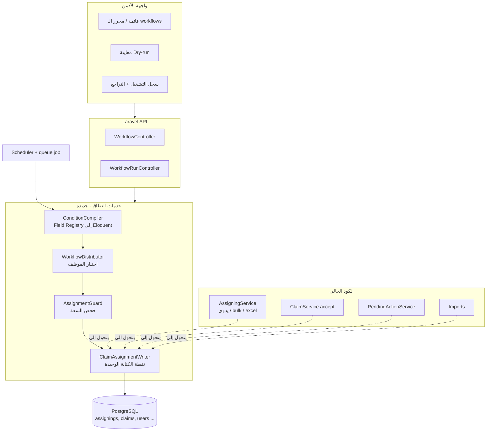
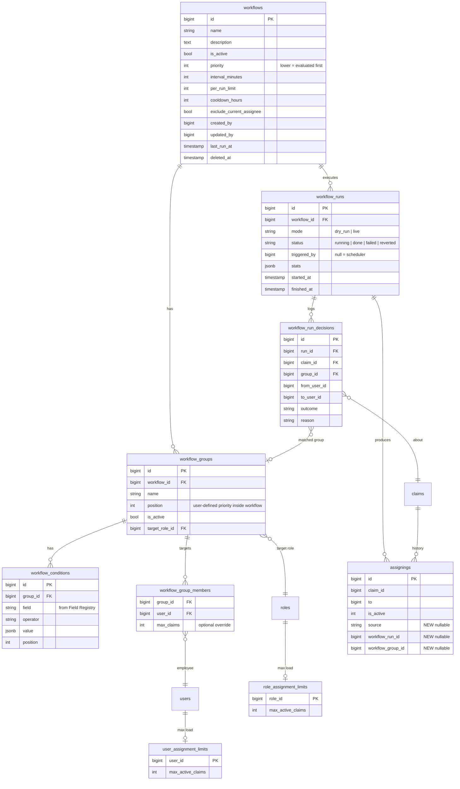
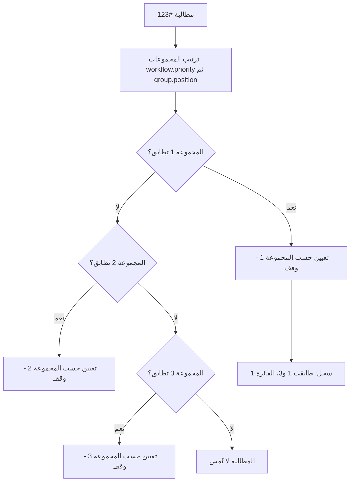
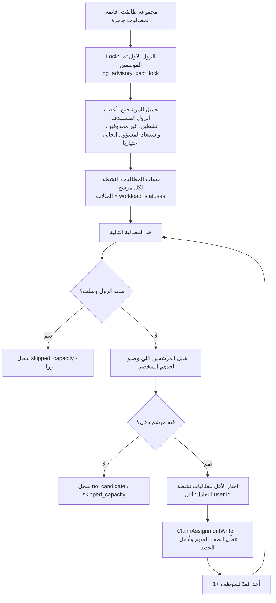
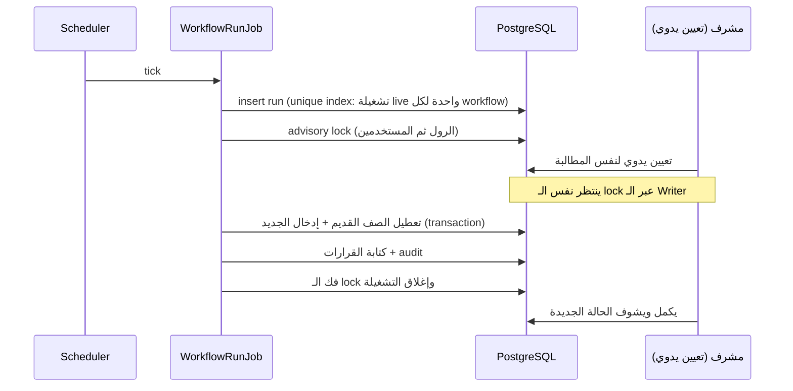
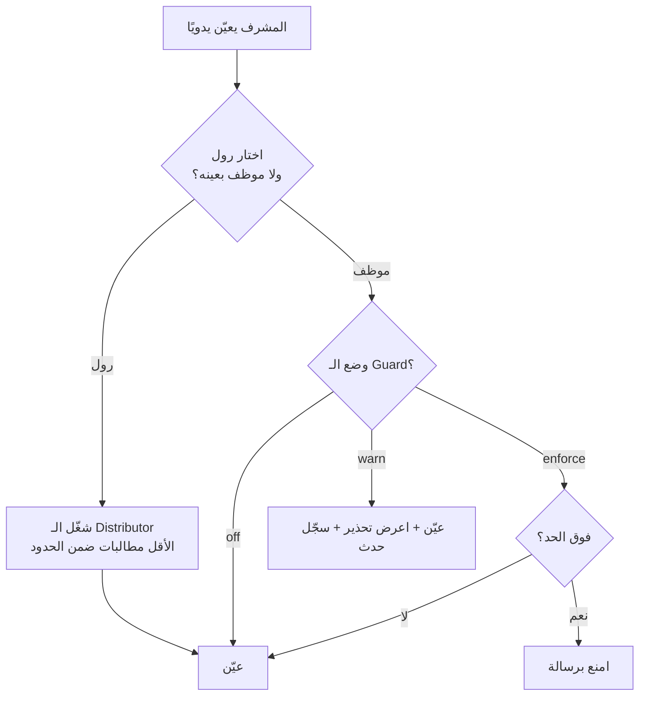

# Workflow Configuration — تصميم الميزة (عربي)

> النطاق: تصميم ميزة **"Workflow Configuration"** (التوزيع التلقائي للمطالبات بقواعد) فوق كود RCP الحالي على `main`.
> الملف المقابل: `workflow-configuration-design-en.md` (نفس المحتوى بالإنجليزي).
> المدخلات: BRD v1.0 من المدير + البروتوتايب `rcp_workflows_configuration_v1_2.html`.
> مستويات الثقة: **[مؤكد]** = متحقق منه في الكود، **[مرجع]** = من الـ BRD/البروتوتايب أو استنتاج من الكود، **[تخمين]** = افتراض مني يحتاج تأكيد من الـ business.

---

## 0. اقرأ ده الأول — الحاجات غير المريحة

1. **التوزيع على "أقل مطالبات" لوحده مش آمن.** لو موظف ملوش حد أقصى، الـ workflow ممكن يدفنه في مطالبات. لازم حدود السعة (لكل موظف ولكل رول) تتبني **قبل** تشغيل الميزة. [مؤكد]
2. **حالات المطالبة لسه مش متعرّفة.** الميزة مش هتعرف تحدد *أي مطالبات* تقدر تنقلها ولا *أي مطالبات تتحسب حِمل* غير لما الـ business يجاوب أسئلة القسم 8. البناء قبل الإجابة = إعادة بناء. [مؤكد]
3. **كتابة الـ assignments متفرقة.** لقيت **8 مسارات كود موجودة** بتعمل insert في `assignings` (القسم 3.3). لو الميزة اتضافت لبعضها بس، حدود السعة والتاريخ هيبقوا غير متسقين. لازم نقطة كتابة واحدة كشرط أساسي. [مؤكد]
4. **مفيش حاجة في الداتا بيز بتضمن "مسؤول نشط واحد لكل مطالبة".** تزامن بين تعيين يدوي وتشغيل workflow ممكن يطلّع صفّين نشطين. محتاجين lock دلوقتي وunique index بعد تنضيف الداتا. [مؤكد]
5. **الـ workflow اللي بينقل تلقائي ممكن يلغي قرار يدوي لمشرف بهدوء.** محتاجين cooldown وسجل مراجعة ظاهر، وإلا هنتلام على "المطالبات بتنط بين الناس". [مرجع]

---

## 1. الفكرة في رسمة واحدة

الـ *workflow* مجموعة قواعد محفوظة: **"أي مطالبات" ← "لأي رول/موظفين" ← "كام لكل واحد"**. الـ scheduler بيقيّمها دوريًا وبينشئ assignments عادية.


خصائص أساسية:
- ناتج الـ workflow هو **صف عادي في `assignings`**. كل حاجة بتقرأ التعيينات (الرؤية، التاريخ، التقارير) تفضل شغالة بدون تغيير.
- **حفظ الـ workflow عمره ما بينقل مطالبات.** بس التشغيل الصريح (مجدول أو "شغّل الآن").
- **Dry-run الأول:** الأدمن يشوف بالظبط مين هيستلم إيه قبل أي كتابة.

---

## 2. مكان الميزة في السيستم



الأسهم المنقطة هي الـ refactor اللي بيخلّي قواعد السعة موثوقة: كل مسار بينشئ تعيين يعدّي على `ClaimAssignmentWriter`. الترحيل تدريجي (القسم 13).

---

## 3. أساس السيستم والداتا بيز (اللي هنبني عليه)

### 3.1 الجداول المهمة

| الجدول | بيحتوي على | ليه مهم هنا |
|---|---|---|
| `claims` | المطالبة؛ `status` (enum `ClaimStatus`، 23 قيمة)، flag `is_close`، المبالغ، التواريخ | مصدر الشروط |
| `assignings` | تاريخ التعيينات؛ `claim_id`, `from`, `to`, `supervisor_id`, `assign_date`, `assign_comment`, `is_active`, `deleted_at` | **المسؤول الحالي = الصف اللي `is_active = 1`**؛ التاريخ = كل الصفوف |
| `users` | `role_id`, `client_id`, `supervisor_id`, `user_type`، soft delete | المرشحين للتوزيع |
| `roles` | enum `Roles`: SUPER_ADMIN=1, SUPERVISOR=2, COLLECTOR=3, EXTERNAL_OFFICE=4, LEGAL_DEPARTMENT=5, TAHEIYA_ADMIN=6, OTHERS=7, SENIOR_COLLECTOR=8 | الرول المستهدف |
| `permissions` | أعمدة JSON منها `settings` | مكان مفتاح صلاحية الميزة |
| `settings` | key + قيمة JSON | الـ kill switch وقائمة حالات الحِمل |
| `claim_comments`, `claim_status_histories` | التعليقات وتاريخ الحالات | مرافقات الـ audit |

### 3.2 حقائق لازم نحترمها
- في `assignings` فهارس على `(claim_id, is_active, created_at)` و`("to", is_active)` — كفاية لحساب الحِمل لكل موظف. [مؤكد]
- `is_active` من نوع `tinyInteger` (0/1). [مؤكد]
- موديل `Assigning` **مفيهوش SoftDeletes** رغم إن الجدول فيه `deleted_at`. [مؤكد]
- تعيين المطالبة **مبيغيّرش `claims.status`** (السطر اللي كان بيعمل كده متعلّق comment في `AssigningService`). يعني حالة "assigned" مش موثوقة. [مؤكد]
- عمود `assign_as_office` موجود وغير مستخدم. [مؤكد]
- رؤية المطالبات للمستخدم بتتحسب من التعيينات النشطة (والتفويضات) عبر `Claim::scopeVisibleTo`. [مؤكد]

### 3.3 كل مسارات الكود اللي بتكتب في `assignings` حاليًا [مؤكد]

| # | المسار | السلوك |
|---|---|---|
| 1 | `AssigningService::create` | يدوي، مطالبات كتير ← عدة موظفين (تقسيم متساوي) |
| 2 | `AssigningService::bulkCreate` | يدوي، مطالبات كتير ← موظف واحد |
| 3 | `AssigningService::excelBulkAssign` | تعيين جماعي بإكسل (متزامن) |
| 4 | `Jobs/ProcessBulkAssignClaimsOpenSpout` | تعيين جماعي بإكسل (queued) |
| 5 | `ClaimService` (accept، حوالي سطر 170) | تعيين عند القبول |
| 6 | `Actions/ClaimImportActions/AcceptClaimAction` | تعيين عند قبول الاستيراد |
| 7 | `Imports/ClaimImportWithActionMapper` (حوالي سطر 548) | تعيين أثناء استيراد المطالبات |
| 8 | `PendingActionService` (دالتين) | نقل للقانونية / لمحصّل أو مكتب جديد |
| 9 | (جديد) تشغيل الـ workflows | — |

المسارات 1–8 كلها بتعطّل الصف القديم وتدخل صف جديد **بدون lock وبدون أي فحص سعة**.

---

## 4. تصميم الداتا بيز المستهدف

### 4.1 مخطط العلاقات (ERD)



### 4.2 شرح الجداول

**القواعد (الإعدادات)**
- `workflows` — الحاوية: الاسم، تشغيل/إيقاف، `priority` عام، معدل التشغيل (`interval_minutes`)، حدود أمان (`per_run_limit` = أقصى مطالبات في التشغيلة، `cooldown_hours` = مطالبة اتوزعت تلقائي قريب متتلمسش تاني)، و`exclude_current_assignee` (متدّيش المطالبة لللي هي عنده أصلًا).
- `workflow_groups` — كتلة شروط مرتبة بـ **هدف واحد**. الـ `position` هو **أولوية المستخدم**. ده الرد على "مجموعتين اتحققوا والإسناد لاتنين مختلفين" (القسم 6).
- `workflow_conditions` — صف لكل شرط (`field`, `operator`, `value`). جوه المجموعة الشروط بـ **AND**. المجموعات المختلفة بدائل (OR بالأولوية، مش اتحاد).
- `workflow_group_members` — أي موظفين من الرول المستهدف يستلموا مطالبات؛ و`max_claims` اختياري خاص بالـ workflow.

**السعة (جديد، ومفيد خارج الـ workflows كمان)**
- `user_assignment_limits(user_id, max_active_claims)` — الحد الأقصى للموظف اللي المدير طلبه ("الموظف ميخدش أكتر من X"). `NULL` أو مفيش صف = بلا حد.
- `role_assignment_limits(role_id, max_active_claims)` — الحد الإجمالي للرول.

**التنفيذ والمراجعة**
- `workflow_runs` — صف لكل تشغيلة (dry-run أو live) وعدّاداتها في `stats`.
- `workflow_run_decisions` — صف لكل مطالبة اتفحصت: اتعيّنت، اتخطّت (cooldown / سعة / مجموعة أقل أولوية / لا مرشح / خطأ) و*ليه*. الجدول ده هو اللي بيجاوب "ليه المطالبة دي اتنقلت؟".

**تعديل على جدول موجود (إضافي، nullable فقط)**
- `assignings.source` (`manual | bulk | excel | import | accept | pending_action | workflow`)، `workflow_run_id`، `workflow_group_id`. الصفوف القديمة تفضل `NULL`. بتُستخدم في الـ cooldown والتراجع عن تشغيلة والتقارير.

**الإعدادات (من غير جدول جديد)**: المفتاح `workflows.enabled` (kill switch) و`workflows.workload_statuses` (الحالات اللي بتتحسب حِمل) في جدول `settings` الموجود.

### 4.3 الفهارس
- `workflow_groups (workflow_id, position)` و`workflow_conditions (group_id, position)`.
- `workflow_run_decisions (run_id)` و`(claim_id, created_at)`.
- `assignings (claim_id, source, created_at)` لبحث الـ cooldown.
- **Partial unique index** على `workflow_runs (workflow_id) WHERE mode='live' AND status='running'` — الـ workflow ميشتغلش مرتين في نفس الوقت.
- بعد تنضيف الداتا (القسم 10): partial unique على `assignings (claim_id) WHERE is_active = 1`.
- فهارس `assignings` تتعمل بـ `CREATE INDEX CONCURRENTLY` بنفس نمط migrations `2026_10_04_*` الموجودة.

---

## 5. الشروط: إزاي بنعبّر عن "أي مطالبات"

الشروط **مش SQL حر**. **Field Registry** (كلاس PHP) بيعمل whitelist للحقول المسموح بيها في الواجهة؛ كل عنصر عارف نوعه وعملياته المسموحة وإزاي يتحول لـ Eloquent clause.

أمثلة على عناصر الـ registry [تخمين — القائمة النهائية من الـ BRD]: حالة المطالبة، المبلغ، عمر المطالبة بالأيام، تاريخ الاستحقاق، العميل، رول المسؤول الحالي، عدد التعيينات السابقة، `is_close`.

القواعد:
- عمليات حسب النوع (`=`, `in`, `>`, `<`, `between`, `is null` ...).
- وقت نسبي فقط (مثلًا "أقدم من 30 يوم") بيتقيّم وقت التشغيل. بدون triggers مطلقة أو منطق timezone.
- كل query بيضاف لها تلقائيًا **فلتر الأهلية** من القسم 8 (`status in whitelist AND is_close = 0`) — الأدمن مبيقدرش يشيله.
- مدخل المستخدم عمره ما يوصل SQL كنص؛ الحقول غير المعروفة بتتـرفض عند الحفظ.

---

## 6. لما مجموعتين يطابقوا نفس المطالبة (أولوية يحددها المستخدم)

الأدمن بيرتّب المجموعات بالسحب والإفلات؛ الترتيب بيتخزن في `workflow_groups.position`. بين الـ workflows الترتيب بـ `workflows.priority`.



- **أول مطابقة تكسب.** المطالبة بتتعيّن مرة واحدة على الأكثر في التشغيلة.
- السجل بيحفظ *كل* المجموعات اللي طابقت والفائزة (`outcome = assigned` والباقي في `reason`)، فالأدمن يشوف التعارضات.
- **الـ Dry-run بيعرض تقرير "تداخل":** "128 مطالبة تطابق المجموعة 1 والمجموعة 3 — المجموعة 1 تكسب". الأدمن يعيد الترتيب قبل التفعيل.
- لو هدف المجموعة الفائزة معندوش سعة، المطالبة **متنزلش** تلقائيًا للمجموعة اللي بعدها (ده يناقض أولوية الأدمن بصمت). بتتسجل `skipped_capacity`. ممكن تبقى خيار لكل مجموعة بعدين [تخمين].

---

## 7. عملية التوزيع (اختيار الموظف)

### 7.1 الخوارزمية



ثلاث تفاصيل مهمة:
1. **مطالبة واحدة كل مرة مع إعادة عدّ بعد كل واحدة** — فالدفعة بتتوزع مش بتتكوّم على اللي كان أقل في البداية.
2. **الأقل مطالبات نشطة** (عدد مطلق) مش أقل نسبة استخدام. البروتوتايب بيستخدم greedy-by-utilisation؛ صياغة الـ BRD "أقل مطالبات". أنا ماشي مع الـ BRD. [مرجع]
3. **كسر تعادل حتمي** (أقل user id) عشان الـ dry-run والتشغيل الفعلي يدّوا نفس الإجابة.

### 7.2 مثال محسوب

الموظفين (الحالي / الحد الشخصي): Ahmed 130/150، Mohamed 140/300، Khaled 70/200، Sara 50/100. حد الرول 500. الموظف المصدر: Ahmed.

| الدفعة | النتيجة |
|---|---|
| 20 مطالبة | الـ 20 كلهم لـ **Sara** (50 ← 70؛ فضلت الأقل بعد كل مطالبة) |
| 200 مطالبة | Sara +50 (وصلت حدها 100)، Khaled +60، Mohamed +0، والـ **90 الباقيين بيفشلوا بسبب سعة الرول** (المتاح 110 بس) ويتسجلوا، مش بيتفرضوا |

(محسوب بسكريبت أثناء التحليل؛ منطق البروتوتايب greedy-by-utilisation كان هيبعت دفعة الـ 20 لـ Khaled.)

### 7.3 التزامن والأمان



حواجز الأمان:
- **Kill switch** `workflows.enabled` — إعداد واحد بيوقف كل التشغيلات.
- **حد التشغيلة** (`per_run_limit`) و**cooldown لكل مطالبة** (`cooldown_hours`).
- **Dry-run إلزامي** قبل أول تفعيل للـ workflow أو بعد تغيير قواعده.
- **التراجع عن تشغيلة**: جدول القرارات + `assignings.workflow_run_id` يسمحوا برجوع المسؤول السابق لكل مطالبات التشغيلة (بس لو محدش غيّره بعدها).
- حفظ أو تعديل الـ workflow **عمره** ما يشغّل تشغيلة.

---

## 8. حالات المطالبة — أسئلة للـ business

الميزة محتاجة قائمتين مختلفتين، و**مش نفس القائمة**:

- **(E) Eligible**: الحالات اللي الـ workflow يقدر *ينقلها*.
- **(W) Workload**: الحالات اللي *بتتحسب* في حِمل الموظف/حده.

وكمان: كل query بتشترط `claims.is_close = 0`. ملاحظة: `is_close = 1` بتتحط من بعض الإجراءات (closed, rejected, collected out of system) لكن ملقتهاش متحطة من كل حالات التحصيل [مرجع] — فلازم نفحص الحالة والـ flag مع بعض.

افتراضاتي المقترحة [تخمين] لكل الـ 23 قيمة في `ClaimStatus`:

| الحالة (value) | E مقترح | W مقترح | ملاحظة |
|---|---|---|---|
| registered | نعم | نعم | مطالبات جديدة — الاستخدام الرئيسي |
| assigned | نعم | نعم | مش موثوقة (التعيين مبيغيّرش الحالة) |
| approved | **اسأل** | نعم | "Pending" في التسميات القديمة — هل بتستنى موافقة؟ |
| follow_up | نعم | نعم | |
| follow_up/delay | نعم | نعم | هدف إعادة التوزيع المعتاد |
| follow_up/partial | نعم | نعم | |
| default_in_payment | **اسأل** | نعم | |
| default_in_payment_by_system | **اسأل** | نعم | |
| law_firm | لا | لا | تخص القانونية؛ والقانونية مستثناة |
| transfer_to_elm | لا | لا | خارجي |
| closed | لا | لا | |
| rejected | لا | لا | |
| collected_out_of_system | لا | لا | |
| done | لا | لا | محصّلة بالنظام |
| manaual_collected | لا | لا | (sic: القيمة مكتوبة كده في الكود) |
| manaual_collected_for_installment | لا | لا | القيمة موجودة في الـ enum؛ والكود بيكتب `follow_up/partial` بدلها |
| bank_collected | لا | لا | |
| collected_credited | لا | لا | |
| discount | **اسأل** | لا | بتظهر في تاريخ الحالات؛ هل هي حالة مستقرة؟ |
| claim_amount_change | **اسأل** | لا | |
| dispute payment | **اسأل** | لا | الكود بيحط `follow_up/partial` بدلها |
| delete_installment | **اسأل** | لا | |
| back_to_original_status | **اسأل** | لا | |

لآخر خمس حالات ملقيتش مكان بيكتبها في `claims.status` نفسه؛ بتظهر كحالات action/history [مرجع]. استعلام واحد على الـ production هيحسم:
`select status, count(*) from claims where is_close = 0 group by 1 order by 2 desc;`

### الأسئلة المطلوب إجابتها
1. أي حالات يقدر الـ workflow ينقلها (عمود E)؟ خصوصًا: `approved`، الاتنين `default_in_payment*`، `discount`.
2. أي حالات تتحسب حِمل على الموظف (عمود W)؟ هل المطالبات المحصّلة لكن غير المقفولة تتحسب؟
3. هل المطالبات اللي عليها **طلب موافقة معلّق** (زي النقل للقانونية) تتخطّى؟ [تخمين: نعم]
4. هل المطالبات اللي عند **القانونية أو المكتب الخارجي** تتوزع تاني أصلًا؟ [تخمين: أبدًا]
5. الحد بيخص *كل* المطالبات النشطة ولا حالات معينة (مثلًا follow-up بس)؟
6. القوائم عامة ولا كل workflow يختار قائمته؟ [تخمين: عامة افتراضيًا، وoverride لكل workflow بعدين]

القوائم بتتخزن في `settings`، يعني الإجابات إعدادات مش كود.

---

## 9. التأثير على التعيين اليدوي (Manual)

حد الموظف اللي المدير عايزه ("الموظف ده ميخدش مطالبات أكتر") بيفتح السؤال: هل بينطبق كمان لما المشرف يعيّن **يدويًا**؟

| الخيار | المعنى | المميزات | العيوب |
|---|---|---|---|
| **A. إلزام في كل مكان** | اليدوي والـ bulk والإكسل والاستيراد كلهم يتمنعوا عند الحد | متسق | بيكسر الاستيراد والقرارات اليدوية العاجلة؛ نطاق تأثير كبير |
| **B. للـ workflow بس؛ الحساب فقط لما يتختار رول** | الحدود على الـ workflows. في اليدوي، الحساب **بيحصل فقط لو المشرف اختار رول** (السيستم يختار الموظف). اختيار موظف بعينه مبيتمنعش | مخاطرة صفر على المسارات الحالية؛ مطابق للطلب | الحد ممكن يتجاوز باختيار شخص |
| **C. هجين (الموصى به)** | يبدأ زي B؛ التعيين اليدوي لشخص بيعرض **تحذير** ("Sara على 100/100") ويتسجل؛ وبعدين نضيف مفتاح "enforce" لكل مسار | تدريجي وقابل للقياس | شغل أكتر شوية |

**التوصية: C، وتبدأ بوضع B.**



طرح الـ Guard لكل مسار: **off ← warn ← enforce.** الإعدادات المبدئية: workflow = enforce؛ يدوي / bulk / إكسل = warn؛ الاستيراد = warn (كود الاستيراد بيبلع الـ exceptions فالمنع هناك هيخفي أخطاء)؛ نقل القانونية والنظام = مستثنى. أحداث التحذير بتتخزن (`assignment_guard_events`، جدول log صغير [تخمين]) عشان نقدر نعرض للمدير أرقام حقيقية قبل ما حد يشغّل الـ enforce.

---

## 10. الداتا القديمة — إزاي هتتعامل

المبدأ: **مفيش migration هادم. إضافي، nullable، قابل للتراجع.**

| الداتا الموجودة | اللي هيحصل |
|---|---|
| صفوف `assignings` (كل التاريخ) | متلمسش. الأعمدة الجديدة nullable وقيمتها `NULL` = "قديم / مصدر غير معروف". |
| الحِمل الحالي لكل موظف | **بيتحسب لحظيًا** من الصفوف النشطة. مفيش عمود عدّاد، يعني مفيش backfill ولا انحراف. |
| موظفين فوق الحد بالفعل | **grandfathered**: مفيش حاجة بتتاخد منهم؛ بس مش هيستلموا جديد لحد ما ينزلوا تحت الحد. |
| الحدود | تبدأ فاضية = بلا حد. الأدمن يحددها؛ ممكن نعمل seed لقيم مقترحة، لكن عمرها ما تتطبق بصمت. |
| مطالبات فيها **أكتر من مسؤول نشط** (ممكن حاليًا، مفيش guard) | audit query الأول (تحت). تقرير للـ business. إصلاح بأمر one-off متراجَع. وبعدين بس نضيف الـ partial unique index. |
| تعيينات نشطة على **مستخدمين محذوفين (soft delete)** | audit وإعادة تعيين بإجراء يدوي عادي؛ والـ workflows بتستبعد المحذوفين من المرشحين. |
| مستخدمين رولهم اتغيّر بعد التعيين | تفضل زي ما هي؛ الـ workflow بيستخدم رول المرشحين وقت التشغيل بس. |
| الصلاحيات | مفتاح جديد في `permissions.settings`، **مقفول افتراضيًا**، مفتوح للـ Super Admin؛ وبيتمنح للرولات التانية من شاشة الصلاحيات الموجودة. الافتراضيات تتضاف بأمر `app:update-permission` الموجود (فيه `--dry-run`). |
| `settings` | seed للقيمة `workflows.enabled = false`. |

استعلامات الـ audit (PostgreSQL) قبل التفعيل:

```sql
-- claims with more than one active assignee
select claim_id, count(*) from assignings
where is_active = 1 and deleted_at is null
group by claim_id having count(*) > 1;

-- active assignments pointing to deleted users
select a.claim_id, a."to" from assignings a
join users u on u.id = a."to"
where a.is_active = 1 and u.deleted_at is not null;

-- current load per employee
select "to", count(*) from assignings
where is_active = 1 and deleted_at is null
group by "to" order by 2 desc;
```

---

## 11. التغييرات المطلوبة (Checklist)

**الداتا بيز** — 8 جداول جديدة (القسم 4)، 3 أعمدة nullable على `assignings`، فهارس جديدة (concurrently)، seeds للإعدادات. مفيش عمود بيتمسح أو يتغير نوعه.

**الباك إند**
- `ConditionCompiler` + `FieldRegistry`.
- `WorkflowDistributor`.
- `AssignmentGuard` (أوضاع off/warn/enforce، لكل مسار).
- `ClaimAssignmentWriter` — نقطة الكتابة الوحيدة: transaction، advisory lock، تعطيل الصف القديم، إدخال الجديد، تحديد `source`، audit.
- ترحيل مسارات الكتابة الثمانية الموجودة للـ writer، **واحد واحد**، مع اختبارات لكل مسار.
- `WorkflowRunJob` (queued) + إدخال في الـ scheduler (بدون تداخل؛ ولاحظ إن الـ scheduler الحالي فيه أوامر كتير كل دقيقة، وقيمة الـ queue الافتراضية في البيئة `sync` — تشغيلات الـ workflow لازم تشتغل على queue حقيقي).
- Controllers/requests/resources لـ CRUD، dry-run، run-now، السجل، التراجع.
- مفتاح صلاحية + policy.

**الفرونت إند** — قائمة الـ workflows، المحرر (مجموعات بالسحب للترتيب، شروط، رول/موظفين مستهدفين، حدود)، معاينة dry-run مع تقرير التداخل، سجل التشغيل/التراجع، بانر تحذير في التعيين اليدوي، شاشة الحدود.

**التشغيل** — توثيق الـ kill switch؛ تنبيه لو تشغيلة فشلت أو وصلت لحد التشغيلة.

---

## 12. تأثير الميزة على السيستم

| المجال | التأثير | التخفيف |
|---|---|---|
| الأداء | query عدّ لكل مرشح في كل تشغيلة؛ queries شروط على `claims` | فهرس `("to", is_active)` الموجود؛ حد التشغيلة؛ فترة تشغيل بره الذروة |
| التزامن | سباق بين workflow وتعيين يدوي | advisory lock في الـ writer؛ unique index للتشغيلة |
| الرؤية / الصلاحيات | المطالبات بتنتقل بين الناس؛ المستخدم بيشوفها بنفس الـ visibility scope | مفيش حاجة مطلوبة؛ نفس آلية اليدوي |
| التاريخ / المراجعة | صفوف أكتر في `assignings`؛ سجلات قرارات جديدة | عمود `source`؛ سياسة احتفاظ بالقرارات (مثلًا 90 يوم) [تخمين] |
| التقارير / التصدير | التعيينات بقى ليها `source` | عمود اختياري جديد، والتقارير الحالية متتغيرش |
| الإشعارات | الموظفين بيستلموا مطالبات من غير ما حد يبلّغهم | نقرر لو محتاجين إشعار [سؤال مفتوح] |
| الاستيراد | مبيتلمسش مبدئيًا (warn بس) | — |
| التراجع | الميزة تتقفل فورًا؛ والتشغيلة تتراجع | kill switch + revert |

---

## 13. خطة التنفيذ

| المرحلة | المحتوى | المخاطرة |
|---|---|---|
| 0 | إجابة أسئلة القسم 8؛ تشغيل استعلامات الـ audit (القسم 10) | لا شيء |
| 1 | `ClaimAssignmentWriter` + ترحيل المسارات الموجودة؛ الـ Guard في وضع **off** | متوسطة (بتلمس مسارات حية) — اختبارات لكل مسار |
| 2 | جداول الحدود + الـ Guard في وضع **warn**، وجمع الأرقام | منخفضة |
| 3 | جداول الـ workflow، الـ compiler، الـ distributor، و**dry-run فقط** | منخفضة |
| 4 | تشغيل live خلف الـ kill switch، workflow تجريبي واحد | متوسطة |
| 5 | قرار وضع enforce لليدوي/bulk/إكسل؛ إضافة unique index للمسؤول النشط | متوسطة |

---

## 14. أسئلة مفتوحة (ملخص)
1. أسئلة القسم 8 (حالات الأهلية/الحِمل، الطلبات المعلقة، القانونية/المكتب).
2. حد الموظف عام ولا لكل workflow؟ (التصميم يدعم الاتنين: عام + override اختياري)
3. المطالبة المتخطّاة (الحد وصل) تنزل للمجموعة التالية ولا تستنى؟ [الافتراضي: تستنى]
4. إشعارات للموظفين عند التعيين التلقائي؟
5. معدل التشغيل: فترة ثابتة كفاية ولا محتاجين "يوميًا الساعة 08:00"؟ (التصميم حاليًا بيدعم الفترة فقط)
6. هل الـ workflow يسحب مطالبات من موظف *محدد* (فكرة "source" في البروتوتايب) — مفترض نعم؛ أكّد.
