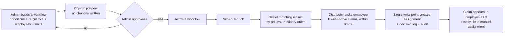
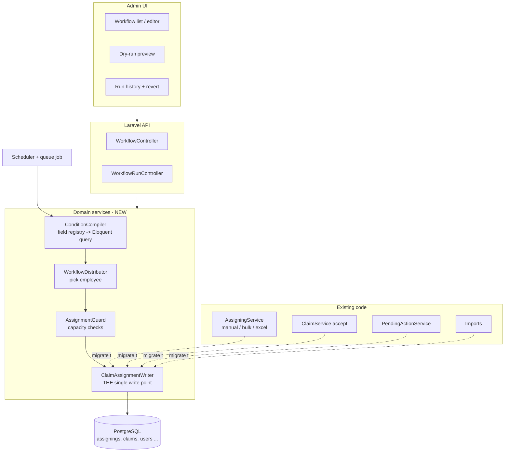
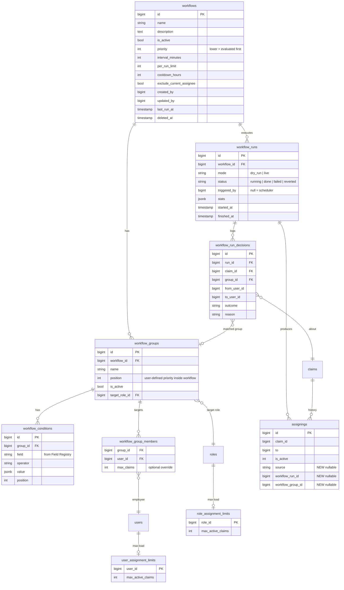
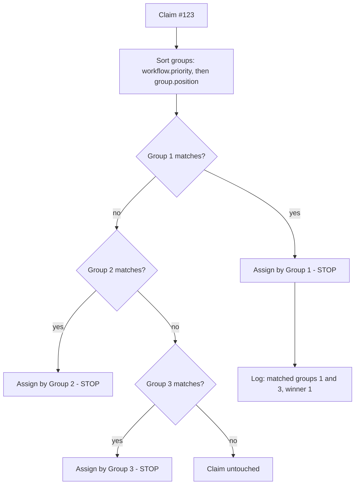
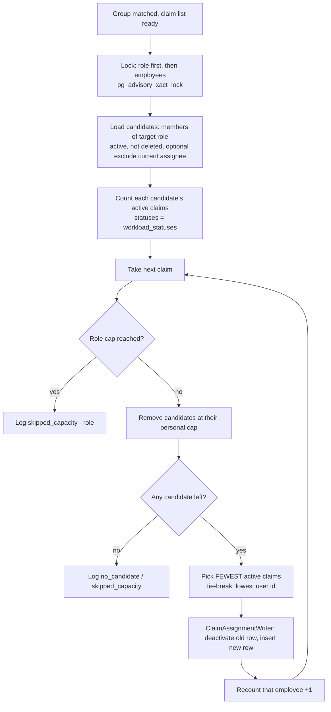
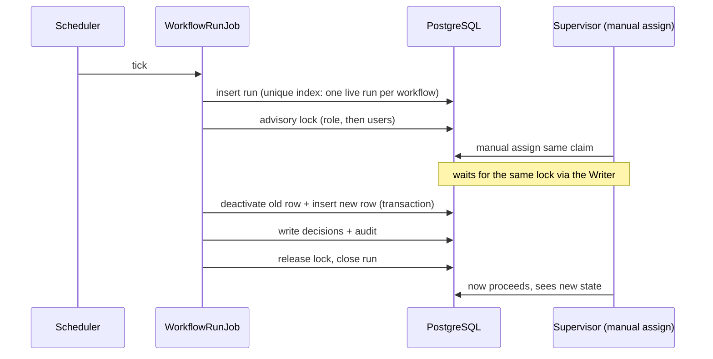
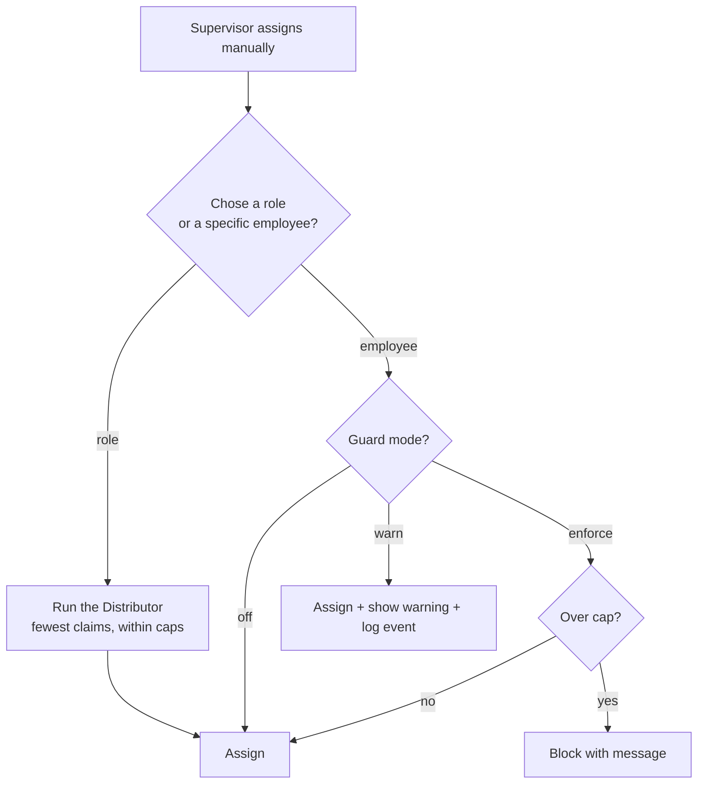

# Workflow Configuration — Feature Design (English)

> Scope: design of the new **"Workflow Configuration"** feature (rule-based automatic claim distribution) on top of the RCP codebase as it exists on `main`.
> Companion file: `workflow-configuration-design-ar.md` (same content, Arabic).
> Inputs: the manager's BRD v1.0 and the interactive prototype `rcp_workflows_configuration_v1_2.html`.
> Confidence tags used below: **[Confirmed]** = verified in code, **[Reference]** = taken from the BRD/prototype or inferred from code, **[Guess]** = my assumption, to be confirmed by the business.

---

## 0. Read this first — the uncomfortable parts

1. **Distribution by "fewest claims" is not safe by itself.** If an employee has no limit, the workflow can bury him. Capacity limits (per employee and per role) must exist *before* the feature is switched on. [Confirmed risk]
2. **Claim statuses are not defined yet.** The feature cannot decide *which claims* it may move, nor *which claims count as workload*, until the business answers section 8. Building before that answer means rebuilding. [Confirmed]
3. **Assignment writes are scattered.** I found **8 separate existing code paths** that insert into `assignings` (section 3.3). If the feature is added only to some of them, capacity limits and history will be inconsistent. A single write point is a prerequisite. [Confirmed]
4. **Nothing in the database guarantees "one active assignee per claim".** Concurrency between a manual assignment and a workflow run can create two active rows. Needs a lock now and a unique index after a data clean-up. [Confirmed]
5. **A workflow that moves claims automatically can quietly undo a supervisor's manual decision.** We need a cooldown and a visible audit trail, otherwise the feature will be blamed for "claims jumping between people". [Reference]

---

## 1. The idea in one picture

A *workflow* is a saved set of rules: **"which claims" → "to which role/employees" → "how many each"**. A scheduler evaluates it periodically and creates normal assignments.



Key properties:
- The result of a workflow is an **ordinary row in `assignings`**. Everything that already reads assignments (visibility, history, reports) keeps working unchanged.
- **Saving a workflow never moves claims.** Only an explicit run (scheduled or "run now") does.
- **Dry-run first**: the admin sees exactly who would receive what before anything is written.

---

## 2. Where the feature sits in the system



The dotted arrows are the refactor that makes the capacity rules trustworthy: every path that creates an assignment goes through `ClaimAssignmentWriter`. Migration is gradual (section 9, phase order).

---

## 3. System and database baseline (what we build on)

### 3.1 Tables that matter

| Table | What it holds | Why it matters here |
|---|---|---|
| `claims` | the claim; `status` (enum `ClaimStatus`, 23 values), `is_close` flag, amounts, dates | source of the conditions |
| `assignings` | assignment history; `claim_id`, `from`, `to`, `supervisor_id`, `assign_date`, `assign_comment`, `is_active`, `deleted_at` | **current assignee = the row with `is_active = 1`**; history = all rows |
| `users` | `role_id`, `client_id`, `supervisor_id`, `user_type`, soft-deleted | candidates for distribution |
| `roles` | `Roles` enum: SUPER_ADMIN=1, SUPERVISOR=2, COLLECTOR=3, EXTERNAL_OFFICE=4, LEGAL_DEPARTMENT=5, TAHEIYA_ADMIN=6, OTHERS=7, SENIOR_COLLECTOR=8 | target role |
| `permissions` | JSON columns incl. `settings` | where the feature's permission key lives |
| `settings` | key + JSON value | kill switch, workload-status list |
| `claim_comments`, `claim_status_histories` | comments and status history | audit companions |

### 3.2 Facts to respect
- `assignings` has indexes on `(claim_id, is_active, created_at)` and `("to", is_active)` — enough for load counting per employee. [Confirmed]
- `is_active` is `tinyInteger` (0/1). [Confirmed]
- `Assigning` model has **no SoftDeletes trait** even though the table has `deleted_at`. [Confirmed]
- Assigning a claim **does not change `claims.status`** (the line that did is commented out in `AssigningService`). So "assigned" is not a reliable status. [Confirmed]
- The `assign_as_office` column exists but is unused. [Confirmed]
- Visibility of claims for a user is computed from active assignings (and delegations) through `Claim::scopeVisibleTo`. [Confirmed]

### 3.3 Every code path that writes `assignings` today [Confirmed]

| # | Path | Behaviour |
|---|---|---|
| 1 | `AssigningService::create` | manual, many claims → several employees (even split) |
| 2 | `AssigningService::bulkCreate` | manual, many claims → one employee |
| 3 | `AssigningService::excelBulkAssign` | Excel bulk assign (synchronous) |
| 4 | `Jobs/ProcessBulkAssignClaimsOpenSpout` | Excel bulk assign (queued) |
| 5 | `ClaimService` (accept flow, ~line 170) | assignment on acceptance |
| 6 | `Actions/ClaimImportActions/AcceptClaimAction` | assignment on import accept |
| 7 | `Imports/ClaimImportWithActionMapper` (~line 548) | assignment during claims import |
| 8 | `PendingActionService` (two methods) | transfer to legal / to new collector or office |
| 9 | (new) workflow runs | — |

Paths 1–8 each deactivate the old row and insert a new one **without a lock and without any capacity check**.

---

## 4. Target database design

### 4.1 Entity-relationship diagram



### 4.2 Tables explained

**Rules (configuration)**
- `workflows` — the container: name, on/off, global `priority`, how often it runs (`interval_minutes`), safety limits (`per_run_limit` = max claims per run, `cooldown_hours` = a claim that was auto-assigned recently is not touched again), `exclude_current_assignee` (do not give the claim back to who already has it).
- `workflow_groups` — an ordered block of conditions with **one target**. `position` is the **user-defined priority**. This is the answer to "two groups match with different assignees" (section 6).
- `workflow_conditions` — one row per condition (`field`, `operator`, `value`). Inside a group they are combined with **AND**. Different groups are alternatives (OR by priority, not by union).
- `workflow_group_members` — which employees of the target role receive claims; optional per-workflow `max_claims` override.

**Capacity (new, also useful outside workflows)**
- `user_assignment_limits(user_id, max_active_claims)` — the per-employee cap the manager asked for ("an employee must not take more than X"). `NULL`/no row = unlimited.
- `role_assignment_limits(role_id, max_active_claims)` — total cap for a role.

**Execution and audit**
- `workflow_runs` — one row per run (dry-run or live), with counters in `stats`.
- `workflow_run_decisions` — one row per claim considered: assigned, skipped (cooldown / capacity / lower priority group / no candidate / error) and *why*. This table is what lets us answer "why did this claim move?".

**Change to an existing table (additive, nullable only)**
- `assignings.source` (`manual | bulk | excel | import | accept | pending_action | workflow`), `workflow_run_id`, `workflow_group_id`. Old rows keep `NULL`. Used for cooldown, revert-run and reporting.

**Settings (no new table)**: key `workflows.enabled` (kill switch) and `workflows.workload_statuses` (statuses counted as workload) in the existing `settings` table.

### 4.3 Indexes
- `workflow_groups (workflow_id, position)`, `workflow_conditions (group_id, position)`.
- `workflow_run_decisions (run_id)` and `(claim_id, created_at)`.
- `assignings (claim_id, source, created_at)` for the cooldown lookup.
- **Partial unique index** on `workflow_runs (workflow_id) WHERE mode='live' AND status='running'` — a workflow cannot run twice at once.
- After the data clean-up (section 10): partial unique `assignings (claim_id) WHERE is_active = 1`.
- Create indexes on `assignings` with `CREATE INDEX CONCURRENTLY`, same pattern the `2026_10_04_*` migrations already use.

---

## 5. Conditions: how "which claims" is expressed

Conditions are **not free SQL**. A **Field Registry** (a PHP class) whitelists the fields the UI may use; each entry knows its type, allowed operators and how to turn itself into an Eloquent clause.

Examples of registry entries [Guess — final list comes from the BRD]: claim status, claim amount, age of the claim in days, due date, client, current assignee's role, number of previous assignments, "is_close".

Rules:
- Operators per type (`=`, `in`, `>`, `<`, `between`, `is null` ...).
- Relative time only (e.g. "older than 30 days"), evaluated at run time. No absolute triggers or time-zone logic.
- Every query implicitly adds the **eligibility filter** from section 8 (`status in whitelist AND is_close = 0`) — the admin cannot remove it.
- The user input never reaches SQL as text; unknown fields are rejected on save.

---

## 6. When two groups match the same claim (user-defined priority)

The admin orders the groups by drag-and-drop; the order is stored in `workflow_groups.position`. Across workflows the order is `workflows.priority`.



- **First match wins.** One claim is assigned at most once per run.
- The decision log records *all* groups that matched and which one won (`outcome = assigned`, other matches stored in `reason`), so the admin can see conflicts.
- **Dry-run shows an "overlap" report**: "128 claims match both Group 1 and Group 3 — Group 1 wins". The admin can then reorder before activating.
- If the winning group's target has no capacity, the claim is **not** pushed down to the next group automatically (that would silently contradict the admin's priority). It is logged as `skipped_capacity`. This can become a per-group option later [Guess].

---

## 7. The distribution process (employee selection)

### 7.1 Algorithm



Three important details:
1. **One claim at a time, with a recount after each** — so a batch is spread, not dumped on whoever was lowest at the start.
2. **Fewest active claims** (absolute count), not lowest utilisation percentage. The prototype uses greedy-by-utilisation; the BRD wording is "fewest claims". I follow the BRD. [Reference]
3. **Deterministic tie-break** (lowest user id) so a dry-run and the real run give the same answer.

### 7.2 Worked example

Employees (current / personal cap): Ahmed 130/150, Mohamed 140/300, Khaled 70/200, Sara 50/100. Role cap 500. Source employee: Ahmed.

| Batch | Result |
|---|---|
| 20 claims | all 20 go to **Sara** (50 → 70; she stays the fewest after every single claim) |
| 200 claims | Sara +50 (hits cap 100), Khaled +60, Mohamed +0, remaining **90 claims fail on role capacity** (only 110 free) and are logged, not forced |

(Computed by script during analysis; the prototype's greedy-by-utilisation logic would send the 20-claim batch to Khaled instead.)

### 7.3 Concurrency and safety



Safety rails:
- **Kill switch** `workflows.enabled` — one setting stops all runs.
- **Per-run cap** (`per_run_limit`) and **per-claim cooldown** (`cooldown_hours`).
- **Mandatory dry-run** before the first activation of a workflow or after its rules change.
- **Revert a run**: the decisions table plus `assignings.workflow_run_id` let us restore the previous assignee for every claim of a run (only if nobody changed it since).
- Saving or editing a workflow **never** triggers a run.

---

## 8. Claim statuses — questions for the business

The feature needs two different lists, and they are **not the same list**:

- **(E) Eligible**: statuses a workflow may *move*.
- **(W) Workload**: statuses that *count* toward an employee's load/cap.

Also: every query additionally requires `claims.is_close = 0`. Note that `is_close = 1` is set by some actions (closed, rejected, collected out of system) but I did not find it set by all collected statuses [Reference] — so status and flag must both be checked.

My proposed defaults [Guess] for all 23 values of `ClaimStatus`:

| Status (value) | Proposed E | Proposed W | Note |
|---|---|---|---|
| registered | yes | yes | new claims — main use case |
| assigned | yes | yes | not reliably set (assignment does not change status) |
| approved | **ask** | yes | "Pending" in older labels — is it waiting for approval? |
| follow_up | yes | yes | |
| follow_up/delay | yes | yes | typical redistribution target |
| follow_up/partial | yes | yes | |
| default_in_payment | **ask** | yes | |
| default_in_payment_by_system | **ask** | yes | |
| law_firm | no | no | belongs to Legal; Legal is exempt |
| transfer_to_elm | no | no | external |
| closed | no | no | |
| rejected | no | no | |
| collected_out_of_system | no | no | |
| done | no | no | collected by system |
| manaual_collected | no | no | (sic: value is spelled like that in code) |
| manaual_collected_for_installment | no | no | enum value exists; code writes `follow_up/partial` instead |
| bank_collected | no | no | |
| collected_credited | no | no | |
| discount | **ask** | no | appears in status history; is it a resting status? |
| claim_amount_change | **ask** | no | |
| dispute payment | **ask** | no | code sets `follow_up/partial` for it |
| delete_installment | **ask** | no | |
| back_to_original_status | **ask** | no | |

For the last five I found no place that writes them to `claims.status` itself; they appear as history/action statuses [Reference]. A one-line production query will settle it:
`select status, count(*) from claims where is_close = 0 group by 1 order by 2 desc;`

### Questions I need answered
1. Which statuses may a workflow move (column E)? Especially: `approved`, both `default_in_payment*`, `discount`.
2. Which statuses count as an employee's workload (column W)? Should collected-but-not-closed claims count?
3. Should claims that have a **pending approval request** (pending actions such as transfer to legal) be skipped? [Guess: yes]
4. Should claims currently held by **Legal or External Office** ever be redistributed? [Guess: never]
5. Is the cap about *all* active claims or only specific statuses (e.g. follow-up only)?
6. Are the lists global, or should each workflow choose its own? [Guess: global default, optional per-workflow override later]

The lists are stored in `settings`, so the answers are configuration, not code.

---

## 9. Impact on manual assignment

The employee cap the manager wants ("this user should not take more claims") raises the question: does it also apply when a supervisor assigns **by hand**?

| Option | What it means | Pros | Cons |
|---|---|---|---|
| **A. Enforce everywhere** | manual, bulk, Excel, imports all blocked at the cap | consistent | breaks imports and urgent manual decisions; big blast radius |
| **B. Workflow-only; calculate only when a role is chosen** | caps apply to workflows. In manual assignment, the calculation runs **only if the supervisor picks a role** (system chooses the employee). Picking a specific employee is never blocked | zero risk to current flows; matches the request | the cap can be bypassed by choosing a person |
| **C. Hybrid (recommended)** | start as B; manual assignment to a person shows a **warning** ("Sara is at 100/100") and logs it; later add a per-path "enforce" switch | gradual, measurable | slightly more work |

**Recommendation: C, starting in B mode.**



Guard rollout per path: **off → warn → enforce.** Initial settings: workflow = enforce; manual / bulk / Excel = warn; imports = warn (the import code swallows exceptions, so blocking there would hide failures); Legal and system transfers = exempt. Warn events are stored (`assignment_guard_events`, small log table [Guess]) so we can show the manager real numbers before anyone turns on enforcement.

---

## 10. Existing data — how it is handled

Principle: **no destructive migration. Additive, nullable, reversible.**

| Existing data | What happens |
|---|---|
| `assignings` rows (all history) | untouched. New nullable columns are `NULL` = "legacy / unknown source". |
| Current load per employee | **computed live** from active rows. No counter column, so nothing to backfill and nothing to drift. |
| Employees already over a cap | **grandfathered**: nothing is taken away; they simply receive no new claims until under the cap. |
| Limits | start empty = unlimited. Admin sets them; defaults can be seeded as a suggestion, never silently enforced. |
| Claims with **more than one active assignee** (possible today, no guard) | audit query first (below). Report to the business. Fix with a reviewed one-off command. Only then add the partial unique index. |
| Active assignments to **soft-deleted users** | audit and reassign with a normal manual action; workflows exclude deleted users from candidates. |
| Users whose role changed after assignment | left as is; the workflow only uses the role of candidates at run time. |
| Permissions | new key in `permissions.settings`, **closed by default**, open for Super Admin; granted to other roles from the existing permissions screen. Defaults added through the existing `app:update-permission` command (it has `--dry-run`). |
| `settings` | seed `workflows.enabled = false`. |

Audit queries (PostgreSQL) to run *before* activation:

```sql
-- claims with more than one active assignee
select claim_id, count(*) from assignings
where is_active = 1 and deleted_at is null
group by claim_id having count(*) > 1;

-- active assignments pointing to deleted users
select a.claim_id, a."to" from assignings a
join users u on u.id = a."to"
where a.is_active = 1 and u.deleted_at is not null;

-- current load per employee
select "to", count(*) from assignings
where is_active = 1 and deleted_at is null
group by "to" order by 2 desc;
```

---

## 11. Required changes (checklist)

**Database** — 8 new tables (section 4), 3 nullable columns on `assignings`, new indexes (concurrently), settings seeds. No column is dropped or retyped.

**Backend**
- `ConditionCompiler` + `FieldRegistry`.
- `WorkflowDistributor`.
- `AssignmentGuard` (modes off/warn/enforce, per path).
- `ClaimAssignmentWriter` — the single write point: transaction, advisory lock, deactivate old row, insert new row, set `source`, audit.
- Migrate the eight existing write paths to the writer, **one at a time**, with tests per path.
- `WorkflowRunJob` (queued) + scheduler entry (non-overlapping; mind that the current scheduler already has many every-minute commands, and the environment default queue is `sync` — workflow runs must run on a real queue).
- Controllers/requests/resources for CRUD, dry-run, run-now, history, revert.
- Permission key + policy.

**Frontend** — workflow list, editor (groups with drag-to-order, conditions, target role/employees, limits), dry-run preview with overlap report, run history/revert, manual-assignment warning banner, limits screen.

**Operations** — kill switch documented; alert if a run fails or hits its per-run cap.

---

## 12. Impact on the system

| Area | Impact | Mitigation |
|---|---|---|
| Performance | one count query per run per candidate; condition queries over `claims` | existing `("to", is_active)` index; per-run cap; run off-peak interval |
| Concurrency | workflow vs manual assignment race | advisory lock in the writer; unique run index |
| Visibility / permissions | claims move between people; users see them through the existing visibility scope | none needed; same mechanism as manual |
| History / audit | more rows in `assignings`; new decision logs | `source` column; retention policy for decisions (e.g. 90 days) [Guess] |
| Reports / exports | assignments now have a `source` | optional new column, existing reports unchanged |
| Notifications | employees get claims without a human telling them | decide if a notification is wanted [open question] |
| Imports | untouched initially (warn only) | — |
| Rollback | feature can be switched off instantly; a run can be reverted | kill switch + revert |

---

## 13. Delivery plan

| Phase | Content | Risk |
|---|---|---|
| 0 | answer section 8; run audit queries (section 10) | none |
| 1 | `ClaimAssignmentWriter` + migrate existing paths; Guard in **off** mode | medium (touches live paths) — tests per path |
| 2 | limits tables + Guard **warn** mode, collect numbers | low |
| 3 | workflow tables, compiler, distributor, **dry-run only** | low |
| 4 | live runs behind kill switch, one pilot workflow | medium |
| 5 | decide enforce mode for manual/bulk/Excel; add unique active-assignee index | medium |

---

## 14. Open questions (summary)
1. Section 8 questions (eligible/workload statuses, pending actions, legal/office).
2. Is the cap per employee global, or per workflow? (design supports both: global + optional override)
3. Should a skipped claim (cap reached) fall through to the next group, or wait? [default: wait]
4. Notifications to employees on automatic assignment?
5. Run frequency: fixed interval acceptable, or do they need "daily at 08:00"? (design currently supports interval only)
6. Should a workflow be allowed to take claims from a *specific* employee (the prototype's "source" idea) — yes assumed; confirm.
