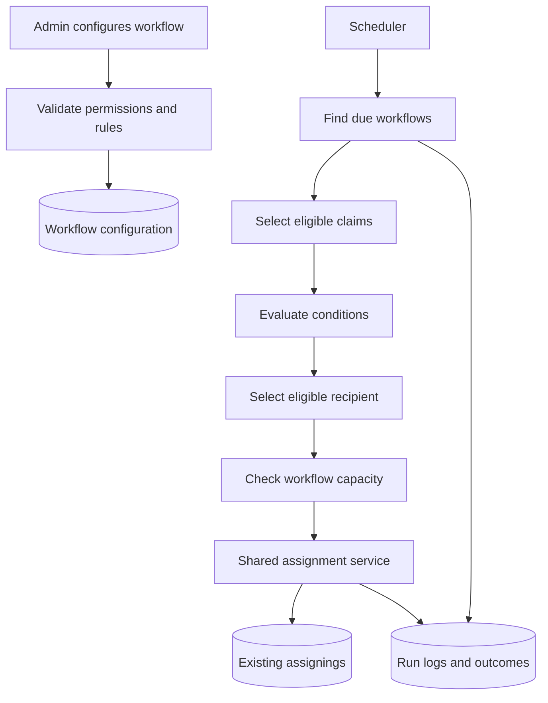
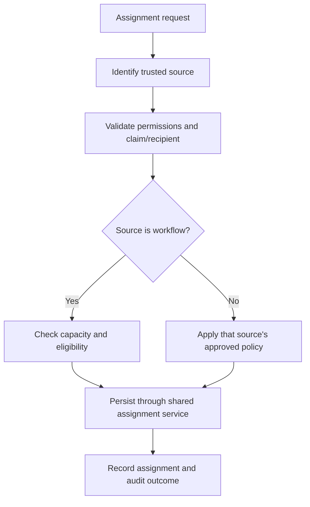

# Workflow Configuration — Flow Architecture

## 1. Goal

Introduce configurable rules for automatic claim assignment while preserving the existing assignment process and data.

**Design principle:** Workflow Configuration decides *which claim should be assigned to whom*. A shared assignment service validates and records the assignment. The workflow engine must not create a separate assignment mechanism or modify existing assignments during migration.

## 2. High-level flow

Configuration, dry-run, and execution logs are new capabilities. The existing `assignings` records remain the source of truth for claim assignment.

## 3. Main system and database changes

| Area | Proposed change |
|---|---|
| Workflow configuration | Store workflows, groups, conditions, status, schedule, and priority. |
| Execution | Add a scheduler/job, dry-run, run records, and per-claim outcomes. |
| Validation | Use an allowlist of supported condition fields/operators; never accept arbitrary SQL. |
| Assignment | Reuse the existing assignment service and `assignings` table. Add final eligibility and concurrency checks. |
| Permissions and audit | Add workflow-management permissions and track configuration changes. |
| Capacity | Define employee/role limits and their source before implementing enforcement. Add capacity storage only if no existing authoritative source exists. |

Suggested tables: `workflows`, `workflow_groups`, `workflow_conditions`, `workflow_runs`, `workflow_execution_logs`, and `workflow_audits`. Final names and fields should follow the existing project conventions.

## 4. Manual assignment and Capacity

Manual assignment should **not be forced to follow workflow capacity rules** if the business wants capacity to control automatic assignment only. Do not apply one global capacity rejection to every assignment path.

Recommended policy:

- **Workflow assignment:** enforce the approved employee/role capacity rules.
- **Manual assignment:** bypass capacity checks, but retain authorization, claim/recipient validity, assignment-history handling, and concurrency safeguards.
- **Imports and special transfers:** define their own explicit policies; do not silently swallow rejected rows.
- **Audit:** record the assignment source (manual, workflow, import, or transfer) so decisions can be explained later.

Implement this with an explicit assignment context/policy, for example `source = manual | workflow | import | transfer`. The shared assignment service should apply capacity based on that context. Do not use a broad boolean bypass that disables all validation, and do not infer the source from user input that has not been validated.

This preserves manual flexibility without allowing the automatic workflow to exceed its configured capacity. If the business later wants capacity warnings for manual assignments, add a warning-only mode without blocking the action.

## 5. Existing data and rollout

1. Audit duplicate active assignments and inconsistencies before adding constraints.
2. Deploy additive tables and permissions while automatic execution remains disabled.
3. Do not rewrite existing `assignings` rows or create fake historical workflow logs.
4. Run a dry-run on a bounded claim set; show proposed recipients, skipped claims, and capacity blockers.
5. Agree whether existing claims are in scope. Do not process historical backlog automatically on activation.
6. Enable a limited workflow first, then review logs and assignment reports before expanding.

Do not add a unique constraint for one active assignment per claim until existing data and every assignment writer have been checked.

## 6. Execution safeguards

- Revalidate eligibility and capacity immediately before a workflow assignment is saved.
- Prevent overlapping runs and make retries idempotent.
- Record assigned, skipped, and failed outcomes with clear reasons.
- Recalculate workload after each assignment when required by the approved distribution rule.
- Keep the existing assignment and claim-visibility behavior compatible.

## 7. Decisions required before implementation

- Definition of an active claim for workload counts.
- Employee/role eligibility, capacity limits, and the source of those limits.
- Whether workflows may reassign already-assigned claims.
- Priority when a claim matches multiple groups or workflows.
- Policies for imports, legal transfers, deletion, and recovery.
- Treatment of historical claims during the first run.

## Recommendation

Ship workflow execution with capacity enforced for **automatic workflow assignments only** by default. Keep manual assignment exempt from capacity while preserving its normal validation and audit controls. Expand enforcement to other sources only through an explicit business decision and regression testing.

**Status:** Proposed architecture; implementation and runtime behavior must be verified during development and testing.
