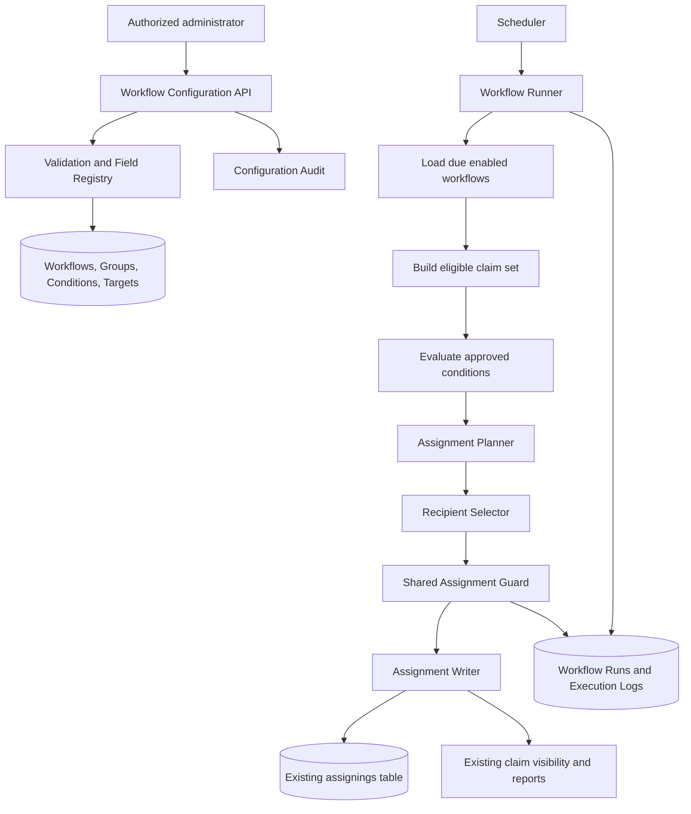
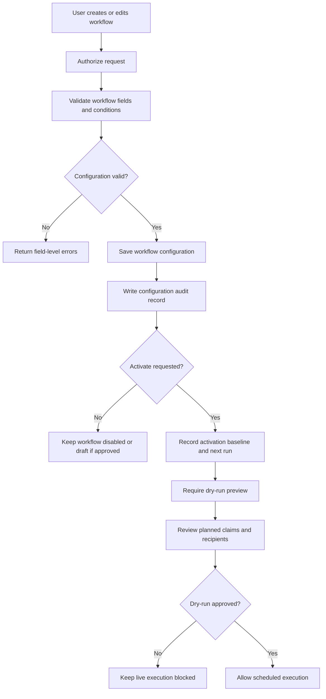
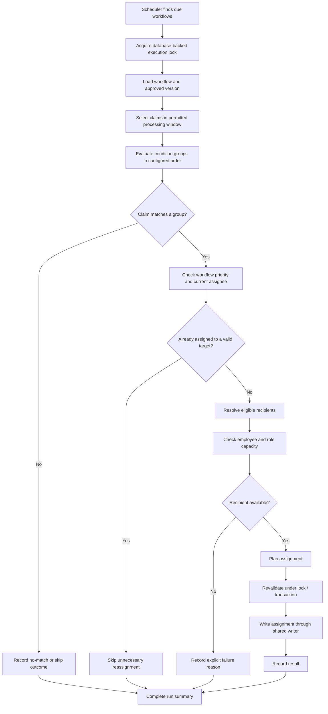

# Workflow Configuration — System & Data Flow Architecture

| Property | Details |
|---|---|
| Feature | Workflow Configuration / Automated Claim Assignment |
| Repository | `AhmedRamadan03/rcp` |
| Architecture baseline | `main` at `0c1ed66`, as reviewed in the technical analysis |
| Requirements sources | BRD v1.0 (draft) and interactive prototype v1.2 |
| Document purpose | Explain how the feature should fit into the existing system, which database/application changes are needed, and how existing data should be protected |
| Status | Proposed architecture — not implemented or validated by application tests |

## 1. Objective and scope

Workflow Configuration allows authorized users to define recurring rules that select claims and assign them to a specific employee or an eligible role. The system evaluates the configured conditions, chooses a valid recipient, applies the assignment safely, and records the execution outcome.

This document focuses on three areas:

1. The current database and assignment-system baseline.
2. The proposed architecture and end-to-end flow.
3. A safe approach for existing assignments and data migration.

The design follows the BRD as the intended business source of truth. Prototype-only behavior is not treated as approved unless Business confirms it.

## 2. Current system baseline

The reviewed `main` branch already has a claim-assignment foundation, but the analysis did not find a complete workflow-configuration engine or all capabilities the BRD describes as existing.

| Existing area | Current role / observation | Architectural implication |
|---|---|---|
| `claims` and `Claim` model | Stores claims and exposes assignment-related relationships/visibility behavior. | The workflow should query existing claims; it should not create a parallel claim store. |
| `assignings` and `Assigning` model | Stores claim assignment records, including `claim_id`, recipient (`to`), active state, and soft-delete-related database data. | Reuse the existing assignment domain. Audit its historical rows and active-assignment behavior before adding constraints. |
| `AssigningService` | Existing assignment entry point used by multiple application flows. The reviewed implementation does not provide the proposed unified capacity/concurrency guard. | Add a shared assignment-writing/validation boundary rather than allowing the workflow engine to write assignment rows independently. |
| `UserService` | Contains active-assigned-claim counting and reassignment behavior. The reviewed `reAssign()` changes the recipient on the same row. | Confirm the required history semantics; avoid silently rewriting historical assignment records as part of this feature. |
| Users, roles, and user type | Provides recipient identity, role membership, and user-type information. | Define eligibility and Internal/External meaning explicitly; do not infer them from UI labels. |
| Permissions | Existing permission infrastructure is present. | Add workflow permissions through the project's existing permission/default/backfill mechanism. |
| Scheduler / queue configuration | Existing scheduled commands and queue configuration are present, but production deployment details were not verified. | Confirm real scheduler and worker deployment before choosing job/lock behavior. |

### Important current-state gaps

The reviewed branch did not reveal a complete existing implementation of employee/role capacity limits, explicit assignment eligibility rules, a general workflow audit trail, or concurrency protection for assignment operations. These should be treated as implementation scope unless another branch or external system is confirmed to provide them.

The existing assignment code also needs a data-quality review: the analysis found no database constraint guaranteeing only one active assignment per claim, and the model/database soft-delete behavior should be reconciled. Do not add a uniqueness constraint until existing rows and all assignment writers are made compatible with it.

## 3. Proposed high-level architecture

The feature should have a configuration path and an execution path. Both should use shared domain services for eligibility, capacity, and writing assignments.

**Core design rule:** The workflow engine must not implement a second, independent assignment mechanism. It should decide *which claim should go to which recipient*, then delegate validation and persistence to a shared assignment boundary that can also be adopted by manual assignment and import flows.

## 4. End-to-end flows

### 4.1 Configure and activate a workflow

The BRD specifies Enabled/Disabled, while the prototype also introduces Draft. Keep Draft only if Business formally approves it. The activation baseline and mandatory dry-run are proposed safeguards against unexpected reassignment of historical backlog.

### 4.2 Scheduled execution

The diagram shows the recommended flow, not implemented behavior. The exact rules for already-assigned claims, group/workflow priority, eligibility, and the meaning of the execution interval must be approved before the engine is built.

### 4.3 Assignment write boundary

The shared assignment boundary should perform the final checks immediately before persistence:

1. Confirm the claim and target user still exist and are eligible.
2. Recalculate current active workload using one approved definition.
3. Check both employee-level and role-level capacity where configured.
4. Prevent concurrent operations from exceeding the agreed limits.
5. Persist the assignment and relevant history/audit information in a transaction.
6. Return a structured outcome, such as assigned, skipped, or rejected with a reason.

A planner may calculate a batch in advance for preview and fair distribution, but a plan is not a guarantee: eligibility and capacity must be revalidated during the write because manual assignment or another workflow may have changed the state. Do not perform an independent SQL query for every claim inside an unbounded loop; use bounded batches and bulk/eager-loaded workload data, then perform authoritative checks at write time.

## 5. Proposed database changes

These are proposed additions, not tables confirmed to exist today. Final names and column types should follow the project's migration conventions.

| Table / area | Purpose | Likely key fields |
|---|---|---|
| `workflows` | Stores each configured workflow and its execution state. | `id`, `name`, `type`, `status`, `client_id` if confirmed, `interval_value`, `interval_unit`, `priority`, `enabled_at`, `next_run_at`, timestamps, soft-delete fields if approved |
| `workflow_groups` | Stores ordered condition groups and each group's assignment target. | `id`, `workflow_id`, `position`, `target_type`, `target_id` |
| `workflow_conditions` | Stores validated conditions without arbitrary SQL. | `id`, `workflow_group_id`, `field_key`, `operator`, `value`, timestamps |
| `workflow_runs` | One record per scheduled or dry-run execution. | `id`, `workflow_id`, workflow/config version or snapshot, `mode`, `status`, start/end timestamps, counts, error summary |
| `workflow_execution_logs` | Records claim-level outcomes and reasons. | `id`, `workflow_run_id`, `claim_id`, planned/actual target, `outcome`, `reason_code`, timestamp |
| `workflow_audits` | Tracks configuration changes and who made them. | `id`, `workflow_id`, actor, action, before/after snapshot or diff, timestamp |
| Existing `assignings` | Remains the source of truth for assignment records. | Reuse existing structure; add columns only if a specific approved reporting/history need requires them. |
| Capacity storage | Stores employee and role limits if no existing source is found. | Employee capacity and role capacity fields/table, with effective status and auditability as required. |

### Database design rules

- Use foreign keys and indexes aligned with actual query patterns, such as enabled/due workflows, workflow-to-groups, group-to-conditions, and run-to-claim logs.
- Use a field registry/allowlist for condition fields and operators. Never execute user-provided SQL or accept unrestricted column names.
- Keep configuration audit records separate from execution outcomes: one explains *who changed the rules*; the other explains *what a run did*.
- Define whether a workflow is tenant/client-specific before deciding the final `client_id` constraint and uniqueness rules.
- Do not add a partial unique index for one active assignment per claim until duplicate active rows have been audited, all relevant writers are transaction-safe, and the intended active-row definition is confirmed.
- If assignment provenance is required in reports, explicitly define how a system/workflow assignment is represented. Do not invent fake users or fabricate historical assignment records.

## 6. Condition evaluation and recipient selection

### Condition evaluation

Use a server-side field registry that maps an approved business field to a known database expression or query-builder callback. Each field should define supported operators, value validation, and whether it is available in the first release.

Start with fields already represented reliably in the current database. The analysis identified prototype fields such as portfolio value, last actual activity, delay days, and claim age whose definitions or direct storage were not confirmed. Do not expose those fields until their business definitions and data sources are agreed.

The BRD specifies AND-only conditions within a group. Do not implement prototype-only OR behavior unless the BRD is formally changed.

### Recipient selection

For role-based assignment, the BRD's intended rule is the eligible employee with the lowest current active assigned-claim count, recalculated after each assignment. Capacity must also be respected if the combined role/employee limits are confirmed.

The prototype's simulation uses a different rule and can return different recipients. It must not be used as the implementation oracle unless Business explicitly changes the approved rule.

Before implementation, define:
- The exact active/open claim statuses included in workload counts.
- Employee eligibility and treatment of inactive/deleted users.
- Role membership and Internal/External recipient semantics.
- Role-level versus employee-level capacity behavior.
- Tie-breaking when employees have equal workload.
- What happens when a claim matches multiple groups or workflows.
- Whether an already-valid assignee is kept rather than reassigned on every run.

## 7. Existing data: migration and rollout strategy

**Default principle: schema migration must not silently reassign claims or manufacture history.** Adding workflow configuration should leave current assignments unchanged unless a separately approved and audited operation explicitly changes them.

### Phase A — Audit before migration

1. Take a verified backup and confirm the rollback/restore procedure.
2. Measure claims with multiple active assignment rows, missing/deleted recipient users, and inconsistent active/deleted state.
3. Confirm how existing reports and claim visibility determine the current assignee.
4. Calculate current workload using the exact candidate definition and compare it with existing reports.
5. Identify current users/roles and decide where capacity values will come from. Do not invent limits or apply arbitrary defaults.
6. Inventory every assignment writer, including manual operations, imports, legal transfers, user deletion/reassignment, and revert paths.

Produce a data-quality report first. Resolve anomalies with an explicit business-approved policy; do not delete or rewrite assignment history merely to make a constraint pass.

### Phase B — Additive schema deployment

1. Add workflow configuration, group, condition, run, log, and audit tables.
2. Add the new permission through the existing permission/default mechanism, with access disabled for roles that should not manage workflows.
3. Add capacity storage only after confirming no authoritative existing source exists.
4. Do not change the meaning of existing assignment columns or mass-update existing claims.
5. Deploy the schema in a backward-compatible way so the current assignment system continues to operate while workflow execution is disabled.

### Phase C — Backfill only what is necessary

- Backfill permissions/configuration defaults using the existing application mechanism while preserving current permission values.
- If a new capacity source is introduced, populate it only from approved, authoritative values. Leave unknown values explicitly unset rather than guessing.
- Do not create historical `workflow_runs`, audit entries, or workflow assignment records for events that never occurred.
- Existing assignment rows should remain as they are until data-quality findings are reviewed and a separate repair plan is approved.
- Do not enable a new uniqueness constraint until duplicate detection, cleanup, and writer compatibility checks are complete.

### Phase D — Dry-run and controlled activation

1. Create the workflow disabled.
2. Run dry-run against a bounded claim set and show the matched count, proposed recipients, capacity blockers, and exclusions.
3. Have Operations approve the result before the first live run.
4. Set an explicit activation baseline so historical backlog is not processed by accident. If the business wants historical claims included, make that a deliberate, reviewed option.
5. Apply a per-run processing limit and record every claim-level result.
6. Enable live execution for a limited workflow/cohort, then compare logs, workload counts, and assignment reports before widening rollout.

### Phase E — Capacity guard rollout

Because capacity enforcement changes existing behavior, do not turn it on globally without measurement.

| Mode | Behavior | Intended use |
|---|---|---|
| `off` | Existing behavior; no enforcement. | Initial deployment while collecting baseline data. |
| `warn` | Record a would-be capacity violation but allow the operation. | Measure impact across manual assignment and imports. |
| `enforce` | Reject an operation that violates the approved policy. | Only after Operations approval and path-by-path regression tests. |
| `exempt` | Explicitly bypass the guard for an approved operation class. | Only for documented cases such as legal transfers or recovery flows, where Business approves it. |

Every rejection must be surfaced to the caller/import result, not merely swallowed by a generic exception handler. An exemption must be explicit, limited to a known context, and audited.

## 8. Compatibility with existing assignment flows

The workflow engine and existing assignment entry points should converge on one shared assignment boundary over time.

| Flow | Recommended handling |
|---|---|
| Manual assignment | Integrate with the shared guard after the warning/measurement period and policy approval. |
| ART/GIG imports | Ensure capacity violations are reported as row-level/import outcomes; do not silently discard failures. |
| Legal transfer / law-firm flows | Confirm business rules first; add a narrowly scoped exemption only if the transfer must bypass normal capacity. |
| User deletion and reassignment | Ensure the process remains possible and does not become blocked by a general capacity rule. |
| Revert/recovery paths | Preserve operational recovery capability with explicit policy and audit. |
| Reports and claim visibility | Verify the existing assignment remains the source of truth and that changes immediately preserve correct visibility/history. |

The exact impact on each path must be validated against the current code before implementation. This document does not claim that the integrations have already been made.

## 9. Failure handling, concurrency, and observability

- Prevent overlapping runs of the same workflow using a database-backed lock or another deployment-appropriate distributed lock. Confirm the production database, cache driver, and number of application servers before finalizing the mechanism.
- Revalidate recipient eligibility and capacity within the assignment transaction/locking boundary. A precomputed plan alone cannot protect against concurrent manual assignment.
- Make retries safe: record run identity and claim-level outcomes so a retry does not blindly create duplicate assignments.
- Keep failures isolated per claim where the approved batch policy permits partial success; record stable reason codes such as `no_matching_group`, `no_eligible_recipient`, `employee_capacity`, `role_capacity`, `already_on_target`, and `assignment_write_failed`.
- Provide run summaries: scanned, matched, assigned, skipped, failed, and elapsed time.
- Alert on repeated run failures, high rejection rates, lock contention, and growing backlog.
- Test with concurrent workflow runs and manual assignments targeting the same role/employee.

## 10. Implementation sequence and acceptance gates

| Phase | Deliverables | Acceptance gate |
|---|---|---|
| **0 — Business decisions** | Approved rules for interval, eligible recipients, active workload, capacity, priority, and existing claims. | No unresolved decision that changes the execution algorithm. |
| **1 — Data foundation** | Migrations, models, permission defaults, indexes, and data-quality scripts. | Existing application behavior unchanged; migrations tested on representative data. |
| **2 — Configuration API** | CRUD, field registry, validation, configuration audit. | Invalid/unapproved fields and operators are rejected; permissions verified. |
| **3 — Execution engine** | Planner, selector, shared assignment writer/guard, scheduler/job, dry-run, run logs. | Unit/feature tests plus idempotency and concurrency tests pass. |
| **4 — Existing-flow integration** | Manual/import/legal/recovery paths handled under approved policies. | No silent import failures; regression tests pass for each affected path. |
| **5 — Production rollout** | Dry-run, limited activation, monitoring, gradual enforcement. | Operations signs off on observed results before broader rollout. |

Minimum tests should include the BRD distribution rule, employee and role capacity boundaries, no eligible recipient, overlapping workflows, already-valid assignee, duplicate active assignments, retry/idempotency, scheduler overlap, concurrent manual assignment, import error reporting, permission enforcement, and claim visibility/history regression.

## 11. Decisions required before final implementation design

1. Confirm whether the execution duration means a recurring interval or claim age.
2. Confirm whether workflows can process already-assigned claims and approve the no-unnecessary-reassignment rule.
3. Define Internal/External eligibility and role membership.
4. Confirm role-level and employee-level capacity semantics and the source of capacity values.
5. Approve the active/open claim definition used for workload counts.
6. Define tie-breaking and priority across groups/workflows.
7. Confirm tenant/client scope and workflow name uniqueness.
8. Decide whether Draft is a supported state and whether any prototype-only options are in scope.
9. Define capacity behavior and exceptions for manual assignments, imports, legal transfers, deletion, and revert flows.
10. Confirm production scheduler, queue workers, database, cache, and multi-server deployment details.
11. Approve how the first run treats existing backlog and the maximum number of claims processed per run.
12. Decide whether batch execution is partial-success or all-or-nothing.

## 12. Verification boundaries

This architecture is based on the existing technical analysis of the BRD, prototype, and selected code on `main` at `0c1ed66`. The application was not run and tests were not executed as part of that analysis. Production data, real deployment/queue settings, frontend behavior, and other branches were not inspected. Therefore, proposed tables, services, and flows must be verified against the current repository and deployment before implementation.

**Recommendation:** Approve the business rules first, then implement the additive configuration foundation, execution engine, and controlled data-safe rollout in that order. Keep the current assignment records as the source of truth and avoid mass reassignment during migration or activation.
