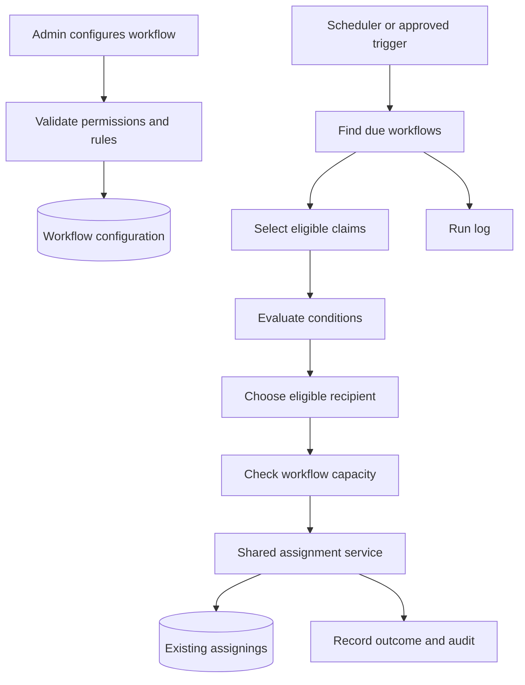

# Workflow Configuration — Flow Architecture

**Purpose:** Assess how configurable workflows for automatic claim assignment can fit into the existing system, what should change, and how current data should be protected.

> This is a proposed design, not a claim that the feature has already been implemented. Exact model relationships, assignment entry points, and capacity sources must be confirmed against the current code before implementation.

## 1. Database and System Analysis

### Existing system boundary

- The existing `assignings` records remain the source of truth for claim assignments. Workflow Configuration should use the existing assignment path rather than create a parallel assignment table or mechanism.
- Assignment can originate from different paths, including manual assignment and potentially imports or transfers. These paths must not accidentally inherit the same capacity policy.
- Workflow evaluation and assignment persistence are separate responsibilities: the workflow determines eligible claims and recipients; the existing assignment process validates and records the result.
- The current authoritative source for employee/role capacity is not established in this design. Inspect existing models, relationships, and workload calculations before introducing new capacity storage.
- Before changing constraints, inspect current assignment records and every code path that creates, changes, or removes assignments. The design must not assume that existing data is duplicate-free or that only one writer exists.

### Main risks to account for

- Duplicate or inconsistent active assignments may exist in historical data.
- A workflow may select a claim or recipient that becomes ineligible before the assignment is saved.
- Concurrent workflow runs or manual actions may assign the same claim or exceed capacity unless the final write is protected.
- Applying capacity globally could block valid manual assignments.
- Processing all historical claims on first activation could create an unexpected assignment backlog.

## 2. Changes Required to Support Workflow Configuration

### Proposed database changes

| Component | Purpose |
|---|---|
| `workflows` | Store workflow definition, enabled status, schedule, and priority. |
| `workflow_groups` | Organize rules or assignment groups within a workflow. |
| `workflow_conditions` | Store supported condition fields, operators, and values. |
| `workflow_runs` | Track each scheduled or manually triggered execution. |
| `workflow_execution_logs` | Record per-claim outcomes such as assigned, skipped, or failed, with reasons. |
| `workflow_audits` | Track configuration changes and who made them. |

These are proposed table names; final names, fields, foreign keys, indexes, and relationships should follow existing project conventions. Add capacity tables only if code inspection confirms there is no reliable existing source of capacity limits or workload.

### Proposed system changes

1. Add workflow configuration management with permission checks and validation.
2. Add a scheduler/job to find due workflows, select eligible claims, evaluate configured conditions, and choose recipients.
3. Restrict conditions to an allowlist of supported fields and operators. Do not execute arbitrary SQL from configuration.
4. Reuse the existing assignment service and `assignings` table for persistence.
5. Recheck claim eligibility, recipient eligibility, and applicable capacity immediately before saving.
6. Prevent overlapping runs and make retries idempotent; log each outcome and its reason.
7. Add dry-run support so proposed assignments can be reviewed before execution is enabled.

### Manual assignment and capacity policy

Capacity should apply to automatic workflow assignments by default—not automatically to every assignment path.

- **Workflow assignment:** enforce the approved capacity and eligibility rules.
- **Manual assignment:** do not block solely because the recipient has reached workflow capacity. Keep authorization, claim/recipient validation, concurrency safeguards, and assignment history.
- **Imports and transfers:** define an explicit policy for each path instead of silently treating them as workflow assignments.
- **Audit:** record a trusted source such as `manual`, `workflow`, `import`, or `transfer`.

Pass the source as a trusted assignment context to the shared assignment service. Apply capacity according to that context; do not use a broad bypass that disables other validation, and do not trust an unvalidated client-supplied source value. If needed, manual assignment can later show a capacity warning without blocking the action.

### Proposed flow

## 3. Handling Existing Data

1. **Inspect before migrating:** review the current `assignings` schema, relationships, active-assignment definition, duplicate records, and all assignment writers. Confirm the capacity source and workload calculation.
2. **Use additive migrations:** introduce workflow tables, indexes, and permissions without rewriting existing assignment records. Keep workflow execution disabled during deployment.
3. **Preserve historical meaning:** do not fabricate workflow-run history for assignments made before the feature existed. Existing assignments remain existing assignments; new workflow logs begin when workflow execution is enabled.
4. **Do not auto-reassign existing claims:** define explicitly whether already-assigned claims are excluded, eligible for reassignment, or handled by a separate reviewed process.
5. **Dry-run first:** test on a bounded set and report proposed recipients, skipped claims, capacity blockers, and reasons. Compare the output with expected business rules before writing assignments.
6. **Avoid an unreviewed historical backlog:** set the first-run scope and cutoff explicitly. Do not process every old claim automatically on activation.
7. **Roll out gradually:** enable a limited workflow, monitor logs and assignment reports, validate capacity behavior, then expand.
8. **Delay risky constraints:** do not add a unique constraint for one active assignment per claim until existing records, the business definition, and all assignment writers have been verified.
9. **Keep rollback safe:** disabling the workflow should stop new automated runs without deleting existing assignments or workflow audit history.

## Decisions Required Before Implementation

- What qualifies as an active claim and an active assignment?
- Where do capacity limits come from, and how is workload calculated?
- Can a workflow reassign a claim that already has an assignee?
- How are priority conflicts handled when multiple workflows match?
- What policies apply to imports, transfers, and recovery?
- Which existing claims are eligible during the first run?

**Recommended default:** preserve the current assignment records and manual flow; enforce capacity for automatic workflow assignments only; introduce the feature gradually behind a disabled-by-default execution switch.
