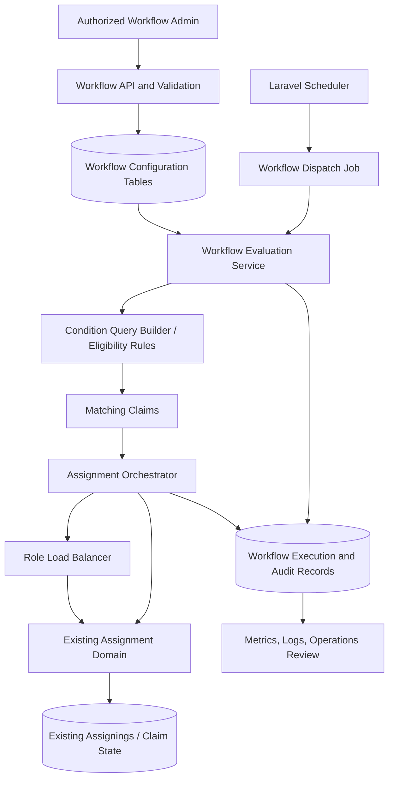

# RCP Workflow Configuration — Solution Architecture

**Document type:** Solution Design Proposal (SDP)  
**Status:** Proposed — for Architecture, Product, and Operations review  
**Repository baseline:** `AhmedRamadan03/rcp`, branch `docs/workflow-configuration-analysis`  
**Scope:** Configurable claim workflows, condition groups, scheduled evaluation, employee/role assignment, capacity-aware load balancing, and gradual adoption of existing RCP data.

> This document is a new architecture proposal. It does not replace or modify the existing workflow-analysis document or the BRD. Business requirements below follow the supplied Workflow Configuration BRD v1.0; implementation details are recommendations that must be validated with the project owners before coding.

## 1. Executive Recommendation

Implement workflow configuration as a **separate, data-driven orchestration layer** that reuses RCP's existing claim, user, role, payment, and assignment concepts. Do not replace the existing assignment mechanism or mass-reassign the current portfolio.

The proposed feature should:

1. Let authorized users configure enabled/disabled Internal or External workflows, execution duration, condition groups, and assignment actions.
2. Evaluate workflows in a scheduled background process, without a new per-workflow trigger/start-method field.
3. Support a condition group containing one or more conditions combined with **AND**. Each group has its own target: a specific employee or a role.
4. For role targets, select an eligible employee with the **lowest current active assigned-claim count**, while respecting employee and role capacity.
5. Reuse the existing assignment history/active-assignment mechanism, and write a separate workflow execution/audit record for traceability and idempotency.
6. Roll out in stages: schema and services first, dry-run/observability next, then enable workflows for a limited scope. Existing assignments remain untouched unless a separately approved reassignment project is undertaken.

**Important design principle:** the workflow engine decides *which claims qualify and who should receive them*; the existing RCP assignment domain remains the source of truth for *recording and enforcing assignment changes*.

## 2. Evidence From the Current RCP Codebase

The following observations are based on the repository branch inspected for this proposal.

| Existing component | Observed behavior | Architectural implication |
|---|---|---|
| `Claim` model | Uses soft deletes; exposes `assignees()`, active `assignee()`, `statusHistory()`, `payments()`, and claim status/date fields. It also defines `scopeVisibleTo()`. | Build eligibility and condition evaluation against explicit query services. Do not use UI visibility scope as a substitute for operational eligibility. |
| `Assigning` model | Represents a claim assignment with `claim_id`, `from`, `to`, `supervisor_id`, `assign_date`, and active state via `is_active`. | Preserve this existing assignment ledger/mechanism. Confirm database constraints and the exact transaction used by current assignment endpoints before implementation. |
| `User` model | Has `role_id`, `supervisor_id`, soft deletes, `subordinates()`, and active-claim relations based on active assigning records. | Role membership appears to be represented by `users.role_id`; eligibility must filter inactive/deleted users and apply current business rules. |
| `Role` model | Exposes `users()` through `users.role_id`. | Role recipients can be resolved from current role membership; do not persist a static copy of role members in a workflow. |
| `PaymentLink` model | Has `due_date`, `send_status`, `collector_id`, and a relation to `Payment`; payment can lead to a claim. | Payment-delay conditions should be evaluated using the canonical payment/link status and due-date semantics, not a duplicated workflow-only payment table. |
| `ClaimStatusHistory` model | Records `claim_id`, `previous_status`, `current_status`, user, reason/note, and timestamps. | Status-transition-based conditions can use the existing history when the requirement means “entered status”; current-state conditions should query the claim itself. |

### Items that still require repository-level verification

The model review alone does **not** establish all database constraints or business rules. Before implementation, inspect migrations and the current assignment services/controllers to confirm:

- The exact database types, indexes, foreign keys, and uniqueness constraints for `assignings`.
- The authoritative definition of a capacity limit and whether employee and role limits already exist, where they are stored, and how overrides work.
- Which claim statuses count as an active workload for capacity and fairness.
- Existing assignment authorization, delegation, supervisor checks, and audit conventions.
- The authoritative business meaning of “Internal” versus “External”.
- Existing queue, scheduler, locking, and retry conventions in production.

Do not introduce a second capacity configuration or assignment pathway until these checks are complete.

## 3. Problem Statement and Goals

RCP needs to turn operational rules—such as “a claim has remained in a qualifying state for 10 days” or “a payment link is overdue”—into configurable, repeatable assignment decisions without a code deployment for every rule adjustment.

The solution must be safe under concurrent scheduler runs, large claim volumes, changing role membership, unavailable employees, capacity exhaustion, and legacy assignments.

### In scope

- Workflow list, create/edit wizard, enable/disable, validation, and audit.
- Internal/External workflow type and configured evaluation interval.
- Multiple independent condition groups; AND logic within each group.
- Employee or role assignment per group.
- Least-current-assigned-claims distribution for role assignments, subject to eligibility and capacity.
- Background processing, retries, idempotency, failure records, and operational monitoring.
- Gradual migration/adoption of existing data without automatic reassignment.

### Out of scope for the first release

- Automatically moving all currently assigned claims to rebalance the portfolio.
- Alternative role distribution metrics such as claim value, risk score, or recourse type.
- A user-configurable OR expression builder, arbitrary SQL, or executable code in condition values.
- Replacing existing claim assignment history or the permission system.
- Introducing a new capacity policy before the existing policy has been audited.

## 4. Proposed High-Level Architecture

### Responsibilities

- **Workflow API:** validates input, authorization, field/operator compatibility, group completeness, and assignment target existence.
- **Configuration persistence:** stores versioned workflow definitions, groups, conditions, and actions.
- **Scheduler/dispatcher:** discovers enabled workflows due for evaluation and dispatches bounded jobs. It should not perform a full portfolio scan in one scheduler process.
- **Evaluation service:** converts a validated condition definition into a safe, indexed query. It never executes raw SQL or arbitrary user-provided code.
- **Eligibility service:** applies existing user status, role membership, authorization, assignment, and capacity rules.
- **Assignment orchestrator:** locks/rechecks the claim and selected recipient, invokes the existing assignment domain, and records the outcome.
- **Execution ledger:** records which workflow/group was evaluated for a claim and the outcome, enabling deduplication, retries, and support investigations.
- **Operations/monitoring:** reports run duration, candidates, assignments, skipped claims, capacity failures, retries, and last successful run.

## 5. Proposed Data Model

The names below are **proposed logical names**, not claims that these tables already exist. Final names, data types, foreign keys, and indexes must follow RCP migration conventions.

### 5.1 `workflows`

Stores the workflow's identity and scheduling policy.

- `id`
- `name`, nullable `description`
- `type`: `internal` or `external`
- `execution_interval` and `execution_interval_unit` (positive duration)
- `is_enabled`
- `version` (incremented on configuration edits)
- `created_by`, `updated_by`, timestamps, and soft-delete/archive strategy as appropriate

Do not add a separate trigger/start-method field; the BRD explicitly says conditions and execution interval govern evaluation.

### 5.2 `workflow_condition_groups`

- `id`, `workflow_id`
- `name` or display order
- `priority` / evaluation order, if approved by the business
- `assignment_type`: `employee` or `role`
- `target_user_id` nullable
- `target_role_id` nullable
- timestamps

Database/application validation must enforce exactly one valid target according to assignment type. If the product confirms that multiple matching groups can apply to the same claim, define an explicit precedence policy before implementation. Recommended default: evaluate groups in configured priority order and stop after the first successful match for a claim in one workflow run. This is a recommendation, not a confirmed BRD decision.

### 5.3 `workflow_conditions`

- `id`, `workflow_condition_group_id`
- `field_key` from an application-owned allowlist
- `operator` from the allowed operators for that field
- `value_json` for typed values (or normalized value columns if required by query/index performance)
- `position`, timestamps

Use a field registry that defines each field's data type, allowed operators, query implementation, and validation. Examples that need business approval include claim status, claim age, payment due-date age, and payment-link status. Do not expose arbitrary database columns or SQL expressions to administrators.

AND is fixed within a group. Do not support OR in V1.

### 5.4 `workflow_executions`

One record per workflow run or bounded batch.

- `id`, `workflow_id`, `workflow_version`
- `started_at`, `finished_at`
- `status`: pending/running/completed/partial/failed
- `candidate_count`, `matched_count`, `assigned_count`, `skipped_count`, `failed_count`
- `error_summary` (sanitized), timestamps

### 5.5 `workflow_claim_executions` (idempotency and per-claim audit)

- `id`, `workflow_execution_id`, `workflow_id`, `workflow_version`
- `condition_group_id`, `claim_id`
- `decision`: matched/skipped/assigned/failed
- `selected_user_id` nullable
- `reason_code` and safe diagnostic details
- `assignment_id` nullable, pointing to the existing assignment record when available
- `attempt_count`, timestamps

Add a unique idempotency constraint based on the approved business semantics, for example `workflow_id + workflow_version + condition_group_id + claim_id + evaluation_window_key`. Do not use a uniqueness key that permanently prevents a claim from being reconsidered when it becomes eligible again. Define the evaluation-window/re-entry policy explicitly.

### Data-model rules

- Keep `assignings` as the existing source of truth for actual assignment state/history.
- Do not store a second, denormalized “current assignee” that can drift from `assignings`/claim relationships.
- Use foreign keys and indexes where consistent with existing RCP conventions.
- Use JSON only for typed condition values/configuration that benefit from it; keep frequently filtered and relational fields normalized.
- Store a workflow version on executions so an audit record explains which configuration made the decision.

## 6. Condition Evaluation and Scheduling

### 6.1 Scheduler pattern

1. A Laravel scheduler command periodically finds enabled workflows due for evaluation.
2. It creates or claims a run record and dispatches a queue job per workflow or bounded batch.
3. The job loads a stable workflow version and scans eligible claims in chunks using keyset/chunked iteration.
4. Each condition group is evaluated through a controlled query builder; use database indexes and bounded query plans.
5. Candidate claims are rechecked immediately before assignment because status, payment state, assignee, or capacity may have changed since selection.
6. The run is finalized with counts and any partial failures.

Use a scheduler lock / atomic claim of due workflows to avoid two scheduler nodes dispatching the same run. Queue retries must be safe because the same job may execute more than once.

### 6.2 Interval semantics

The BRD specifies a workflow execution duration and unit but does not define whether it means a fixed cadence, minimum interval between evaluations, or age threshold for claims. The recommended interpretation is:

- **Execution interval:** how often the workflow is evaluated.
- **Claim-age condition:** a separate condition, such as “created at least 10 days ago”.

Product/Operations must approve this distinction. It prevents a 10-day claim-age rule from being confused with “run the workflow every 10 days.” Persist and calculate schedule timestamps consistently; timezone configuration is excluded from the wizard per BRD, so use the application's established timezone policy.

### 6.3 Payment delay

For “payment overdue,” agree on the canonical definition with Collection Operations. Likely inputs include payment-link `due_date`, `send_status`, and the related payment/claim state. A link that is paid or canceled should not count as overdue unless the business explicitly says otherwise. Do not infer payment delay solely from the claim's overall status.

### 6.4 Multiple matching groups

The BRD says each group has an independent target but leaves the behavior when several groups match the same claim for the SDP/project's approved priority rule. This is a release-blocking business decision. Recommended V1: explicit group priority and first-match-wins per claim per workflow evaluation, with the decision recorded. If the intended behavior is multiple actions for one claim, define allowed action combinations and sequencing instead.

## 7. Capacity-Aware Role Assignment

### 7.1 Candidate eligibility

Resolve role members dynamically at assignment time. Exclude users who are deleted/inactive or otherwise ineligible under current RCP rules. Apply existing constraints for role membership, user type, client/tenant context if relevant, delegation, supervisor rules, and claim restrictions. Do not assume role membership alone makes an employee eligible.

The current `User` model uses `role_id` and `Role::users()`; confirm whether additional membership rules exist elsewhere.

### 7.2 Workload count

Use **current active assigned-claim count** as the only distribution basis, per BRD. Count from the canonical active assignment state, not all historical assignment rows.

Before coding, Operations must approve the exact status/assignment definition of “current assigned claim.” The existing `User` model has a `remaining_claims()` helper excluding some completed states, while assignment relationships use active `assignings`. Do not assume that this helper exactly equals the BRD's workload count without comparing it with current operational reports.

### 7.3 Selection algorithm

For each claim being assigned to a role:

1. Load eligible role members and their current active assigned-claim counts.
2. Exclude members who have reached their individual capacity.
3. Apply any existing role-level capacity constraint; do not exceed it.
4. Sort by current count ascending, then use a stable tie-breaker (for example, oldest last-assignment timestamp, followed by user ID) approved by the team.
5. Select the lowest-load eligible user.
6. Atomically reserve/recheck capacity and assignment eligibility; record the assignment using the existing assignment domain.
7. Refresh the selected user's workload before selecting the next claim, so the next claim goes to the next-lowest count.
8. If nobody is eligible or capacity is exhausted, leave the claim with its current assignee, record a reason, and do not silently fall back to an unrelated user.

### 7.4 Example

Assume two eligible employees have counts of 1 and 5, and neither is at capacity. For 20 new claims, a repeated least-count selection does **not** assign all 20 to the employee with one claim. Counts progress toward balance: the employee with one claim receives the first few assignments until the loads converge, then assignments alternate as ties and capacities dictate.

If counts begin at 1 and 5 and there is no capacity restriction, after assigning 20 claims the final counts should be approximately 13 and 13 (the initial total is 6; total after 20 is 26). This is a useful test oracle for a simple two-person case. With different capacities or changing eligibility, exact equality is not guaranteed; constraints take precedence.

### 7.5 Concurrency and race conditions

A simple “SELECT count → choose user → INSERT assignment” is unsafe when several queue workers run concurrently. Two workers may both choose the same lowest-load user based on a stale count.

Mitigations:

- Serialize assignment decisions for a role/workload partition where practical, or use a database-backed lock keyed to the role and relevant client scope.
- Within a transaction, lock/recheck the claim and capacity state; use row locks or an atomic capacity-reservation mechanism appropriate to the actual schema/database.
- Add database constraints that prevent duplicate active assignments for the same claim if compatible with existing business behavior.
- Make the assignment operation idempotent and ensure retries do not create duplicate active assignment records.
- Recompute the count after successful assignment or maintain a rigorously updated counter only if measurements prove a counter is necessary. A counter must be reconcilable against the canonical assignment records.

Do not rely on application memory, cache-only locks, or a precomputed count without a final transactional check.

## 8. Handling Existing Data and Gradual Rollout

**Do not migrate historical claims into new workflow assignment tables as if they were new assignments.** Existing claims and assignment history already represent operational reality.

### Phase 0 — Inventory and baseline

- Snapshot counts of claims by status, active assignments, unassigned eligible claims, role membership, deleted/inactive users, and current workload per employee.
- Identify duplicate or inconsistent active assignments, if any, and agree on remediation separately.
- Capture current assignment/capacity rules and performance baselines.
- Decide which legacy claims are eligible for future workflow processing.

### Phase 1 — Additive schema only

- Add workflow configuration and execution/audit tables.
- Add indexes and foreign keys after checking current schema and production data volume.
- Do not alter or rewrite existing `assignings` rows.
- Keep workflows disabled by default; no claim is reassigned just because the new tables exist.

### Phase 2 — Read-only / dry-run

- Run evaluation without performing assignment writes.
- Record which claims would match each group, the proposed recipient, current workload counts, and skip reasons.
- Compare results with Operations' expectations and existing reports.
- Tune field definitions, active-workload semantics, indexes, and group precedence before enabling writes.

### Phase 3 — Controlled activation

- Enable one approved workflow for a limited cohort, claim subset, or operational team.
- Initially process only **unassigned claims** or a specifically approved eligibility cohort. Existing assigned claims should be excluded by default.
- Compare predicted and actual outcomes; watch assignment distribution, capacity violations, failures, and queue duration.
- Expand gradually after acceptance criteria are met.

### Phase 4 — Backfill only if required

A backfill is needed only if the business requires workflow audit history for existing claims. Backfill **audit/eligibility metadata**, not fake assignment events. Use chunked, restartable commands with checkpoints, dry-run support, metrics, and a clear exclusion policy. Do not retroactively apply current workflow rules to historical claims unless Operations approves the resulting business impact.

### Phase 5 — Rebalancing (separate approval)

If Operations wants existing portfolios redistributed, treat that as a separate migration/business operation with its own preview, approval, exception handling, rollback strategy, and audit. It is explicitly not an automatic side effect of workflow creation or editing.

## 9. Editing and Versioning

- Editing a workflow updates the same workflow record; it must not create a duplicate.
- Increment `version` on meaningful configuration changes.
- Jobs already running should finish using their captured version or abort and restart according to a documented policy; never mix old and new conditions in one execution.
- Changes apply to future processing only. They must not automatically reassign claims already assigned.
- Disabling a workflow prevents new runs; define whether an already-running batch finishes or is canceled.
- Archive/soft-delete workflows with execution history rather than deleting referenced audit data.

## 10. Failure Handling and Operational Safety

| Scenario | Expected behavior |
|---|---|
| No eligible role member | Keep current assignment unchanged; log `no_eligible_employee`. |
| Capacity exhausted | Do not assign beyond capacity; log `capacity_exhausted` and allow a later run to reconsider if policy permits. |
| Claim changed after matching | Re-evaluate current status, payment, and assignment state before writing; log `claim_no_longer_eligible` if it no longer qualifies. |
| Employee disabled/deleted or removed from role | Recompute eligibility at assignment time and choose another eligible member; never use stale role-member snapshots. |
| Duplicate job/retry | Idempotency record and transactional checks prevent duplicate assignment. |
| Concurrent assignment workers | Lock/reserve and recheck capacity; retry boundedly on conflict. |
| Partial workflow failure | Mark the run partial, preserve per-claim results, retry only safe failures, and expose a reason for each failure. |
| Invalid workflow config | Reject it at save time; also validate defensively at execution time in case of legacy/corrupt data. |
| Workflow edited during a run | Pin execution to a version and follow the documented cancellation/restart policy. |
| Scheduler/queue outage | Resume from durable run/checkpoint state; do not silently skip the interval or duplicate prior assignments. |

Logs must not expose debtor sensitive data unnecessarily. Store reason codes and identifiers; restrict detailed diagnostic payloads to authorized operational users.

## 11. Security and Authorization

- Reuse RCP authentication and permission conventions; do not invent a parallel authorization system.
- Authorize workflow list/view/create/edit/enable/disable actions separately where current permission granularity allows it.
- Validate target employees and roles server-side; the UI's selector is not a security boundary.
- Enforce the correct client/tenant boundary according to RCP's deployment model. Confirm whether each deployment has an isolated database and avoid adding a redundant `client_id` filter without checking that model.
- Restrict condition fields and operators through a server-owned registry.
- Protect execution history and failure details with operational permissions.
- Audit who changed configuration, what changed, which version was executed, and why a claim was assigned or skipped.

## 12. Performance and Database Considerations

- Evaluate candidates with chunking/keyset pagination, not loading the full claims table into memory.
- Add indexes based on observed query plans and actual filter combinations. Candidate indexes to evaluate include enabled workflows/next-run fields, workflow foreign keys, condition group ordering, execution idempotency keys, active assignment lookup by `claim_id` and `to`, and claim fields used by approved conditions.
- Confirm whether partial indexes for active assignments are supported and useful in the production database.
- Avoid a query per claim per condition. Build a bounded query for each group where possible, eager-load only what cannot be expressed safely in SQL, and measure query counts.
- For payment-delay conditions, index/query the actual due-date/status columns and join paths after checking existing indexes.
- Use EXPLAIN/query-plan review and realistic production-like data volumes before rollout.
- If workload counts become expensive, consider a maintained workload projection only after measurement; it must have reconciliation and repair tooling and must not become a competing source of truth.

## 13. API and Application Service Boundaries

Exact endpoint paths and payloads should follow existing RCP API conventions. Suggested service boundaries:

- `WorkflowConfigurationService`: create/update/enable/disable and versioning.
- `WorkflowConditionRegistry`: allowed fields, data types, operators, and validation.
- `WorkflowSchedulerService`: due-run discovery and dispatch.
- `WorkflowEvaluationService`: group matching and candidate selection.
- `ClaimAssignmentEligibilityService`: shared eligibility and capacity checks.
- `RoleLoadBalancingService`: least-current-assigned-claims selection and concurrency control.
- `WorkflowAssignmentOrchestrator`: transactional recheck, existing assignment integration, idempotency, and result recording.

These are proposed boundaries, not mandatory class names. Prefer extracting reusable logic from the existing assignment domain over duplicating it inside workflow jobs.

## 14. Testing Strategy and Acceptance Criteria

### Unit tests

- Each approved condition field/operator/value combination.
- AND semantics and empty/incomplete group rejection.
- Employee assignment and role assignment.
- Lowest-count selection, deterministic ties, employee capacity, and role capacity.
- Inactive/deleted users, role membership changes, and no-eligible-member outcomes.
- Workflow version changes and group precedence.

### Integration tests

- End-to-end evaluation to existing assignment records.
- Claim and assignment rechecks inside transactions.
- Concurrent jobs cannot exceed capacity or create duplicate active assignments.
- Queue retry and duplicate delivery remain idempotent.
- Payment overdue logic excludes paid/canceled links according to approved policy.
- Existing assignment APIs and claim visibility continue to behave as before.

### Data/scale tests

- Large candidate sets processed in bounded chunks.
- Query plans use relevant indexes.
- Backfill is restartable and does not mutate assignment history.
- Workload counts match an independent query over canonical active assignments.

### Acceptance criteria

1. An authorized administrator can create, edit, enable, and disable a valid workflow.
2. Invalid/incomplete groups cannot be saved.
3. Every condition in a group must match.
4. A role assignment chooses the eligible employee with the lowest current active assigned-claim count, subject to capacity.
5. Assignment failures preserve the current assignee and record a reason.
6. Duplicate/retried jobs do not duplicate assignment actions.
7. Workflow edits do not automatically reassign existing claims.
8. Existing claim, assignment, permission, and audit flows remain functional.
9. Dry-run output agrees with Operations' approved sample cases before production activation.

## 15. Delivery Plan

| Stage | Deliverable | Exit gate |
|---|---|---|
| 1. Discovery | Confirm assignment service, capacity rules, active workload definition, database constraints, scheduler, and tenant boundaries | Product + Operations + Engineering sign-off |
| 2. Foundation | Additive migrations, models, validation, workflow CRUD, authorization, versioning | Migration review and API tests pass |
| 3. Evaluation | Scheduler, safe condition registry/query builder, execution ledger, dry-run mode | Candidate accuracy and performance accepted |
| 4. Assignment | Reuse assignment domain; role load balancing, capacity enforcement, locking, idempotency | Concurrency and capacity tests pass |
| 5. Pilot | One disabled-by-default workflow, dry-run comparison, limited activation and monitoring | Operational sign-off |
| 6. Rollout | Gradually enable approved workflows and document runbooks | Metrics stable; rollback plan tested |

## 16. Decisions Required Before Development

These decisions should be resolved in the architecture review:

1. What is the exact meaning of workflow execution interval versus a claim-age threshold?
2. Which claim statuses and assignment records count toward current workload and capacity?
3. Where are employee and role capacity limits currently defined, and what happens when the two limits conflict?
4. When several condition groups match one claim, is the policy first-match-wins, highest-priority, or multiple actions?
5. Can a workflow assign only unassigned claims, or can it reassign claims under any explicit rule? Recommended V1 default: unassigned claims only.
6. What exactly distinguishes Internal from External workflows in terms of eligible claims, actors, and permissions?
7. Should a failed claim be retried on every run, after a cooldown, or only after an operational correction?
8. Which field/operator combinations are approved for V1?
9. What is the expected portfolio size, evaluation frequency, and maximum acceptable run duration?
10. What is the approved tie-breaker when employees have equal workload?

## 17. Final Assessment

The feature is feasible without replacing RCP's existing claim-assignment model. The safest implementation is an additive workflow configuration and execution layer that calls the current assignment domain, evaluates conditions through a strict allowlist, and balances role assignments using current active assignment counts plus capacity enforcement.

The most important risks are not the workflow tables themselves; they are ambiguous workload/capacity semantics, concurrent assignment races, repeated job execution, and unintended treatment of the existing portfolio. Resolve the listed business decisions, validate the underlying migrations/services, prove behavior in dry-run mode, and only then enable assignment writes.

**Recommendation:** approve the architecture direction for detailed implementation planning, subject to the decision list in Section 16. Do not approve automatic historical reassignment as part of the initial release.
