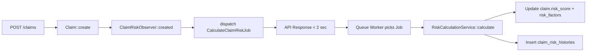
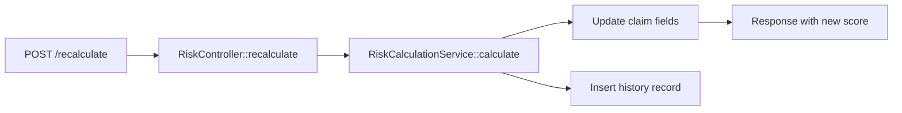

# 📋 وثيقة تحليلية كاملة لميزة تقييم المخاطر (Risk Assessment System)

**تاريخ الإعداد:** 2026-10-05  
**المطور:** Ahmed (Backend Team)  


---

## 1. مقدمة عامة

### 1.1 الهدف من الميزة
أتمتة تقييم المخاطر المالية والتشغيلية المرتبطة بكل مطالبة تأمين جديدة، بهدف:
- تقليل الأخطاء البشرية في الموافقة أو الرفض
- تسريع عملية اتخاذ القرار
- توفير بيانات دقيقة للإدارة (KPIs وتقارير المخاطر)

### 1.2 المشكلة التي كانت موجودة (Pain Point)
قبل إضافة هذه الميزة:
- لم يكن هناك نظام مؤسسي لتقييم المخاطر
- القرارات تعتمد بالكامل على خبرة الموظف الفردية (Subjective)
- لا توجد بيانات تاريخية مُنظمة لتتبع سلوك المدينين أو العملاء
- خطر الموافقة على مطالبات مزيفة أو مبالغ فيها بدون رصد

---

## 2. نظرة عامة على الحل (Solution Overview)

تم تصميم نظام **Risk Assessment** كخدمة مستقلة (Micro-Service Pattern داخل Laravel) تعتمد على:
- **نموذج تقييم مرجح (Weighted Scoring Model)**
- **7 عوامل (Risk Factors)** مبنية على بيانات المطالبة نفسها
- **حساب في الخلفية (Background Job)** لضمان عدم التأثير على أداء النظام
- **API مستقل** لإدارة وإعادة حساب المخاطر عند الطلب

---

## 3. البنية التقنية (Technical Architecture)

### 3.1 الملفات الجديدة / المُعدلة

| الملف | النوع | الغرض |
|-------|--------|--------|
| `database/migrations/2026_08_01_100000_add_risk_fields_to_claims_table.php` | Migration | إضافة `risk_score`, `risk_factors`, `risk_calculated_at` إلى جدول `claims` |
| `database/migrations/2026_08_01_100001_create_claim_risk_histories_table.php` | Migration | جدول سجل تاريخ المخاطر لكل مطالبة |
| `database/migrations/2026_10_05_100000_add_indexes_to_claims_table.php` | Migration | إضافة Indexes (`debtor_nid`, `client_id`, `status`, `amount`) لتحسين الأداء |
| `app/Models/ClaimRiskHistory.php` | Model | نموذج سجل تاريخ المخاطر |
| `app/Services/Risk/RiskCalculationService.php` | Service | الخدمة الرئيسية لحساب درجة المخاطر |
| `app/Jobs/CalculateClaimRiskJob.php` | Job | تشغيل الحساب في الخلفية (Queue) |
| `app/Observers/ClaimRiskObserver.php` | Observer | مراقبة إنشاء/تحديث المطالبات وتفعيل الحساب |
| `app/Http/Controllers/Api/V1/RiskController.php` | Controller | واجهة API لإدارة المخاطر |
| `app/Providers/AppServiceProvider.php` | Provider | تسجيل الـ Observer |
| `routes/api/claims.php` | Routes | مسارات API للميزة |
| `app/Models/Claim.php` | Model | إضافة Relations (`riskHistories`) و Accessors (`riskLevel`, `riskColor`, `riskLabel`) |

---

## 4. نموذج الحساب (Scoring Model)

### 4.1 الصيغة الرياضية

```
النتيجة النهائية = Σ (درجة العامل × وزن العامل ÷ 100)

الحد الأقصى: 100 نقطة
```

### 4.2 العوامل السبعة (Seven Risk Factors)

| # | العامل | الوزن | الحقل المستخدم | طريقة الحساب | الملاحظات |
|---|--------|--------|----------------|---------------|------------|
| 1 | نوع المطالبة (`Claim Type`) | 15% | `type` | Match Enum: Individual=20, Corporate=40, Leasing=35, Gov=25, Municipality=30 | Corporate = أعلى خطر |
| 2 | قيمة المطالبة (`Amount`) | 20% | `amount` | Brackets: ≥100k=100, ≥50k=80, ≥20k=60, ≥10k=40, ≥5k=25, <5k=10 | قيمة أعلى = خطر أعلى |
| 3 | قدم الحادث (`Accident Age`) | 15% | `accident_date` | Months diff: >24=90, >12=70, >6=40, >3=20, <3=10 | حادث قديم = مخاطر أعلى |
| 4 | السجل السابق (`Claim History`) | 15% | `debtor_nid` | `(Previous × 10) + (Rejected × 20)` | يعتمد على تاريخ المدين |
| 5 | نوع المدين (`Debtor Type`) | 20% | `debtor_type` | Insured=20, Third Party=80 | طرف ثالث = أعلى خطر |
| 6 | مخاطر المنطقة (`City Risk`) | 10% | `city_id` | ثابت = 30 (قابل للتطوير بربط جدول مخاطر المدن) | يمكن ربطه بجدول مستقبلاً |
| 7 | مخاطر العميل (`Client Risk`) | 5% | `client_id` | `(Rejected / Total) × 100 × 2` | نسبة المطالبات الملغاة للعميل |

### 4.3 مستويات المخاطر (Risk Levels)

| الدرجة | المستوى | اللون | التفسير |
|--------|---------|--------|---------|
| 0 - 29 | **Low** | 🟢 Green | مخاطر منخفضة - معالجة عادية |
| 30 - 69 | **Medium** | 🟠 Orange | مخاطر متوسطة - مراجعة مستحبة |
| 70 - 100 | **High** | 🔴 Red | مخاطر عالية - مراجعة إجبارية |

---

## 5. تدفق البيانات (Data Flow)

### 5.1 عند إنشاء مطالبة جديدة (`POST /claims`)


### 5.2 عند إعادة حساب المخاطر (`POST /claims/{id}/risk/recalculate`)


---

## 6. قاعدة البيانات (Database Schema)

### 6.1 جدول `claims` (الإضافات)

```sql
ALTER TABLE claims ADD COLUMN risk_score DECIMAL(5,2) DEFAULT 0;
ALTER TABLE claims ADD COLUMN risk_factors JSON NULL;
ALTER TABLE claims ADD COLUMN risk_calculated_at TIMESTAMP NULL;
CREATE INDEX claims_debtor_nid_index ON claims(debtor_nid);
CREATE INDEX claims_client_id_index ON claims(client_id);
CREATE INDEX claims_status_index ON claims(status);
CREATE INDEX claims_amount_index ON claims(amount);
```

### 6.2 جدول `claim_risk_histories` (جديد)

```sql
CREATE TABLE claim_risk_histories (
  id BIGINT PRIMARY KEY AUTO_INCREMENT,
  claim_id BIGINT FOREIGN KEY REFERENCES claims(id),
  risk_score DECIMAL(5,2),
  risk_factors JSON,
  trigger ENUM('created', 'updated', 'manual_recalc', 'status_change'),
  calculated_by BIGINT NULL REFERENCES users(id),
  created_at TIMESTAMP DEFAULT CURRENT_TIMESTAMP
);
CREATE INDEX claim_risk_histories_claim_id_index ON claim_risk_histories(claim_id, created_at);
```

---

## 7. واجهات البرمجة (API Endpoints)

### 7.1 عرض تفاصيل المخاطر
```http
GET /api/v1/claims/{claimId}/risk
Authorization: Bearer {token}
Response:
{
  "success": true,
  "data": {
    "risk_score": 53,
    "risk_level": "medium",
    "risk_color": "orange",
    "risk_label": "مخاطر متوسطة - مراجعة مستحبة",
    "risk_factors": {
      "claim_type": {"score": 20, "weight": 15, "label": "نوع المطالبة"},
      ...
    },
    "calculated_at": "2026-10-05T09:30:00Z",
    "history": [
      {"id": 1, "score": 53, "trigger": "updated", "created_at": ...}
    ]
  }
}
```

### 7.2 إعادة حساب المخاطر
```http
POST /api/v1/claims/{claimId}/risk/recalculate
Response:
{
  "success": true,
  "message": "تم إعادة حساب المخاطر بنجاح",
  "data": { ... }
}
```

### 7.3 ملخص المخاطر (Dashboard)
```http
GET /api/v1/claims/risk-summary
Response:
{
  "total_claims": 2925,
  "high_risk": 450,
  "medium_risk": 1200,
  "low_risk": 1275,
  "avg_score": 42.5,
  "high_risk_percentage": 15.4
}
```

---

## 8. نموذج الحساب (Example Calculation)

### مثال على Claim حقيقي:
```json
{
  "id": 123,
  "type": "individual",
  "amount": 75000,
  "accident_date": "2025-04-01",
  "debtor_nid": "009654321",
  "debtor_type": "third_party",
  "city_id": 5,
  "client_id": 10
}
```

### الحساب خطوة بخطوة:

| العامل | الدرجة الخام (Score) | الوزن | المساهمة (Contribution) |
|--------|---------------------|-------|------------------------|
| نوع المطالبة (Individual) | 20 | 15% | 20 × 0.15 = **3.0** |
| قيمة المطالبة (75k) | 80 | 20% | 80 × 0.20 = **16.0** |
| قدم الحادث (18 شهر) | 70 | 15% | 70 × 0.15 = **10.5** |
| السجل السابق (Previous=1, Rejected=0) | (1×10)+(0×20) = 10 | 15% | 10 × 0.15 = **1.5** |
| نوع المدين (Third Party) | 80 | 20% | 80 × 0.20 = **16.0** |
| مخاطر المنطقة (City) | 30 | 10% | 30 × 0.10 = **3.0** |
| مخاطر العميل (Client) | 30 | 5% | 30 × 0.05 = **1.5** |
| **المجموع** | | | **51.5** → رُقّب لـ **51.5** → مستوى **Medium** |

---

## 9. الأداء (Performance)

### قبل التحسين:
- **Claim جديد** كان يتأخر 30+ ثانية بسبب استعلامات SQL ثقيلة بدون Indexes
- الـ Observer كان يعمل بشكل متزامن (Synchronous) ويعطل الـ API

### بعد التحسين:
- إضافة **4 Indexes** (`debtor_nid`, `client_id`, `status`, `amount`)
- تحويل الـ Risk Calculation إلى **Background Job** (`CalculateClaimRiskJob`)
- **Claim جديد** يتم في < 2 ثانية
- **حساب المخاطر** يعمل في الخلفية (< 5 ثوانٍ بدون تأثير على الـ User)

---

## 10. استخدامات عملية (Use Cases)

### 10.1 للمشرفين (Supervisors)
- مراجعة قائمة المطالبات حسب مستوى المخاطر: `GET /claims/risk-summary`
- تحديد الأولويات: معالجة المطالبات `Low` أولاً، ثم `Medium`، ثم `High`

### 10.2 للمحللين (Analysts)
- تحليل أسباب رفض المطالبات بناءً على `risk_factors`
- مقارنة `Client Risk` بين العملاء لتحديد العملاء ذوي المخاطر العالية

### 10.3 للمسؤولين (Management)
- تقارير دورية عن متوسط `avg_score`
- نسبة المطالبات عالية المخاطر (`high_risk_percentage`)
- اتخاذ قرارات استراتيجية (مثلاً: زيادة التحقيقات الميدانية للمناطق ذات `City Risk` عالي)

---

## 11. تعليمات التشغيل والاختبار

### 11.1 تشغيل الـ Queue (ضروري)
```bash
# للتطوير
php artisan queue:work --daemon --tries=3

# للإنتاج (باستخدام Supervisor)
supervisorctl restart laravel-worker
```

### 11.2 اختبار الـ Feature
```bash
# 1. إنشاء Claim
curl -X POST http://app.test/api/v1/claims \
  -d '{"client_id":10,"amount":50000,"type":"individual","debtor_type":"third_party","debtor_nid":"123456"}'

# 2. حساب المخاطر يدوياً
curl -X POST http://app.test/api/v1/claims/1/risk/recalculate \
  -H "Authorization: Bearer TOKEN"

# 3. عرض التفاصيل
curl -X GET http://app.test/api/v1/claims/1/risk \
  -H "Authorization: Bearer TOKEN"
```

---

## 12. التحسينات المستقبلية (Future Improvements)

| التحسين | الوصف | الأولوية |
|---------|--------|-----------|
| **ربط مخاطر المنطقة بجدول** | إنشاء جدول `city_risk_factors` بدلاً من القيمة الثابتة 30 | متوسطة |
| **نموذج ML** | استخدام Machine Learning للتنبؤ بالمخاطر بناءً على السجل التاريخي | منخفضة |
| **إشعارات تلقائية** | إرسال إشعار للمشرف عند ظهور `High Risk` جديد | متوسطة |
| **تقارير PDF** | توليد تقرير PDF شهري للمخاطر | منخفضة |
| **واجهة Dashboard** | إضافة رسوم بيانية (`Charts`) في لوحة التحكم | متوسطة |

---

## 13. ملخص التنفيذ (Implementation Summary)

```text
✅ تم إضافة حقول المخاطر إلى جدول claims
✅ تم إنشاء جدول سجل المخاطر claim_risk_histories
✅ تم إنشاء RiskCalculationService (7 عوامل + أوزان)
✅ تم إنشاء CalculateClaimRiskJob (تشغيل في الخلفية)
✅ تم إنشاء RiskController (3 APIs)
✅ تم إضافة Routes للمخاطر
✅ تم تعديل Claim Model (Accessors + Relations)
✅ تم إضافة Indexes لتحسين الأداء
✅ تم تسجيل Observer مع Job في AppServiceProvider
```


